# EL FLUIDO DE TRABAJO - LAS EXIGENCIAS DEL MOTOR Y LA CONTAMINACIÓN ATMOSFÉRICA

#### 1. Composición del fluido de trabajo

Como se dijo en el Capítulo 1, la energía química contenida en el combustible se libera bajo forma de calor cuando el combustible se quema gracias a la presencia del oxígeno del aire. Es por lo tanto necesario introducir en el motor aire y combustible, al mismo tiempo.

Si el combustible fuese exclusivamente de hidrocarburos y la combustión fuese completa, la mezcla comprimida en la cámara de combustión se transformaría al quemarse en vapor de agua  $(H_2O)$ , dióxido de carbono  $(CO_2)$  y nitrógeno  $(N_2)$ . El nitrógeno, gas inerte presente en el aire, no participa en la combustión. El vapor de agua producido por la combustión se mantiene sobre la temperatura crítica y se comporta como un gas permanente. En la práctica los hidrocarburos no son puros, la combustión no es completa y entre los productos de la combustión se encuentran también partes alícuotas de otros gases, monóxido de carbono (CO), hidrocarburos no quemados  $(HC)^{(1)}$ , óxidos de nitrógeno  $(NO_x)$  y también oxígeno  $(O_2)$  y diferentes impurezas.

El fluido de trabajo está por lo tanto formado inicialmente por el aire y el combustible y después por los gases producto de la combustión. Su composición química varía así durante el ciclo operativo.

En los párrafos que siguen examinaremos sumariamente las características del aire, las reacciones químicas de la combustión y los gases de escape.

### 2. El aire atmosférico

Una masa de aire atmosférico seco está, en forma aproximada, compuesta por 77 partes de nitrógeno y 23 partes de oxígeno. Contiene también pequeñas cantidades de otros gases, pero éstos se comportan en la combustión como gases inertes y pueden ser considerados desde el punto de vista de los motores como nitrógeno.

(1) Para indicar los hidrocarburos no quemados se ha usado el símbolo HC (Hydrocarbon), universalmente adoptado.

Las proporciones en volumen son: 21 por ciento para el oxígeno, 79 por ciento para el nitrógeno y los demás gases.

La masa de 1 m³ de aire a la presión de 1 bar (760 mm Hg), es decir a la presión atmosférica normal y a la temperatura de 273,16 °K (0 °C), es de 1,275 kg.

Un kilogramo de aire a la presión atmosférica y a la temperatura de 273,16 °K ocupa un volumen de 0,77351 m3.

La tabla siguiente se refiere a la composición del aire:

|                                     | Masa molecular | Proporción en volumen | Masa relativa |
|-------------------------------------|-------------------|--------------------------|------------------|
| Oxígeno O 2              | 32                | 0,2099                   | 6,717            |
| Nitrógeno N 2            | 28                | 0,7803                   | 21,861           |
| Anhídrido carbónico CO 2 | 44                | 0,0003                   | 0,013            |
| Otros gases                         | 40                | 0,0095                   | 0,376            |
| Aire (total)                        |                   | 1,0000                   | 28,970           |

Table: Composición del aire.

## 3. Cantidad de aire necesaria para la combustión. Razón estequiométrica

Como se dijo en el capítulo anterior, los combustibles más usados en los motores endotérmicos son mezclas de hidrocarburos, es decir, están compuestos esencialmente por carbono e hidrógeno. El carbono y el hidrógeno reaccionan con el oxígeno según las siguientes ecuaciones elementales;

$$C + O_2 \rightarrow CO_2$$
  
$$2 H_2 + O_2 \rightleftharpoons 2 H_2O$$ 

CO2 y H2O son productos de la combustión.

En nuestro caso el comburente es el aire: por lo tanto la combustión se produce en presencia del nitrógeno que forma parte del aire, por lo que las ecuaciones arriba consideradas se transforman en:

$$C + O_2 + N_2 \rightarrow CO_2 + N_2$$
  
$$H_2 + 1/2 O_2 + N_2 \rightarrow H_2O + N_2$$

Los productos de la combustión son por lo tanto anhídrido carbónico  $CO_2$ , agua  $H_2O$  y nitrógeno  $N_2$  si se desprecian los otros gases presentes en el aire y si se considera la combustión como teóricamente completa.

De las ecuaciones de la reacción eliminamos  $N_2$  que aparece en igual medida en ambos términos y damos a cada componente el valor en masa teniendo en cuenta que la masa atómica para el hidrógeno es = 1, para el carbono = 12 y para el oxígeno = 16. Se obtiene:

$$C + O_2 \rightarrow CO_2$$

Apliquemos estas ecuaciones al caso de la combustión de un hidrocarburo escogido entre los principales componentes de la gasolina: el **nonano.** Su fórmula es C9H20. Combinándose con el oxígeno produce CO2 y H2O, mientras el nitrógeno N2 permanece inerte. Escribamos la ecuación de la reacción en forma genérica:

...
$$C_9H_{20} + ...O_2 = ...CO_2 + ...H_2O$$
.

En la ecuación el número de átomos ha de ser igual para ambos términos, y teniendo esto en cuenta se tiene:

$$C_9H_{20} + 14O_2 = 9CO_2 + 10H_2O.$$

Multiplicando el número de los átomos de cada constituyente por la respectiva masa atómica se tiene:

$$[9 \times 12 (C_9) + 20 (H_{20})] + [14 \times 32 (O_2)] =$$

$$= [9 \times 12 (C) + 9 \times 32 (O_2)] + [10 \times 2 (H_2) + 10 \times 16 (O)]$$

$$128 \text{ kg } C_9 H_{20} + 448 \text{ kg } O_2 = 396 \text{ kg } CO_2 + 180 \text{ kg } H_2 O$$

es decir, para un kg de nonano (dividiendo por 128 todos los términos):

1 kg de nonano + 3.5 kg de oxígeno = 3.094 kg de anh. carb. + 1.406 kg de agua.

Por lo tanto para la combustión de 1 kg de nonano se necesitan 3,5 kg de oxígeno y como el oxígeno está proporcionado por el aire, que contiene un 23 % de oxígeno, se necesita una masa de aire de:

$$\frac{3.5}{0.23}  = 15.2 kg$$

En conclusión, la masa de aire necesaria para la combustión completa de 1 kg de nonano es de 15,2 kg. Este valor corresponde a la razón entre las masas de aire y de combustible, llamada estequiométrica, que representa la dosis teórica ideal para obtener la combustión completa. La razón estequiométrica varía poco para los diferentes hidrocarburos. En la práctica en los motores la razón aire/combustible, que llamaremos también proporción o razón de mezcla, se aparta, durante el funcionamiento, del valor estequiométrico: cuando hay defecto de aire, se dice que la mezcla es rica; cuando hay exceso de aire, la mezcla es pobre.

En los motores a gasolina la razón de mezcla proporcionada por los carburantes puede variar de 11 a 20.

En los motores de encendido por compresión para que todo el combustible inyectado esté en contacto con aire para poder quemarse, se necesita un fuerte exceso de aire y la razón entre la masa de aire introducida en el motor y la del combustible es superior a 25.

## 4. La disociación

La combustión se desarrolla inicialmente con una fuerte velocidad de reacción, por lo que la formación de compuestos es rápida; pero apenas comienza la formación de CO2 y H2O, se produce un aumento de temperatura a causa del cual los compuestos empiezan a disociarse en sus elementos. La concentración de los elementos que constituyen el combustible, que era máxima al comienzo de la combustión, disminuye gradualmente a medida que prosigue la combustión, por lo que disminuye la velocidad de la reacción de formación de CO2 y H2O. Al mismo tiempo, sin embargo, aumenta la concentración de estos últimos y por lo tanto también aumenta la velocidad con que se produce la disociación. Está claro en consecuencia que en las ecuaciones químicas:

$$C + O_2 \rightleftharpoons CO_2$$
  
$$2 H_2 + O_2 \rightleftharpoons 2 H_2O$$ 

se termina por alcanzar un estado de equilibrio en el cual la velocidad de formación es igual a la de disociación: este estado de equilibrio químico es, para cada reacción, variable con la temperatura. La disociación aumenta, en efecto, con la temperatura, lentamente al principio y después con rapidez mucho mayor. Por ejemplo, el porcentaje de anhídrido carbónico disociado, en condiciones de equilibrio químico, es el 5 % a 2000 °K, el 8,5 % a 2500 °K, el 27,5 % a 3000 °K y a 3200 °K alcanza ya el 64,5 %.

 Cuando los gases se disocian absorben calor causando una disminución apreciable del calor desarrollado por la combustión, y por lo tanto de la temperatura alcanzable en el motor.

# 5. Calor total desarrollado por la combustión y tonalidad térmica

El calor desarrollado por la combustión puede ser calculado con la suma de las cantidades de calor desarrolladas separadamente por la combustión del carbono y del hidrógeno menos la cantidad de calor necesaria para romper las moléculas de los hidrocarburos.

El calor desarrollado en la transformación del carbono en CO2 es de 34 000 kJ (8140 kcal) por cada kg de C consumido; el desarrollado por la combustión del hidrógeno que se transforma en vapor de agua es de 120 150 kJ (28 700 kcal) por cada kg de H.

Refiriéndonos siempre al caso del nonano, podemos escribir:

$$0.8438 \text{ kg C} \times 34\ 000 \text{ kJ} = 28\ 690 \text{ kJ } (6860 \text{ kcal})$$
  
$$0.1562 \text{ kg H} \times 120\ 150 \text{ kJ} = 18\ 770 \text{ kJ } (4480 \text{ kcal})$$

$$\text{Total:    } 47\ 460 kJ\ (11\ 340\ kcal)$$

Puesto que la disociación requiere por cada kg de nonano de unos 3600 kJ, el calor total desarrollado por la combustión de 1 kg de nonano vale:

$$47\ 460 - 3600 = 43\ 860\ kJ\ (10\ 467\ kcal)$$

A menudo resulta útil referirse, en el estudio de los motores de encendido por chispa, a la cantidad de calor que puede obtenerse de la unidad de volumen de la mezcla.

Se ha definido como tonalidad térmica o potencial térmico (o efecto térmico) a la energía por unidad de volumen, es decir, la cantidad de calor que puede desarrollarse por una unidad de volumen de mezcla a temperatura y presión constantes. La potencia obtenible de un motor depende del valor de la tonalidad térmica de la mezcla empleada.

Calculemos, a modo de ejemplo, la tonalidad térmica de la mezcla airenonano.

Hemos visto antes cómo para la combustión completa de 1 kg de nonano se necesitan 15,2 kg de aire. La densidad del nonano es de 0,718 kg/dm³ a 293 °K (20 °C), por lo que el volumen de 1 kg de nonano resulta de:

$$\frac{1}{0.718} = 1{,}39 \ \mathrm{dm}^3.$$

La densidad del aire a 293 °K y 1 bar de presión es de 1,204 kg/m³ por lo que 15,2 kg de aire a 293 °K tienen un volumen de:

$$\frac{15.2}{1.204} = 12.6  \mathrm{m}^3.$$.

Ya hemos calculado el calor que se desarrolla en la combustión de 1 kg de nonano: cerca de 43 800 kJ (10 500 kcal). Se tiene entonces que el volumen de (12 600 + 1,4) dm³ de mezcla desarrolla aproximadamente 43 800 kJ (10 500 kcal) si no se considera el calor de evaporación ni la correspondiente variación de volumen.

Dado el bajo valor del volumen ocupado por el combustible, en la práctica se lo desprecia sin más: la tonalidad térmica está dada entonces por la razón entre el poder calorífico inferior del combustible y el volumen ocupado, a una temperatura dada, solamente por el aire.

A 293 °K para la mezcla aire-nonano resulta de:

$$\frac{43\ 800}{12\ 601.4} = 3,476\ \text{kJ/dm}^3 (0,830\ \text{kcal/l}).$$

La tonalidad térmica para los combustibles líquidos normalmente usados varía poco de un combustible a otro. Como media se puede considerar igual a 3,5 kJ/dm3 a temperatura normal, es decir, es igual a 3500 kJ/m.

## 6. Formación de la mezcla aire-combustible

Veamos ahora cómo se realiza la mezcla justa del aire con el combustible y cuáles son las exigencias del motor a este respecto.

En los motores de encendido por chispa la mezcla se produce por carburación o por inyección del combustible en el conducto de entrada del aire; raramente por inyección en la cámara de combustión.

En los motores de encendido por compresión el combustible se inyecta en la cámara de combustión.

Los dispositivos que sirven para introducir en el aire el combustible con el carburador o el sistema de inyección para los motores ECh y sólo el sistema de inyección para los motores EC.

En los motores ECh el combustible, que generalmente es gasolina, es más bien volátil y la mezcla aire-combustible se forma fácilmente, antes de entrar en el cilindro, en la justa proporción, lista para ser encendida por medio de la chispa.

En los motores EC el combustible es generalmente gasóleo. La mezcla se crea a medida que las gotitas de líquido pulverizado penetran en el aire que se encuentra en la cámara de combustión, y la reacción de combustión se produce en cuanto las partículas de líquido se mezclan con el aire a alta temperatura y presión.

Mientras en los motores ECh la mezcla del combustible y del aire se produce antes de la combustión, en los motores EC se produce casi al mismo tiempo que la combustión, la cual se desarrolla a medida que se inyecta el combustible. Otra diferencia entre los dos tipos de motores es que mientras para los primeros la mezcla procede prácticamente durante toda la fase de admisión, en los segundos tiene una duración que difiere poco de la de la combustión y ocupa por lo tanto una pequeña fracción del tiempo en el que se completa cada ciclo.

## 7. Las exigencias del motor de encendido por chispa

La mezcla se forma al paso del aire por el conducto de aspiración y es regulada por el chorro del carburador o del inyector de modo que la razón de mezcla aire/gasolina sea la requerida por las condiciones de funcionamiento del motor.

El carburador o el sistema de inyección mezclan la gasolina, en forma de gotitas finísimas y vapor, con el aire.

La razón aire-gasolina requerida por un motor varía, en una cierta medida, al variar el régimen de funcionamiento.

Consideremos un motor que funcione a plena abertura a carga constante. En estas condiciones el valor de la razón de mezcla influye tanto sobre la potencia como sobre el consumo específico, que es el consumo referido a un kW o bien a un Cv medido al freno durante 1 h.

Coincidiendo con el punto de potencia máxima la razón aire/gasolina generalmente tiene un valor diferente del estequiométrico. Hay que notar también que en la curva del consumo específico se tiene un punto de mínima al cual corresponde la razón de mezcla de máxima economía. De las curvas indicadas en la figura 1 puede verse que para la máxima potencia la mezcla tiene que ser más rica que la estequiométrica, mientras que para la máxima economía tiene que ser más pobre.

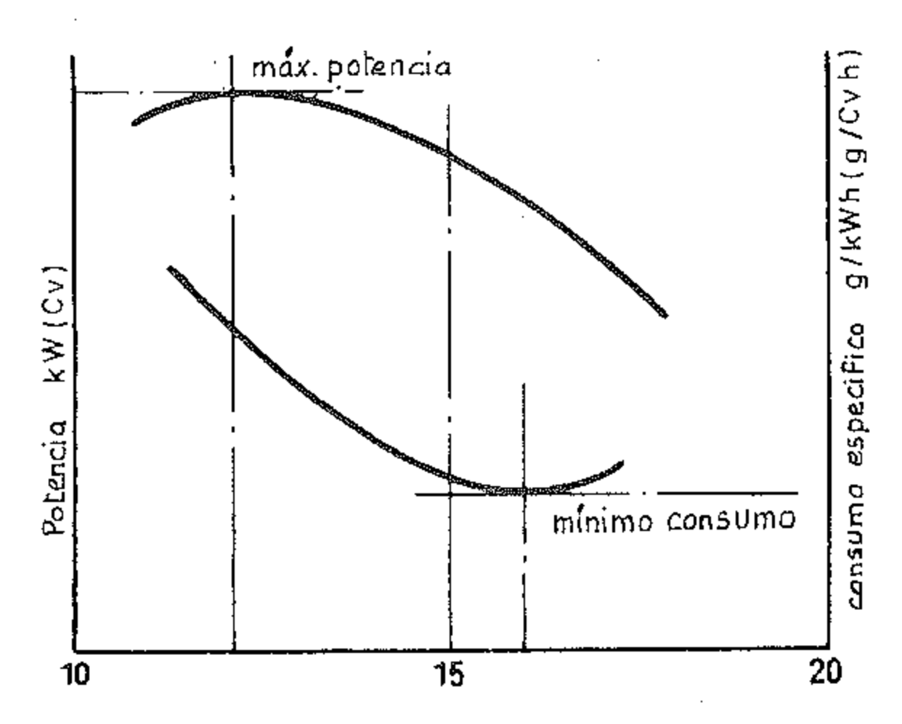{width=50%}

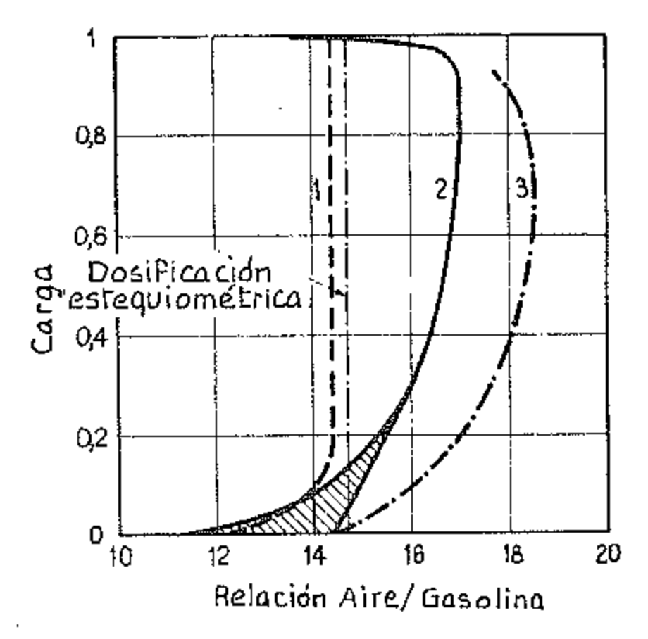{width=50%}

Cuando el motor funciona a abertura parcial las condiciones no son exactamente las mismas, pero son comparables.

En general los motores requieren unas razones de mezcla que siguen aproximadamente las curvas de la figura 2.

Como se ve, en las diferentes zonas de variación de la abertura de la mariposa del carburador, las exigencias del motor difieren y en consecuencia el carburador tiene que modificar la razón de mezcla. A medida que se reduce la carga, la mezcla tiene que ser enriquecida hasta alcanzar un máximo cuando el motor funciona al mínimo sin carga y la mariposa está prácticamente cerrada. En esta condición la presión en el conducto de aspiración es del orden de magnitud de 0,3 bar y en la cámara de compresión de 1,1 bar, mientras que para los gases de escape, al final de la fase de escape, la presión es aproximadamente igual a la atmosférica. La presión de los gases de escape no está apreciablemente influenciada por la posición de la mariposa y la masa de los gases de escape en el cilindro al final de la carrera de escape tiende a permanecer casi constante para los diferentes regímenes. Para el mínimo la carga de gases frescos introducida es mucho menor que la correspondiente al funcionamiento a plena abertura y por esto la proporción de los gases quemados presentes en la carga es mucho mayor. Además, siendo la presión en el conducto de aspiración más baja que la atmosférica, cuando la válvula de admisión comienza a abrirse, la diferencia de presión entre la cámara de combustión y el conducto de aspiración causa inicialmente un paso de los gases de escape al conducto de aspiración. Apenas el pistón comienza a efectuar la carrera de admisión, los gases de escape vuelven a ser aspirados hacia el cilindro, seguidos por la carga de mezcla fresca con el resultado final de que la mezcla en la cámara de combustión resulta diluida por los productos de la combustión. Estos tienden a reducir el contacto del combustible con las partículas de aire; en consecuencia la combustión se debilita y resulta una pérdida de potencia. Por lo tanto es necesario enriquecer la mezcla con más combustible para que aumenten las probabilidades de contacto entre el combustible y el aire.

A medida que se abre la mariposa las diferencias de presión se van haciendo menores y la dilución de la mezcla con gases de escape se reduce, por lo que la razón de mezcla requerida es menos rica.

A régimen de crucero es deseable que el carburador proporcione una mezcla con la razón de máxima economía. A regímenes de potencia elevada los motores demandan una mezcla más rica, como se indica en la figura 2, pero otras razones intervienen también para aumentar este enriquecimiento. A altas potencias es necesario extraer mayores cantidades de calor de las superficies térmicamente más solicitadas, como la válvula de escape y las zonas que la rodean. Enriqueciendo la mezcla se rebaja la temperatura de la llama y por lo tanto se reducen los peligros de daños a las válvulas de escape y también la tendencia a la detonación. En efecto, el combustible en exceso, al evaporarse, tiende a rebajar la temperatura en la cámara de combustión y esto contribuye a reducir las posibilidades de detonación.

En los motores de automóvil la detonación produce un picado o golpeteo fácilmente perceptible y el conductor, así advertido, puede variar las condiciones de funcionamiento modificando la posición del acelerador o cambiando de marcha. En los motores de aviación el picado no es perceptible, y por esto están dotados de complicados dispositivos para conseguir el adecuado enriquecimiento de la mezcla.

Todo lo que hemos dicho en este párrafo se basa en el supuesto de que la mezcla que entra en los cilindros de un motor de encendido por chispa es homogénea, mientras que en realidad puede suceder que el fenómeno de combustión se verifique en una corriente formada por estratos de diferentes razones de mezcla.

Como veremos se puede aprovechar la estratificación para hacer posible un funcionamiento regular del motor con cargas de mezcla de una razón global aire/gasolina muy alta y por lo tanto, menor consumo.

## 8. Las exigencias del motor de encendido por compresión

Las características que distinguen sustancialmente el motor EC del motor ECh en la formación de la mezcla son:

- La ausencia de la mariposa de admisión;
- La formación de la mezcla de combustible y aire en la cámara de combustión en vez de en el conducto de aspiración.

La alimentación se produce por inyección. Puesto que los combustibles usados son poco volátiles y los tiempos disponibles para la evaporación de las partículas de combustible, desde el instante en el cual entran en la cámara de combustión al del encendido, son pequeñísimos, es necesario un enérgico remezclado para poner todas las partículas en contacto con el oxígeno del aire. Además es necesario introducir en la cámara de combustión una cantidad de aire apreciablemente mayor que la correspondiente a la razón estequiométrica para que se verifiquen mayores probabilidades de conseguir la oxidación de todo el combustible inyectado.

La razón aire/combustible influye, como en el motor ECh, en la potencia y en el consumo.

En el motor EC la cantidad de aire que entra en el cilindro varía poco con la velocidad. Variando la cantidad de combustible introducido se modifica la razón aire/combustible. Cuando se reduce la cantidad de combustible el rendimiento térmico indicado se aproxima al del ciclo de aire, pero dada la pequeña cantidad de energía introducida la p.m.e. y la potencia disminuyen. Cuando se introduce una gran cantidad de combustible, el rendimiento térmico indicado se reduce, pero la p.m.e. y la potencia aumentan, dado que se introduce mayor cantidad de calor, hasta cuando se alcanza un valor de la razón aire/combustible cercano al estequiométrico.

Cerca de la razón estequiométrica el motor EC comienza a producir humo en el escape porque en algunas zonas de la cámara se localiza una mezcla tan rica que no todas las partículas de carbono y de oxígeno reaccionan entre sí en el tiempo disponible para la combustión. El humo es precisamente la consecuencia de una combustión incompleta. Para evitarlo se debe regular el motor para una razón de mezcla más pobre que la que daría la máxima potencia.

La figura 3 muestra la curva de potencia para un motor típico a velocidad constante: como puede verse en la zona cercana a la razón de mezcla estequiométrica correspondiente a la máxima potencia la cantidad de humos de escape no es aceptable. Por esto es necesario limitar la potencia del motor adoptando una razón de mezcla pobre. La cantidad de aire adicional con respecto a la correspondiente a la razón estequiométrica, expresada en masa, se llama exceso de aire.

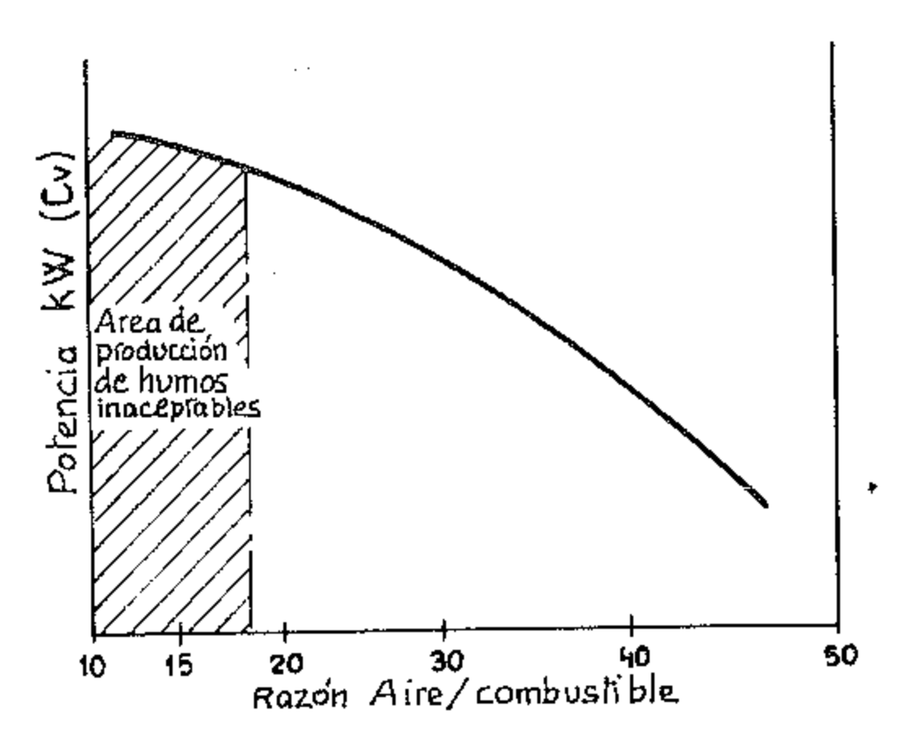{width=50%}

También por otras razones de las que hablaremos en el capítulo sobre la combustión, los motores de encendido por compresión trabajan siempre con exceso de aire.

La cantidad de combustible que puede introducirse en cada ciclo no debe superar un cierto valor que está determinado por la cantidad de humos de escape permitida y por la temperatura de los pistones. Como índice de ésta se toma usualmente la temperatura máxima de los gases de escape. Un valor que puede considerarse aceptable es de 850 ÷ 900 °K (577 ÷ 627 °C). Téngase presente que en los motores de encendido por chispa la temperatura de los gases de escape puede en cambio superar sin problemas el valor de 1100 °K (827 °C).

En la figura 4 se indican, para un motor a inyección directa, las curvas de la p.m.e. (presión media efectiva), del consumo específico y de la razón aire/combustible a un régimen establecido haciendo variar la cantidad de combustible inyectado, medido en mg por ciclo y por litro de cilindrada. Como se ve, la razón aire/combustible varía mucho dentro de los límites del humo y de la temperatura de los gases de escape.

En los motores Diesel, la regulación de la carga se efectúa sólo sobre el combustible y por lo tanto las exigencias del motor se satisfacen fácilmente haciendo variar con medios mecánicos la capacidad de la bomba. Deben adoptarse disposiciones especiales particularmente con respecto a la velocidad de inyección, con la cual está relacionado el gradiente de presión del combustible y por lo tanto la pulverización. El problema es especialmente apreciable cuando el motor gira al régimen mínimo, es decir, cuando la velocidad de salida del combustible por las perforaciones de los inyectores es más baja.

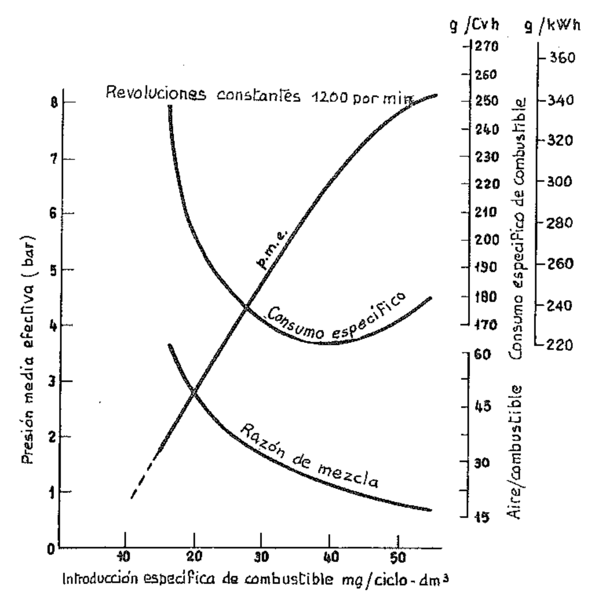{width=50%}

A regímenes intermedios se verifican normalmente las mejores condiciones globales para el funcionamiento del motor, puesto que la velocidad del combustible a la salida del inyector es ya tal que produce una óptima pulverización, y el tiempo disponible para el encendido y la combustión no es demasiado restringido.

Además, puesto que el rendimiento volumétrico es elevado, se puede tener una cierta libertad en la dosificación del combustible. Esto se aprovecha para *adecuar* la curva del par o torque y de la potencia del motor al tipo de trabajo que éste debe cumplir, variando oportunamente la razón aire/combustible. Esta «adecuación» o adaptación se consigue regulando, mediante oportunos sistemas mecánicos o electrónicos, la cantidad de combustible por ciclo según las exigencias particulares.

Así, aumentando la entrada de gasóleo se puede aumentar el par motor en los regímenes intermedios, y puede mejorarse la combustión cuando el motor funciona a grandes alturas, reduciendo la entrada de gasóleo en relación con la reducción de la presión atmosférica.

## 9. Las emisiones nocivas de los motores ECh

Las emisiones de los motores ECh provienen en su mayor parte de los gases de escape y, en menor medida, de los gases que se filtran entre cilindros y pistones. La evaporización de gasolina que puede provenir de la instalación de alimentación es asimismo causa de emisiones nocivas.

Como ya hemos dicho, además del anhídrido carbónico y del agua que deberían ser los únicos productos presentes en el escape en caso de combustión completa de los hidrocarburos, en los gases de escape de los motores ECh se encuentra:

- Óxido de carbono CO

- Hidrocarburos no quemados y parcialmente oxidados HC

— óxidos de nitrógeno NOx

— compuestos de plomo (en el caso de gasolinas etiladas).

El CO es muy tóxico por su gran afinidad con la hemoglobina de la sangre (300 veces mayor que la del oxígeno). Si la concentración de la carboxihemoglobina en la sangre alcanza el 50 %, la asimilación del oxígeno se interrumpe y se produce la asfixia interna.

Los hidrocarburos no quemados HC no presentan por sí mismos efectos tóxicos, pero cuando se encuentran en un porcentaje elevado y en determinadas condiciones atmosféricas, pueden dar lugar a reacciones químicas secundarias, con producción de peróxidos y aldehídos de olor desagradable, irritantes, y nocivos para las plantas. El agente que determina las reacciones es el óxido de nitrógeno, que bajo el efecto de las radiaciones solares ultravioletas y en presencia de sustancias orgánicas se oxida pasando a NO2, el cual por acción de la luz solar (efecto fotoquímico) actúa sobre los HC desarrollando ozono y productos oxidados. Al benzopireno 3-4 se le atribuyen propiedades cancerígenas.

Los óxidos de nitrógeno NOx son tóxicos para la sangre, pero las concentraciones en la atmósfera debidas a los gases de escape no parecen ser dañinas para el organismo humano. Parece que por oxidación de ozono el NO se transforma en ácido nítrico, el cual origina irritación de los ojos, efecto que parece unido a los peróxidos y a los aldehídos.

Los valores medios de las emisiones de motores ECh funcionando a carga constante son los siguientes:

|                 | 4 tiempos       | 2 tiempos a carburación |
|-----------------|-----------------|-------------------------|
| CO              | i ÷ 3 %         | 1,5 ÷ 7,5 %             |
| HC              | 100 ÷ 200 ppm   | 2000 ÷ 6000 ppm         |
| NO x | 1000 ÷ 3000 ppm | 100 ÷ 500 ppm           |

donde los porcentajes son en volumen y ppm significa partes por millón.

Óxido de carbono CO. — La concentración en volumen y en peso del CO en los gases de escape está esencialmente en función de la razón aire/gasolina A/B, es decir, de la dosificación de la mezcla (fig. 5).

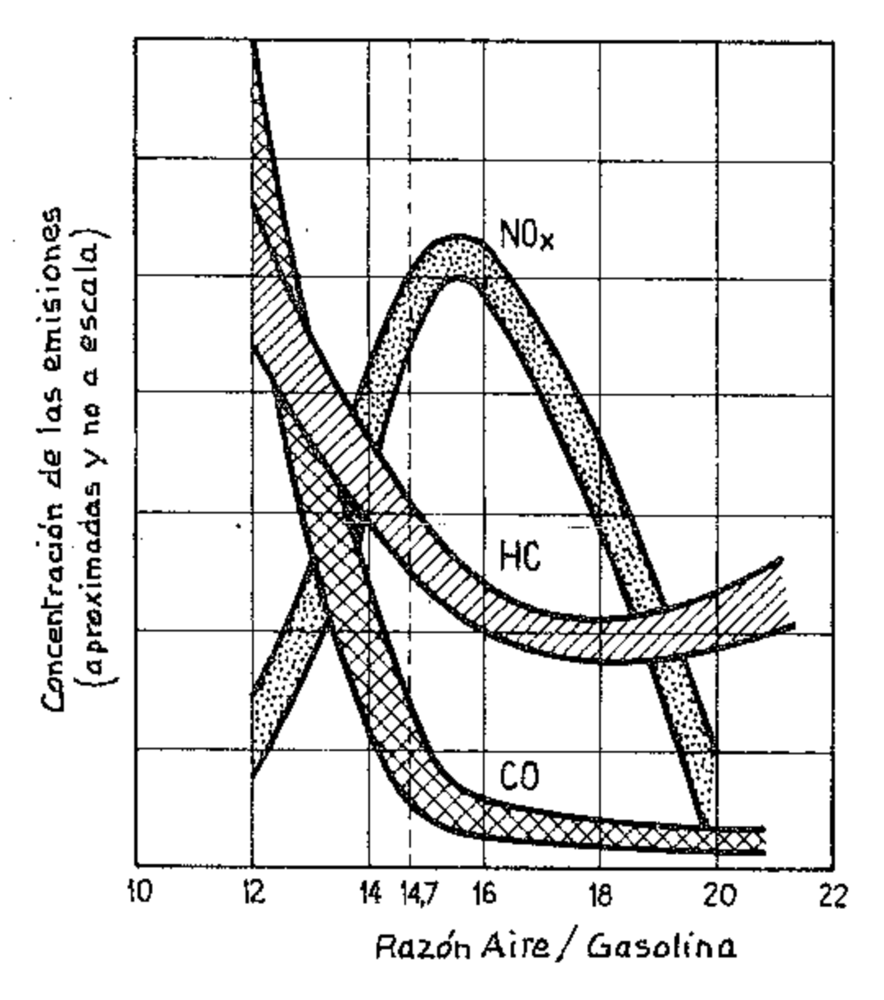{width=50%}

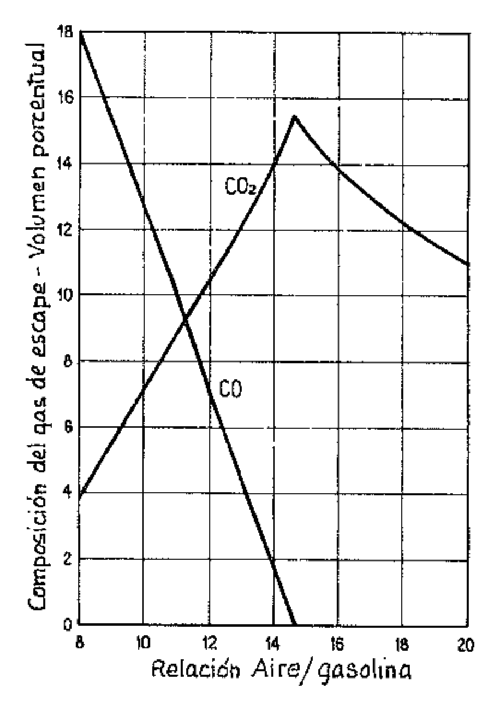{width=50%}

En teoría una combustión ideal daría lugar a una variación del CO que seguiría una trayectoria correspondiente aproximadamente a la del diagrama de la figura 6 en la cual, para mayor información, se ha trazado también el diagrama relativo al CO2.

En realidad las emisiones de CO no se anulan para la dosificación estequiométrica (A/B = 14,7): además varían también por efecto de la relación de compresión, como puede observarse en los diagramas de la figura 7.

En el párrafo 7 hemos visto cómo el motor ECh requiere de una continua variación de la dosificación A/B según las exigencias de marcha del vehículo: en efecto, durante la aceleración y la deceleración la razón A/B puede descender a valores muy bajos, como también al régimen mínimo. Es necesario tener presente además que el contenido medio volumétrico de los gases de escape en función de la carga y de la velocidad del motor puede variar de 1 a 20. Está claro entonces que la concentración y el contenido de óxido de carbono varían notablemente durante la marcha de un automóvil al variar las condiciones de funcionamiento del motor, como lo indica claramente la figura 8, que se refiere a un tipo particular de autovehículo.

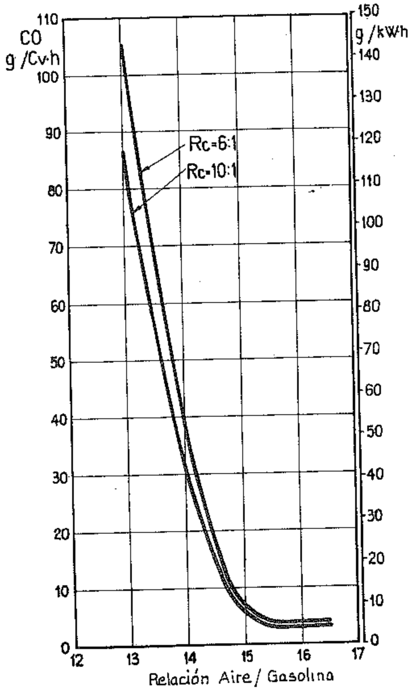{width=50%}

Notemos por fin que las emisiones de CO en concentración no dependen del avance del encendido.

Para limitar las emisiones de CO es necesario adoptar disposiciones adecuadas para permitir el empleo de mezclas pobres, es decir, la máxima evaporación de la gasolina y su mejor distribución en los cilindros.

Hidrocarburos HC. — Los hidrocarburos están presentes en los gases de escape en todas las condiciones de funcionamiento del motor. Su concentración alcanza valores especialmente elevados cuando el motor funciona con fuertes depresiones en el múltiple de admisión (es decir, al mínimo y durante las deceleraciones).

En tales condiciones, en efecto, la mezcla demasiado rica se diluye en la cámara de combustión con los gases quemados residuales y con éstos una parte de la gasolina sale del cilindro sin haberse quemado.

En las demás condiciones de funcionamiento la presencia del HC en los gases de escape se debe a una combustión incompleta de la mezcla en el estrato en contacto con las paredes de la cámara de combustión, el cual está enfriado a una temperatura inferior a aquella a la cual pueden tener lugar las reacciones de oxidación (estrato de extinción o de apagado). Fundamentalmente, en las emisiones de HC influyen la dosificación de la mezcla (A/B), el contenido de gases residuales en la carga y el espesor del «estrato de extinción», el cual es función de la temperatura media en la cámara de combustión (dependiente a su vez de la carga y de la dosificación).

En la figura 9 se ponen en evidencia las variaciones de las concentraciones de HC en las mismas condiciones de funcionamiento del motor tomado como ejemplo para la figura 8.

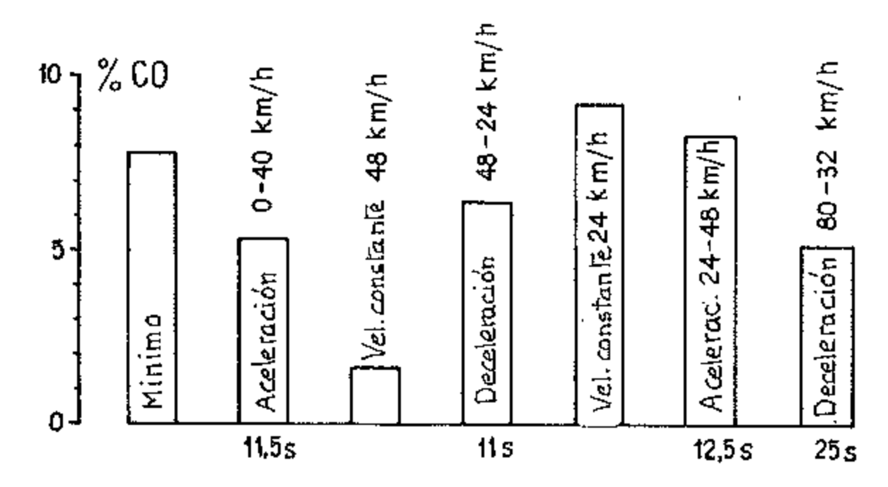{width=50%}

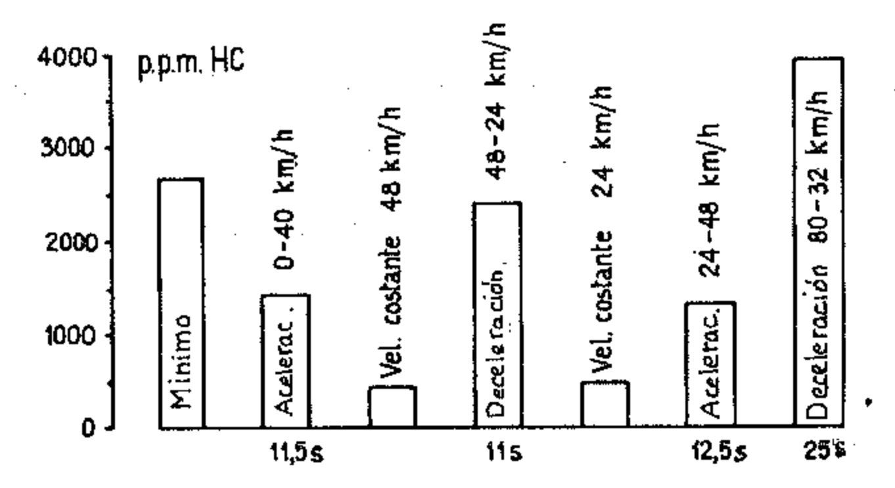{width=50%}

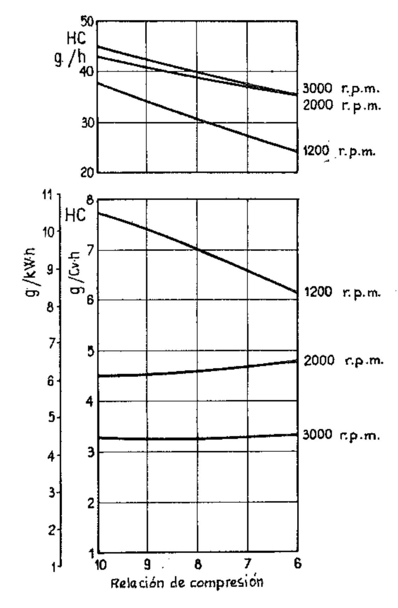{width=50%}

En la figura 10 se indican las emisiones específicas en g/kWh y en g/Cvh y en g/h obtenidas de un cilindro de un motor FIAT (125 B) en función de la relación de compresión, a tres diferentes regimenes de revoluciones.

Óxidos de nitrógeno NOx. — Los óxidos de nitrógeno se forman durante la combustión y su disociación es detenida por la repentina disminución de la temperatura debida a la expansión.

La concentración depende del contenido de oxígeno disponible para la reacción con el nitrógeno y de la temperatura: varía por lo tanto con la dosificación, con la carga del motor y con el avance del encendido (fig. 11).

En este diagrama donde la medida de la concentración está-dada-en partes por millón (p.p.m.) se puede observar que, yendo de mezclas ricas a mezclas pobres, a partir de un cierto valor de la razón A/B, el efecto de la disminución de temperatura prevalece sobre el debido al aumento de la concentración de oxígeno disponible para la reacción de oxidación del nitrógeno.

Por cuanto las temperaturas máximas de combustión se incrementan por un mayor avance del encendido y por una mayor presión absoluta en el múltiple de admisión, resulta evidente que estos factores provocan mayores emisiones de NOx.

También el aumento de la relación de compresión causa generalmente un aumento de las emisiones específicas de NOx (fig. 12).

Compuestos de plomo. — Los compuestos de Pb en el escape se deben a la presencia en la gasolina de aditivos antidetonantes tetraetil plomo y tetrametil plomo (ver párr. V.4.). Evidentemente su cantidad depende, a igualdad de otras condiciones, del consumo de gasolina. Su eliminación requiere obviamente del empleo de gasolinas sin Pb.

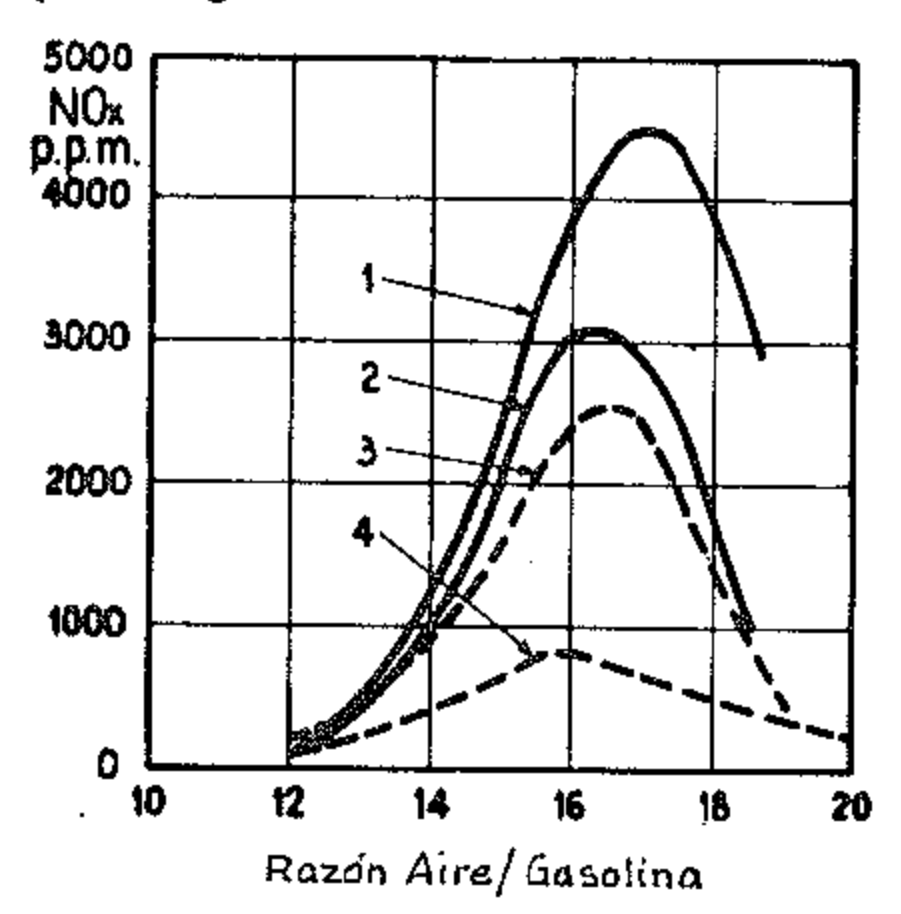{width=50%}

 Avance del encendido 30º antes del P.M.S. - 2. Avance del encendido 15º antes del P.M.S. - 3. Depresión en el múltiple de admisión 254 mmHg - 4. Depresión en el múltiple de admisión 381 mmHg.

{width=50%}

### 10. Las emisiones en los motores de encendido por compresión

Las emisiones más notorias, porque son evidentes, causadas por los motores Diesel son el humo y el olor.

El humo se mide con aparatos especiales, mientras que para el olor no existe un modo práctico de medición, aún estando relacionado con algunas emisiones de hidrocarburos.

El humo no es causado sólo por el hollín, es decir, por partículas carbonosas, sino que a veces, en especiales condiciones de mala regulación, es causado además por «aerosol» como el humo blanco consecuencia de una falta de combustión, es decir, de combustible no quemado, y el humo azul producido por filtraciones de lubricante entre cilindros y pistones por ajuste defectuoso. El consumo de lubricante influye en la emisión de humo y pueden influenciar en gran medida la emisión de hidrocarburos.

Como se dijo en el párrafo 8, el motor Diesel presenta la particularidad de funcionar sin restricción del aire (sólo algunos motores de pequeña cilindrada están provistos de una válvula de mariposa en el conducto de aspiración), por lo cual la razón aire/gasóleo (A/G) puede variar más o menos desde 20 a 1 hasta 90 a 1.

Como hemos visto, el motor Diesel no puede funcionar con razón A/G cercana al valor estequiométrico (14 a 1) sin un fuerte aumento del humo y del CO (fig. 13). Esto depende del hecho de que parte del aire no es alcanzado por el combustible inyectado y la combustión comienza en zonas de mezcla muy rica, dado que el aire y el combustible no han tenido tiempo de mezclarse completamente.

En estas condiciones, el hidrógeno presente en el combustible se combina con la mayor parte del oxígeno del aire y queda una cantidad de éste insuficiente para la oxidación del carbono. Evidentemente, si los inyectores no funcionan regularmente a causa de un mantenimiento descuidado o de excesivo desgaste o bien si el filtro de aire está parcialmente obturado, la situación se agrava y tienen lugar unas emisiones que se evitarían si el motor estuviera bien mantenido.

Las emisiones de los motores Diesel no relacionadas con el humo dependen de parámetros diferentes de los que regulan las emisiones en los motores de encendido por chispa y varían en relación con el tipo de cámara de combustión y el sistema de inyección. De las pruebas hechas en motores Diesel a inyección directa usados normalmente en autovehículos industriales, resulta que el CO medido en porcentaje del volumen total de los gases de escape es —como promedio— unas 100 veces inferior al emitido por los motores de encendido por chispa.

El porcentaje de HC es del mismo orden de magnitud, mientras que el de  $NO_x$  es superior, así como es claramente superior el de anhídrido sulfuroso (en el gasóleo se admite una cantidad de azufre de 1,25 % en masa contra una cantidad seis veces menor para la gasolina).

| Al mínimo                  | A plena carga                |
|----------------------------|------------------------------|
| $0.01 \div 0.1 \%$         | 0,03 ÷ 0,3 %                 |
| $20 \div 300 \text{ ppm}$  | $150 \div 1000 \text{ ppm}$  |
| $200 \div 400 \text{ ppm}$ | 750 ÷ 3000 ppm               |
|                            | 0,01 ÷ 0,1 % 20 ÷ 300 ppm |

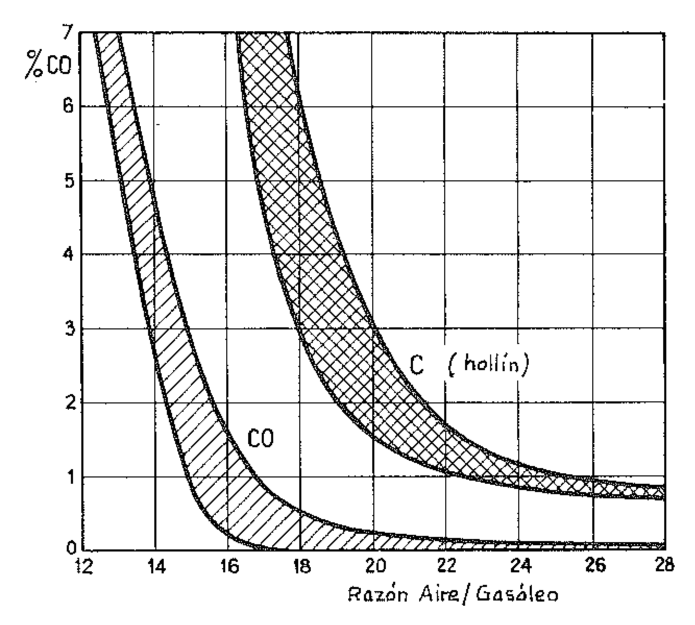{width=50%}