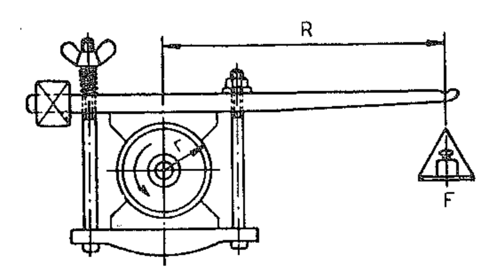
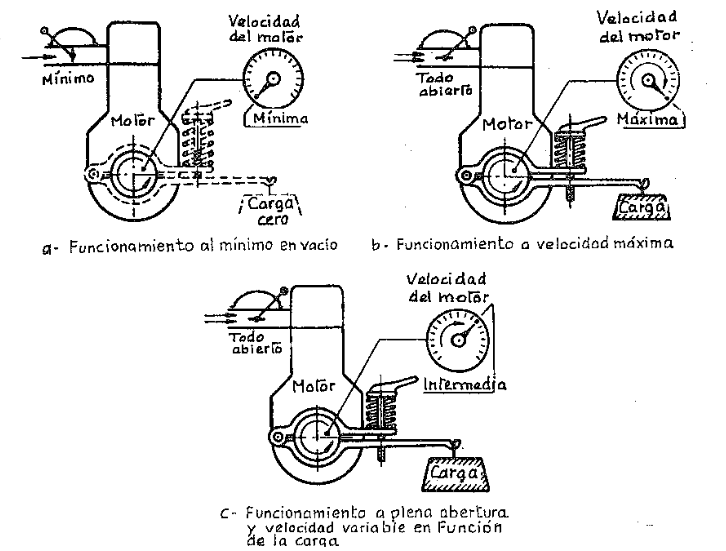
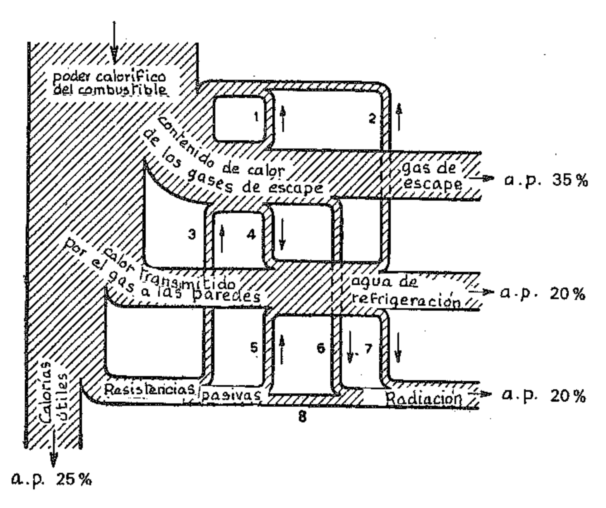
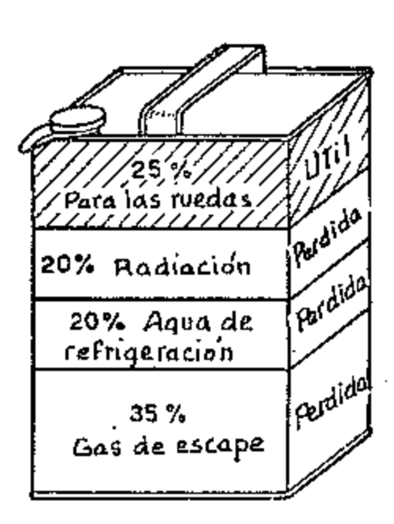
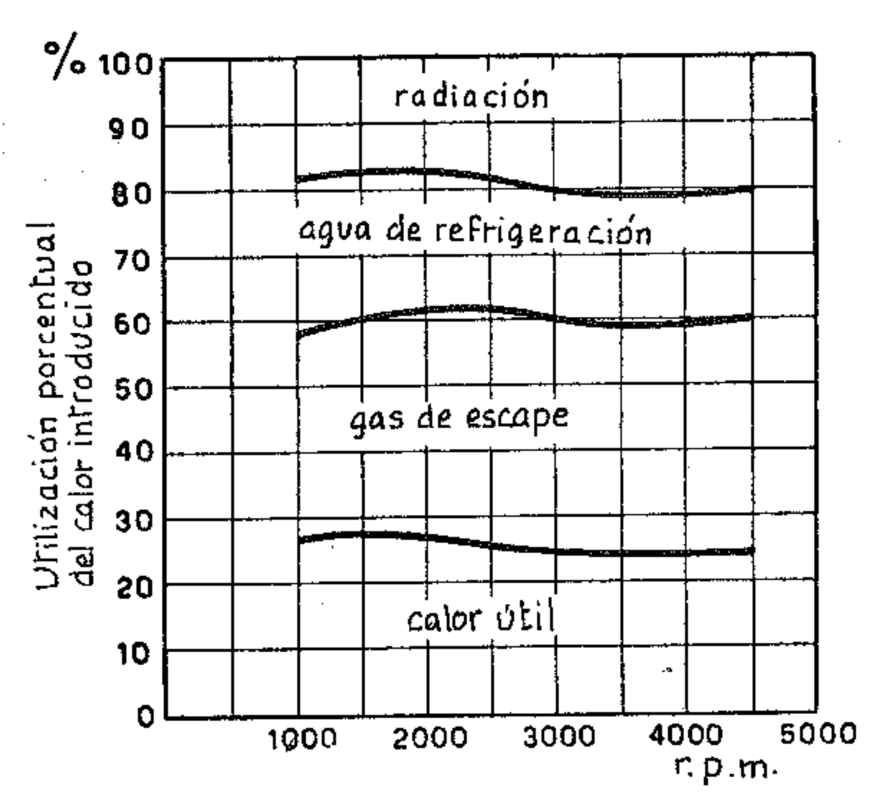
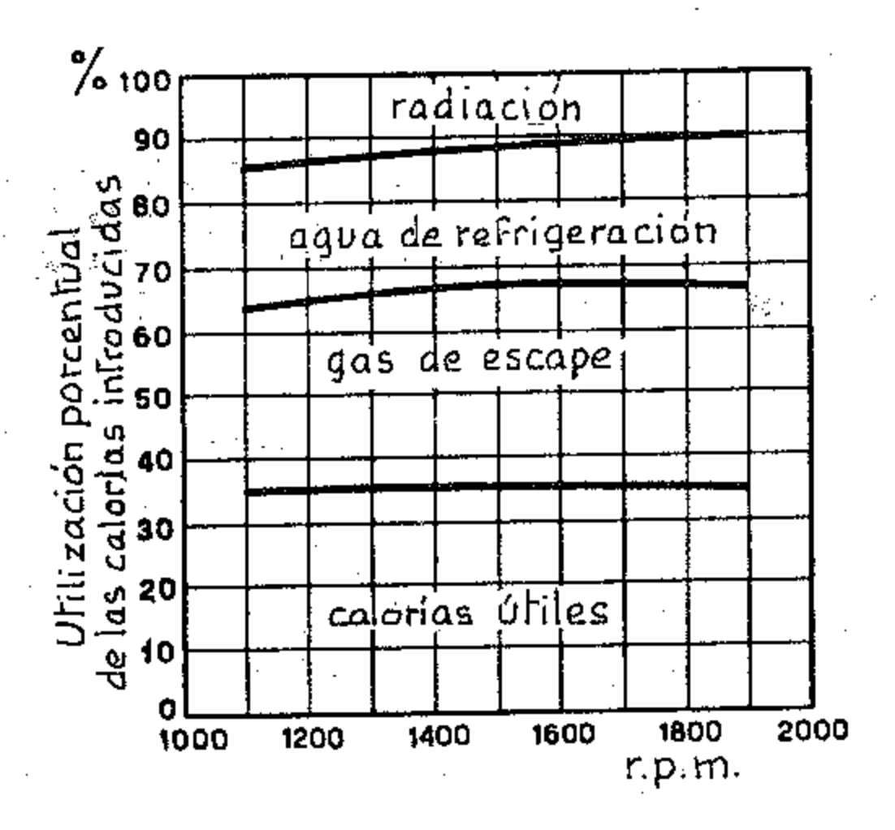
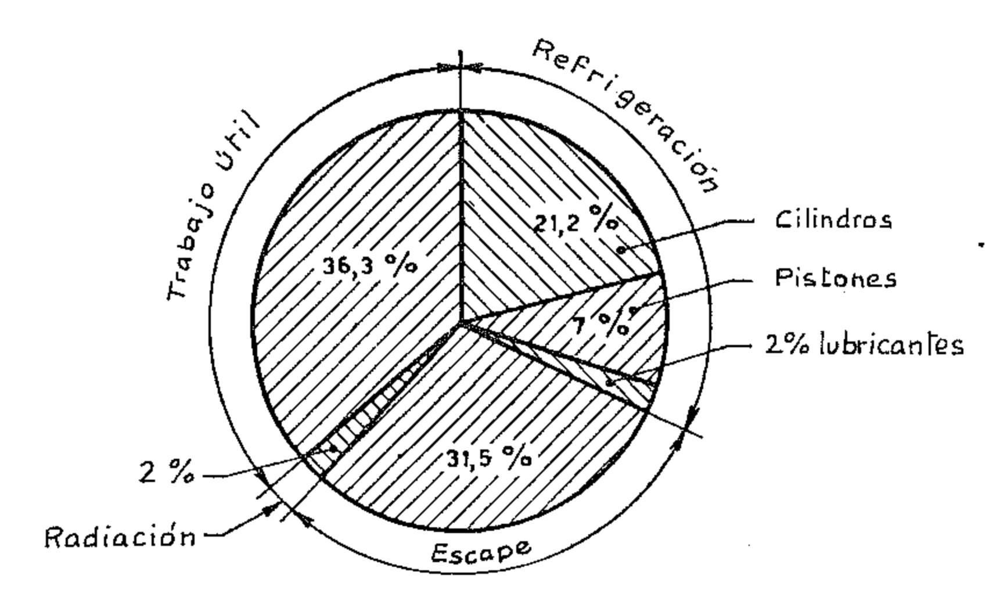

## CÁLCULO DE LA POTENCIA - RENDIMIENTOS -BALANCE TÉRMICO

La potencia desarrollada en el interior del cilindro no es transmitida íntegramente al eje motor, porque una parte es absorbida por las resistencias pasivas. Podemos entonces decir que tenemos tres categorías diferentes de potencia: la potencia indicada  $P_i$ , la potencia absorbida por las resistencias pasivas  $P_p$  y la potencia efectiva en el eje  $P_e$ .

La potencia indicada puede calcularse partiendo del ciclo indicado, cuya área representa el trabajo realizado por los gases en el interior del cilindro durante un ciclo. La potencia efectiva puede obtenerse midiendo con un freno el trabajo en el eje a la salida del motor. La potencia absorbida por las resistencias pasivas, más comúnmente llamada potencia absorbida por los rozamientos, se mide generalmente haciendo girar el motor sin encendido, mediante una fuente externa de potencia. También puede calcularse como la diferencia entre la potencia indicada Pi y la potencia efectiva  $P_e$ .

$$P_i = P_p + P_e \qquad \qquad P_p = P_i - P_e$$

#### 1. Potencia indicada

Como ya sabemos, la presión media indicada p.m.i. es la ordenada media del ciclo indicado, igual a la razón entre el área del ciclo y la cilindrada de un cilindro. Ella representa por lo tanto el valor de la presión que, multiplicado por la cilindrada de un cilindro, da el mismo valor del trabajo útil indicado del ciclo o sea el mismo trabajo realmente realizado por las presiones que continuamente varían en el cilindro.

Conociendo la p.m.i. es fácil obtener la potencia indicada, es decir, la potencia desarrollada por el fluido en el cilindro.

Indicando con  $p_i$  la p.m.i., con D el diámetro del pistón y con C su carrera, el valor de la fuerza total que actúa sobre el pistón está dado por  $\frac{\pi \cdot D^2}{A}$   $p_i$  y el trabajo realizado por esta fuerza durante la carrera útil resulta:

$$W_i = \frac{\pi \cdot D^2}{4} p_i \cdot C$$

Puesto que  $\frac{\pi \cdot D^2}{4}$  C es igual a la cilindrada  $V_p$  de un cilindro (volumen parcial), se puede escribir:

$$W_i = V_p \cdot p_i$$

Para calcular la potencia indicada basta multiplicar el trabajo realizado durante una carrera por el número de las carreras útiles completadas en la unidad de tiempo.

En el motor de 4 tiempos el ciclo se completa en dos revoluciones, por lo que, si n es el número de revoluciones que el motor completa en un minuto y si i es el número de cilindros (por lo que la cilindrada total es  $V = V_p \cdot i$ ), la **potencia indicada**  $P_i$  está dada en watt por:

$$P_i = \frac{V \cdot p_i}{2} \cdot \frac{n}{60} \tag{W}$$

donde la cilindrada V se expresa en m3 y la presión  $p_i$  en pascal.

Expresando V en dm3,  $p_i$  en bar (= 100 000 Pa) se tiene, en kW:

$$P_i = \frac{1}{2} \cdot \frac{V}{1000} p_i \cdot 100\ 000 \frac{n}{60} \cdot \frac{1}{1000} = \frac{V \cdot p_i \cdot n}{1200} \tag{kW}$$

Según el sistema técnico, es decir, expresando V en litros,  $p_i$  en kg/cm² se tiene en  $\mathbb{C} V$ .

$$P_i = \frac{1}{2} \cdot \frac{V}{1000} \cdot p_i \cdot 10\ 000 \frac{n}{60} \cdot \frac{1}{75} = \frac{V \cdot p_i \cdot n}{900} \tag{Cv}$$

En el motor de 2 tiempos, como el ciclo se completa en una revolución y se tiene una carrera útil por cada revolución, la potencia está dada por:

$$P_i = \frac{V \cdot p_i \cdot n}{600} \tag{kW}$$

Podemos refundir las dos fórmulas en una sola de carácter general obteniendo:

$$P_i = \frac{V \cdot p_i \cdot n}{300 \, h} \tag{kW}$$

donde h es el número de tiempos del ciclo operativo.

## 2. Potencia efectiva o potencia al freno

La potencia indicada es, como hemos dicho, la potencia desarrollada por el fluido de trabajo en el interior del cilindro.

De mayor interés práctico es la potencia generada por el par o torque disponible a la salida del eje motor, es decir la potencia efectiva, llamada también potencia al freno, puesto que se mide con un dispositivo aplicado al eje motor.

Éste consiste en un freno de tipo adecuado, cuyo momento frenante se puede medir. Conociendo el momento frenante y el número de revoluciones del motor se calcula la potencia efectiva. En el capítulo dedicado a los ensa-yos describiremos los principales tipos de frenos usados para medir la potencia efectiva de los motores, limitándonos aquí a describir el freno de Prony, que en la práctica no se usa, pero que sirve para aclarar el concepto seguido para determinar la potencia efectiva.

La figura 1 lo representa en forma esquemática. Una rueda de radio r, aplicada al eje motor, está rodeada por las zapatas regulables de un freno. Un brazo de longitud R, unido rígidamente al freno, está libre para moverse dentro de un ángulo limitado y en su extremo lleva un peso F. Cuando el eje motor gira, el rozamiento entre la rueda y las zapatas del freno genera un momento que tiende a hacer girar el brazo y que es equilibrado por el peso aplicado en el extremo.

En cada vuelta del eje motor, un punto cualquiera situado en la periferia de la rueda aplicada al eje mismo completa un recorrido igual a  $2\pi r$ , de modo que el trabajo de la fuerza tangencial de rozamiento f está dado por:

$$2\pi rf$$

Ahora bien, el producto  $r \cdot f$  no es más que el momento aplicado al freno por el eje motor, momento que, como hemos dicho, es equilibrado por el momento igual y contrario  $R \cdot F$  producido por la masa puesta en el extremo del brazo.

El trabajo absorbido por el freno en cada vuelta del eje motor vale por lo tanto:

$$2\pi \cdot R \cdot F$$

y entonces la potencia efectiva es:

$$P_{\nu} = 2 \pi \cdot R \cdot F \cdot n$$

donde n es el número de revoluciones del motor en la unidad de tiempo.

Como n normalmente está dado en revoluciones por minuto, R en m y la fuerza F en newton, la potencia efectiva medida al freno resulta expresada en kW.

$$P_e = \frac{2\pi \cdot R \cdot F \cdot n}{60 \times 1000} = \frac{\pi}{30\ 000} R \cdot F \cdot n \tag{kW}$$

En el caso en que F se midiera en kg (peso) y la potencia estuviera dada en Cv, se tendría:

$$P_e = \frac{2\pi \cdot R \cdot F \cdot n}{75 \times 60} = \frac{2\pi}{4500} R \cdot F \cdot n \tag{Cv}$$

En la práctica, la longitud del brazo R se escoge de modo que el valor del producto de R por la constante  $\frac{\pi}{30\ 000}$  o bien  $\frac{2\ \pi}{4500}$  sea un número redondo para simplificar el cálculo.

El producto R F llamado par del motor (torque), que se expresa en Nm o bien en kgm según el sistema técnico, es el momento de torsión del cigüeñal.

El torque representa la capacidad del motor para producir trabajo, mientras que la potencia es la medida de la cantidad de trabajo que el motor realiza en un cierto período de tiempo. Hablando por ejemplo de un vehículo, el torque define la capacidad para desplazar la carga; la potencia se desarrolla durante el desplazamiento de la carga.

## 3. La velocidad y la carga

Las fuerzas que hacen girar el cigüeñal dependen de la presión de los gases y por lo tanto esencialmente de la cantidad de combustible quemado en cada ciclo, mientras que las que se oponen a su rotación están dadas por los rozamientos internos del motor y por la resistencia externa, cuya magnitud se denomina generalmente carga. Esta resistencia consiste en una cupla aplicada a la salida del eje en oposición a la cupla (o par) motriz.

La velocidad del motor depende por tanto del valor de la carga y de la posición de la palanca que regula la cantidad de combustible. La regulación de la carga y de la velocidad es una cuestión de equilibrio entre las fuerzas que provocan la rotación del cigüeñal y las fuerzas opuestas que tienden a impedirla. Establecido un régimen de rotación, si varía la carga se crea un desequilibrio entre las fuerzas en oposición y debe variarse la posición de la palanca de regulación del combustible para que se restablezca el equilibrio.

{width=50%}

En un motor de encendido por chispa (ECh) si la válvula de mariposa del carburador está cerrada, o casi, y no hay carga, el par motriz sirve sólo para equilibrar las resistencias internas del motor, y el motor gira al mínimo. Esta condición está ilustrada en la figura 2a. Si, siempre sin carga, la válvula de mariposa se abre completamente, la velocidad de rotación puede alcanzar un valor tan elevado que algunos órganos del motor pueden destruirse. Si, con la válvula toda abierta, se aplica al eje motor una carga constante de tal magnitud que el motor funciona a la máxima velocidad prevista en el proyecto, equilibrándose el par motriz con el resistente, la velocidad del motor permanece constante. Esta condición está ilustrada en la figura 2b.

Entre las dos situaciones a y b, existe un número infinito de combinaciones de regulación del combustible y regulación de la carga para obtener la velocidad deseada. Este conjunto de combinaciones se llama gama de funcionamiento a abertura parcial.

Cuando la válvula de mariposa está completamente abierta es necesario aplicar una cierta carga para mantener la velocidad máxima permitida, como se indica en la figura 2b. Si se aumenta la carga evidentemente se reduce la velocidad, como muestra la figura 2c. Estas condiciones, para las cuales manteniendo la mariposa totalmente abierta se hace variar la carga y en consecuencia la velocidad de rotación, corresponden al llamado régimen de funcionamiento a abertura total y carga (o velocidad) variable.

En el funcionamiento a abertura total, variando la carga se encuentra el régimen al cual el motor proporciona la máxima potencia al freno. Si, partiendo de esta condición, se aumenta la carga aplicada, disminuye la velocidad así como también la potencia; si se reduce la carga, la velocidad del motor aumenta, pero la potencia al freno vuelve a disminuir. La velocidad a la cual se tiene la máxima potencia se llama régimen de máxima potencia. Cuando se dice que el motor funciona a media carga se entiende que la carga es la mitad de la correspondiente al régimen de máxima potencia.

Lo anterior es válido para todos los motores, tanto ECh como EC. La diferencia entre los dos tipos de motores está basada esencialmente en el método con el cual se hace variar la cantidad de combustible que entra en los cilindros. En el motor ECh la regulación de la cantidad de combustible se efectúa al mismo tiempo que la del aire por medio de una válvula de mariposa. En el motor EC la regulación se efectúa en cambio sólo sobre el combustible, y se consigue variando el caudal de la bomba de inyección.

# 4. Potencia absorbida por las resistencias pasivas y rendimiento mecánico

Ésta es potencia perdida y es la diferencia entre la potencia indicada y la potencia efectiva:

$$P_p = P_i - P_e.$$

Es utilizada para vencer el rozamiento entre las partes mecánicas en movimiento, para realizar el trabajo de bombeo del fluido y para accionar los diferentes grupos accesorios como las bombas para el agua, el aceite, etc.

La diversidad de causas y las variaciones de los valores al variar las condiciones de funcionamiento del motor hacen difícil medir con exactitud la potencia absorbida por los rozamientos. Su valor total puede obtenerse midiendo la potencia efectiva, calculando la potencia indicada según el ciclo indicado y restando la primera de la segunda, pero el procedimiento es largo y complicado.

Más práctico y conveniente resulta el procedimiento siguiente: se mide la potencia efectiva con un freno dinamométrico eléctrico, después se desconecta el encendido del motor y se usa el dinamómetro para arrastrar el motor en unas condiciones tan parecidas a las anteriores como sea posible. La potencia desarrollada por el freno dinamométrico usado como motor eléctrico es la potencia perdida en los rozamientos.

Este procedimiento da lugar a algunos errores, pero los errores en un sentido quedan compensados por los errores en sentido opuesto. Este procedimiento es usado normalmente en la industria.

Conociendo la potencia indicada y la efectiva se puede obtener el **rendi**miento mecánico u orgánico del motor:

$$\eta_m = \frac{P_e}{P_i}$$

que es un índice de la importancia de la pérdida de potencia causada por las resistencias pasivas.

Para los grandes motores lentos de varios cilindros la medición directa de la potencia absorbida por las resistencias pasivas no resulta practicable y por eso se sigue el método siguiente. Se mide primero la potencia P normal y después  $P'_e$  que se obtiene suprimiendo la combustión en uno de los cilindros. Puesto que las pérdidas mecánicas pueden considerarse invariadas, la diferencia  $P_e - P'_e$  da la potencia indicada del cilindro que se ha excluido.

Llamando i al número de cilindros se tiene:

$$P_i = i (P_e - P'_e),$$

y el valor de la potencia absorbida resulta:

$$P_i - P_e = i \left( P_e - P_e' \right) - P_e.$$

El rendimiento mecánico resulta:

$$\eta_m = \frac{P_e}{P_i} = \frac{P_e}{i (P_e - P'_e)}$$

Este método no da resultados muy precisos porque, como puede deducirse de la fórmula obtenida, para limitar el error de evaluación del rendimiento a un 2 % sería necesario que el error de lectura de las potencias no superase el 3 %, aproximadamente.

Las experiencias enseñan que la pérdida de potencia causada por los rozamientos es en parte proporcional a la velocidad de rotación del motor y en la parte restante aproximadamente proporcional al cuadrado de dicha velocidad.

Las pérdidas por el trabajo de bombeo dependen de las secciones de paso de los conductos y de las válvulas. Las pérdidas debidas a los rozamientos dependen de la naturaleza y de la superficie de los cojinetes, del tipo de lubricante, de los juegos existentes entre las diferentes partes en movimiento y en contacto, etc.

Cerca del 6 % de la potencia perdida total (en condiciones de plena carga) se debe al rozamiento de los pistones y de los cojinetes de bicla, el 25 % al bombeo y el resto al rozamiento de los demás cojinetes y al accionamiento de los órganos accesorios.

El valor del rendimiento mecánico total  $\eta_m$  a torque máximo varía de 0,8 a 0,9. En general, para un motor de automóvil que tenga a plena carga el rendimiento mecánico  $\eta_m = 0.8$ , éste se hace igual a 0,55 cuando el torque se reduce al 30 % de su valor máximo.

Cuando se anula la potencia efectiva, se anula también el rendimiento mecánico porque toda la potencia proporcionada por el motor es consumida por las resistencias pasivas. En la marcha en vacío para cada grado de admisión del fluido se establece un régimen de revoluciones tal que la potencia absorbida por el rozamiento equilibra la potencia indicada: el motor sólo alcanza en este caso a impulsarse a sí mismo.

### 5. La presión media efectiva

La presión media indicada puede ser concebida como la suma de dos presiones medias hipotéticas, a saber la presión  $p_p$  que es necesaria para vencer las resistencias pasivas y la  $p_e$  que produce el trabajo efectivo del motor.

| Combustible                                      |                                                                                                                                       | Relación compresión                                                                    | p.m.e. bar kg/cm²                                                                                                    |
|--------------------------------------------------|---------------------------------------------------------------------------------------------------------------------------------------|-------------------------------------------------------------------------------------------|----------------------------------------------------------------------------------------------------------------------------|
| Carburante para autotracción                     | normal                                                                                                                                | 6,5 ÷ 8 8,5 ÷ 10,5                                                                     | 7,5 ÷ 8,5 8,5 ÷ 11                                                                                                      |
| Carburante especial aviación                     | motor normal                                                                                                                          | 6 ÷ 10,5 6 ÷ 7,5                                                                       | *8 ÷ 10 10 ÷ 18                                                                                                         |
| Gasóleo (Diesel)  Motores  4 T  Motores  Motores | Inyección directa Iny. dir. sobrealimentado Cámara de turbulencia Cám. de turb. sobrealimentada Precámara Inyección directa Precámara | $8 \div 10$ $14 \div 19$ $14 \div 19$ $15 \div 22$ $15 \div 22$ $16 \div 22$ $20 \div 22$ | $6.5 \div 8.5$ $6 \div 10$ $9 \div 12$ $6 \div 9$ $9 \div 12$ $6 \div 12$ $6.5 \div 8.5$ $5.5 \div 7$ |

Table: Valores normales de las relaciones de compresión y presiones medias efectivas para diferentes combustibles.

Los valores más altos se refieren, sólo en el caso de motores de ciclo Otto, a las cámaras de mejor rendimiento.

Este concepto se expresa claramente en forma matemática si nos referimos a la expresión del rendimiento mecánico  $\eta_m = \frac{P_e}{P_i}$ 

En efecto, puede escribirse:

$$P_e = P_i \cdot \eta_m = \frac{V \cdot p_i \cdot n}{300 \, h} \eta_m$$

y, haciendo  $p_i \cdot \eta_m = P_e$ , prospect

$$P_e = \frac{V \cdot p_e \cdot n}{300 \, h} \tag{kW}$$

El término  $p_e$  es la presión media efectiva (p.m.e.) y es muy útil para comparar los motores y establecer sus límites de prestaciones (ver Tab. VII). Su valor (1), sacado de la fórmula anterior es:

para los motores de cuatro tiempos:

$$p_e = \frac{1200 P_e}{V \cdot n} \; ; \tag{bar}$$

(1) Si la  $P_e$  se expresa en Cv la p.m.e. para los motores de 4 tiempos está dada por  $p_e = \frac{900 \cdot P_e}{V \cdot n}$  y para los de 2 tiempos por  $p_e = \frac{450 \cdot P_e}{V \cdot n}$ .

para los motores de dos tiempos:

$$p_e = \frac{600 P_e}{V \cdot n} \tag{bar}$$

De lo anterior resulta que la presión efectiva es una función lineal de la cilindrada, del número de revoluciones y de la p.m.e. Mientras la cilindrada es un simple valor geométrico, los otros dos factores varían en relación a las características del proyecto.

#### 6. Rendimientos

Consideramos oportuno resumir los diferentes conceptos de rendimiento.

El rendimiento termodinámico  $\eta_t$  es la razón entre el trabajo indicado, medido por el área del ciclo indicado, y el equivalente en trabajo del calor consumido para obtenerlo. Es el producto de dos rendimientos: el rendimiento térmico ideal y el rendimiento indicado.

El rendimiento térmico ideal  $\eta_{\epsilon}$  es la razón entre el trabajo medido por el área del ciclo ideal y el equivalente en trabajo del calor aportado al mismo ciclo.

Como sabemos, el rendimiento térmico de los ciclos ideales resulta de las expresiones siguientes:

para el ciclo Otto:

$$\eta_{\varepsilon} = 1 - \frac{1}{\varrho^{k-1}}$$

para el ciclo Diesel:

$$\eta_{\varepsilon} = 1 - \frac{1}{\varrho^{k-1}} \cdot \frac{\tau'^k - 1}{k(\tau' - 1)}$$

El rendimiento indicado  $\eta_i$  es la razón entre el área del ciclo indicado y el área del ciclo ideal; tiene en cuenta las diferencias entre el ciclo ideal y el práctico ya examinadas en los párrafos IV.2,3, y depende en gran parte de las cualidades termodinámicas de la cámara de combustión en relación a su forma y a la disposición de las válvulas y de la bujía, o del inyector.

El rendimiento mecánico  $\eta_m$  es la razón entre el trabajo útil medido en el eje a la salida del motor y el trabajo indicado. Tiene en cuenta el trabajo absorbido por el rozamiento de los órganos del conjunto biela-manivela (pistón, aros, pasadores) y por los órganos auxiliares propios del motor, y el trabajo absorbido por bombeo (aspiración y descarga o escape).

Por órganos auxiliares se entienden: el mando de la distribución, las bombas de aceite para la lubricación, las bombas de agua para la circulación del agua de refrigeración o enfriamiento, las bombas de aire para el barrido, etc. El rendimiento mecánico empeora al aumentar la velocidad media del pistón y, a igualdad de velocidad, al disminuir la carga; empeora además al disminuir la cilindrada unitaria de cada cilindro. El rendimiento mecánico está normalmente comprendido entre 0,80 y 0,90; naturalmente los valores más bajos se refieren a los motores rápidos y de pequeña cilindrada.

El rendimiento total de un motor es la razón entre el trabajo útil en el eje motor y el equivalente a la energía térmica del combustible consumido; es por lo tanto igual al producto del rendimiento termodinámico por el mecánico:

$$\eta = \eta_t \cdot \eta_m$$

Conociendo el consumo específico el rendimiento total puede calcularse fácilmente.

Sabemos que 1 W = 1 J/s por lo que 1 kWh = 3600 kJ. Ahora bien, si  $c_s$  es el consumo específico, es decir, el consumo en g/kWh del motor y  $H_i$  el poder calorífico inferior del combustible en kJ/kg, el trabajo equivalente al consumo de combustible por kWh está dado en J por:

$$\frac{c_s}{1000}H_i$$

y el rendimiento total resulta:

$$\eta = \frac{3600 \times 1000}{c_s \cdot H_i} = \frac{3600000}{c_s \cdot H_i}$$

Expresando la potencia en Cv, el consumo específico en g/Cvh y el poder calorífico inferior en kcal/kg, es:

$$\eta = \frac{75 \times 3600 \times 1000}{c_s \cdot H_i \cdot 427} = \frac{632\ 000}{c_s \cdot H_i}$$

El rendimiento volumétrico  $\eta_{\nu}$  es la razón entre la masa  $P_{e}$  del aire efectivamente introducido en el cilindro por cada ciclo y la masa  $P_{t}$  de la carga completa, es decir, de un volumen de aire igual al volumen del cilindro, en las condiciones atmosféricas de 278 °K y 1 bar:

$$\eta_v = \frac{P_e}{P_t}$$

El rendimiento volumétrico es función de la velocidad media de la mezcla o del aire a través del difusor del carburador, los conductos de aspiración y las válvulas. Su valor máximo varía entre 0,70 y 0,85, según el tipo de motor.

EJEMPLO. — Calcular el rendimiento total de un motor Diesel para el cual el consumo específico medio es de 270 g/kWh al emplear un gasóleo de un poder calorífico  $H=44\,000\,\mathrm{kJ/kg}$ .

El valor del rendimiento total está dado por:

$$\eta = \frac{3\ 600\ 000}{c_s \cdot H_i} = \frac{3\ 600\ 000}{270 \times 44\ 000} = 0,303.$$

#### 7. Balance térmico

Después de todo lo dicho, resulta claro que sólo una parte de la energía térmica del combustible quemado en un motor es transformada en energía mecánica. La parte restante se dispersa por caminos diferentes: el agua de refrigeración, por medio del radiador, dispersa un porcentaje importante; los gases de escape que salen a alta temperatura extraen un porcentaje aún mayor; las partes mismas del motor transmiten el resto por radiación al aire ambiental. La cantidad de calor equivalente al trabajo realizado para vencer las resistencias pasivas es también absorbida a través de estas tres vías fundamentales de dispersión.

{width=50%}

Cantidad de calor proveniente del gas de los espacios muertos y del escape - 2. Cantidad de calor transmitida a la mezcla aire-combustible por las paredes calientes - 3. Cantidad de calor de rozamiento transmitida a los gases de escape - 4. Cantidad de calor transmitida por los gases de escape al medio refrigerante - 5. Cantidad de calor de rozamiento transmitida al medio refrigerante - 6. Cantidad de calor irradiada por el tubo de escape - 7. Cantidad de calor irradiada por los conductos recorridos por el agua de refrigeración - 8. Cantidad de calor irradiada por las partes del motor que no están refrigeradas.

{width=50%}

{width=50%}

{width=50%}

En la figura 3 se representa, en detalle, cómo se subdivide el flujo térmico de un motor de combustión interna refrigerado por agua.

La medición de los porcentajes de calor perdido se realiza en las salas de ensayo con métodos bastante sencillos: en base a los resultados se registra el llamado balance térmico. En las figuras 5 y 6 se representan respectivamente los balances térmicos de un motor a carburación de 4 tiempos para automóvil y de un motor Diesel rápido de 4 tiempos, ambos en función de las revoluciones del motor; la figura 7 se refiere a un motor Diesel lento.

Los valores representados en las figuras son aproximados, puesto que varían según el tipo y el diseño del motor.

{width=50%}