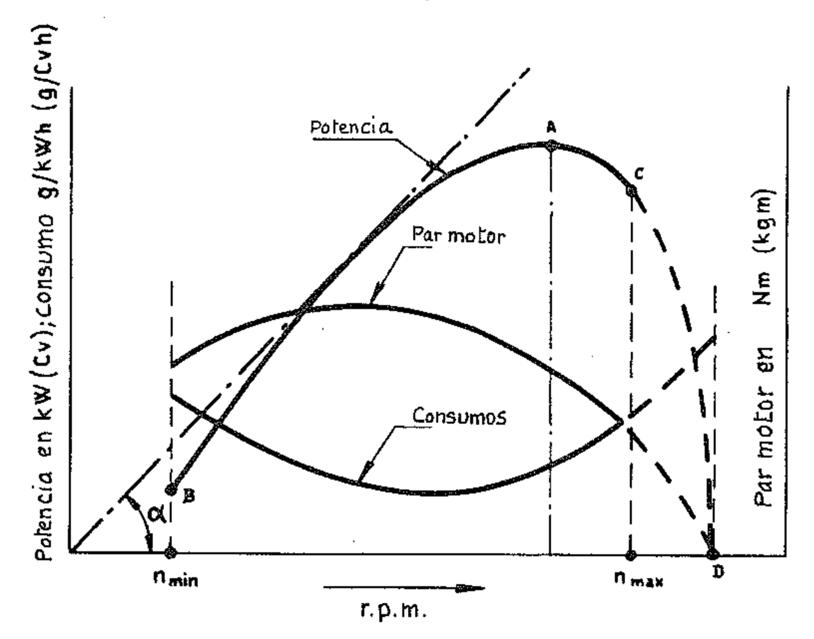
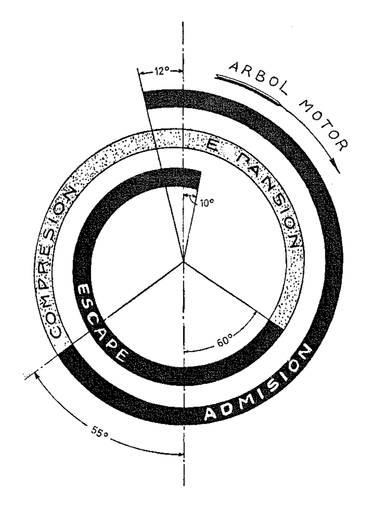
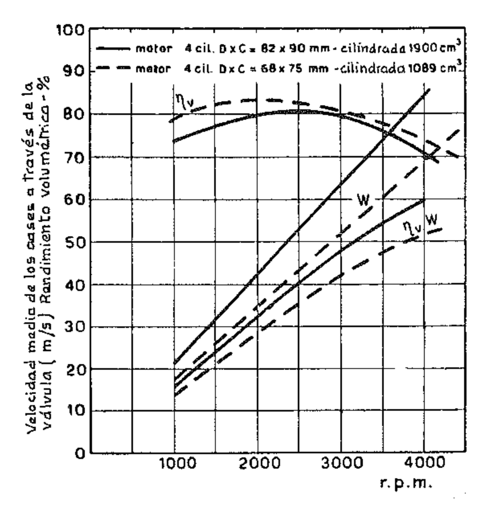
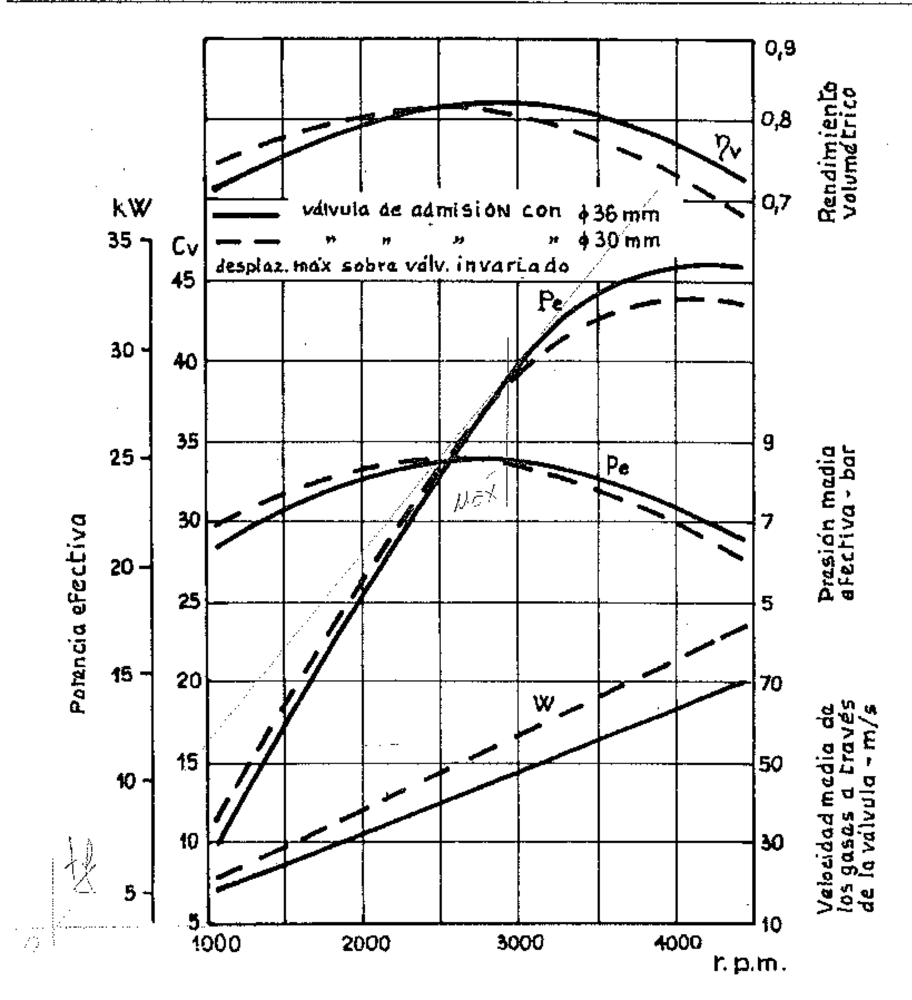
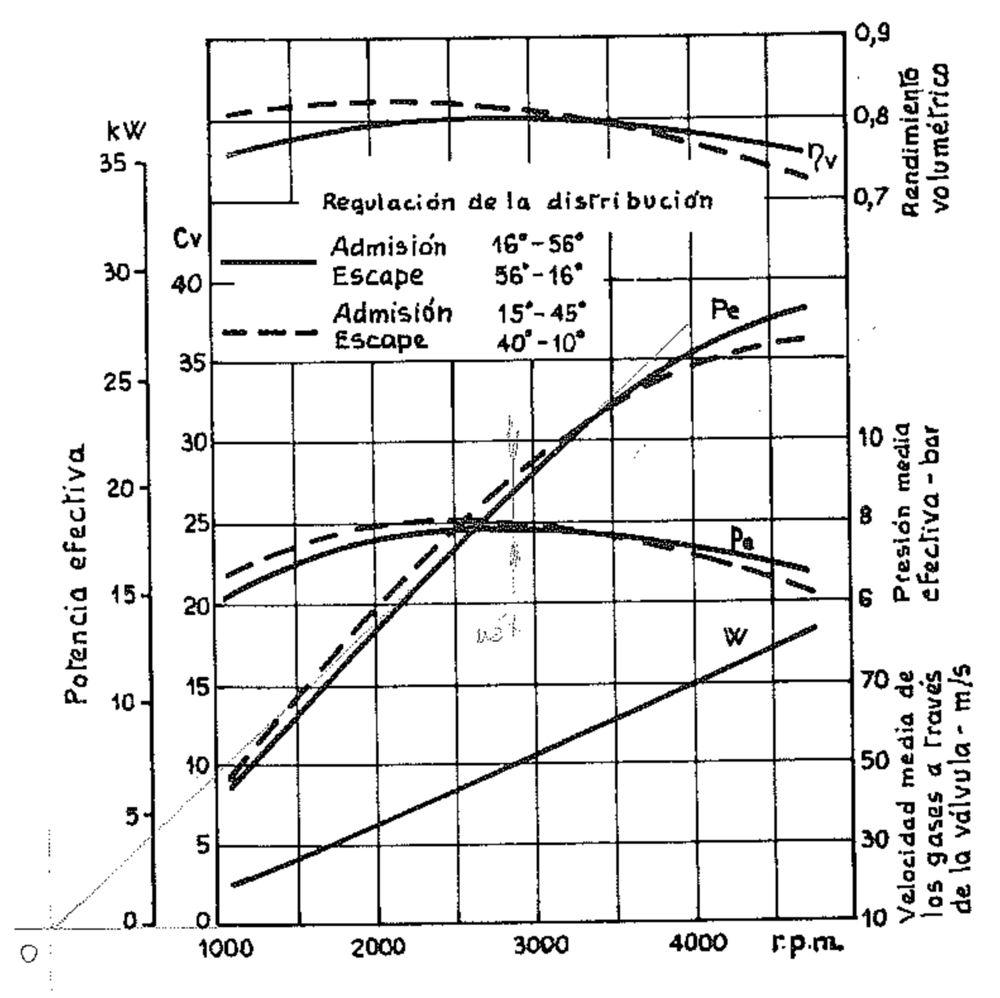
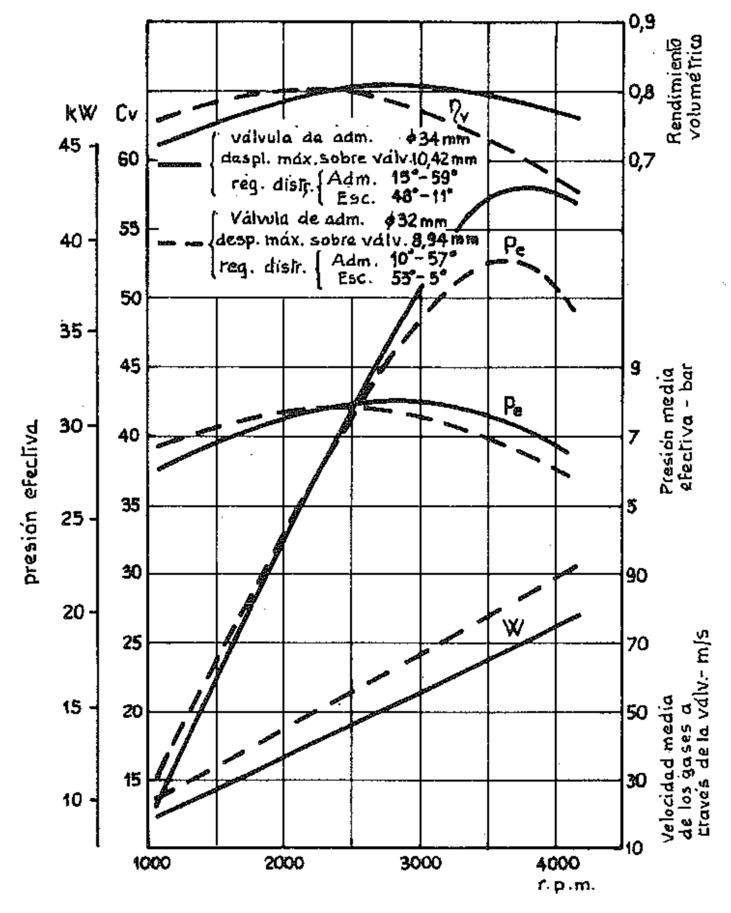

## LAS PRESTACIONES DEL MOTOR Y FACTORES QUE LAS INFLUENCIAN

#### 1. Curvas características

Las prestaciones de las que es capaz un motor quedan definidas por sus curvas características, es decir, por los diagramas que muestran las variaciones de la potencia, del par motor y del consumo de combustible en función del número de revoluciones.

Para mejor definir las características del motor, se pueden trazar otros diagramas como los de la potencia indicada, de la p.m.e., de los consumos a diferentes grados de regulación y a diferentes cargas, etc. Pero normalmente, como datos comerciales de un motor, son suficientes las primeras curvas características.

Éstas se determinan generalmente en el banco de ensayos en condiciones de alimentación máxima, es decir, con el carburador a plena apertura o bien, para los motores Diesel, con la bomba de inyección regulada para la máxima capacidad permitida (o sea a plena carga).

En la figura 1 se han trazado, para un caso genérico, las curvas de la potencia efectiva  $P_c$ , del par motor o torque  $M_t$  (momento de torsión) y del consumo específico  $c_s$  en función del número de revoluciones por minuto.

Entre los valores de la potencia  $P_e$  y los del par motriz  $M_t$  existe la siguiente relación:

(1) 
$$P_e = M_t \cdot \omega = M_t \frac{2 \pi n}{60} = 0,1047 \cdot M_t \cdot n$$

donde  $\omega$  es la velocidad angular. Por lo tanto es fácil, conociendo la curva del momento, obtener la de la potencia y viceversa.

Expresando los valores del par  $M_t$  en N m y los de la potencia en kW la (1) queda:

$$P_c = \frac{0.1047 \times M_t \times n}{1000} = \sim \frac{M_t \cdot n}{10000} \tag{kW}$$

La curva del momento puede servir, cambiando las unidades de medida sobre el eje de las ordenadas, como curva de la p.m.e.  $(p_e)$  puesto que, para una cilindrada dada V, el momento de torsión es, para cada valor del número de revoluciones, proporcional a la p.m.e. En efecto, de la expresión de la potencia efectiva obtenida en función de la  $p_e$  (párr. VII.5):

$$P_e = \frac{V \cdot p_e \cdot n}{300 \cdot h} \tag{kW}$$

y de la del momento de torsión obtenida de la (1):

$$M_t = \frac{1000 \times P_e}{0.1047 \times n} = \sim 10^4 \frac{P_e}{n} \tag{Nm}$$

se obtiene

$$P_e = \frac{0.1047 \times M_t \times n \times 0.3 \times h}{V \times n} = 0.0314 h \frac{M_t}{V} \tag{bar}$$

donde la cilindrada V está en  $dm^3$ , y h es el número de tiempos.

Por lo tanto, para los motores de 4 tiempos (h = 4):

$$p_e = 0.126 \frac{M_t}{V} \tag{bar}$$

y para los de 2 tiempos (h = 2):

$$p_e = 0.063 \frac{M_t}{V} \tag{bar}$$

Usando las unidades tradicionales, es decir,  $P_e$  en Cv,  $M_t$  en kgm, V en litros, las expresiones anteriores quedan como sigue:

$$P_c = \frac{M_t \cdot \omega}{75} = M_t \frac{2 \cdot \pi \cdot n}{60 \times 75} = \frac{M_t \cdot n}{716.2} \tag{Cv}$$

$$M_t = 716.2 \frac{P_c}{n} \tag{kgm}$$

$$P_e = \frac{225 \cdot h \cdot M_t}{716.2 \cdot V} = 0.314 \frac{h}{V} M_t \qquad (kg/cm^2) \checkmark$$

Los diagramas ponen en evidencia que el valor de la potencia aumenta con el número de revoluciones hasta un cierto límite, señalado por el punto A, para después disminuir hasta anularse en el punto D, y que el régimen de par máximo es notablemente inferior al de potencia máxima.

Para cada motor existe una velocidad de rotación para la cual la masa de fluido de trabajo que entra en cada uno de los cilindros y es utilizada es la máxima posible para cada ciclo. A esa velocidad entonces, el área del ciclo indicado, la p.m.i. y el par motor indicado asumen sus valores máximos, por lo tanto también el producto del rendimiento volumétrico por el rendimiento térmico del motor alcanza su valor máximo.

La potencia indicada, continúa aún aumentando al aumentar la velocidad de rotación por el hecho de que, aunque disminuye la masa de fluido de trabajo utilizada para cada ciclo, aumenta el número de los ciclos y por lo tanto la masa utilizada en la unidad de tiempo.

Si se continúa aumentando la velocidad de rotación, se alcanza un valor pasado el cual la masa de fluido activo de cada ciclo se reduce más rápidamente que lo que aumenta el número de ciclos en la unidad de tiempo, y la potencia indicada disminuye. Puesto que el par motor efectivo está dado por el producto del par motor indicado por el rendimiento mecánico del motor, rendimiento que como hemos visto no es constante sino que varía al variar el número de revoluciones, el valor máximo del par motor efectivo se alcanza a aquel régimen de rotación para el cual es máximo el producto del rendimiento volumétrico por el rendimiento térmico y por el rendimiento mecánico, régimen que por lo tanto, en general, difiere del régimen de máximo par motor indicado.

La tangente a la curva de la potencia (fig. 1) que pasa por el origen de los ejes, señala en el punto de tangencia el régimen de máximo par motor. En efecto, la relación:

$$M_t = \text{const.} \times \frac{P}{n} = \text{const.} \times \text{tg } \alpha$$

demuestra que el par motor es máximo para el máximo valor de α.

La parte dibujada con línea de trazos de la curva de la potencia no se obtiene nunca en la práctica, porque no tiene ningún interés: por otra parte durante el ensayo se perjudicaría la resistencia del motor que normalmente no está dimensionado para poder soportar durante largo rato un régimen tan alto (correspondiente al punto D).

El punto B corresponde al régimen mínimo de utilización. Durante la marcha al mínimo (en vacío) la potencia desarrollada por el fluido de trabajo es totalmente absorbida por las resistencias mecánicas: por debajo, el funcionamiento del motor es irregular a causa de la alimentación imperfecta y de la irregularidad del par motor.

### 2. Rendimiento volumétrico

Las prestaciones del motor dependen, a igualdad de las demás condiciones, principalmente de la cantidad de aire utilizado. Cuanto mayor es la cantidad de aire introducida, tanto mayor es la cantidad de combustible que puede quemarse, y por lo tanto mayores serán la energía aportada y la potencia indicada.

El rendimiento volumétrico nos da la medida del grado de llenado del motor y en consecuencia de la calidad del sistema de introducción de aire o de mezcla.

Ya.hemos dado, en el párrafo VII.6, la definición del rendimiento volumétrico: éste es la razón entre la masa efectiva de aire introducida en el cilindro en la unidad de tiempo y la masa del aire que teóricamente debería ser introducida en el mismo tiempo, calculada en base a la cilindrada y a las condiciones de temperatura y presión a la entrada del cilindro.

El rendimiento volumétrico varía generalmente con el régimen del motor porque la resistencia que el fluido encuentra en su camino hacia los cilindros depende de la forma y de las dimensiones de los conductos y pasos, y la resistencia es tanto mayor cuanto mayor sea la velocidad del fluido.

La masa de aire efectiva introducida a diferentes regímenes se mide en ensayos en el banco de pruebas; la teórica se calcula basándose en las dimensiones y en el número de los cilindros y en el régimen del motor teniendo en cuenta la densidad de la atmósfera. Cuando el motor es sobrealimentado, en el cálculo deben considerarse las condiciones de temperatura y presión existentes en los conductos de admisión.

Puesto que la curva de la p.m.e., y por lo tanto también la de la potencia, varía en relación con la del rendimiento volumétrico, es importante conocer cuáles son las variables que influyen en el rendimiento volumétrico:

1) La densidad de la carga y la dilución debida a los gases residuales cuando la carga llega al cilindro, son de una cierta importancia. Generalmente las paredes de los conductos de aspiración y del cilindro ceden calor a la carga fresca y aumentan su temperatura, por esto la densidad de la carga disminuye y se tiene una cierta reducción del rendimiento volumétrico.

También los gases residuales presentes en el cilindro después del escape contribuyen a reducir la densidad de la mezcla o del aire que entra cediéndo-le calor; además al expandirse durante la fase de admisión sustraen parte del volumen que debería ser ocupado por la carga fresca, mezclándose con ella.

2) El diseño de los conductos de aspiración y de escape tiene mucha importancia. Los conductos de aspiración han de ser tales que permitan la admisión de la mayor cantidad posible de aire o mezcla y los de escape, tales que opongan la mínima resistencia al paso de los gases.

Del área de la sección de los conductos de aspiración y de la del paso entre la válvula y su asiento depende la velocidad del aire. La experiencia dice que los mejores valores del rendimiento volumétrico se verifican en general en los motores automovilísticos dentro de un rango de velocidades del fluido de  $40 \div 60$  m/s, entendiendo por velocidad el valor medio teórico calculado convencionalmente en base a la cilindrada del motor (párr. VII.6). En régimen de potencia máxima la velocidad media del fluido que entra es muy superior.

3) Los tiempos de apertura y de cierre de las válvulas son otras variables que influyen en el rendimiento volumétrico.

Es intuitivo que existe una estrecha relación entre el tiempo de apertura de las válvulas y el llenado del cilindro según la velocidad de rotación. En el siguiente párrafo se trata este argumento.

En el rendimiento volumétrico pueden influir las ondas de presión que se crean en los conductos de aspiración y de escape, en relación con las rápidas variaciones de velocidad de la masa gaseosa en movimiento.

Cuando las ondas de presión que se forman en el conducto de aspiración tienen un ritmo tal que, poco antes del cierre de la válvula, la presión a la entrada del cilindro alcanza un máximo o un mínimo, se tiene respectivamente un aumento (sobrealimentación por inercia) o una disminución del rendimiento volumétrico. De manera análoga se explica la influencia de las ondas de presión en el escape. Éste fenómeno es aprovechado, cuando es posible, escogiendo adecuadamente la longitud de los conductos.

El rendimiento volumétrico, en fin, puede ser mejorado notablemente comprimiendo el fluido antes de enviarlo al cilindro, y aún más si después de esta compresión, que aumenta su temperatura, se lo refrigera mediante un intercambiador de calor interpuesto entre el compresor y el cilindro. Éste es el caso de los motores sobrealimentados.

## 3. Tiempos de apertura de las válvulas y su influencia en el rendimiento volumétrico

Los datos referentes a los tiempos de apertura de las válvulas pueden ser reunidos en un diagrama como el indicado en la figura 2, en el cual los instantes en los que las válvulas comienzan a abrirse y aquéllos en los cuales se cierran están indicados con referencia a los puntos muertos.

En los ciclos ideales se ha supuesto que la apertura y el cierre de las válvulas se produce instantáneamente coincidiendo con los puntos muertos. En la práctica las válvulas se abren y se cierran cuando el pistón está algo alejado de los puntos muertos. En particular el comienzo de la apertura de la válvula de escape y el cierre de la de admisión están generalmente distantes del P.M.I.

En la figura 2 se representa el diagrama de la distribución de un motor para el cual los datos son:

comienzo apertura válvula de admisión 12º (0,209 rad) antes del P.M.S. 55º (0,960 rad) después del P.M.I. comienzo apertura válvula de escape 60º (1,047 rad) antes del P.M.I. cierre válvula de escape 10º (0,174 rad) después del P.M.S.

El avance de la apertura de la válvula de aspiración con respecto al P.M.S. es principalmente una consecuencia de la ley que la válvula sigue en su movimiento. El tiempo durante el cual se completa el movimiento de apertura es relativamente largo porque para tener un movimiento regular no deben superarse ciertos valores de la velocidad y de la aceleración de la válvula. Por lo tanto, para que la válvula esté completamente abierta en el momento más conveniente para obtener el máximo llenado del cilindro (es decir, cuando el pistón alcanza la velocidad más alta), es necesario que el comienzo de la apertura se produzca antes del P.M.S. En los motores rápidos el avance o adelanto tiene que ser mayor que en los motores lentos.

El retraso del cierre con respecto al P.M.I. es debido a la misma razón por la que la apertura se inicia con adelanto con respecto al P.M.S. Además sirve para utilizar la energía cinética del fluido en movimiento en el conducto de admisión. Durante la carrera de admisión el fluido adquiere una velocidad elevada y por inercia penetra en el cilindro incluso cuando el pistón disminuye su velocidad acercándose al P.M.I. y continúa entrando por un cierto tiempo cuando el pistón ya ha comenzado la carrera de compresión. Cuanto mayor es la velocidad de rotación del motor, tanto mayor es la energía cinética de los gases y por lo tanto mayor es el retraso que hay que dar al cierre de la válvula, con respecto al P.M.I.

En el párrafo anterior hemos dicho algo sobre la formación de ondas de presión en los conductos. Escogiendo adecuadamente la longitud del conducto de aspiración se puede conseguir que las oscilaciones de la columna de gas debidas a la sucesión de aspiraciones estén en fase con el movimiento de la válvula a fin de resaltar el efecto de la inercia. Con esta disposición se puede conseguir un grado de llenado superior al normal, que los ingleses llaman «ram effect» (¹).

El adelanto o avance con el cual se abre la válvula de escape con respecto al P.M.I., o sea antes del comienzo de la carrera de escape, tiene como efecto

(1) N. del T.: «efecto ariete».

{width=50%}

el rebajar la presión de los gases quemados a un valor cercano al del ambiente exterior, aunque no se reduce apreciablemente el trabajo de expansión, dado que cuando el pistón se aproxima al P.M.I. actúa sobre el cigüeñal con un brazo de palanca pequeño, que tiende a anularse. La válvula, que se abre gradualmente, alcanza la apertura máxima cuando la carrera de escape ya ha comenzado.

El efecto de la reducción de la expansión es por otra parte compensado por la más completa expulsión de los gases quemados.

El retraso del cierre con respecto al P.M.S. tiene en cuenta, como en el caso de la aspiración, la gradualidad con que se cierra la válvula y la inercia de los gases quemados.

Los ángulos de avance y de retraso se establecen en relación con la velocidad media de salida del gas y con la aceleración de la válvula. El investigador inglés Ricardo encontró que, para una velocidad media de los gases de 60 m/s y con una aceleración normal para la válvula, las mejores condiciones se tienen cuando, con el pistón en el P.M.I., la válvula ya ha alcanzado la mitad de su recorrido de apertura y, con el pistón en el P.M.S., ésta está aún abierta en una proporción de un 5 %.

Del diagrama resulta que cerca del P.M.S. mientras todavía no está cerrada la válvula de escape, ya está abierta la de admisión. El ángulo durante el cual las dos válvulas están abiertas al mismo tiempo se llama ángulo de cruce o traslapo. Las áreas de paso entre las válvulas y sus asientos, durante el traslapo, son bastante pequeñas, dado que la válvula de admisión está iniciando su ascensión y la de escape está acercándose a su asiento, por lo tanto la velocidad de los gases de escape es alta y la corriente tiende a mantener la dirección del movimiento. Ésta es la razón por la cual a regímenes de uso normal del motor, los gases de escape no tienden a penetrar en el conducto de admisión durante el traslapo.

El rendimiento volumétrico depende, además de la velocidad de los gases en los conductos y a través de las válvulas, también de los ángulos durante los cuales las válvulas permanecen abiertas. Si dependiese sólo de la velocidad de los gases, asumiría su valor máximo al número de revoluciones mínimo porque las pérdidas de carga son aproximadamente proporcionales al cuadrado del número de revoluciones. Pero la elección de los tiempos de apertura de las válvulas interviene en gran medida para variar esta condición.

Así por ejemplo un motor diseñado para funcionar a regímenes elevados tiene un ángulo de retraso del cierre de la válvula de admisión más bien amplio. Por debajo de un cierto régimen sucede que la inercia de la columna de gas aspirado disminuye en relación con su baja velocidad y por esto, al comienzo de la carrera de compresión, una parte del gas es devuelta hacia atrás, a través de la válvula aún abierta, el conducto de aspiración. El rendimiento volumétrico, en consecuencia, disminuye.

En general la curva del rendimiento volumétrico presenta un punto de máxima a un régimen de velocidad intermedio, como se ve en la figura 3, donde se han trazado las curvas de rendimiento volumétrico  $\eta_{\nu}$  y de la velocidad media teórica W del gas a través de las válvulas de admisión, en función del número de revoluciones. También se indica la curva del producto  $\eta_{\nu}W$ .

Para modificar la curva del rendimiento volumétrico es necesario por lo tanto actuar tanto sobre la velocidad de los gases como sobre el diagrama de la distribución. La curva de la potencia variará en consecuencia, como diremos en el párrafo siguiente.

Es extremadamente difícil establecer por medio del cálculo cuáles son los valores óptimos de los ángulos de adelanto y retraso para un motor dado. Ellos dependen de muchos factores, incluso de carácter constructivo. Pero, en base a consideraciones teóricas y a datos de comparación con motores conocidos, se pueden establecer en la etapa de proyecto valores muy cercanos, si no, incluso, coincidentes, a los que podrían ser definidos experimentalmente para obtener los mejores resultados.

{width=50%}

Cuando se habla del diagrama de la distribución se entiende el teórico, es decir, aquél definido por la forma de la leva (excéntrica) que acciona la válvula, considerando el cinematismo intermedio como indeformable y sin juegos.

En realidad, entre la regulación teórica y la regulación efectiva existen siempre diferencias debidas a la elasticidad de los órganos que componen el mecanismo, a los juegos existentes entre ellos y a las dilataciones debidas a las temperaturas alcanzadas durante el funcionamiento. Teniendo en cuenta estas razones de carácter constructivo, que pueden determinar variaciones de los ángulos de hasta 6º (0,1047 rad) o incluso de 8º (0,1396 rad), las razones principales de la necesidad de anticipar la apertura y retrasar el cierre de la válvula de admisión deben relacionarse con la velocidad W del fluido y con la forma de la leva.

# 4. Influencia de la velocidad de los gases y de los tiempos de apertura de las válvulas sobre la curva de potencia

Variando la sección de los conductos, o también las dimensiones de las válvulas, o bien los tiempos de apertura de las válvulas o bien unas y otros en conjunto, se pueden provocar apreciables variaciones de la potencia en el rango de revoluciones establecido.

— Aumentando las dimensiones de los conductos y de las válvulas disminuye la velocidad de los gases, por lo que mejora el rendimiento volumétrico para los regímenes altos porque la resistencia al paso de los gases disminuye. Para regímenes bajos con la reducción de la velocidad de los gases varía la influencia que los tiempos de apertura de las válvulas de admisión tienen sobre el rendimiento volumétrico: como ya se ha dicho, puede también verificarse que al comienzo de la fase de compresión una cierta cantidad de-mezcla sea devuelta atrás, hacia el conducto de aspiración.

En definitiva, aumentando válvulas y conductos, se desplaza hacia un régimen más elevado el valor máximo del rendimiento volumétrico y por lo tanto del par máximo y de la potencia máxima. El régimen máximo del motor aumenta así como también la potencia, mientras la potencia para regímenes bajos diminuye. De forma secundaria se verifica también un aumento del régimen mínimo del motor. Todo esto se refleja en una elevación de la curva del momento de torsión para los regímenes altos y un descenso para las bajas revoluciones, es decir, en un funcionamiento menos estable del motor.

La reducción de la velocidad del fluido para los regímenes bajos es causa de otros importantes fenómenos: en los motores a carburación favorece la condensación del combustible, tanto que en ciertos casos se forma sobre las paredes de los conductos una delgada película de carburante, mientras que en los motores de inyección reduce la turbulencia y por lo tanto influye en la propagación de la combustión. Como consecuencia a esos regímenes la marcha se hace irregular y aumenta el consumo específico.

— Disminuyendo las dimensiones de los conductos y de las válvulas, las variaciones se producen en sentido opuesto. El aumento de la velocidad de los gases en los conductos desplaza hacia un régimen inferior el rendimiento volumétrico máximo y en consecuencia también el par motor y la potencia máxima. El régimen máximo del motor se reduce, la potencia correspondiente disminuye, mientras la potencia a bajos regímenes aumenta. El funcionamiento del motor resulta más estable y el «mínimo» mejora.

En la figura 4 se han dibujado los diagramas característicos de un típico motor de automóvil: las curvas de línea continua han sido obtenidas con conductos y válvulas de dimensiones grandes; las de trazo discontinuo, con conductos y válvulas de dimensiones menores.

- Los efectos de las variaciones en los tiempos de apertura de las válvulas pueden describirse, brevemente, del modo siguiente:
- 1) Con tiempos de apertura largos, es decir, grandes ángulos de admisión y de escape, los resultados son comparables a los que pueden obtenerse aumentando las dimensiones de los conductos y de las válvulas. Es decir, se consigue un aumento del régimen máximo de rotación del motor y un incremento de potencia para altas revoluciones. En efecto, sucede que cuando el

{width=50%}

pistón está en el P.M.S., terminada la carrera de escape, la válvula de escape permanece aún abierta por un tiempo suficiente para crear en el cilindro, gracias a la velocidad de los gases que escapan, una depresión que se utiliza, estando abierta anticipadamente la válvula de admisión, para hacer entrar la mezcla o el aire incluso antes de que comience la carrera de admisión. Éste es el efecto del denominado *cruce* entre las fases de aspiración y de escape. Así, de la misma manera, aprovechando la inercia de la columna de gas que entra, se puede hacer continuar el llenado del cilindro incluso durante el primer tramo de la carrera de compresión. Éste es el efecto del *traslapo* entre las fases de admisión y de escape.

Mientras de esta manera se aumenta el régimen máximo de revoluciones y por lo tanto la potencia, se tiene por el contrario para bajas revoluciones una reducción de la potencia porque disminuye o se anula el efecto debido a la energía cinética del gas entrante, tanto que en casos límites durante el traslapo la mezcla puede ser devuelta atrás por los gases de escape.

2) Con tiempos de apertura breves se excluye para el motor la posibilidad de funcionar a regímenes elevados. De éstos resulta una reducción de la potencia máxima en provecho de la potencia a regímenes bajos.

En la figura 5 se representan las curvas características y de rendimiento volumétrico de un mismo motor con tiempos o períodos de apertura breves

(curva discontinua) y largos (curva continua).

Resulta por lo tanto claro que, en los casos en que se quiera obtener la máxima potencia posible (por ejemplo, vehículos deportivos), se adoptarán ángulos de avance y de retraso grandes y grandes dimensiones de los conductos y de las válvulas. Al contrario, se adoptarán ángulos pequeños y conductos «estrangulados» en los casos en que interese obtener regímenes de revoluciones modestos (como por ejemplo en motores para instalaciones fijas para los cuales es de gran importancia la «durabilidad») y desplazar el máximo par motor hacia los regímenes inferiores.

{width=50%}

La figura 6 muestra las consecuencias de la variación de las dimensiones de los conductos y de las válvulas de admisión y de los tiempos de apertura de las válvulas sobre las curvas características de un motor normal de 4 tiempos de carburación.

De lo dicho en este párrafo es fácil deducir que para obtener las mejores condiciones de llenado de los cilindros, y por lo tanto de relación efectiva de compresión, sería necesario que en toda la gama de revoluciones los ángulos

{width=50%}