#### 5. Pérdida de potencia debida a la resistencia pasiva

Entre las partes en contacto dotadas de movimiento relativo, entre-los gases y las paredes de los conductos y entre las moléculas de los gases mismos se crean unos rozamientos que absorben una cierta cantidad de trabajo. El trabajo absorbido por el movimiento de los gases es, como sabemos, el **trabajo** de bombeo que depende de las secciones y forma de los conductores y de la velocidad de los gases. El trabajo absorbido por el rozamiento entre las superficies deslizantes, que en el motor están en su mayoría representadas por acoplamientos cilíndricos, depende de la terminación de las superficies, de las características de la lubricación, del grado de precisión del acoplamiento, etc.

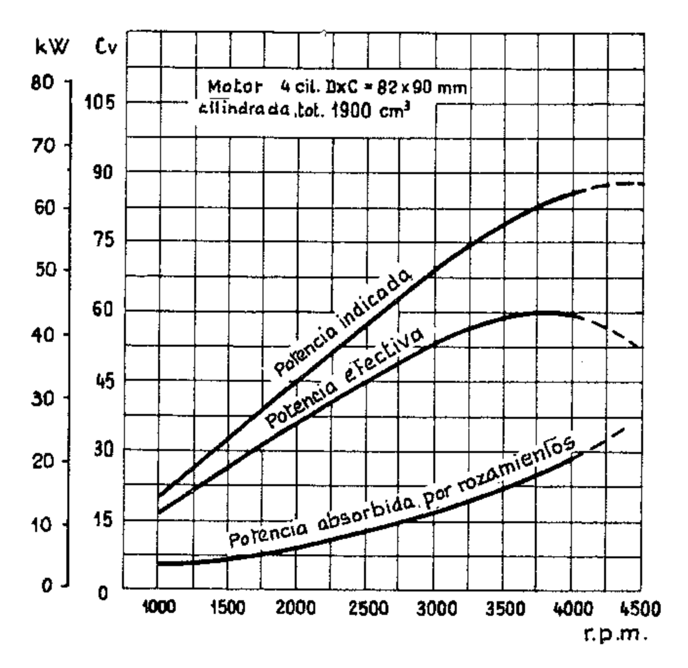{width=50%}

La experiencia enseña que la pérdida de potencia debida a los rozamientos es en parte proporcional a la velocidad y en parte proporcional al cuadrado de la velocidad.

En la figura 1 se han trazado las curvas de la potencia indicada  $P_i$ , de la potencia efectiva  $P_e$  y de la absorbida por los rozamientos  $P_p$  en función del número n de revoluciones por minuto de un motor, a plena apertura. La potencia absorbida por los rozamientos es la diferencia entre las otras dos. Las razones entre los valores de la potencia efectiva y los valores correspondientes de la potencia indicada representan los valores del rendimiento mecánico  $\eta_m$  para los diferentes números de revoluciones.

La potencia indicada comienza a disminuir a un-cierto régimen-como consecuencia de la disminución del rendimiento volumétrico; si se continúa aumentando el número de revoluciones se alcanza un régimen al cual la potencia absorbida por los rozamientos iguala la potencia indicada y la potencia efectiva se anula.

En la figura 2 se han trazado, siempre en función de la velocidad de rotación, las curvas de la presión media indicada p.m.i., de la presión media efectiva p.m.e. y de la presión media absorbida por las resistencias de rozamiento. También se indica la curva del rendimiento mecánico  $\eta_m$  para el motor considerado en particular.

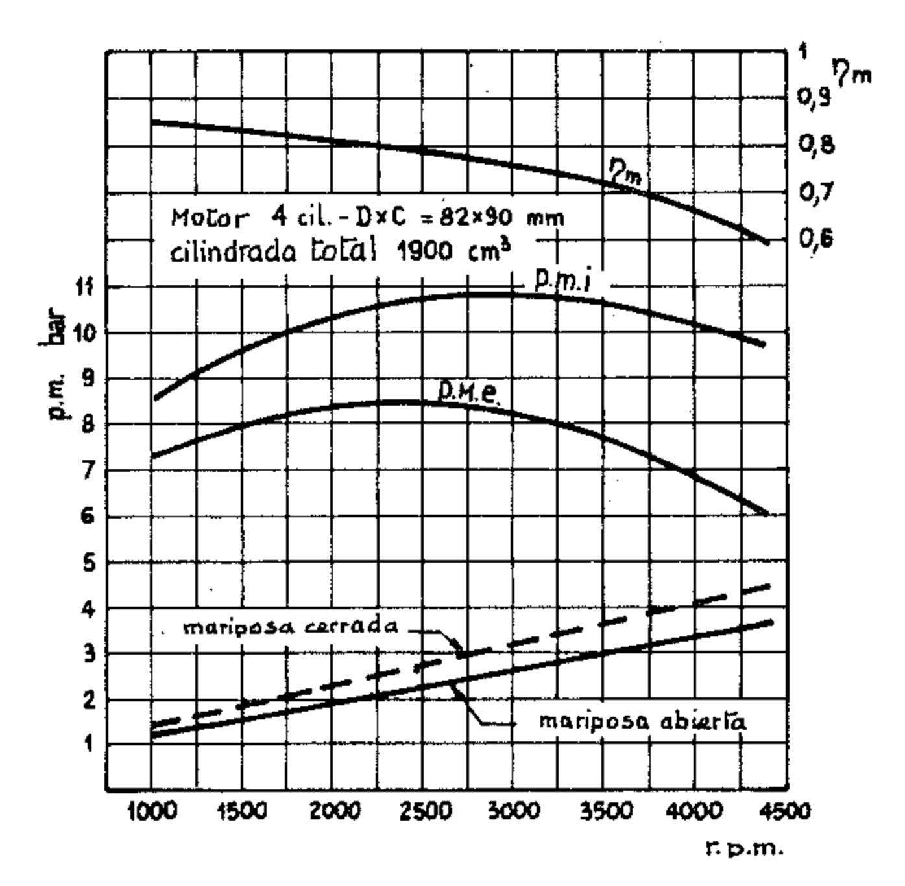{width=50%}

El rendimiento mecánico al régimen de par máximo varía de motor a motor entre 0,8 y 0,9. En general para los motores automovilísticos que a plena carga tienen  $\eta_m = 0.8$ , si el par se reduce al 30 % de su valor máximo,

 $\eta_m$  cambia a aproximadamente 0,55.

En la figura 3 están trazadas las curvas del consumo específico en g/kWh y del consumo por hora en kg en función del número de revoluciones por minuto de un motor ECh. El consumo específico tiene el valor mínimo a regímenes intermedios y aumenta hacia los regímenes altos y bajos. A baja velocidad priman las pérdidas del calor a través de las paredes mientras que a alta velocidad tienen más importancia las pérdidas de rozamiento; por esto, al aumentar el número de revoluciones el consumo por hora aumenta en mayor proporción que la potencia efectiva y en consecuencia aumenta el consumo específico.

Si se mide el consumo a un número constante de revoluciones, haciendo variar la abertura de la mariposa (o, para los Diesel, el caudal de la bomba de inyección) y correspondientemente la carga; es decir, la p.m.e., se obtienen unas curvas interesantes, especialmente útiles en el caso de las aplicaciones automotrices.

En la figura 4 se presenta una de estas curvas para un motor con carburador, de lo que resulta evidente que, reduciendo la apertura y en consecuencia la carga, el consumo específico aumenta de manera rápida. En efecto, con el cierre gradual de la mariposa la potencia absorbida por bombeo aumenta, la potencia absorbida por los rozamientos permanece en conjunto casi constante, mientras la potencia indicada disminuye; por lo tanto la potencia efectiva disminuye más rápidamente que el consumo por hora y por esto el consumo específico aumenta.

En el párrafo VII.4 hemos dicho cómo se mide en la práctica la potencia absorbida por los rozamientos.

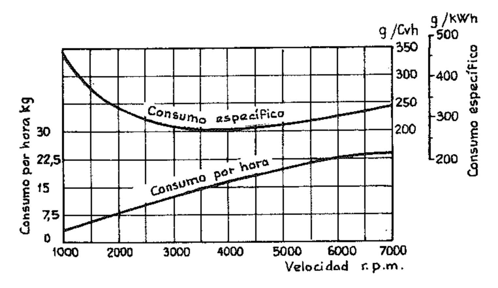{width=50%}

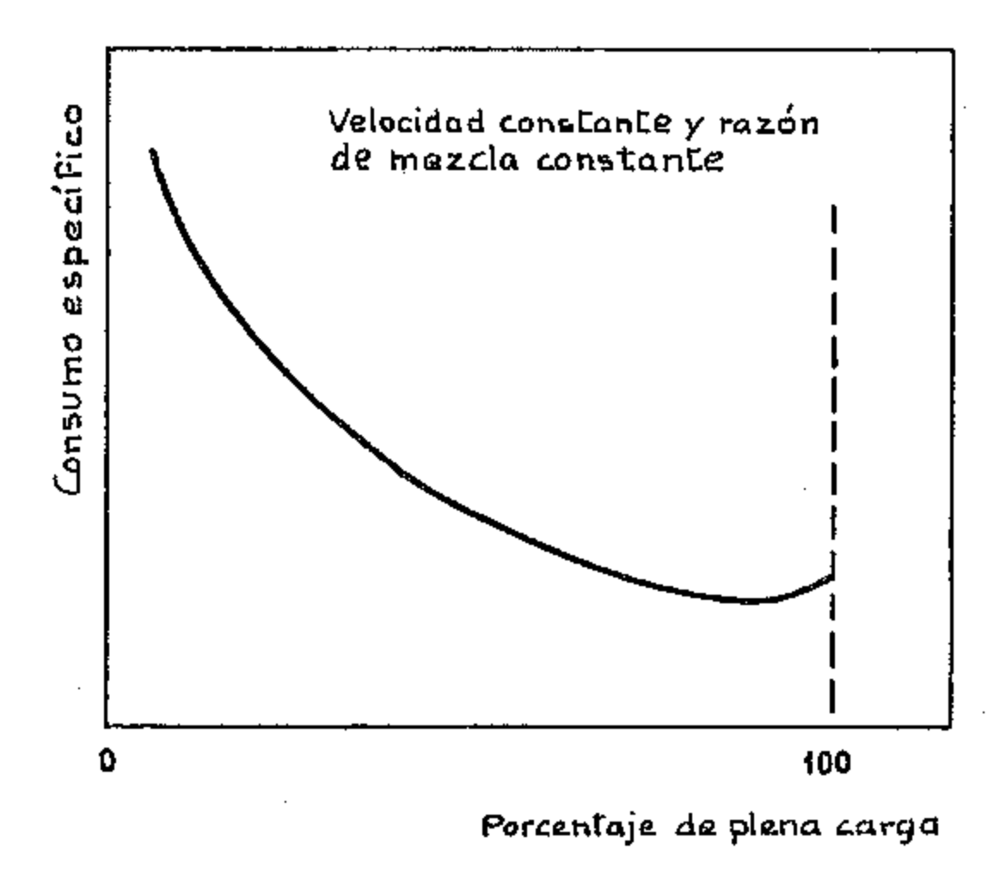{width=50%}

#### 6. El consumo específico de los motores de cuatro tiempos ECh

Hemos visto en el párrafo anterior que el consumo específico varía al variar el régimen de giros y la carga, es decir, la p.m.e. Para tener un cuadro completo del modo en que varía el consumo específico para todo el rango de funcionamiento, se puede recurrir al denominado plano acotado de los consumos.

Las figuras 5 y 6 dan el plano acotado de los consumos obtenido en el banco de pruebas para un motor de ciclo Otto: están trazadas, en función de la p.m.e. y del número de revoluciones, las curvas de igual consumo específico. Por comodidad se han indicado además con líneas de trazos las curvas de igual potencia (que son partes de hipérboles).

Se desprende de los diagramas que el consumo específico-varía mucho al variar la p.m.e. y relativamente poco al variar la velocidad del motor.

En general, en condiciones de p.m.e. máxima, el consumo es máximo a regímenes bajos y disminuye al aumentar las revoluciones, hasta cuando la velocidad de rotación del motor alcanza los 2/3 - 3/4 de la máxima, para después crecer nuevamente con ulteriores aumentos de la velocidad. Las razones de esto son varias. Recordemos antes que nada lo que ya se ha dicho en el párrafo anterior, es decir, que a través de las paredes del cilindro y de la cámara se disipa a regímenes bajos un porcentaje de calor mayor que el que se pierde a regímenes altos, teniendo en cuenta el tiempo durante el cual los gases calientes están en contacto con las paredes. Además a bajo régimen dado que la mezcla es rica pueden verificarse condensaciones y fenómenos de oscilación de la presión en los conductos. La razón por la que sobrepasado un cierto régimen el consumo específico comienza a aumentar de nuevo es debida al fuerte gradiente de aumento de las pérdidas mecánicas. En menor medida se hace sentir el incremento de las pérdidas de bombeo consecuencia del aumento de la velocidad de los gases en los conductos.

El aumento del consumo específico al disminuir la p.m.e., a igualdad de régimen de rotación, deriva principalmente de pérdidas mecánicas que se hacen porcentualmente cada vez más importantes en comparación con las p.m.e. que se van haciendo cada vez más reducidas (las pérdidas mecánicas, como hemos visto, son prácticamente independientes de la carga del motor). Concurren además las progresivamente crecientes pérdidas por «estrangulación» debidas al sistema mismo de regulación de la carga del motor.

En la figura 7 se reproducen los diagramas de las presiones en el cilindro en condiciones de plena carga y de 1/4 de carga para poner en evidencia las variaciones de los valores de las presiones durante la carrera de admisión y por lo tanto también las del trabajo de bombeo.

Sobre el consumo de combustible tiene notable influencia la relación de compresión: en efecto, como ya hemos visto, aumentando la relación de compresión aumenta el rendimiento térmico ideal y por lo tanto disminuye el consumo específico. En la figura 8 se ha dibujado, en función de la relación de compresión, la curva del consumo específico considerado proporcional al rendimiento térmico ideal, suponiendo igual a 1 el consumo específico para la relación de compresión 4.

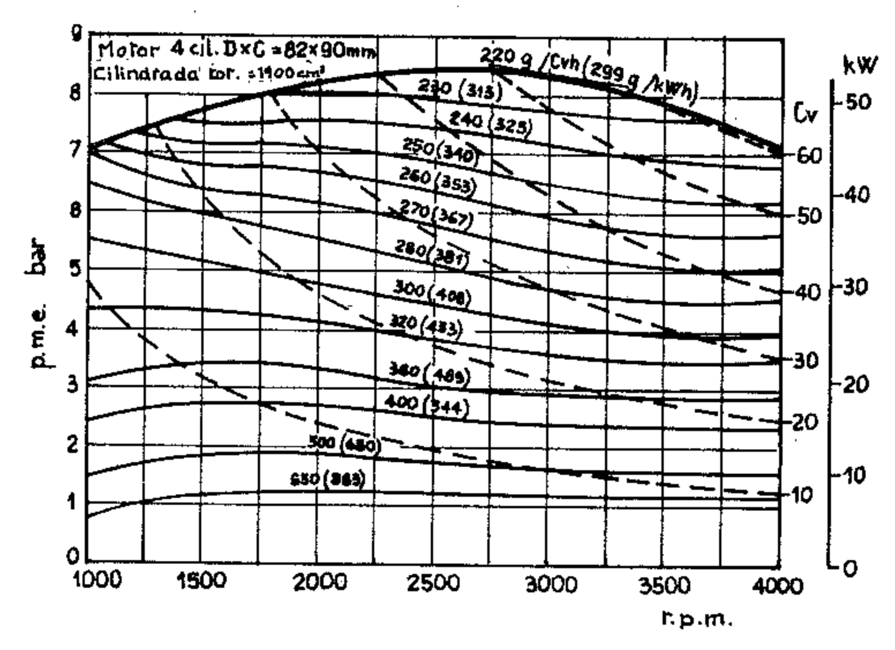{width=50%}

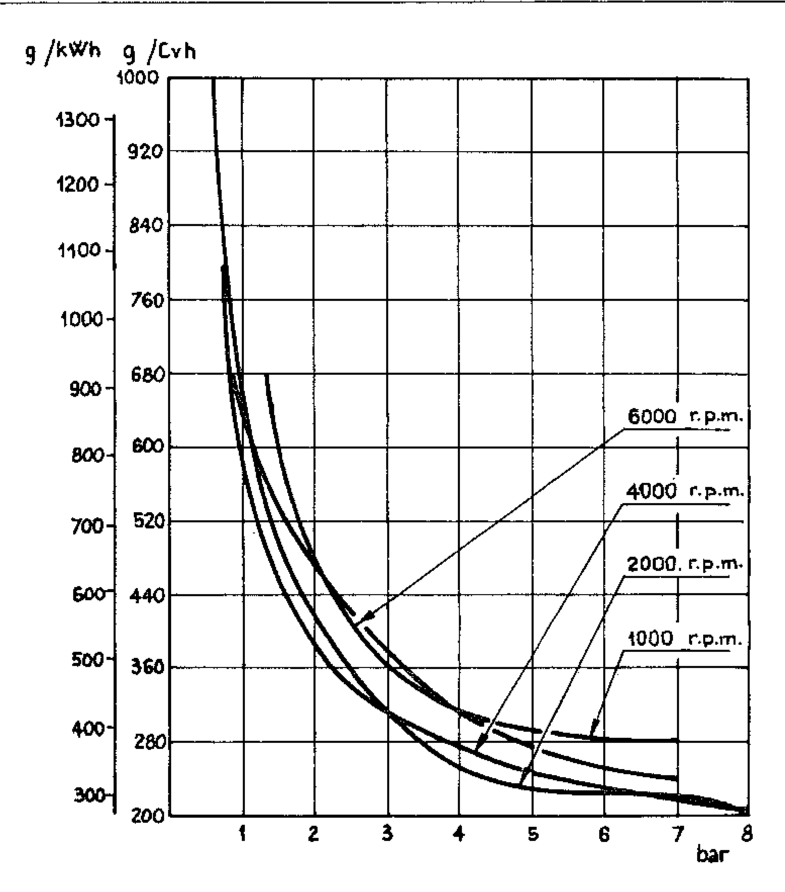{width=50%}

# 7. El consumo específico de los motores de encendido por compresión

Los motores Diesel tienen consumos específicos más bajos que los motores de ciclo Otto en toda la gama de giros y de cargas. Especialmente buenos son los motores a inyección directa porque son menores las pérdidas de calor debido a la forma más compacta de la cámara de combustión. Como hemos constatado en el estudio de los ciclos, el rendimiento termodinámico del ciclo Diesel, a igualdad de la relación de compresión, es inferior al del ciclo Otto, pero como en la práctica la relación de compresión del ciclo Diesel es generalmente del orden del doble que la del ciclo Otto, el rendimiento del ciclo Diesel es superior y por lo tanto el consumo es inferior.

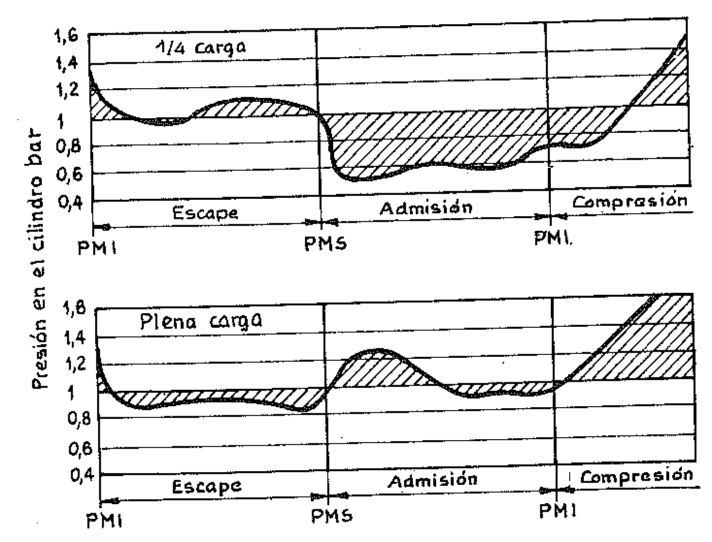{width=50%}

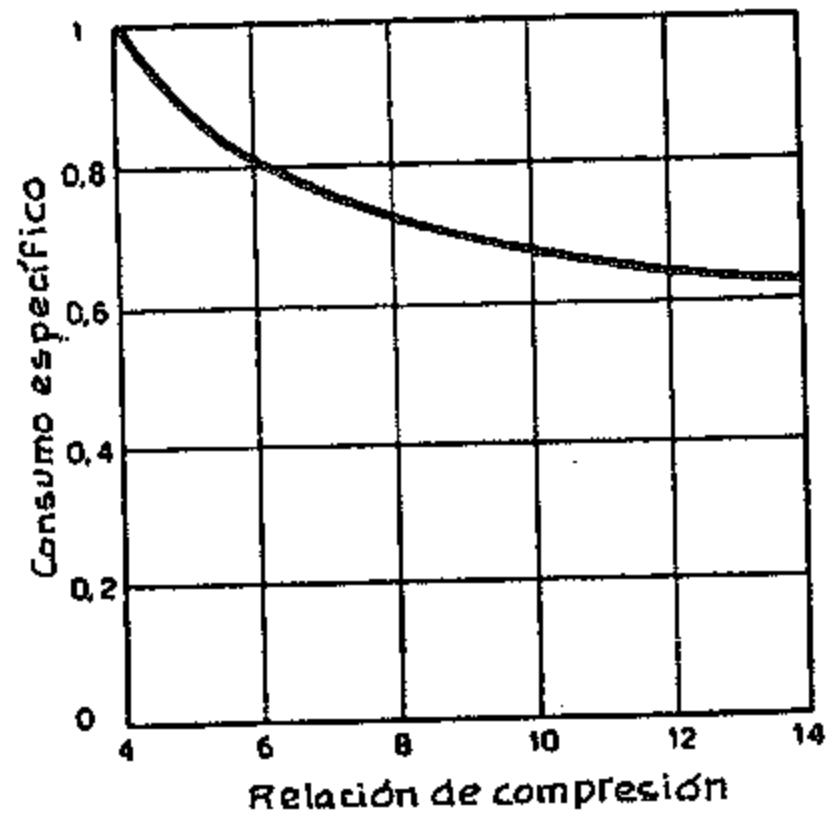{width=50%}

El sistema de alimentación por inyección permite una dosificación más precisa para cada cilindro al variar el régimen; además, faltando la estrangulación o restricción del aire las pérdidas por bombeo a regímenes elevados son inferiores a las del motor a carburación (¹).

(1) A menos que se trate de motores con regulador «por depresión» para regular el caudal del combustible (sistema que, por su economía, es normalmente usado en los motores Diesel más pequeños), en cuyo caso, debiéndose aún mantener la válvula de mariposa, se tiene las mismas pérdidas por «estrangulación» que el motor a carburación.

La curva de los consumos en las condiciones de p.m.e. máxima es por lo tanto más llana que la de los motores de ciclo Otto, es decir, para los regímenes altos y bajos el consumo varía menos con respecto al valor mínimo.

En la figura 9 se representa el plano acotado de los consumos para un motor de ciclo Diesel de 4 tiempos a inyección directa. De la comparación entre las figuras 9 y 10 puede verse que la curva del consumo mínimo no corresponde a la cuva de p.m.e. máxima, sino que coincide con valores de la p.m.e. bastante inferiores. La explicación está dada por las siguientes consideraciones.

Para que la combustión sea lo más completa posible, el motor Diesel tiene que funcionar con mucho exceso de aire. Por otra parte para obtener el máximo de la p.m.e. correspondiente a un régimen cualquiera, hay que introducir en el cilindro la máxima cantidad de combustible compatible con una combustión suficientemente regular (es decir, con un nivel aceptable de humos y con temperatura de gases de escape no excesiva). En estas condiciones puesto que no cambia el llenado de los cilindros, ya que se está operando al mismo régimen, el exceso de aire ya no es tal que permita quemar completamente todo el combustible introducido. El consumo específico correspondiente a la p.m.e. a plena carga resulta, en consecuencia, influenciado negativamente por la combustión incompleta del combustible introducido. Al disminuir la carga, el consumo específico, aunque influenciado por las pérdidas mecánicas que se hacen proporcionalmente mayores, tiende a mejorar porque mejora la combustión como consecuencia del aumento del exceso de aire con respecto al combustible introducido. Al pasar la p.m.e. del valor máximo a aproximadamente 3/4, el consumo específico se reduce apreciablemente hasta llegar al valor mínimo; disminuyendo aún más la p.m.e. el aumento del exceso de aire prácticamente ya no tiene más efecto, mientras aumenta notablemente la importancia de las pérdidas mecánicas, de manera que el consumo específico aumenta de nuevo, manteniéndolas sin embargo siempre inferior al correspondiente de un motor de ciclo Otto.

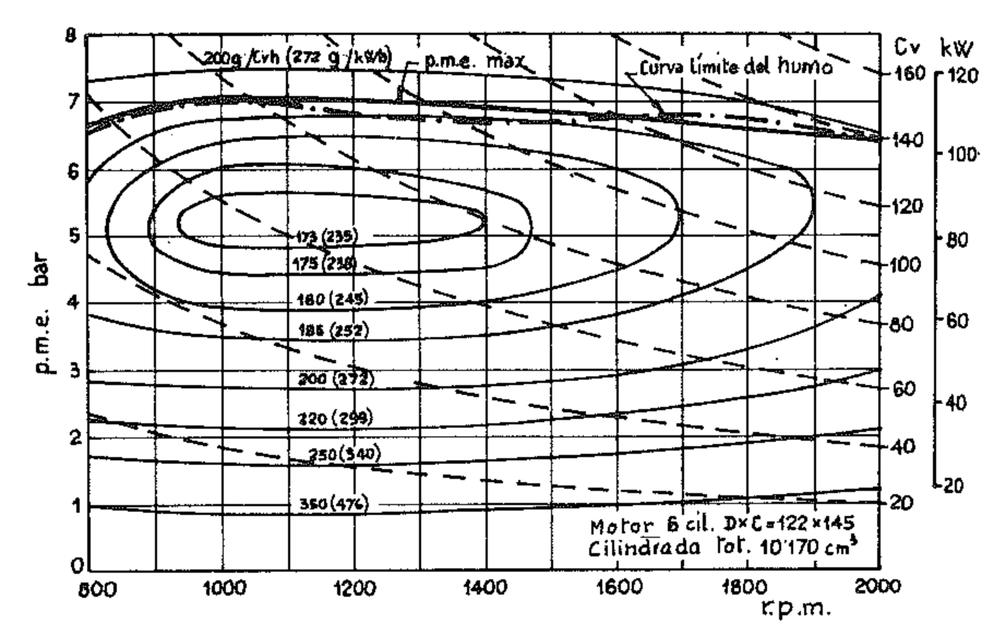{width=50%}

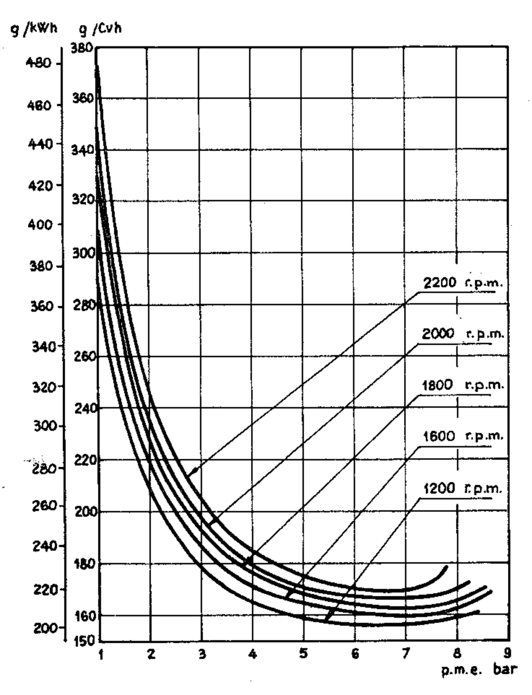{width=50%}

Como es sabido, un defecto común en el funcionamiento a plena carga es el humo en el escape, cuya causa principal es, como hemos dicho, la combustión incompleta del combustible introducido. El humo en el escape se mide generalmente en el banco de ensayos mediante aparatos especiales. Para cada motor, fijado el valor de la cantidad de humos admitida, se determina para todo el rango de revoluciones la introducción máxima de combustible y la correspondiente p.m.e., para ese nivel de humos en particular. La curva de la p.m.e. que resulta, comúnmente llamada curva al límite de humo, se traza sobre el plano acotado de los consumos (ver fig. 9). La curva de la p.m.e. máxima a la cual se tara el motor no debe superar en ningún punto la curva al límite de humo.

#### 8. Relación entre la potencia y las condiciones atmósfericas

Algunos parámetros que varían en función de la altura de funcionamiento y de las condiciones atmosféricas, es decir, la presión, la temperatura y el grado de humedad del aire atmosférico, influyen notablemente sobre las prestaciones de los motores.

Estudios y experiencias realizadas en motores de aviación en ambientes del aire, han confirmado que la potencia es directamente proporcional a la presión barométrica y a la raíz cuadrada de la temperatura absoluta. A esta conclusión puede también llegarse mediante el cálculo.

Con el fin de hacer comparables los datos de potencia obtenidas de los motores aunque se ensayen en diferentes condiciones de temperatura y presión ambiental, se ha establecido al referirlos a una atmósfera o aire patrón («standard»), es decir, a la presión de 1,013 bar (760 mm de mercurio) a la temperatura de 288 °K (15 °C). La fórmula adoptada es la siguiente:

$$P_0 = P_e \frac{p_0}{p} \sqrt{\frac{T}{T_0}}$$

donde:  $P_0$  = potencia en atmósfera standard en kW (o en Cv);

 $P_e$  = potencia obtenida al freno en kW (o en Cv);

p = presión atmósferica ambiente en mm de mercurio (o en bar);

 $p_0$  = presión normal de 760 mm de mercurio (1,013 bar);

 $T = \text{temperatura ambiente en } ^{\circ}\text{K};$ 

 $T_0$  = temperatura absoluta normal = 288 °K.

La expresión 
$$\frac{p_0}{p} \sqrt{\frac{T}{T_0}}$$
 se llama factor de corrección o de potencia.

En cuanto a la humedad, la corrección puede hacerse restando de la presión atmosférica la presión del vapor de agua ambiental y usando el valor que resulta en lugar del valor p en la fórmula de corrección. La figura 11 muestra la variación de la presión, de la temperatura y del factor de corrección al variar la altura.

EJEMPLO. — Calcular la pérdida porcentual de potencia, referida a la atmósfera standard, que sufre un motor de automóvil a la altura del puerto de montaña del Stelvio (2758 m).

De la tabla XI, para una altura de 2758, se tiene:

$$T = 270 \,\mathrm{°K}$$
 ;  $p = 723 \,\mathrm{mbar}$ .

Aplicando la fórmula

$$P_e = P_0 \frac{p}{p_0} \sqrt{\frac{\mathbf{T}_0}{T}},$$

se obtiene:

$$P_e = P_0 \cdot \frac{723}{1013} \sqrt{\frac{288}{270}} = P_0 \cdot 0.738.$$

La pérdida es de

$$(1 + 0.738) P_0 = 0.262 P_0$$
, es decir, del 26,2 %.

En líneas generales se puede considerar que las pérdidas de potencia debidas a la altura son de aproximadamente un 10 % por cada 1000 m de desnivel.

| Alturas m | Temp. "K | Presión |       | Den-           | Alturas | Temp. | Presión |       | Den-           |
|--------------|-------------|---------|-------|----------------|---------|-------|---------|-------|----------------|
|              |             | mm Hg   | bar   | sidad kg/m³ | m       | °K    | mm Hg   | bar   | sidad kg/m³ |
| 0            | 288         | 760     | 1,013 | 1,225          | 3500    | 265,4 | 493     | 0,657 | 0,863          |
| 200          | 286,8       | 742     | 0,989 | 1,202          | 4000    | 262,1 | 462     | 0,616 | 0,819          |
| 400          | 285,4       | 725     | 0.966 | 1,179          | 4500    | 258,9 | 433     | 0,577 | 0,777          |
| 600          | 284,2       | 707     | 0,942 | 1,156          | 5000    | 255,6 | 405     | 0,540 | 0,736          |
| 800          | 282,9       | 690     | 0,920 | 1,134          | 5500,   | 252,4 | 379     | 0,505 | 0,697          |
| 1000         | 281,6       | 674     | 0,898 | 1,112          | 6000    | 249,1 | 354     | 0,472 | 0,660          |
| 1200         | 280,3       | 658     | 0,877 | 1,090          | 6500    | 245,9 | 330     | 0,440 | 0,624          |
| 1400         | 279         | 642     | 0,856 | 1,070          | 7000    | 242,6 | 308     | 0,410 | 0,590          |
| 1600         | 277,7       | 626     | 0,834 | 1,048          | 7500    | 239,7 | 287     | 0,382 | 0,557          |
| 1800         | 276,4       | 611     | 0,814 | 1,027          | 8000    | 236,1 | 267     | 0,356 | 0,525          |
| 2000         | 275,1       | 596     | 0,794 | 1,007          | 8500    | 232,9 | 248     | 0,330 | 0,495          |
| 2200         | 273,8       | 582     | 0,776 | 0,987          | 9000    | 229,6 | 230     | 0,306 | 0,466          |
| 2400         | 272,5       | 567     | 0,756 | 0,967          | 9500    | 226,4 | 214     | 0,285 | 0,439          |
| 2600         | 271,2       | 553     | 0,737 | 0,947          | 10000   | 223,1 | 198     | 0,264 | 0,413          |
| 2800         | 269,9       | 539     | 0,718 | 0,928          | 10500   | 219,9 | 183     | 0,244 | 0,388          |
| 3000         | 268,6       | 526     | 0,701 | 0,909          | 11000   | 218,1 | 170     | 0,226 | 0,361          |

Table: Temperatura, presión y densidad del aire al variar la altura.

Cuando es necesario solucionar la pérdida de potencia causada por la disminución de la presión barométrica a causa de la altura, como sucede en el caso de los aviones, se recurre a la aplicación de un compresor para introducir en los cilindros una masa de aire en lo posible igual a la que el motor aspiraría a baja altura.

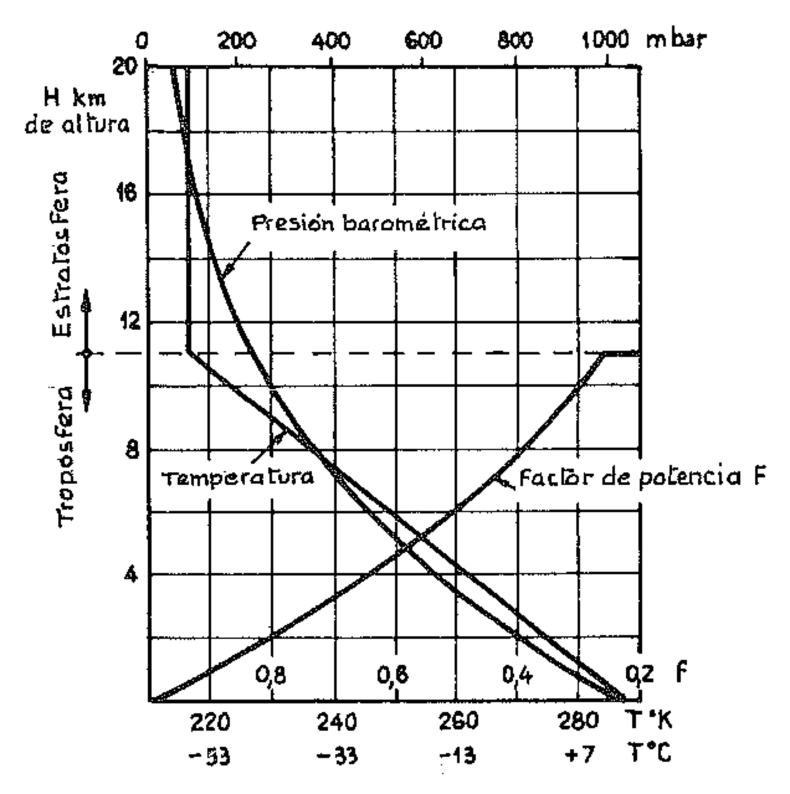{width=50%}

La presencia del compresor es una característica de los motores sobrealimentados, es decir, alimentados con una carga de aire o mezcla superior a la que correspondería a la cilindrada (ver capítulo XXII), mientras en el caso de los motores que funcionan a alturas importantes se trata de una alimentación con aire que de la condición de baja presión es llevado por el compresor a una densidad parecida o igual a la del nivel del mar. Para los motores de aviación lo ideal sería que el compresor proporcionara una presión constante al variar la altura de funcionamiento, teniendo también en cuenta la variación de la temperatura de modo que la masa de la carga fuera constante. Por esto el compresor centrífugo de los motores de aviación de gran potencia estaba provisto de un verdadero cambio de marchas, generalmente de dos velocidades, que se conectaban automáticamente según la altura.

#### 9. Velocidad media del pistón

La velocidad media del pistón está dada por:

$$u = \frac{C \cdot n}{3000}$$
 m/s.

donde C es la carrera expresada en cm y n es el número de revoluciones por minuto.

Un parámetro interesante es el grado de solicitación de los órganos principales, y da una idea del valor del rendimiento mecánico del motor. Hemos visto, hablando del rendimiento mecánico, cómo las pérdidas por rozamiento pueden atribuirse en gran parte al movimiento del pistón contra la pared del cilindro; la pérdida de potencia es entonces tanto más elevada cuanto mayor es la velocidad media del pistón.

Pero la importancia del parámetro u se manifiesta en muchos otros problemas relativos a la dinámica del motor; damos aquí dos ejemplos significativos:

a) Fuerzas de inercia. — Las fuerzas de inercia, giratorias y alternativas, están caracterizadas por el factor  $m \cdot \omega^2 \cdot r$ . Como podemos considerar la masa m proporcional al cubo del diámetro D del pistón y por lo tanto proporcional a la cilindrada V, puede escribirse la expresión de las fuerzas de inercia en la forma cualitativa:

$$F = K \cdot V \cdot \omega^2 \cdot r = K \cdot V \cdot \omega^2 \cdot \frac{C}{2} = K' \cdot V \cdot \omega^2 \cdot \frac{u}{n},$$

donde K y K' son constantes.

Se concluye que, entre dos motores de igual cilindrada y que funcionan a igual número de revoluciones, está sometido a mayores fuerzas inerciales, y por lo tanto a cargas más importantes, el motor cuyo pistón se mueve a mayor velocidad.

Se ve también, al comparar dos motores de dimensiones diferentes, que las fuerzas de inercia aumentan en el motor más grande no sólo por efecto del aumento de las masas en proporción directa con el aumento de la cilindrada, sino también por efecto del aumento que asume la velocidad del pistón si no se varía el valor de la razón  $\mu = C/D$ . De aquí que, aumentando las dimensiones, necesariamente debe reducirse la velocidad de rotación.

b) Calor extraído por la refrigeración. — Como índice de la refrigeración de un motor podemos asumir la razón q entre la cantidad de calor extraída con la refrigeración y la desarrollada, para cada cilindro.

Como la cantidad de calor extraída es proporcional al área de la superficie de transmisión, y por lo tanto al cuadrado del diámetro, mientras que la desarrollada es proporcional a la cilindrada unitaria, y en consecuencia, para un valor establecido de la relación  $\mu = \frac{C}{D}$ , al cubo del diámetro, la razón que resulta inversamente proporcional al diámetro D del cilindro. Además, dado que la cantidad de calor desarrollado es con buena aproximación proporcional al número de los ciclos en la unidad de tiempo, y por lo tanto igual al número de revoluciones por minuto del motor, mientras la cantidad de calor extraída es prácticamente independiente de las revoluciones, la razón q resulta también inversamente proporcional al número de vueltas n del motor. Se tiene así:

$$q = \frac{K}{n \cdot D}$$

donde K es una constante de proporcionalidad. Introduciendo en esta expresión la razón  $\mu = \frac{C}{D}$ , que es constante, y recordando la expresión de la velocidad media u se obtiene:

$$q = \frac{K}{n \cdot \frac{C}{u}} = \frac{K'}{n \cdot C} = \frac{K''}{u}$$

Esto significa que la razón entre la cantidad de calor extraída y la desarrollada, y por lo tanto el grado de refrigeración del motor, resulta inversamente proporcional a la velocidad media del pistón.

#### 10. Relación carrera: diámetro

Es tendencia general, especialmente notada en el campo de la autotracción, la de adoptar una relación  $\mu = \frac{C}{D}$  cercana o inferior a 1.

En particular, en los motores de 8 cilindros y en los motores de cilindros contrapuestos, es conveniente que sea menor que 1 por razones de voluminosidad y de peso.

También en los motores lentos para instalaciones estacionarias o fijas, en los cuales la velocidad media del pistón puede ser mantenida en los límites de seguridad deseados incluso con carreras largas, resulta conveniente, dentro de ciertos límites, acortar la carrera.

En el campo de las pequeñas cilindradas el motor de carrera corta («cuadrado» o «supercuadrado») ofrece sobre los motores de carrera larga de igual cilindrada numerosas ventajas, que brevemente podemos resumir como sigue:

- 1) la potencia del motor aumenta, como sabemos, con la 2.ª potencia del diámetro, mientras en la práctica aumenta sólo con exponente 0,5 ó 0,6 de la carrera;
- 2) Se tiene la posibilidad de una mejor disposición de las válvulas y de las bujías porque la cabeza del cilindro es más amplia y las válvulas pueden ser de mayor diámetro;
- 3) la velocidad media del pistón disminuye, a igualdad del número de revoluciones;
- 4) se reducen las fuerzas centrífugas y alternativas. La práctica confirma que la ventaja que se deriva de la carrera menor supera la desventaja de la mayor masa de los órganos en movimiento;
- 5) el cigüeñal y los cojinetes resultan menos solicitados porque se reducen las fuerzas de inercia y el eje motor es más rígido. En efecto, debido a la menor longitud de las manivelas, es fácil que los pasadores de bancada se trasladen con los de manivela, robusteciendo el cigüeñal.

(Es verdad que con el aumento del diámetro aumenta la carga sobre el pistón pero cuando los regímenes son elevados, como en el caso de motores para los autovehículos, la carga sobre el cojinete tiene preponderancia debido a las fuerzas de inercia.)

- 6) A igualdad de potencia, los motores con cilindros contrapuestos o en V tienen menor peso y volumen.

Por el contrario, los motores de carrera larga presentan a igualdad de cilindrada y número de cilindros algunas ventajas desde el punto de vista esencialmente térmico, tales como la forma más compacta, y por lo tanto de mayor rendimiento, de la cámara de combustión, y la mayor capacidad de refrigeración del pistón y del cilindro por efecto de la mayor razón superficievolumen.

A veces por razones de espacio conviene una carrera más larga que la que podría ser aconsejable desde el punto de vista puramente motorístico mientras otras veces, por la misma razón, conviene adoptar una razón C/D < 1.

EJEMPLO. — Determinar aproximadamente las dimensiones (carrera y diámetro) que hay que asignar a un motor Diesel rápido de 6 cilindros, 4 tiempos, de un camión para el cual se necesita una potencia máxima de 110 kW (150 Cv) a 2000 rpm, sabiendo que a dicho régimen se prevé poder obtener una  $p_e$  de 6,6 bar (kg/cm²).

Cilindrada total:

$$V = \frac{300 \ h \cdot P_e}{p_e \cdot n} = \frac{300 \times 4 \times 110}{6.6 \times 2000} = 10 \ dm^3 = 10 \ 000 \ cm^3.$$

Cilindrada unitaria:

$$V_p = \frac{V}{i} = \frac{10\ 000}{6} = 1666\ \text{cm}^3.$$

Poniendo:

$$\mu = \frac{C}{D} = 1.2,$$

se tiene:

$$V_p = \frac{\pi \cdot D^2}{4} C = \frac{\pi \cdot D^2}{4} 1.2 D.$$

De donde:

$$D = \sqrt[3]{\frac{4 V_p}{1.2 \cdot \pi}} = \sqrt[3]{\frac{4 \times 1666}{3.77}} = 12.1 \text{ cm}.$$

En consecuencia:

$$C = 1.2 D = 1.2 \times 12.1 = 14.5 \text{ cm}.$$

#### 11. Dimensiones del cilindro

Sabemos que la potencia efectiva puede expresarse con la fórmula:

$$P_e = \frac{p_e \cdot V \cdot n}{300\ 000 \cdot h}$$

donde  $P_e$  está dada en kW,  $p_e$  en bar, V en cm3 y n en rpm. Expresando V en función de la carrera C y del diámetro D del cilindro, ambos medidos en cm, y del número i de cilindros, puede escribirse:

$$P_e = \frac{p_e \cdot \pi \cdot D^2 \cdot D \cdot i \cdot n}{4 \times 300\ 000\ h};$$

y sustituyendo n por su valor expresado en función de la velocidad media del pistón en m/s:  $n = \frac{3000 \cdot u}{C}$  se tiene:

$$P_e = \frac{p_e \cdot \pi \cdot D^2 \cdot i \cdot u}{400 \times h} \; ;$$

Se deduce que: a igualdad de velocidad media del pistón y de presión media efectiva, la potencia de un motor aumenta con el cuadrado del diámetro del pistón.

De la expresión anterior puede obtenerse el valor del diámetro D:

$$D = \sqrt{\frac{127.32 \cdot h \cdot P_e}{p_e \cdot u \cdot i}}$$

Consideremos ahora dos motores de igual diseño, pero a diferentes escalas; sea s la razón entre las dos escalas. Si los rendimientos volumétricos fuesen iguales, la cantidad de fluido admitido en cada cilindro sería proporcional a las cilindradas de ambos motores y, suponiendo iguales los rendimientos termodinámicos, los dos motores desarrollarían, a igual número de revoluciones, potencias proporcionales a sus cilindradas. En la práctica esto no sucede porque los rendimientos volumétricos no son iguales. En efecto, tomando en consideración las velocidades W de los gases a través de las válvulas, podemos escribir  $A_s \cdot u = A_v \cdot W$  donde  $A_s = \frac{\pi \cdot D^2}{4}$  es el área del pistón y  $A_v$  es la sección útil de paso de la válvula; ésta puede ser expresada como una fracción del área del pistón:  $A_v = \frac{A_s}{K}$ , por lo que se tendrá:

$$A_s \cdot u = \frac{A_s}{K} W \; ; \; W = K u.$$

Si con el índice ' indicamos los datos del motor más grande tenemos:

$$\frac{W'}{W} = \frac{u'}{u}$$

y como

$$u = \frac{C \cdot n}{30}$$
y  
$$ \quad u' = s \cdot C$$
se tiene
$$\frac{W'}{W} = \frac{s \cdot C \cdot n}{C \, n} = s$$

Vemos por lo tanto que la velocidad de los gases en el motor grande es s veces mayor que la velocidad de los gases en el motor pequeño, por lo cual el rendimiento volumétrico es menor.

Además, a igualdad de otras condiciones (temperatura, presión, turbulencia y dosificación del combustible) y suponiendo en primera aproximación que la velocidad de combustión no depende del diámetro del pistón, resulta que el tiempo necesario para la combustión completa, dado el mayor espacio que debe recorrer la llama, es s veces mayor en el motor grande que en el pequeño.

También por estas razones, además de por lo que se dirá a propósito de la carga sobre los cojinetes (párrafo XI.6), se puede concluir que los motores de gran cilindrada unitaria no pueden funcionar a regímenes tan elevados como los de los motores de menor cilindrada unitaria. De aquí que la potencia específica (por litro de cilindrada) es mayor para los motores pequeños que para los grandes (1). Esto vale a igualdad de número de cilindros, porque, a igualdad de cilindrada, en los motores con mayor número de cilindros resultan mayores las pérdidas por rozamiento mecánico.

#### 12. Número de revoluciones

Es obvio que entre dos motores de igual cilindrada, funcionando a regímenes diferentes y teniendo tales regímenes el mismo grado de llenado de los cilindros, resulta de mayor potencia el motor más rápido. En efecto, la cantidad de aire y de combustible introducidos es proporcional al número de revoluciones.

Por lo tanto se adoptan altos números de revoluciones, dentro de los límites permitidos por la velocidad media del pistón y por la regularidad de funcionamiento de las válvulas, cuando se desea obtener altos valores de la relación potencia/peso, o grandes potencias con pequeñas dimensiones.

(1) En el motor grande, es decir, a gran diámetro del pistón, las dificultades de refrigeración son mayores, y el rendimiento de la cámara de combustión tiende a disminuir.

Con frecuencia la elección del número de revoluciones es consecuencia del destino del motor.

Por ejemplo en aeronáutica la velocidad máxima de rotación de la hélice a la cual el rendimiento aerodinámico se mantiene bueno, está relacionada con su diámetro, el que a su vez depende en parte de exigencias de proyecto del aparato: si no se quiere hacer uso de reductores o si se deben adoptar reductores no muy voluminosos, el motor ha de tener una velocidad de rotación limitada. Lo mismo puede decirse para los motores marinos.

El funcionamiento en un rango amplio de velocidades de rotación es una característica de los motores para autovehículos: lo contrario es característico de los motores para instalaciones fijas, para aviación y para tracción ferroviaria.

El régimen mínimo depende sobre todo del número de cilindros, del momento de inercia del volante, de la regulación del carburador o de la bomba de inyección y del sistema de encendido, mientras el régimen máximo admitido depende del peso de las partes dotadas de movimiento alternativo, del tipo de encendido, de la sección de los conductos de aspiración y escape, de las dimensiones y número de los carburadores o del sistema de inyección, así como también de la refrigeración, de la lubricación y de la resistencia de los materiales.

Por las razones recién enumeradas y por otras que mencionaremos en lo que sigue, el motor debe funcionar a un cierto número de revoluciones tanto más bajo cuanto mayor es su cilindrada unitaria, cuanto mayor deba ser su grado de seguridad y de duración y cuanto más silencioso haya de ser su funcionamiento.

### 13. Número y disposición de los cilindros

El número de cilindros se escoge en base a varias consideraciones relacionadas con las características de instalación y el tipo de prestaciones requeridas del motor en los límites impuestos por el costo de fabricación preestablecido.

Consideremos a igualdad de cilindrada total las dos diferentes soluciones:

- Muchos cilindros de pequeña cilindrada unitaria,
- Pocos cilindros de gran cilindrada unitaria.

La primera solución tiene en primera aproximación las siguientes ventajas frente a la segunda:

- Posibilidad de conseguir potencias específicas superiores aumentando el máximo número de revoluciones del motor;
- Mejor rendimiento térmico porque el diámetro menor permite el uso de mayores relaciones de compresión, y por lo tanto reducción de los consumos específicos;
- Mayor facilidad de refrigeración;
- Mayor uniformidad del par motor porque la diferencia entre el valor máximo y mínimo que el par motriz asume durante el desarrollo de un ciclo completo de trabajo disminuye, a igualdad de las demás condiciones, con el aumento del número de cilindros;

- Mejor equilibrado de las masas y por lo tanto reducción de las vibraciones.

Por otra parte presenta las desventajas siguientes:

- Aumento de la longitud del cigüeñal en los motores con cilindros en línea, con todos los problemas relacionados con las vibraciones torsionales;
- Empeoramiento del rendimiento mecánico y por tanto reducción de potencia y aumento de los consumos específicos;
- Aumento del costo de producción por las mayores complicaciones mecánicas en la realización del motor;
- En algunos casos mayor volumen y mayor masa.
- Aumento del gasto de mantenimiento y revisión.

Muy relacionada con el problema del número de cilindros está la disposición de los mismos. Son numerosas las posibilidades de disponerlos racionalmente y entre éstas mencionamos las más significativas, representadas esquemáticamente en la figura 12:

- Cilindros en línea (a),
- Cilindros en dos líneas contiguas (b),
- Cilindros dispuestos en V (c),
- Cilindros dispuestos en W (d),
- Cilindros dispuestos en H (e),
- Cilindros contrapuestos ejes cilindros a 180° (f),
- Cilindros dispuestos según los lados de un polígono: en triángulo, cuadrado, en hexágono (g, h, i),
- Cilindros dispuestos en X (l),
- Cilindros en estrella (simple o varias) (motor radial) (m),
- Cilindros en haz, paralelos al eje motor (n).

## 14. Estabilidad de funcionamiento del motor

Consideremos un motor en régimen, es decir, en condiciones de funcionamiento tales que la velocidad de rotación se mantenga constante y toda la potencia disponible en el cigüeñal sea absorbida por un momento resistente constante. Si, por cualquier razón, el momento resistente, que llamaremos  $M_r$ , disminuye asumiendo el valor  $M'_r$ , de improviso queda disponible en el cigüeñal un momento  $M_d = M_r - M'_r$ ; y como el sistema tiene que estar siempre en equilibrio, este momento imprime una aceleración al conjunto motor - máquina impulsada, venciendo la inercia según la conocida relación:

$$M_d = M_i \cdot \epsilon'$$

donde  $M_i$  es el momento de inercia del sistema y  $\in$  ' es la aceleración angular.

A medida que el árbol acelera, el sistema se desplaza hacia un nuevo régimen de equilibrio que se alcanzará cuando el producto del nuevo momento resistente por la nueva velocidad de régimen sea igual a la nueva potencia del motor; decimos nueva potencia porque, aunque no haya variado la regulación de la alimentación del motor, la potencia habrá asumido otro valor, a causa de la variación del número de revoluciones, según la forma de la curva característica correspondiente a ese grado de regulación.

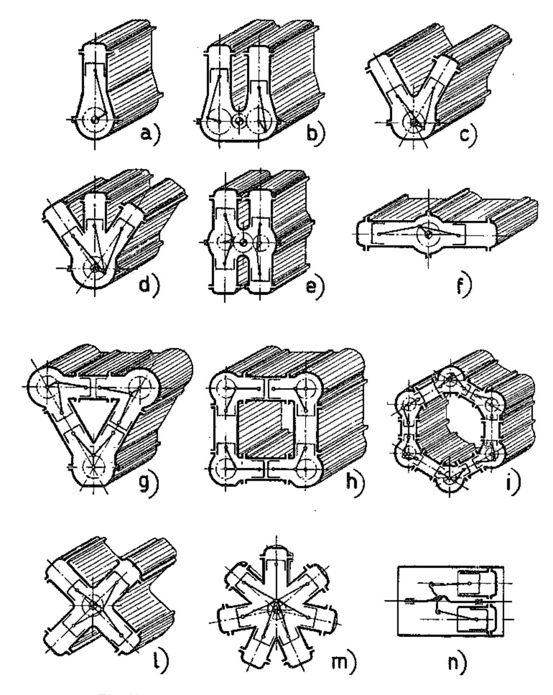{width=50%}

No siempre sin embargo sucede que el nuevo régimen de equilibrio pueda ser alcanzado, y esto depende justamente de la forma de las curvas características. En efecto, en el caso en que la curva de los momentos de valores crecientes o constantes con el aumento de las revoluciones se tiene que a un aumento de velocidad, causado incluso por una mínima disminución del momento resistente, no puede corresponder una nueva condición de equilibrio porque al aumentar la velocidad aumenta, o no disminuye, el momento equilibrante por lo que el número de revoluciones tiende a aumentar cada vez más. En estas condiciones se dice que el funcionamiento del motor es inestable.

Si, al contrario, el momento motriz disminuye al aumentar el número de revoluciones se crea seguramente una nueva condición de equilibrio.

En estas condiciones el funcionamiento es estable y se dice que el motor es elástico.

En conclusión: un motor es estable, y por lo tanto autorregulable, cuando la curva de su momento motriz es decreciente con el aumento del número de revoluciones, es decir, cuando la derivada  $\frac{dM}{dn}$  es negativa, y lo será más cuanto mayor sea el valor absoluto de esta derivada. En cambio es inestable y por lo tanto no autorregulable cuando esta derivada es positiva.

Para los autovehículos es deseable que el motor sea elástico, es decir, que su par vaya aumentando al disminuir el número de revoluciones porque, al reducirse la velocidad como consecuencia de un aumento de la resistencia que el vehículo puede encontrar en su marcha, el motor puede responder con un esfuerzo mayor.

Para hacer más elástico un motor de encendido por chispa para automóvil es necesario disminuir las dimensiones de los conductos de aspiración para desplazar hacia los regímenes bajos la conocida condición de máximo rendimiento volumétrico: en consecuencia la curva de la potencia se rebaja y queda más llana. Por lo tanto, sólo se consigue un mayor grado de elasticidad, a igualdad de otras condiciones, a costa de la potencia máxima o bien, si se quiere mantener el mismo valor de la potencia máxima, aumentando la cilindrada.

En la figura 13 se han trazado las curvas características típicas de un motor de automóvil. Podemos distinguir tres condiciones especiales de funcionamiento:

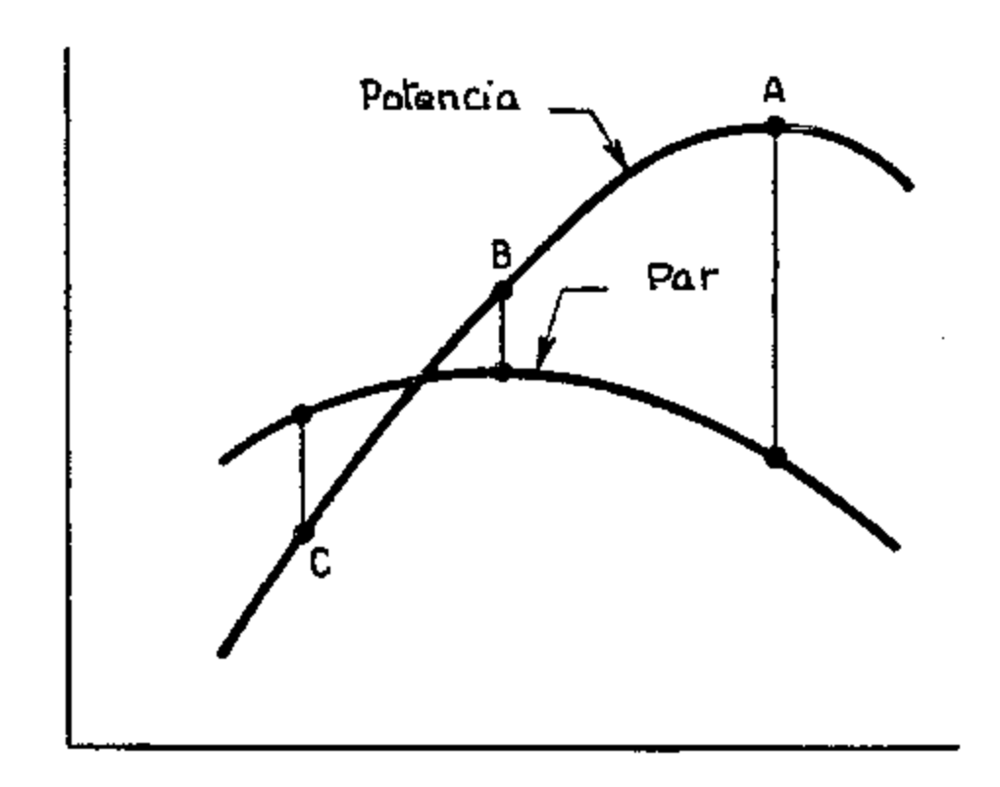{width=50%}

- 1) Motor utilizado a la máxima potencia: punto A. Si un aumento del momento resistente lo hace disminuir de régimen, el par motor aumenta a fin de satisfacer las nuevas demandas; si el motor acelera por disminución del momento resistente, el par motor se reduce también. El motor es por lo tanto estable y autorregulable.
- 2) Motor utilizado a media potencia: punto B. La curva del par tiene en esta zona pequeñas variaciones, por lo que el estado de equilibrio se alcanza con fuertes variaciones de velocidad. Éste es el caso de los motores Diesel en general, cuyo par motor varía poco dentro de todo el rango de utilización.

Por lo tanto el motor es inestable; el equilibrio sólo puede alcanzarse con diferencias de velocidad que generalmente no son aceptables.

- 3) Motor utilizado a baja potencia: punto C. — Ante cada variación del par resistente el motor reacciona con variaciones del par motor en sentido opuesto al requerido. El momento es inestable y no autorregulable porque, si el par resistente disminuye, sólo puede encontrarse el estado de equilibrio a un régimen muy lejano, es decir, a un número de revoluciones demasiado alto; al contrario, si el par resistente aumenta, el motor se detiene.