# 5. Fuerzas alternativas de inercia

En la relación general:

$$F_a = -m_a \cdot a$$

sustituyendo a por la expresión (1) del párrafo 3, obtenemos la fuerza de inercia debida a las masas alternativas:

$$F_a = -m_a \cdot \omega^2 \cdot r (\cos \alpha + \lambda \cos 2 \alpha) (i)$$

En esta expresión el factor entre paréntesis está formado por dos términos, es decir, cos  $\alpha$  y  $\lambda$  cos 2  $\alpha$ , cada uno de los cuales expresa una función senoidal. Dibujando las curvas que reflejan las variaciones de su valor (figura 1), se encuentra, como por otra parte puede deducirse de sus expresiones matemáticas, que el segundo término tiene una frecuencia el doble que la del primero, lo que significa que en un tiempo dado asume el valor cero y su valor máximo el doble de veces que el primer término.

La expresión  $m_a \omega^2 \cdot r \cdot \cos \alpha$  representa la fuerza alternativa de inercia de primer orden y equivale a toda la fuerza de inercia en el caso imaginario de una biela de longitud infinita. El 2.º término  $m_a \omega^2 \cdot r \cdot \cos 2\alpha$  constituye la fuerza alternativa de inercia de segundo orden y es igual a cero en el caso imaginario de la biela de longitud infinita.

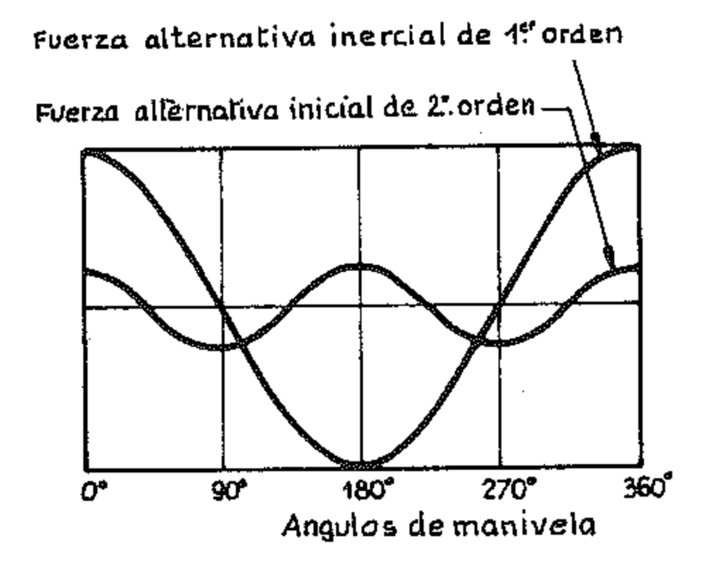

Recordemos que según el sistema de medida internacional SI la unidad de medida de la masa es el kg y la de la fuerza el newton (N). 1 N =  $\frac{1 \text{ kg}}{9,80665}$ , kg = 9,806 N.

(1) Como puede verse también las fuerzas alternativas de inercia tienen una expresión del tipo  $F_a = f(m \omega^2 r)$  como las fuerzas centrífugas; cosa, por otra parte, previsible, porque ambas son fuerzas de inercia que se originan, en sustancia, en un movimiento rotatorio. Este hecho, sin embargo, no debe crear confusión entre las dos fuerzas de inercia (alternativas y rotatorias).

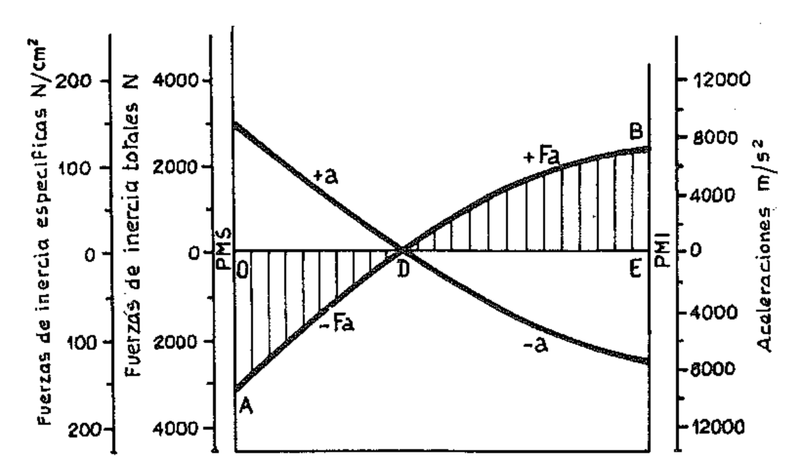

Las fuerzas alternativas de inercia son una de las causas principales de vibraciones de los motores y veremos a continuación cómo este efecto nocivo de ellas puede ser neutralizado completamente o en parte.

El diagrama de las fuerzas alternativas de inercia se obtiene fácilmente cambiando de signo todas las ordenadas del diagrama de las aceleraciones y multiplicando por el valor de la masa de las partes con movimiento alternativo. Así, simplemente invirtiéndolo, el mismo diagrama de las aceleraciones de la figura 115 puede representar, a una escala adecuada, como se indica en la figura 2, el de las fuerzas alternativas. En esta figura se indica además la escala de las fuerzas de inercia específicas (fuerzas de inercia/área del pistón) a las cuales frecuentemente conviene referirse.

El área del diagrama de las fuerzas alternativas, achurada en la figura 2, representa el trabajo realizado por las fuerzas de inercia; puede demostrarse fácilmente que este trabajo es nulo para cada medio giro de la manivela, por lo que las áreas OAD y BED son equivalentes.

# 6. Diagrama de las fuerzas resultantes

La fuerza resultante, dirigida a lo largo del eje del cilindro, que en cada instante actúa sobre los órganos del conjunto biela-manivela, se obtiene haciendo la composición de los valores que en ese instante asumen la fuerza debida a la presión del fluido de trabajo sobre el pistón y la fuerza alternativa de inercia.

Según que estas componentes estén dirigidas en el mismo sentido o en sentido contrario, la fuerza resultante es su suma o bien su diferencia. Así, por ejemplo, al comienzo de la carrera de expansión, la fuerza alternativa de inercia se opone a la debida a la presión de los gases (fig. 3), por lo tanto el empuje transmitido por el pistón al cigüeñal se reduce en una cantidad igual a la fuerza de inercia de las masas alternativas. La reducción es especialmente importante cuando el motor gira a altas velocidades.

Gráficamente puede obtenerse el diagrama de las fuerzas resultantes simplemente componiendo el diagrama de las fuerzas debidas a la presión del gas con el de las fuerzas alternativas de inercia.

Con este procedimiento se ha trazado el diagrama de la figura 4, para un motor monocilíndrico de ciclo Otto y 4 tiempos.

Tanto las fuerzas debidas a la presión de los gases como las inerciales han sido divididas por el área del pistón y por lo tanto están medidas en bar teniendo las mismas dimensiones que una presión; se las considera positivas cuando su dirección coincide con la de la velocidad del pistón, negativas en caso contrario.

La línea de puntos y rayas representa el diagrama de las presiones ejercidas por los gases sobre el pistón, presiones cuyo valor, en función de la posición del pistón, está dado por el ciclo indicado del motor.

La línea de trazos representa, en cambio, el diagrama de las fuerzas específicas de inercia, que puede obtenerse, por ejemplo, de la manera descrita en el párrafo anterior.

La línea continua es el diagrama resultante obtenido de la composición del diagrama de trazos con el de puntos y rayas.

Analizando las diferentes fases del ciclo, notamos que durante la carrera de admisión o aspiración, prácticamente actúa únicamente la fuerza de inercia de las masas alternativas porque la fuerza debida a la ligera depresión que se crea en el cilindro es de magnitud despreciable. En la segunda carrera, moviéndose el pistón de abajo hacia arriba, el diagrama de las fuerzas de inercia se invierte y la presión debida a la compresión se opone evidentemente al movimiento del pistón. En la primera parte de la carrera de expansión, como ya se ha dicho, la fuerza de inercia se opone a la presión de combustión. En la carrera de escape el cilindro está en comunicación con el exterior, los gases quemados ofrecen una resistencia mínima al movimiento del pistón y por lo tanto sobre la manivela actúa prácticamente sólo la fuerza de inercia.

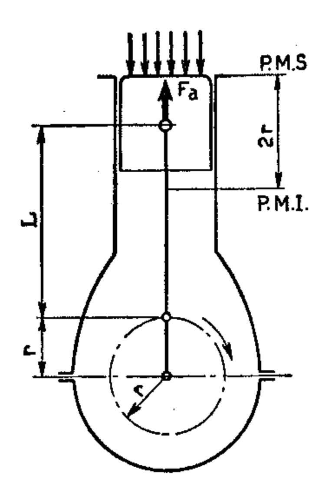

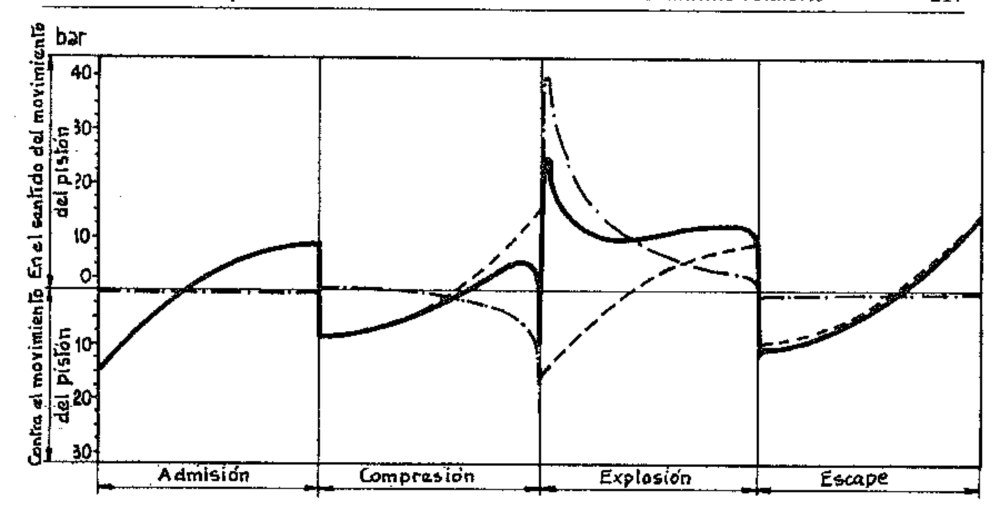

Con el fin de poner en evidencia la importancia que las fuerzas de inercia tienen a los diferentes regímenes de funcionamiento del motor se han trazado en la figura 5 los diagramas resultantes correspondientes a los regímenes de 1000, 2200, 4400 rpm para el mismo motor monocilíndrico de la figura 4, considerando constante el diagrama indicado.

Del examen de la figura se observa que a bajo régimen (a) prevalecen las fuerzas definidas por el diagrama indicado; a medio régimen (b) las fuerzas de inercia comienzan a ser apreciables, reduciendo ligeramente las solicitaciones debidas a las presiones máximas del ciclo; a las altas velocidades (c) las fuerzas de inercia asumen importancia cada vez mayor, regularizando el diagrama resultante y rebajando el valor de la carga máxima sobre los cojinetes, pero aumentando notablemente la carga media.

Hay que notar que para motores pesados y rápidos (como por ejemplo antiguos motores de carrera) a los regímenes muy altos las fuerzas de inercia tienen una importancia preponderante sobre las forma del diagrama resultante, especialmente en las fases no activas, haciéndolo aún más irregular.

Se concluye que en los motores de grandes dimensiones, en los que las partes dotadas de movimiento alternativo son notablemente pesadas, la velocidad de rotación no puede asumir valores muy elevados y en los motores rápidos la magnitud de las masas alternativas habrá de ser tanto menor cuanto mayor sea el régimen, compatiblemente con las solicitaciones del material.

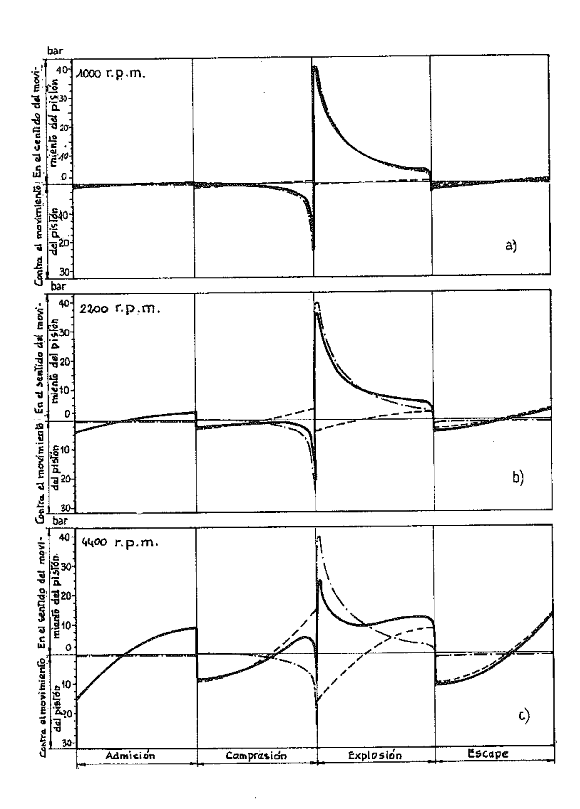

## 7. Diagrama del par motor

La fuerza resultante F sobre el pistón, suma de la fuerza alternativa de inercia  $F_a$  y de la debida a la presión de los gases  $F_g$ , está equilibrada por las reacciones de la biela y de la pared del cilindro. De esto resulta (fig. 6) que sobre la biela-actúa-la fuerza  $F_b$  dirigida según su eje y hacia el perno de la manivela, de intensidad dada por:

$$F_b = \frac{F}{\cos \beta}$$

y sobre la pared del cilindro la fuerza  $F_n$  dirigida perpendicularmente hacia la pared misma, de intensidad:

$$F_n = F \cdot \operatorname{tg} \beta$$

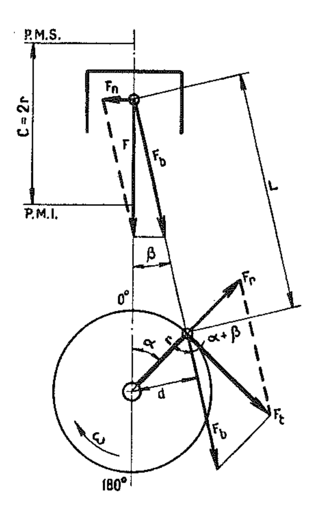

La componente  $F_n$  que, como resulta de la fórmula, es tanto mayor cuanto mayor es el ángulo  $\beta$ , es evidentemente la razón de la pérdida de potencia causada por el rozamiento entre el pistón y la pared del cilindro.

La componente  $F_b$  es en cambio transmitida por la biela al codo del cigüeñal y por lo tanto al cigüeñal.  $F_b$  actúa con respecto al eje de rotación con un brazo  $d = r \operatorname{sen} (\alpha + \beta)$ , de modo que origina el momento motor  $M_t$  de intensidad:

$$M_t = F_b \cdot d$$

Sustituyendo  $F_b$  y d por sus valores se obtiene:

$$M_t = \frac{F}{\cos \beta} r \cdot \sin (\alpha + \beta) = F \cdot r \left[ \sin \alpha + \cos \alpha \frac{\sin \beta}{\cos \beta} \right]$$

Recordando que sen  $\beta = \lambda$  sen  $\alpha$ , y que cos  $\beta = \sqrt{1 - \lambda^2 \sin^2 \alpha}$ , se tiene:

$$M_t = F \cdot r \left[ \operatorname{sen} \alpha + \frac{\lambda \cdot \operatorname{sen} \alpha \cdot \cos \alpha}{\sqrt{1 - \lambda^2 \operatorname{sen}^2 \alpha}} \right],$$

y, despreciando el término  $\lambda^2$  sen2  $\alpha$ , se tiene en definitiva:

$$M_t = F \cdot r \left[ \operatorname{sen} \alpha + \frac{\lambda}{2} \operatorname{sen} 2 \alpha \right]$$

La misma expresión del momento motor puede obtenerse descomponiendo la fuerza  $F_b$  en una componente radial  $F_r$  y una tangencial  $f_t$ .

La primera,  $F_r$ , evidentemente no contribuye al momento motriz, mientras la segunda,  $F_t$ , actúa con un brazo r constante. El momento motriz vale:

$$M_t = F_t \cdot r$$

De la figura se tiene inmediatamente:

$$F_t = F_b \operatorname{sen} (\alpha + \beta)$$

y por lo tanto:

$$M_t = F_b \cdot r \operatorname{sen} (\alpha + \beta)$$

De este modo, o bien repitiendo la construcción gráfica de la figura 6, es fácil trazar en función de  $\alpha$  el diagrama del par motor  $M_t$  el cual, como ya sabemos, se anula para  $\alpha = 0$  y  $\alpha = \pi$  (1).

En la figura 7 se ha trazado el diagrama del par motor para un motor monocilíndrico de 4 tiempos. La forma del diagrama revela el desarrollo

(1) Si los valores de F se han obtenido de los diagramas de las figuras 4 y 5, multiplicando el valor de la carga resultante leído en los diagramas por el área del pistón, y F se toma con el signo que la carga tiene en los diagramas, el valor de la expresión  $\left( \sin \alpha + \frac{\lambda}{2} \sin 2 \alpha \right)$  para el cálculo de M, debe considerarse sólo como valor absoluto (o sea, M, toma siempre el signo de F así calculado).

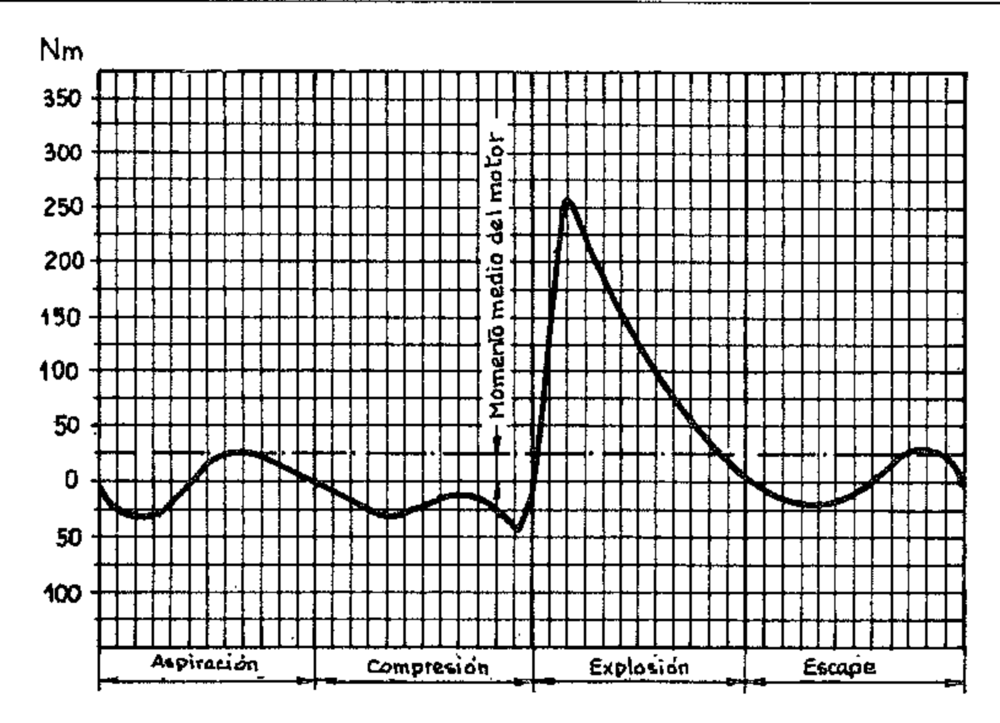

pulsante (puesto ya por otra parte en evidencia por las expresiones analíticas correspondientes) que puede ser causa de irregularidades de marcha y de vibraciones del motor. La suma algebraica de las áreas positivas y negativas del diagrama representa el trabajo motriz realizado en un ciclo; igualando su área a la de un rectángulo que tiene la misma abscisa como base (2 vueltas =  $4 \pi$  en el caso de la figura) la altura del rectángulo representa el valor medio del par motor (momento motriz medio) (1).

Resulta claro que en un motor monocilíndrico de 4 tiempos, en el cual se tiene una sola fase útil cada dos vueltas, el valor de la ordenada máxima es mucho mayor que el de la ordenada media.

## 8. Repartición de los ciclos en los motores de varios cilindros

En el caso de motores de varios cilindros, para regularizar el par motor y hacer en consecuencia más uniforme el movimiento del cigüeñal y más regular la marcha del motor, se hace de modo que los ciclos de los diferentes cilindros se sucedan a iguales intervalos angulares: esto se obtiene disponiendo las manivelas del cigüeñal de modo que las correspondientes a dos ciclos consecutivos estén desfasadas en un ángulo que, como es fácil deducir, está dado en grados por la relación:

(¹) Observamos que las fuerzas de inercia no tienen influencia sobre el valor medio del par motor en cuanto el trabajo es nulo para cada media vuelta de la manivela; estas fuerzas influyen en cambio sobre los valores instantáneos que asume el par motor.

$$\vartheta = 180 \frac{h}{i}$$
 y en radianes por  $\vartheta = \pi \frac{h}{i}$ 

donde h es el número de tiempos e i es el número de cilindros.

Esta regla es válida tanto para los motores con cilindros en línea como para los motores con varias líneas de cilindros siempre que el ángulo entre los planos en los que yacen los cilindros sea también igual a v. Sin profundizar en el problema, hacemos notar que ésta no es la única condición que satisface la repartición uniforme de los ciclos en los motores con varias líneas de cilindros.

En el caso de los motores radiales («estrella»), en los cuales hay una sola manivela, el desfase entre los ciclos está dado por la misma disposición radial de los cilindros: en ellos el ángulo de desfase entre las manivelas está sustituido por el que se tiene entre los cilindros.

En estas condiciones, en el campo de los motores de 4 tiempos, se tiene para un motor de 2 cilindros una fase útil por vuelta ( $\vartheta = 2\pi$ ); para uno de 4 cilindros una cada media vuelta ( $\vartheta = \pi$ ) para uno de 8 cilindros una cada cuarto de vuelta ( $\vartheta = \pi/2$ ) y análogamente. Resulta por lo tanto comprensible la ventaja que se obtiene con el aumento del número de cilindros, considerando que se hace cada vez menor la separación entre la ordenada máxima y la media del par motor.

La relación entre el valor máximo y el medio del par motor es un índice del grado de irregularidad del motor; a modo de ejemplo (fig. 8) reproducimos algunos diagramas del par motor para motores de 4 tiempos con los cilindros de iguales dimensiones, pero en números diferentes, y funcionando al mismo régimen. Los valores de las razones entre par máximo y medio son los siguientes:

- 1 cilindro 10,3 - 5 cilindros 2,33 - 2 cilindros 4,45 - 6 cilindros 1,65 - 3 cilindros 3,47 - 8 cilindros 1,49 - 4 cilindros 2,95

La frecuencia con la que se repite el valor máximo de  $M_r$  para un motor de 2 tiempos es igual a la de uno de 4 tiempos con el doble número de cilindros.

#### 9. El volante

Aunque el valor medio del par motor sea igual al valor medio del momento resistente, la velocidad de rotación del motor y de las masas a él unidas no se mantiene constante durante el sucederse de los ciclos.

De hecho, como el par motor varía durante cada ciclo en los intervalos de tiempo durante los cuales es mayor que el momento resistente, el exceso de trabajo motriz es acumulado por el sistema en rotación en forma de energía cinética y la velocidad de rotación aumenta hasta alcanzar un valor máximo; y en los intervalos de tiempo durante los cuales el par motriz es menor que el momento resistente, la energía acumulada en forma de energía cinética es restituida por el sistema en rotación cuya velocidad de rotación desciende hasta un valor mínimo.

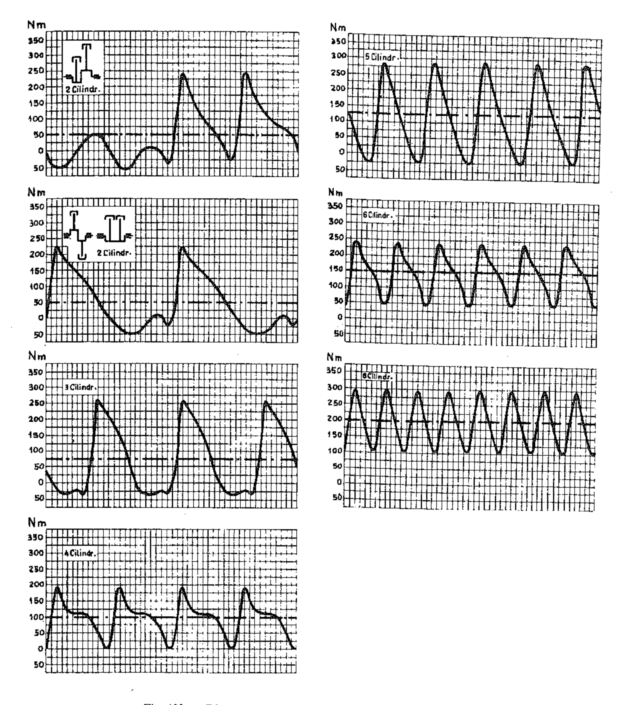

Indicando con  $M_i$  el momento de inercia de las masas en rotación, con  $\omega_2$  el valor máximo de la velocidad angular y con  $\omega_1$  el mínimo, la máxima variación de energía cinética del sistema vale:

$$\Delta E = \frac{1}{2} \cdot M_i \left( \omega_2^2 - \omega_1^2 \right)$$

Con buena aproximación, dado que los valores de  $\omega_2$  y  $\omega_1$  son en general bastante próximos entre sí y a la velocidad media  $\omega$ , podemos escribir:

$$\omega = \frac{\omega_2 + \omega_1}{2}$$

Para cada número de revoluciones se llama grado de irregularidad  $\delta$  a la razón entre la diferencia entre las velocidades de rotación máxima y mínima y la velocidad media, o sea:

$$\delta = \frac{\omega_2 - \omega_1}{\omega}$$

La expresión de  $\Delta E$  se puede escribir:

$$\Delta E = \frac{1}{2} M_i (\omega_2 + \omega_1) (\omega_2 - \omega_1) = M_i \frac{\omega_2 + \omega_1}{2} (\omega_2 - \omega_1)$$

y como  $\omega_2 - \omega_1 = \omega \cdot \delta$ ,  $\Delta E = M_i \omega^2 \delta$ , se tiene:

$$\delta = \frac{\Delta E}{M_i \cdot \omega^2}$$

Puesto que, como hemos dicho antes, la variación  $\Delta E$  de energía cinética del sistema es igual a la diferencia entre el trabajo motor y el resistente, se ve inmediatamente que su valor es tanto más grande cuanto mayor es el grado de irregularidad del par motor (y por lo tanto cuanto menor es el número de cilindros del motor) y cuanto mayor es el valor medio del par motor mismo.

Para un motor dado, es decir, tal que estén fijados su número de cilindros, la forma de su ciclo, etc., las condiciones de funcionamiento más irregulares son en consecuencia las de funcionamiento más irregular y a bajas velocidades.

Para mantener el valor del grado de irregularidad  $\delta$  dentro de límites aceptables, dependientes del tipo de trabajo que el motor deba cumplir, es necesario por tanto asignar un valor adecuado al momento de inercia  $M_i$  del sistema en rotación, lo que se consigue por medio del volante.

En los motores rápidos el volante se calcula para un grado de irregularidad de aproximadamente 1/10 a la velocidad de rotación de  $400 \div 800$  rpm; en los motores lentos para un grado de irregularidad de aproximadamente  $1/15 \div 1/30$  a la velocidad de rotación de  $50 \div 110$  rpm. Nos limitamos aquí a recordar que el punto de partida para el cálculo es el diagrama de las fuerzas tangenciales o del par motor.

Hacemos notar que para ahorrar en masa, conviene obtener el momento de inercia deseado mediante un volante de gran diámetro compatible con la resistencia a las fuerzas centrífugas a que está sometido y con el espacio disponible. Es interesante notar que en los motores de aviación es la hélice la que asume las funciones del volante.

En el dimensionamiento del volante intervienen además muchos factores dependientes de las condiciones de uso y del tipo de motor, como por ejemplo las condiciones de arranque, de marcha al mínimo, de aceleración; la solución más satisfactoria es normalmente una solución de compromiso. El arranque del motor se facilita con un volante de gran momento de inercia. Lo mismo puede decirse de la marcha al mínimo: cuanto mayor es la masa del volante, tanto más bajo es el régimen al cual el motor puede mantenerse en movimiento. Para asegurar una aceleración rápida, es en cambio necesario reducir al mínimo la inercia del volante. A este respecto es necesario tener en cuenta la inercia de todas las masas unidas al árbol motor, y no sólo las que están en rotación; se recurre por esto usualmente a un coeficiente empírico de aumento.

Los motores para vehículos automotores se prestan a algunas consideraciones: un motor comparativamente lento tiene en general, a igualdad de todas las demás condiciones, una masa de volante mayor porque el régimen medio de rotación es menor.

Además, cuanto mayor es el número de cilindros tanto menores pueden ser las masas del volante gracias a las menores fluctuaciones del par motor. Haciendo igual a 100 el momento de inercia del volante de un motor monocilíndrico, a igualdad de grado de irregularidad y de régimen, los valores porcentuales correspondientes para motores de varios cilindros serían los siguientes:

| 2 cilindros | 80 % | 8 cilindros  | 11 % |
|-------------|------|--------------|------|
| 4 cilindros | 44 % | 12 cilindros | 4 %  |
| 6 cilindros | 22 % |              |      |

En la práctica, dado que se requiere, al aumentar el número de cilindros, una mayor suavidad de funcionamiento y especialmente la posibilidad de funcionar regularmente a un régimen medio más bajo, el grado de irregularidad admitido es menor, por lo que se adoptan a veces volantes de masas superiores a las que serían de prever en base a la consideración anterior. Por ejemplo, los momentos de inercia de los volantes de un 4 cilindros y de un 6 cilindros, de igual cilindrada y potencia, y proyectados para funcionar al mismo régimen, no están en la relación teórica 44: 22 = 2, sino en una mucho menor, que oscila entre  $1,1 \div 1,3$ .

Recordemos además que el volante regulariza el par motriz actuando desde el exterior del motor; es un intermediario entre la máquina motriz y la impulsada, por lo cual no puede esperarse ninguna utilidad del volante respecto a las cargas debidas al par motriz, aplicadas al motor y a sus puntos de apoyo.

EJEMPLO. — Calcular la variación de energía producida por un volante de las dimensiones indicadas en la figura 9, que gira a la velocidad media de 1060 rpm y con un grado de irregularidad  $\delta = \frac{1}{40}$ .

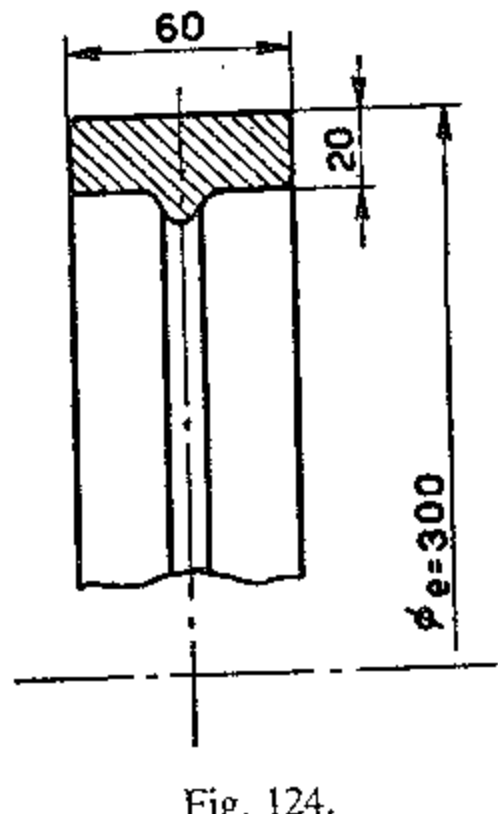

## 1) Momento de inercia de la corona.

Momento de inercia del área de la sección:

$$M_{ia} = \frac{\pi}{32} (D^4 - d^4) = 0.098 (30^4 - 26^4) = 0.098 \times 353 \ 000 = 34 \ 600 \ \text{cm}^4.$$

Momento de inercia del volumen:

$$M_{hc} = 34\ 600 \times 6 = 207\ 600\ \text{cm}^5.$$

Momento de inercia de masa:

$$M_{im} = M_{iv} \cdot \gamma = 207\ 000 \times 10^{-10} \times 7300 = 0.151548 \text{ Nm/s}^2.$$

siendo y la densidad de la fundición.

Velocidad angular media ω:

$$\omega = \frac{\pi \cdot n}{30} = \frac{\pi \times 1060}{30} = 111 \text{ rad/s}.$$

3) Variación de energía producida por el volante (joule):

$$\Delta E = M_{im} \omega^2 \cdot \delta = 0.151548 \times 111^2 \times \frac{1}{40} = 46,68 \text{ J}.$$

# 10. Consideraciones sobre la razón λ

La importancia de la razón  $\lambda = \frac{r}{L} = \frac{C}{2L}$  es de carácter totalmente mecánico, porque no afecta las características termodinámicas del motor. Cuanto menor es la razón λ tanto menor es el empuje lateral del pistón sobre la pared del cilindro, lo que da la posibilidad de acortar el manto y por lo tanto de reducir la masa del pistón; pero en la misma proporción aumenta la masa de la parte de la biela sometida a movimiento alternativo y esto conduce a mayores fuerzas alternativas de inercia. En efecto, consideremos la expresión de las fuerzas alternativas de inercia:

$$F_a = m_a \omega^2 r (\cos \alpha + \lambda \cos 2 \alpha).$$

El valor de la masa  $m_a$  aumenta al aumentar L, pero de manera menos que proporcional, mientras que el valor de  $\lambda$  varía de manera inversamente proporcional a L. De aquí que las fuerzas alternativas de inercia de 1.  $^{\rm er}$  orden aumenten con el aumento de L por efecto del aumento  $m_a$ ; mientras que las de 2.  $^{\rm o}$  orden permanecen aproximadamente constantes, porque el aumento de m casi compensa la disminución de  $\lambda$ .

En la práctica estas consideraciones se matizan según las necesidades del diseño y las disponibilidades de espacio y de peso.

Para dar una idea, aproximadamente, el valor de esta razón está comprendido entre 0,2 y 0,3 a lo que corresponde una longitud de biela de 2,5 y 1,7 veces al valor de la carrera.

### 11. Motor desplazado

El empuje  $F_n$  del pistón sobre la pared del cilindro, expresado por  $F_n = F \operatorname{tg} \beta$  (fig. 10), provoca pérdidas de potencia por rozamiento, y es también causa de desgaste y por lo tanto de defectos en el sellado entre cilindro y pistón. Para disminuir la magnitud de este empuje, y no siendo conveniente, como hemos visto, aumentar más allá de un cierto límite la longitud de la biela para reducir  $\lambda$  (y por lo tanto la oblicuidad  $\beta$ ), se recurre a veces a la traslación lateral del eje del cilindro con respecto al plano vertical que pasa por el eje del cigüeñal: el mecanismo biela-manivela queda «desplazado» (fig. 11). La traslación debe hacerse hacia la misma parte hacia la cual se produce la rotación de la manivela en la fase de expansión. La biela resulta así menos inclinada en las fases de expansión y de aspiración y más inclinada en las fases de compresión y de escape, por lo que se tiene como consecuencia una disminución del empuje máximo y un aumento del mínimo.

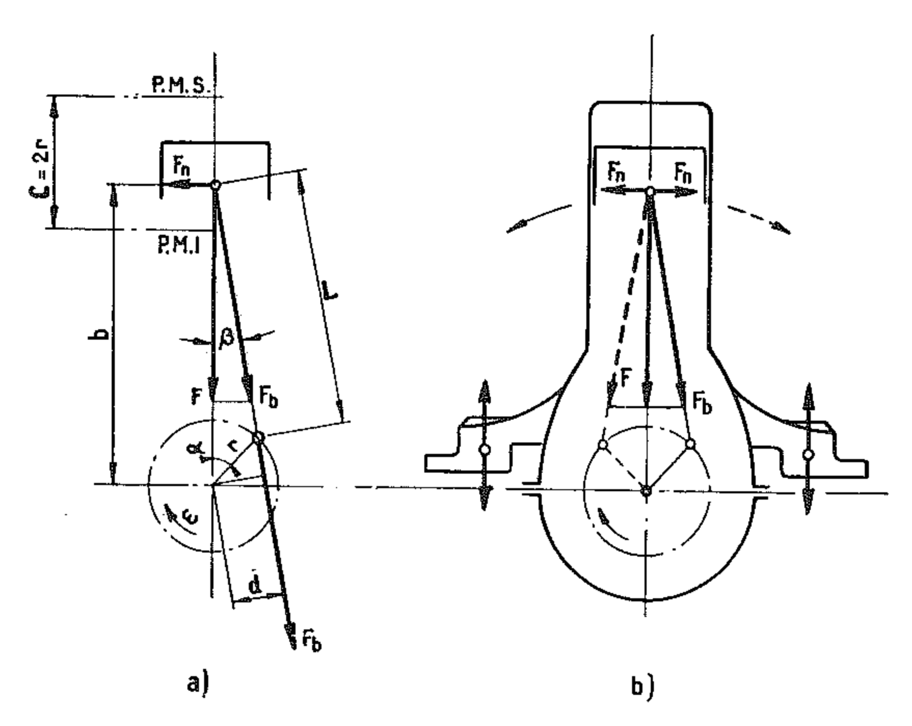

El «desplazamiento» provoca diversas anomalías: los puntos muertos del pistón no corresponden angularmente a los puntos muertos del conjunto biela-manivela de modo que una carrera ocupa un ángulo ligeramente superior a 180° y la otra uno inferior; la carrera del pistón resulta algo mayor que el valor normal.

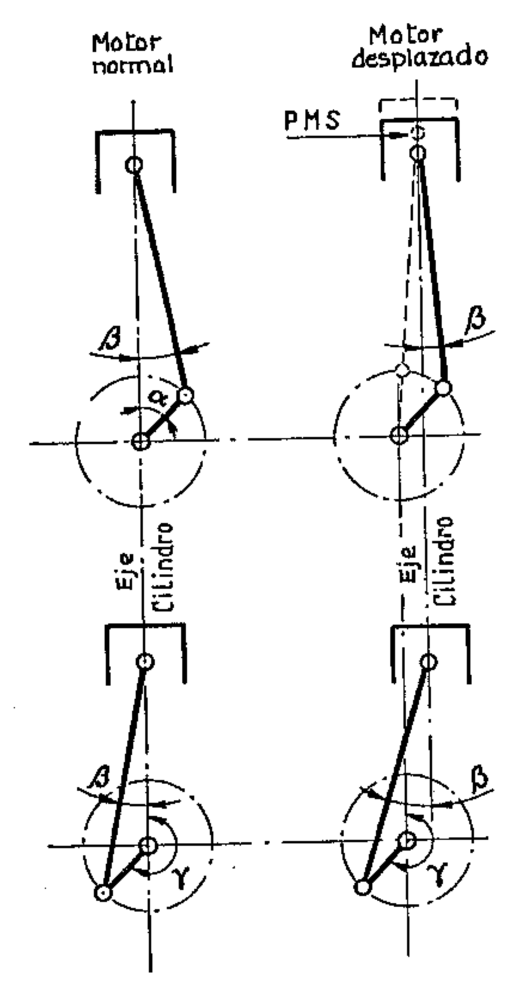

EJEMPLO.— Calcular la oblicuidad de la biela y el empuje lateral  $F_n$  sobre la pared del cilindro, para un ángulo de rotación de la manivela de 0,872 rad (50°) con respecto al P.M.S., con una carga sobre el pistón F=6400~N~(650~kg), sabiendo que la carrera es de 80 mm y la biela tiene una longitud de 150 mm.

Calcular los mismos valores en el caso en que el eje del cilindro se desplace 12 mm.

Motor no desplazado:

(2) 
$$F_n = F \cdot \text{tg } \beta = 6400 \times 0.2084 = 1334 \text{ N (136 kg)}.$$

Motor desplazado:

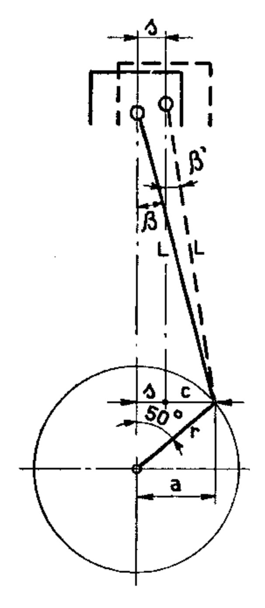

De la figura 12 se tiene:

(1) 
$$a = r \cdot \sin 0.872 \text{ rad } (50^{\circ}) = 40 \times 0.766 = 30.65 \text{ mm}$$

$$c = a - s = 30.65 - 12 = 18.65 \text{ mm}$$

$$\sin \beta' = \frac{c}{L} = \frac{18.65}{150} = 0.124 \quad ; \quad \beta' = 0.1245 \text{ rad } (7^{\circ} 8' 4'');$$

$$F_n = F \cdot \text{tg } \beta' = 6400 \times 0.1251 = 800 \text{ N } (81.4 \text{ kg}).$$