# LA COMBUSTIÓN EN LOS MOTORES DE ENCENDIDO POR CHISPA

### 1. Combustión normal

Para explicar cómo se desarrolla la combustión se han elaborado varias teorías, la mayor parte de ellas fundadas en datos experimentales. Ellas difieren entre sí por ciertos aspectos, pero en general concuerdan al distinguir dos fases principales: una de preparación o precombustión y una de combustión propiamente tal. Durante la fase de preparación la chispa proporcionada por la bujía genera uan reacción local que da lugar a la formación de algunos reaccionantes intermedios. Éstos a su vez crean las condiciones para el inicio y la propagación de la combustión. Los productos intermedios y sus propiedades son vagamente conocidos y no es aquí el caso de tomarlos en consideración.

Cuando salta la chispa, el combustible proveniente del carburador está ya vaporizado porque ha sido expuesto al calor de la compresión y está íntimamente mezclado con el aire necesario para la combustión. Alrededor de la chispa se forma la llama inicial; de ésta la combustión se propaga gradualmente a toda la carga según un frente de llama representado por la superficie más o menos irregular (¹) de separación entre la parte de mezcla ya encendida y aquélla que aún no lo está. A medida que la combustión avanza y se completa, la presión en el cilindro aumenta rápidamente, pero de manera gradual.

Un proceso de combustión que se desarrolle de la manera descrita se define como combustión normal. El encendido se produce en el instante deseado como consecuencia de la chispa y las partículas individuales comienzan a quemarse cuando son alcanzadas por el frente de llama y no antes. No se tienen otros inicios de combustión causados por depósitos de carbón o por partes sobrecalentadas de la bujía o de la cámara de combustión; la combustión se desarrolla de manera gradual, por lo que el desarrollo de energía por parte de la mezcla en combustión es progresivo y regular.

(¹) En condiciones ideales de uniformidad de la mezcla y de ausencia absoluta de turbulencia, el frente de llama tendría una superficie perfectamente esférica. En la combustión normal la irregularidad de la superficie del frente de llama depende de la turbulencia de la mezcla que se quema, de su grado de homogeneidad y de la forma de la cámara de combustión.

### 2. Velocidad de propagación de la llama

En una mezcla homogénea el frente de llama se desplaza en la cámara de combustión con una velocidad que depende de la velocidad de combustión y de otra velocidad que llamaremos de traslación.

La velocidad de combustión se refiere al avance de la reacción química de oxidación del combustible, comparable a la propagación del fuego en un campo de hierba seca sin viento.

La velocidad de traslación se refiere en cambio al movimiento físico del frente de llama con relación a las paredes de la cámara, causado por la diferencia de presión entre los gases quemados y los que aún están por quemarse.

Para hacer más claro el fenómeno nos referimos a la figura 1. Dividamos la cámara de combustión en tres partes A-B-C e imaginemos que la llama avanza de izquierda a derecha. Si la masa de mezcla A está completamente quemada, se expande y comprime las partes de mezcla B y C a volúmenes más pequeños y de mayor densidad. El frente de llama ha avanzado en la zona A con la velocidad de combustión, y ha sido ulteriormente desplazado como consecuencia de la traslación. Cuando el frente de llama avanza en la zona B, ésta se expande a su vez comprimiendo ulteriormente el gas C a un espacio aún menor, comprimiendo también en cierta medida los gases de la zona A. Si se presupone que el número de las divisiones es infinito, el resultado es el de una llama que avanza gradualmente no sólo porque se completa la reacción química, sino también por efecto de la traslación debida a la expansión de los gases.

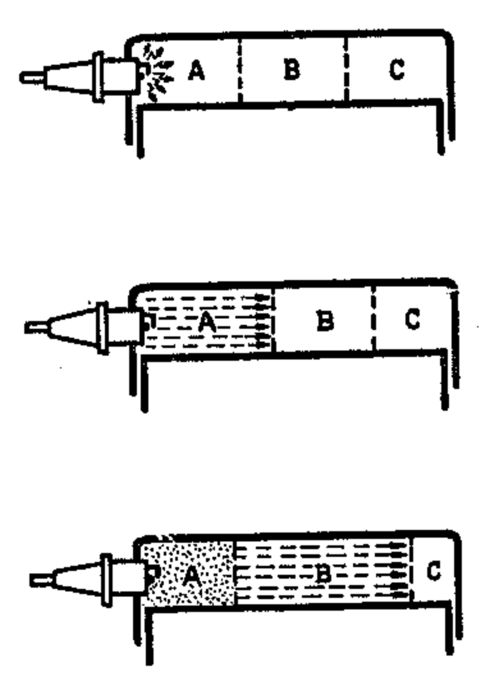{width=40%}

El análisis fotográfico del fenómeno (conseguido con 15 000 ÷ 20 000 fotogramas por segundo a través de una ventanilla de cuarzo) indica que al atravesar la cámara de combustión la llama avanza inicialmente a velocidad relativamente baja. En efecto, al comienzo, la masa de carga quemada es pequeña y la propagación se debe sobre todo a la reacción química. Por otra parte los electrodos de la bujía están casi al ras de la pared de la superficie de la cámara y por lo tanto la chispa salta en un estrato de gas adherido a la pared donde la turbulencia es reducida, por lo que la reacción es relativamente lenta. Apenas la llama alcanza una zona de mayor turbulencia y afecta a una mayor masa de mezcla, avanza más rápidamente con velocidad más bien constante. Es la que normalmente llamamos velocidad de la llama. Hacia el final del recorrido el volumen de los gases por quemar es pequeño, el efecto de traslación resulta despreciable así como también el de la reacción química como consecuencia de la disminución de la turbulencia, por lo que la velocidad de la llama disminuye.

Son de gran importancia para el rendimiento del ciclo el momento en el que comienza la combustión y el tiempo empleado por ésta para completarse.

En efecto, la combustión no se produce instantáneamente en el P.M.S. como está previsto en el ciclo ideal, sino que comienza un poco antes y se desarrolla durante un cierto tiempo después del P.M.S. Por esto la presión hacia el final de la carrera de compresión aumenta, incrementando el trabajo de compresión, y disminuye al comienzo de la carrera de expansión reduciendo el trabajo útil. Como consecuencia el rendimiento del ciclo real es inferior al del ciclo ideal en un porcentaje tanto mayor cuanto mayor es la duración de la combustión.

Los factores de los cuales depende el tiempo necesario para la combustión son: la velocidad de propagación de la llama y la longitud del recorrido que el frente de llama debe hacer, recorrido que depende de las dimensiones y de la forma de la cámara de combustión y de la posición de la bujía.

### 3. Factores que influyen en la combustión

La velocidad de la llama influye en la manera de aumentar de la presión, es decir, en el gradiente de presión que, como veremos, es importante a efectos del funcionamiento del motor. La velocidad de la llama interviene también como factor importante de combustiones anormales. Por lo tanto conviene analizar de qué parámetros depende.

Estos parámetros son numerosos, pero los más importantes son la turbulencia y la razón aire-combustible.

Turbulencia.— De experimentos hechos con dispositivos especiales se ha constatado que si la mezcla no está en movimiento la llama se propaga a una velocidad inesperadamente baja. En estas condiciones no sería posible conseguir altas velocidades de giro del motor; a 3000 rpm el tiempo disponible para la combustión es solamente de unas 2 milésimas de segundo. Pero en el motor la mezcla está sometida a turbulencia que aumenta la velocidad de combustión.

La turbulencia consiste en numerosos pequeños vórtices que se forman en el fluido a su paso entre la válvula y el asiento, y del subsiguiente remezclado durante la fase de compresión. La forma de la cámara de combustión influye evidentemente en el grado final de turbulencia.

Por efecto de la turbulencia se crea en el frente de llama un mezclado de las partículas que se están quemando con las que han de quemarse de modo que la reacción es activada por el aumento de los contactos. Parece que la turbulencia formada por muchísimos pequeños vórtices es más eficaz que una turbulencia debida a vórtices mayores y menos numerosos. Con el aumento de la velocidad del motor aumenta generalmente la turbulencia y por lo tanto también la velocidad de la llama.

Estratificación. — El vórtice generado por la velocidad con la cual la columna del fluido de trabajo entra en la cámara de combustión en general no es tal que pueda hacer la carga homogénea. Y si el movimiento que el fluido asume durante las carreras de admisión y compresión es principalmente rotacional, se forman unos estratos que tienen diferente razón de mezcla.

Razón de mezcla. — La velocidad de la llama alcanza el valor más alto cuando la razón aire-combustible es algo más rica que la razón estequiométrica. Si es demasiado rica, la velocidad de combustión disminuye.

Ésta está también influenciada por otras variables, como la temperatura y la presión de la carga al entrar al cilindro, la humedad, la cantidad de gases residuales, el momento del encendido y la relación de compresión, pero su efecto es menos importante.

Temperatura. — Existe, para una razón de mezcla determinada, un estrecho intervalo de temperatura dentro del cual la reacción de oxidación y por lo tanto la combustión es rapidísima. Para temperaturas mayores o menores la velocidad de combustión disminuye notablemente.

Presión. — Si mayor es la presión en el instante en el que salta la chispa, mayor será la dificultad para el comienzo de la combustión, pero mayor será inmediatamente después la velocidad de propagación.

Humedad. — La velocidad de la llama disminuye al aumentar la humedad. Cantidad de gases residuales. — La presencia de los gases residuales hace evidentemente disminuir la velocidad de combustión.

### 4. Variación de la presión durante la combustión

La velocidad de aumento de la presión, o gradiente de presión, durante la combustión ejerce una notable influencia sobre la presión máxima y sobre la progresividad con la que la fuerza desarrollada por el fluido es transmitida al pistón.

En la figura 2 se ha trazado el diagrama de la variación de la presión en el cilindro durante la combustión normal. El gradiente de presión, calculado como valor del aumento de presión por cada grado de rotación del cigüeñal (tangente del ángulo  $\gamma$ ), influye sobre el área del ciclo indicado y en consecuencia sobre la potencia del motor.

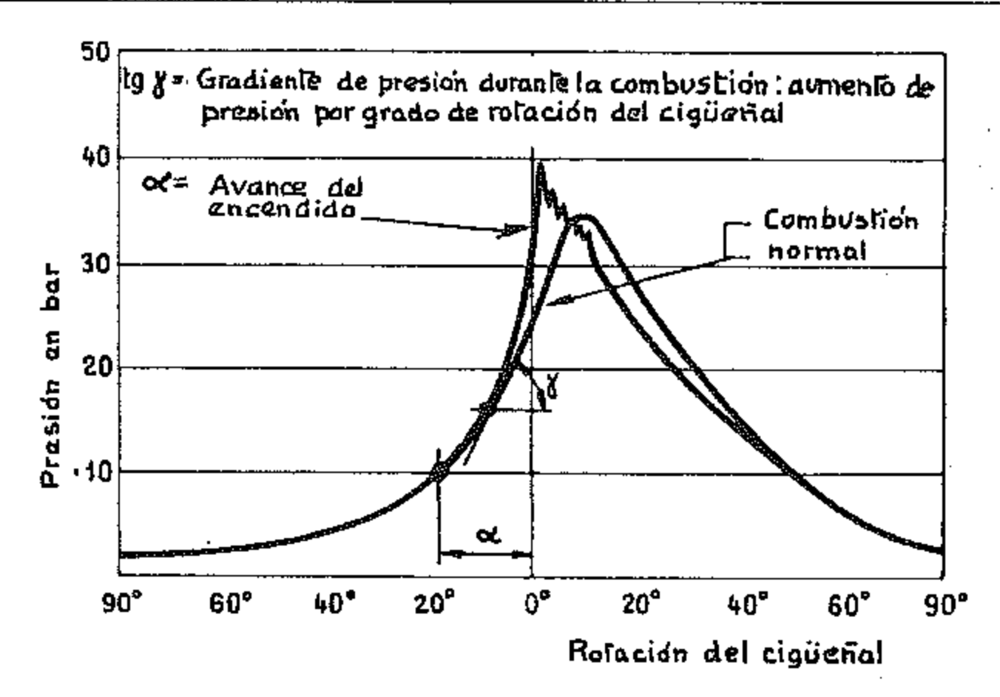{width=50%}

El gradiente de presión depende de la rapidez con la cual se desarrolla la combustión. Al comienzo la cantidad de mezcla que se quema en la unidad de tiempo es pequeña porque la combustión avanza con velocidad relativamente baja, el gradiente de presión es pequeño, pero en cuanto se ve afectada una mayor cantidad de mezcla y aumenta la velocidad de propagación del frente de llama el gradiente de presión aumenta rápidamente. Después tiende a disminuir cuando el frente de llama se reduce de nuevo al llegar, en cualquier dirección, a tocar con las paredes de la cámara, hasta que termina el proceso de combustión. El movimiento del pistón, al hacer variar el volumen de la cámara durante la combustión, tiene, evidentemente, influencia en la variación de la presión.

En la figura 3 se indican las curvas de la presión para tres valores diferentes del gradiente de presión: alto, medio y bajo. Nótese que con un gradiente bajo es necesario encender la mezcla antes que en los demás casos, porque la combustión requiere de un tiempo mayor. Con los gradientes de presión más altos, consecuencia de altas velocidades de combustión, generalmente los picos de presión máxima están más próximos al P.M.S., y esto hace aumentar el área del ciclo indicado y por lo tanto la potencia. Pero razones funcionales limitan el aumento del gradiente de presión: si éste es demasiado alto las fuerzas que actúan sobre el pistón no son lo suficientemente progresivas y el funcionamiento del motor resulta áspero. Además se puede caer en el fenómeno de la detonación.

El investigador inglés H. Ricardo ha descubierto que un gradiente de presión de unos 2 bar por grado proporciona la potencia máxima. Para conseguir gradientes más elevados, siempre dentro de los límites de una combustión normal, se necesita una fuerte turbulencia, la cual sin embargo cuando es excesiva aumenta las pérdidas de calor y causa una disminución de la potencia.

### 5. Combustiones anormales

Como ya hemos dicho, la combustión es normal cuando comienza en el punto y en el instante en que salta la chispa, y avanza gradualmente desde ese punto hasta alcanzar todas las demás zonas de la cámara. Es anormal cuando, una vez saltada la chispa, no avanza de la manera regular antes descrita, o bien cuando no es provocada directamente por la chispa, sino que obedece a otras causas.

Resulta útil dividir las combustiones anormales en dos categorías principales tomando como base de clasificación el modo de encendido:

- --- combustiones anormales por encendido superficial;
- Combustiones anormales por autoencendido.

El encendido superficial se origina en puntos excesivamente calientes o en partículas incandescentes sobre las paredes y puede producirse antes o después de saltar la chispa.

El autoencendido es en cambio un fenómeno de encendido espontáneo de toda o de parte de la mezcla, que se verifica como consecuencia de condiciones especiales de presión y de temperatura. En este caso la combustión se desarrolla con rapidez muy superior a la normal. También el autoencendido puede producirse tanto antes como después de saltar la chispa.

El autoencendido de toda la carga es un caso muy raro. Es frecuente en cambio el autoencendido de aquella parte que queda sin quemar después de que todo el resto se ha quemado tras el avance del frente de llama. En este caso el autoencendido se convierte en detonación. Ésta genera casi siempre un sonido metálico característico acompañado de asperezas de funcionamiento del motor y de una pérdida de potencia. Por su importancia la detonación será tratada en un párrafo aparte (párrafo 7). Las combustiones anormales tienen relación con la composición del combustible.

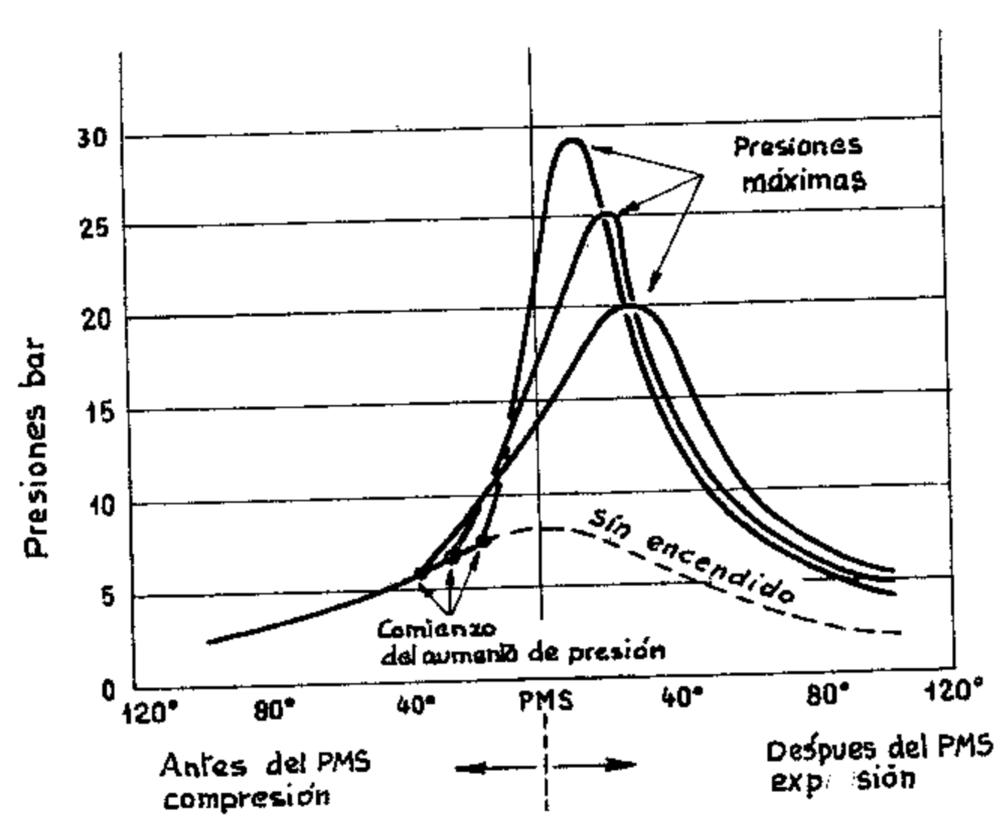{width=50%}

### 6. Encendidos superficiales

Si el motor funciona en condiciones tales que sobre la pared interior de la cámara de combustión ciertas zonas se sobrecalientan, como puede suceder en las válvulas de escape o en los electrodos de la bujía, o bien si se forman partículas incandescentes de carbón, es posible que estas partes calientes enciendan la mezcla que las rodea.

Se tiene entonces un encendido superficial que da lugar a un frente de llama completamente distinto del normal.

El encendido superficial se verifica generalmente antes de que salte la chispa y en tal caso se llama **preencendido**. A veces se producen formas especiales de combustiones anormales que se explican suponiendo que se producen encendidos superficiales también después de haber saltado la chispa, y éstas son llamadas **postencendidos**.

El preencendido tiende a aumentar la temperatura y la presión en la cámara de modo que la temperatura de los puntos calientes aumenta todavía más. Por esto puede suceder que el preencendido se acentúe cada vez más a medida que se suceden los ciclos; los picos de máxima presión tienden entonces a crecer con posibilidad de detonación y a producirse cada vez con más anticipación con respecto al P.M.S. Esta forma de preencendido se llama **progresivo**. 

Cuando se produce, puede suceder fácilmente que la presión máxima del ciclo se alcance antes que el pistón llegue al P.M.S. En tal caso la presión del gas se opone al movimiento del pistón en la última parte de la carrera de compresión, la potencia se reduce y el funcionamiento del motor se hace áspero e irregular. El preencendido ha de ser evitado porque puede ser muy nocivo para los órganos del motor, especialmente para las partes sometidas a temperaturas altas, como los pistones, las válvulas de escape y las bujías.

### 7. La detonación

Como ya se ha dicho, durante el trayecto del frente de llama en la cámara de combustión la parte de carga más alejada de la chispa está sometida a un aumento de presión, de temperatura y de densidad hasta que se alcanzan las condiciones críticas para el autoencendido y para la combustión casi instantánea, es decir, para detonar.

Con la detonación la producción de energía es sumamente rápida y el gradiente de presión en la cámara de combustión es tal que genera vibraciones en la masa de los gases y por lo tanto en las paredes.

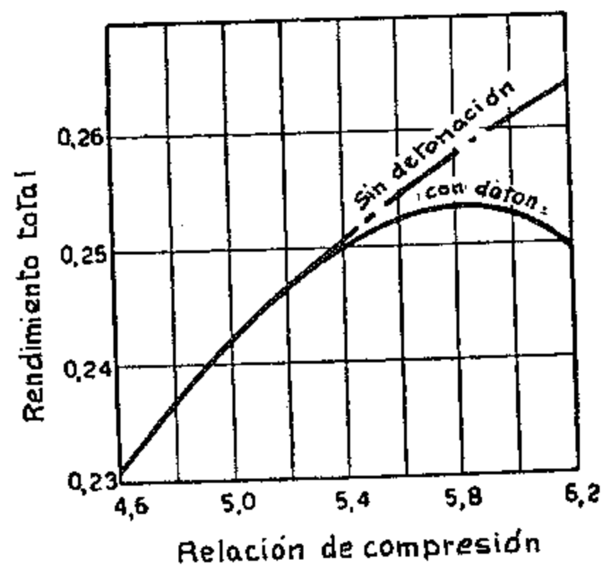{width=50%}

Estas vibraciones se detectan acústicamente por el golpeteo del que ya hemos hablado en el tema de los combustibles.

La detonación puede producirse tanto después de un encendido superficial como después de un encendido regular por chispa; este último es el caso que sucede más comúnmente.

Evidentemente el funcionamiento continuado en estado de detonación puede también conducir a encendidos superficiales. En efecto, el estado de detonación puede causar el recalentamiento excesivo de determinados puntos y tener las mismas consecuencias que una refrigeración insuficiente.

La detonación produce una disminución del rendimiento (fig. 4), irregularidades en el diagrama de la presión (en la figura 5 se comparan los diagramas de las presiones en la fase de combustión en régimen normal y en régimen de detonación) y sobrecalentamiento de algunas partes, tales que pueden producir su destrucción (perforación del fondo de los pistones por fusión, válvulas de escape quemadas, «engomado» de los segmentos por cokerización del aceite lubricante, etc.).

En los autovehículos la detonación es fácilmente perceptible y puede ser evitada variando las condiciones de uso del motor; cuando en cambio por la presencia de otros ruidos, como en el caso de motores de aviación, no es posible oír el golpeteo, el peligro de la detonación es mucho más grave.

El fenómeno no es bien conocido, pero sobre la base de los elementos obtenidos de un gran número de estudios experimentales (¹), la detonación puede ser explicada de manera sencilla como sigue.

Esta teoría explica también la acción de los antidetonantes (ver párrafo V.4), los cuales no son más que antioxidantes que tienen la función de impedir la formación de los peróxidos.

(¹) En pocas palabras: en la fase de compresión, el carburante comienza a oxidarse formando peróxidos (compuestos muy inestables); durante la combustión esta formación aumenta para la parte de mezcla aún por quemar y, por quedar a valores excesivos de temperatura y de presión, los peróxidos se descomponen violentamente dando origen a reacciones en cadena y por lo tanto a la combustión simultánea de la mezcla aún no quemada.

La figura 5 representa un frente de llama normal que atraviesa la cámara de combustión desde la bujía hacia el punto b. En el instante considerado el área a a' b, representa la parte de mezcla aún por quemar. Si ésta no alcanza la temperatura crítica de autoencendido no se encenderá espontáneamente y el frente de llama a a' avanzará regularmente hasta el punto b y la combustión será normal. Si en cambio durante el trayecto del frente de llama en la zona c c' la carga no quemada b alcanza y queda por encima de la temperatura crítica por un tiempo suficiente para el autoencendido, éste se produce en forma de detonación.

Conviene recordar aquí que desde el instante en el que se alcanzan las condiciones críticas de temperatura, presión y densidad, hasta el instante en el que se produce el encendido espontáneo transcurre un pequeño período de tiempo que se llama retraso del encendido (en inglés ignition delay).

La detonación en el motor ECh se produce por lo tanto hacia el final de la compresión y puede entonces evitarse fácilmente si el retraso del encendido es lo suficientemente grande.

### 8. Variables que influyen en la detonación

En el capítulo referente a los combustibles se habló de la importancia de sus características antidetonantes. Nos referiremos aquí a las variables que influyen en la detonación considerando como constante el valor del N.O. del combustible.

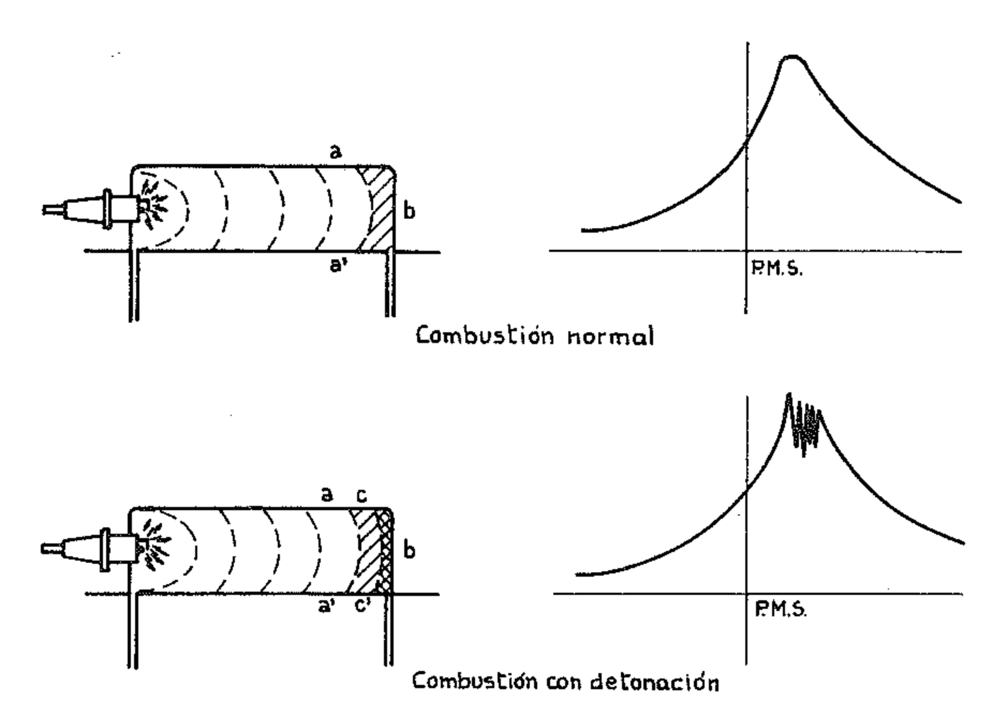{width=50%}

En general todas las medidas tomadas para reducir la temperatura de la parte de carga más alejada de la chispa son útiles para prevenir la detonación porque reducen las probabilidades de que aquélla alcance la temperatura crítica de autoencendido. Toda acción adecuada para reducir la densidad de la carga tiende a reducir la detonación porque disminuye la energía desarrollada. Se reduce la posibilidad de detonación con las siguientes medidas:

- 1) disminuyendo la relación de compresión, por lo que se-reducen la presión y la temperatura;
- 2) Estrangulando la apertura del carburador o disminuyendo el grado de sobrealimentación;
- 3) reduciendo la temperatura de la mezcla a la entrada;
- 4) refrigerando las paredes de la cámara de combustión especialmente en la zona más alejada de la chispa;
- 5) retrasando la descarga de la chispa de modo que la máxima presión se alcance más tarde con respecto al P.M.S.;
- 6) adoptando mezcla rica o bien pobre para reducir la temperatura de la llama.

Además se reduce el peligro de detonación si se aumenta la velocidad de la llama, porque de este modo se tiende a completar la combustión en un tiempo inferior al retraso del encendido. Es útil por las siguientes razones:

- 1) aumenta la turbulencia;
- 2) reduce la longitud del recorrido que la llama debe completar para atravesar la cámara de combustión;
- 3) Utiliza una razón de mezcla rica para obtener la máxima velocidad de la llama.

De entre todos los factores que limitan la potencia y el rendimiento en los motores ECh, la detonación es el más importante; ella pone un límite a la máxima relación de compresión para cada combustible determinado y depende esencialmente de las características de este último.

### 9. Avance del encendido

Como sabemos, la chispa debe saltar antes del P.M.S. como consecuencia del hecho de que la combustión dura un cierto tiempo. El ángulo que la manivela forma con el eje del cilindro en el instante en que salta la chispa, es el ángulo de avance. Generalmente la máxima potencia se obtiene con el ángulo de avance que permite alcanzar en el P.M.S. aproximadamente la mitad del aumento de presión debido a la combustión. Normalmente en esta condición el pico de máxima presión se verifica entre 15° y 25° después del P.M.S.

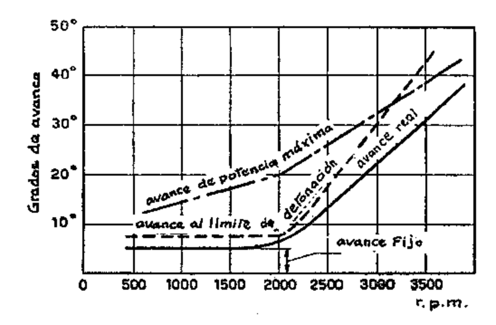{width=50%}

El valor del avance depende principalmente de la velocidad de propagación de la llama y de la longitud del recorrido que la llama debe realizar para completar la combustión.

El valor óptimo del ángulo de avance varía al variar el régimen del motor, principalmente porque la duración de la primera fase de la combustión (aquélla de baja velocidad) es prácticamente independiente del régimen de rotación del motor (1). Por esto al aumentar el régimen tiene que aumentar el valor del ángulo de avance.

Es difícil realizar mecánicamente variadores automáticos del avance con una ley de variación que corresponda a la requerida por el motor para obtener la máxima potencia a todos los regímenes. En la práctica la curva de avance efectivo se acerca sólo aproximadamente a la requerida porque se tolera una ligera pérdida de potencia con respecto a la máxima obtenible, antes que incurrir en el riesgo de provocar la detonación.

Generalmente se da un avance hasta un cierto régimen (avance fijo) y después se lo hace crecer gradualmente hasta el régimen de potencia máxima (avance automático). Este resultado se consigue normalmente con un variador centrífugo.

La aplicación sólo del variador centrífugo de avance no permite sin embargo aprovechar todas las posibilidades del motor incluso a cargas reducidas. Con cargas reducidas, como la densidad de la carga es menor y la combustión avanza más lentamente, el avance óptimo debería ser mayor que el requerido al mismo régimen pero a plena carga. Por otra parte, puesto que la presión inicial de la carga es pequeña, el peligro de incurrir en el fenómeno de la detonación es mínimo incluso para grandes ángulos de avance. Por lo

(¹) Al variar el régimen, la fase de combustión a velocidad de llama constante (es decir, una buena parte de la combustión) tiene prácticamente la misma duración en grados de rotación del cigüeñal; la velocidad de la llama es, en efecto, aproximadamente proporcional al valor de la turbulencia, la cual a su vez es función principalmente de la velocidad de la mezcla en la admisión que «grosso modo» es proporcional a la velocidad del pistón y por lo tanto al régimen del motor.

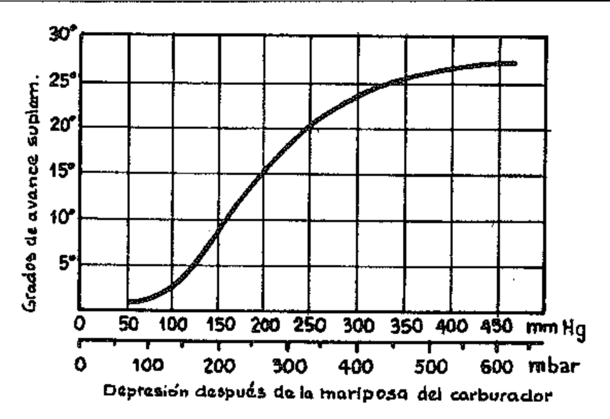{width=50%}

tanto en los autovehículos, en consideración al hecho de que el motor funciona durante mucho tiempo a cargas parciales, se aplica a menudo un variador del avance por vacío que, siendo sensible a la depresión en el múltiple de admisión, hace aumentar oportunamente el avance cuando la alimentación está estrangulada. Con la aplicación de la electrónica al sistema de encendido las condiciones óptimas se alcanzan con el control del avance computerizado (mediante una pequeña central electrónica).

El valor máximo del avance total sobre la curva de potencia máxima alcanza los 30° ÷ 40°; a cargas parciales se alcanzan incluso los 50° ÷ 65°. En la figura 6 se dan las curvas teóricas y reales de un variador centrífugo del avance para un motor de automóvil y en la figura 7 la curva del suplemento de avance proporcionado por el dispositivo de mando por depresión.

Recordemos finalmente que en los motores de aviación es necesario aumentar el avance al aumentar la altura de vuelo porque disminuyen la velocidad de la llama y la presión de alimentación.

### 10. La cámara de combustión

La forma de la cámara de combustión influye en el proceso de combustión y por lo tanto en el rendimiento térmico.

En general puede decirse que las válvulas y la bujía deberían instalarse de modo que al saltar la chispa se queme la mayor parte de la carga y que el volumen reservado a la mezcla que se quema al final disminuya progresivamente. También la superficie superior del pistón puede conformarse de manera que contribuya a este objetivo. Durante la combustión la presión en el cilindro aumentará progresivamente hasta alcanzar su valor máximo cuando el pistón haya superado el P.M.S., sin que se hayan creado las condiciones para la detonación, y después disminuirá gradualmente durante la fase de expansión.

La forma de la cámara contribuye a crear la turbulencia y por lo tanto a incrementar la velocidad del frente de llama.

#### Otros atributos de la forma de la cámara de combustión son:

- 1) mantener baja la temperatura de la porción de carga que se quema al final, generalmente la más alejada de la bujía, de manera que para esta parte la razón entre la superficie y el volumen sea alta;
- 2) abreviar el recorrido de la llama con una posición de la bujía lo más central posible; excepcionalmente con dos bujías.

La posición de la bujía tiene entonces una notable importancia, porque de ella depende la longitud del recorrido que la llama debe completar así como también el área del frente de llama. En definitiva, influye sobre el tiempo necesario para la combustión, sobre los valores del gradiente de presión y, en último análisis, sobre la suavidad del funcionamiento del motor, así como sobre la potencia específica obtenible.

Un buen mínimo y altas velocidades de rotación se consiguen en general con la bujía puesta cerca de la válvula de admisión.

Mejores características antidetonantes y progresividad de la combustión se consiguen en cambio con la bujía puesta más cerca de la válvula de escape; y ésta es la disposición adoptada más frecuentemente. En la figura 8 se indica por ejemplo la posición de la bujía aproximadamente más adecuada para un motor de válvulas laterales; la distancia más conveniente entre el eje de la bujía y el de la válvula de escape es de más o menos el  $30 \div 35 \%$  de la distancia entre los ejes de las válvulas.

Cuando se quiere aumentar el número de revoluciones para conseguir la mayor potencia específica, la forma de la cámara ha de adaptarse a la instalación de válvulas de gran diámetro, teniendo presente que la razón entre el área de la superficie de las paredes y el volumen contenido ha de ser lo más baja posible con el fin de limitar la transmisión de calor al líquido de refrigeración.

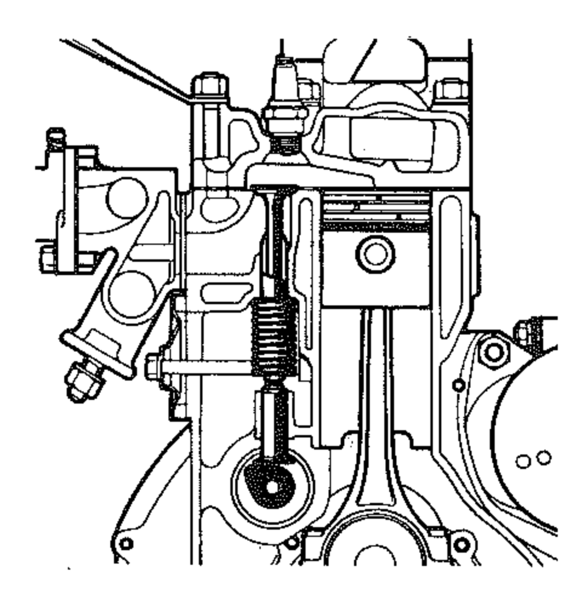{width=50%}

La cámara es buena si las condiciones de la combustión se oponen a la formación de depósitos de carbón. A este respecto conviene crear una fuerte turbulencia al final de la fase de compresión, un tipo de turbulencia que se consigue exprimiendo —por decirlo así— el gas en zonas llamadas de laminación entre el pistón y las paredes de la cámara. Un ejemplo clásico es el de la cámara de alta turbulencia, con válvulas laterales, esquemáticamente representada en la figura 9b.

La zona de laminación, estando más refrigerada, es útil también para prevenir la detonación, dado que se encuentra en la parte más alejada de la bujía.

Las cámaras con válvulas laterales tienen todas una gran superficie con respecto al volumen, y no son adecuadas para altas relaciones de compresión. Ellas han sido usadas durante largo tiempo para motores de automóvil porque permitían motores sencillos, de dimensiones reducidas y bajo costo.

Cuando los avances en el campo de los proyectos y en los métodos de producción han permitido construir motores de válvulas en la cabeza con mecanismos de distribución lo suficientemente silenciosos y de costo aceptable, los motores con válvulas laterales han sido abandonados. Con referencia a la figura 9, las cámaras de combustión más usadas en la actualidad para los autovehículos son aquellas indicadas con las letras g, h, i. La g y la h están muy difundidas porque a una buena eficiencia unen una gran sencillez de construcción. La i, la llamada cámara hemisférica, es usada para obtener la más alta potencia específica porque en comparación con los demás tipos permite la instalación de las válvulas de mayor diámetro. En el caso de 4 válvulas por cilindro la bujía puede estar instalada al centro y la V de las válvulas puede ser menos abierta.

A efectos de la detonación es muy eficiente la triangular porque realiza de la manera más sencilla y racional las condiciones de las que se habló en la primera parte de este párrafo.

La cámara e, llamada «Heron» por el nombre del técnico que ha puesto en evidencia sus ventajas, recuerda la de los motores Diesel de inyección directa. Esta cámara no permite la instalación de válvulas de gran diámetro más que cuando el diámetro del cilindro es superior a la carrera. Últimamente ha despertado un cierto interés como consecuencia del hecho de que se han adoptado, especialmente en los automóviles, motores de carrera muy corta con relación al diámetro de los cilindros. Las ventajas de la cámara «Heron» deben atribuirse sobre todo a la sencillez de la construcción de la culata.

Otro tipo de cámara cuya forma ha sido también usada en motores Diesel (UNIC) y experimentada en motores policombustibles FIAT se concentra en torno a la válvula de escape retirada con respecto a la de admisión (fig. 9f). Esta cámara, llamada May por el nombre del técnico que recientemente la propuso para los motores ECh, o bien *fireball* (bola de fuego) por su disposición alrededor de la válvula de escape, tiene buenas cualidades antidetonantes por lo que, permitiendo una relación de compresión más alta, permite un menor consumo. No permite sin embargo instalar válvulas de diámetro grande y por lo tanto alcanzar potencias altas con regímenes muy elevados.

Al diseñar una cámara de combustión se debe también tener en cuenta la dinámica del fluido que entra porque de ésta depende que los electrodos de la bujía se encuentren rodeados, a la descarga de la chispa, de una mezcla pobre o rica. Naturalmente las condiciones cambian según que la carga sea homogénea o estratificada.

Cuando el motor es alimentado por un carburador, la mezcla se forma por pulverización de la gasolina al comienzo del múltiple de admisión y se homogeniza en gran medida durante el trayecto hacia el cilindro, también por efecto de la evaporación, que por lo demás se completa en el cilindro durante las carreras de admisión y de compresión del pistón.

Cuando en cambio el combustible es introducido por inyección en el múltiple con el inyector cercano a la válvula de admisión o incluso aplicado directamente a la cámara de combustión, la carga generalmente no es homogénea, sino que está formada por estratos que tienen diferente relación airegasolina. Si se consigue que la chispa esté rodeada por un estrato de mezcla rica, se puede reducir el consumo haciendo funcionar el motor con una carga medianamente pobre. Con este fin se han ideado las llamadas cámaras de carga estratificada, en las cuales la bujía está dispuesta de modo que la chispa salte en la zona en la cual la relación aire-combustible es siempre tal que se asegure el encendido. Son típicos los motores de estratificación separada, es decir, con cámara provista de una pequeña precámara alimentada con mezcla rica a través de una válvula propia (fig. 10). La reducción del consumo se consigue sin embargo mediante el sacrificio del rendimiento y por lo tanto de la potencia.

### 11. Principales cámaras de combustión

En la figura 9 se representan esquemáticamente las principales cámaras de combustión divididas en dos categorías que se distinguen inmediatamente por la disposición de las válvulas, laterales o en la cabeza del cilindro.

Las con válvulas laterales, llamadas en T o en L según que las válvulas estén dispuestas en los dos lados del cilindro o en uno solo, tienen una gran superficie con relación al volumen, y no son adecuadas para altas relaciones de compresión.

Todos los motores para autovehículos tienen hoy en día las válvulas en la culata. Los motores con válvulas laterales fueron durante largo tiempo los más usados en los vehículos de serie hasta los comienzos de la Segunda Guerra Mundial, y en los USA hasta algunos años después de la guerra, porque se los prefería, como ya se ha dicho, por su sencillez, silenciosidad, pequeñas dimensiones y bajo costo. Los motores con válvulas en la culata, siendo más complicados y ruidosos, estaban reservados a los automóviles deportivos. Actualmente la solución con válvulas laterales se usa todavía para pequeños motores de máquinas agrícolas o de jardín, motobombas, etc., y motores marinos de baja potencia, para los cuales es indispensable el menor volumen posible.

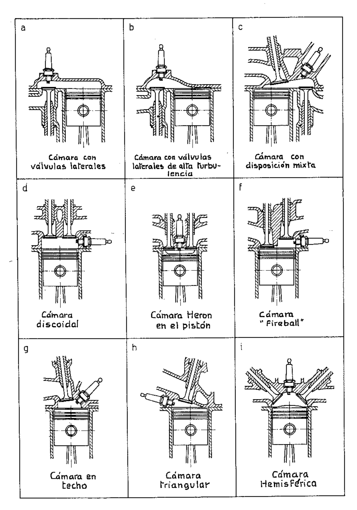

Entre las cámaras con válvulas laterales conviene recordar la llamada a turbulencia, ideada por Sir. H. Ricardo, ilustre investigador inglés (fig. 9b).

En ella, la forma abovedada a la altura de las válvulas, presupone la formación de un vórtice que es activado por la laminación (squish) del fluido entre el pistón y la parte plana de la culata. La turbulencia acelera el movimiento de propagación de la llama hacia la zona más alejada de la chispa y permite aumentar la relación de compresión por encima de los valores normalmente posibles en los motores con válvulas laterales. La práctica ha demostrado después que la forma en cúpula no es indispensable, mientras que en cambio es importante escoger la posición de la bujía para favorecer el encendido y la combustión.

Resumimos ahora brevemente algunas consideraciones sobre los principales tipos de cámaras de los motores con válvulas en la cabeza.

Como se ve en la figura 9, las válvulas pueden estar derechas, es decir, con el vástago paralelo al eje del cilindro, o bien inclinadas. El máximo diámetro que puede conseguirse para las válvulas derechas y para sus asientos depende del diámetro de los cilindros y por lo tanto de las dimensiones externas del motor. Con las válvulas inclinadas, a igualdad de cilindrada, se puede aumentar, aunque sea un poco, su diámetro y por lo tanto la potencia del motor.

a) Cámara discoidal. Es la solución más sencilla e intuitiva, típica cámara de los antiguos motores de aviación refrigerados por líquido, con culata y cilindro integrales, 4 válvulas por cilindro y 2 bujías diametralmente opuestas enroscadas en la pared cilíndrica. No se usa en los motores para autovehículos porque se adapta mal a las pequeñas cilindradas que tiene sólo 2 válvulas por cilindro y una bujía.

b) Cámara en el pistón. Llamada «Heron» por el nombre de quien la propuso y realizó, puede ser considerada como una adaptación de la cámara discoidal a los motores para autovehículos. Está comprendida entre la superficie plana de la culata y el pistón, adecuadamente conformado en forma de copa.

Tiene la ventaja de la sencillez y no requiere de especiales precauciones para asegurar la igualdad de los volúmenes de las cámaras de los diferentes cilindros.

La razón entre el área refrigerada y el volumen es especialmente favorable. El vórtice del fluido en el cilindro se consigue diseñando de manera adecuada el múltiple de admisión.

c) Cámara en el escape. Llamada fireball justamente porque está dispuesta alrededor de la cabeza de la válvula de escape, se caracteriza por una fuerte turbulencia y por excelentes cualidades antidetonantes. Por esto permite altos valores de la relación de compresión. Realizada por primera vez en 1936 por el Marqués de Pescara, inventor del motor-bomba de pistones libres, no había sido tenida en consideración por las limitaciones del diámetro de las válvulas. Recientemente perfeccionada por May, investigador suizo, es una de las soluciones adecuadas para reducir el consumo. Puede observarse que estando los asientos de las válvulas a diferentes niveles, la válvula de admisión ha de tener un vástago más largo que el de la válvula de escape y por lo tanto una masa mayor.

d) Cámara en techo. Las válvulas pueden tener el vástago paralelo al eje del cilindro o ligeramente inclinado. La bujía puede instalarse a fin de provocar el encendido en una posición casi central y su refrigeración es efectiva.

Con frecuencia en los motores de carrera relativamente larga el volumen de la cámara de combustión se amplía más allá del diámetro del cilindro para crear al fluido un paso alrededor de la cabeza de la válvula. La turbulencia para acelerar la combustión es aumentada por las zonas de laminación a los lados del espacio central.

e) Cámara triangular. La mayor parte de la mezcla se recoge en torno a la chispa de modo que el frente de llama, a medida que avanza, encuentra una masa de gas cada vez menor. En los motores de alta relación de compre superficie es algo más favorable que la de la cámara hemisférisión la razón $\frac{\text{superficie}}{\text{volumen}}$ es algo más favorable que la de la cámara hemisférica. Desde el punto de vista de la detonación, como media se la puede considerar equivalente. Pero como, a igualdad de diámetro del cilindro el diámetro de las válvulas es inferior, la potencia específica máxima que puede obtenerse es inferior. Los motores con cámara triangular, al tener los ejes de las válvulas todos sobre un mismo plano, son de construcción más sencilla y económica que los con cámara hemisférica.

f) Cámara hemisférica. Con 2 válvulas la bujía puede instalarse al centro sólo si las válvulas están fuertemente inclinadas y en tal caso la razón $\frac{\text{superficie}}{\text{volumen}}$ no es muy favorable como consecuencia de la forma prominente de la cabeza del pistón.

Como permite adoptar válvulas de gran diámetro, es la cámara para las máximas potencias y para los números de revoluciones más altos.

Con 4 válvulas la bujía se pone al centro y se tiene el resultado máximo en lo referente al rendimiento volumétrico y a la rapidez de combustión.
Es la cámara de más alto rendimiento, teniendo la menor razón $\frac{\text{superficie}}{\text{volumen}}$.

En los motores modernos que tienen una razón de compresión incluso superior a 9 se intenta reducir tanto como sea posible la apertura de la V formada por las válvulas para evitar crear un excesivo abovedado de la cabeza del pistón y disminuir así la superficie de la cámara.

Las cámaras de carga estratificada. Desde que las normas anticontaminación se han hecho más severas y más preocupante es la progresiva escasez del petróleo, las investigaciones se han orientado hacia el estudio de soluciones que permitieran quemar cargas con relación aire/combustible tan alta como fuera posible, a semejanza de lo que ocurre en los motores de encendido por compresión.

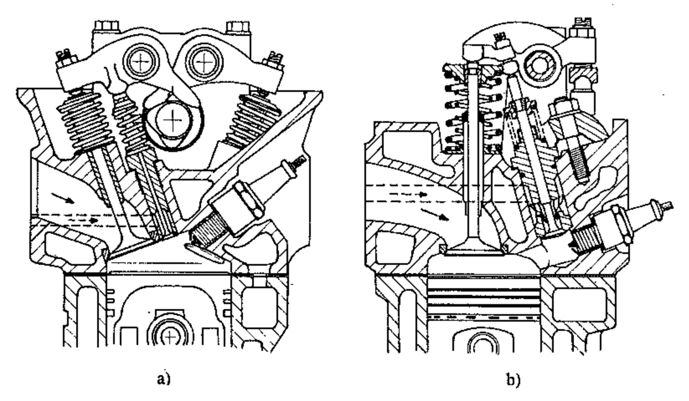

No pocos fabricantes, especialmente los japoneses, han propuesto cámaras de combustión llamadas de carga estratificada, que funcionan según el principio al que hemos aludido en el párrafo anterior. En la figura 10 se han ilustrado dos de entre las soluciones más interesantes para motores alimentados a carburación.

En ambas la estratificación se consigue con un conducto suplementario de sección pequeña para la mezcla rica destinada a la zona que rodea los electrodos de la bujía. Este conducto está provisto de una pequeña válvula propia mandada por el árbol de distribución. La figura 10b se refiere a una solución que incluye una cámara auxiliar en la cual se concentra, alrededor de la bujía, la mezcla rica. De esta manera el motor puede funcionar con un razonable exceso de aire y por lo tanto con una mezcla medianamente pobre y menor consumo. Esta ventaja sin embargo se consigue a expensas de una reducción del rendimiento volumétrico y de la potencia.

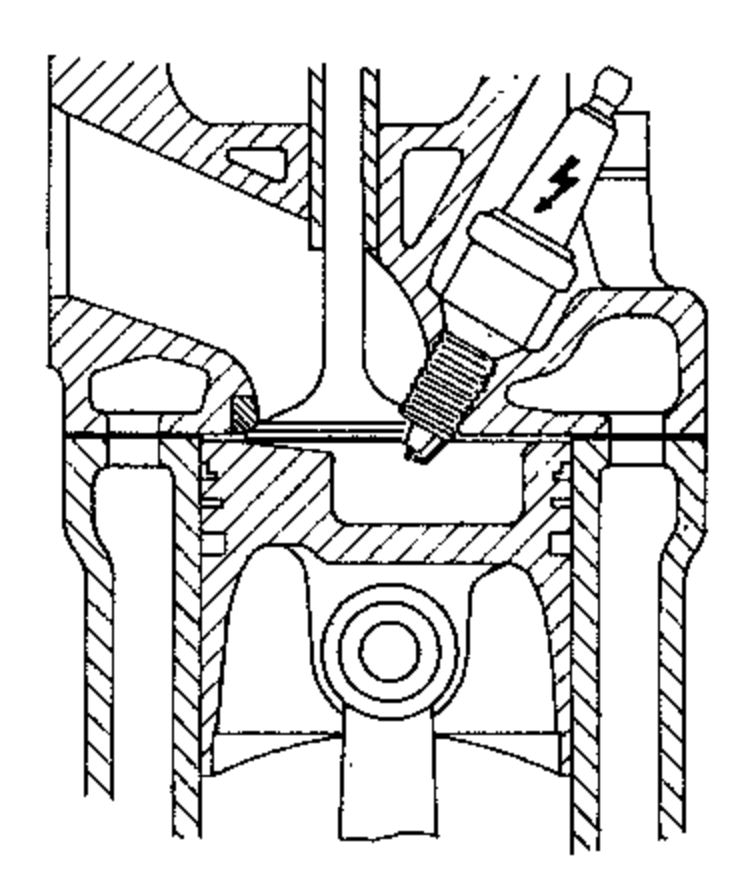{width=50%}

Por esta razón y también por el alto costo el sistema no ha dado origen a ulteriores desarrollos.

Las experiencias han demostrado por otra parte que se pueden alcanzar reducciones de consumo con cámaras más sencillas de alta relación de compresión, como por ejemplo la *fireball* May, con la cámara en el pistón sugerida por el Instituto de Investigaciones Ricardo (ver fig. 11) y también con otras tradicionales, en las que la estratificación del vórtice formado por el flujo en el cilindro se consigue con diseños especiales del conducto de admisión.

Por lo demás nuevos avances, realizados con el control electrónico computerizado aplicado al sistema de introducción del combustible y al encendido, han contribuido a reducir el consumo así como también las emisiones nocivas.

# CAPÍTULO XVII CARBURACIÓN E INYECCIÓN

### 1. La alimentación por depresión y por inyección

La alimentación de los motores ECh se realiza por medio de un conjunto que comprende, además del depósito del combustible, las siguientes partes:

- El filtro de aire y los conductos de admisión (o aspiración);
- La bomba del combustible con filtro y tuberías;
- El dispositivo para mezclar el combustible y el aire y regular el caudal.

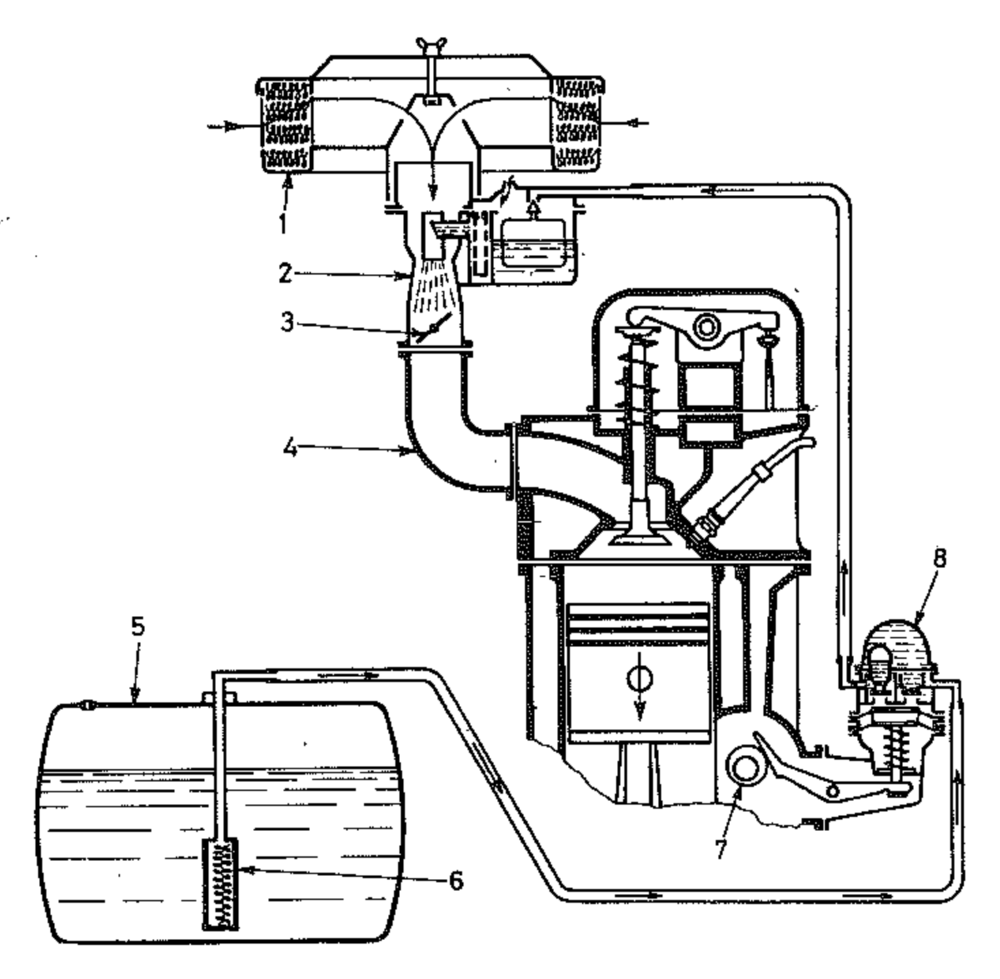

1. Filtro de aire - 2. Carburador - 3. Mariposa del carburador - 4. Colector (o múltiple) de aspiración - 5 Depósito de la gasolina - 6. Filtro del depósito - 7. Leva del árbol de levas - 8. Bomba mecánica para la alimentación de la gasolina.

Este dispositivo es la parte más importante y sofisticada del sistema de alimentación, puesto que de él depende la rapidez y la precisión de la respuesta del motor a los mandos y a las exigencias del servicio.

Dos son los principios adoptados:

Con el primero la gasolina es introducida y mezclada con el aire que pasa por el conducto de admisión por efecto de la depresión creada en él por la aspiración y se trata del carburador tradicional.

Con el segundo la gasolina es introducida bajo presión por medio de inyectores, es decir, por inyección.

Desde sus orígenes los motores de encendido por chispa funcionaron por carburación. Sólo desde hace algunos años la investigación encaminada a reducir las emisiones nocivas y los consumos ha iniciado la aplicación de la inyección.

La inyección a alta presión directamente en los cilindros se introdujo durante la Segunda Guerra Mundial en los motores de aviación alemanes, pero después fue abandonada. Hoy en día el tipo de alimentación por inyección más difundido es a baja presión en los conductos de aspiración por medio de inyectores dispuestos cada uno cerca de la válvula de admisión de cada cilindro. Se lo llama también multichorro (multipoint) para distinguirlo del más reciente **carburador a inyección** en el cual se disponen uno o más chorros como en el carburador tradicional. Esta disposición se llama en inglés «single point».

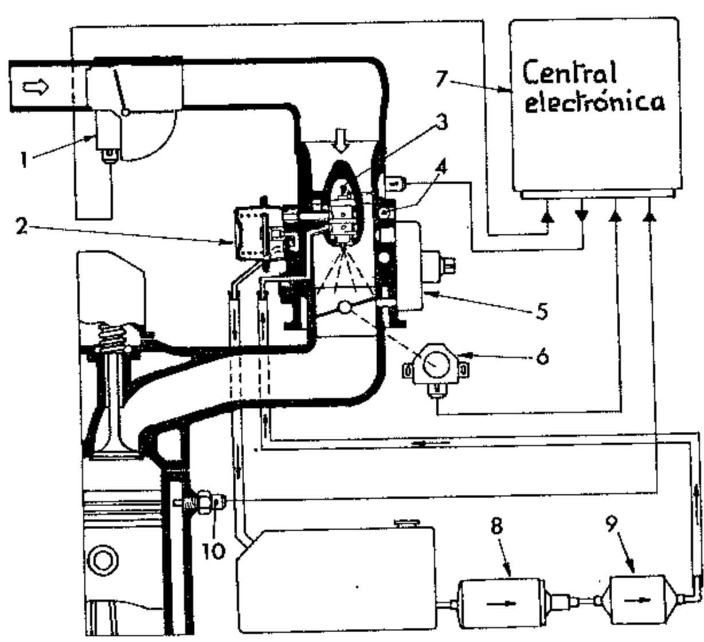

1. Sensor de aire - 2. Regulador de la presión del combustible - 3. Inyector - 4. Calentador por agua Dispositivo de aire suplementario - 6. Mando de la válvula de mariposa - 7. Centralita electrónica 8. Bomba eléctrica - 9. Filtro - 10. Sensor temperatura del motor.

Puesto que la inyección multichorro es la forma de inyección más difundida en los motores para autovehículos europeos, cuando digamos que un motor es a inyección entenderemos que se trata de inyección multichorro. Cuando nos sirvamos del término carburador entenderemos que se trata del tradicional que funciona por depresión; llamaremos carburador de inyección a un carburador en el cual la gasolina es introducida bajo una ligera presión por medio de uno o más inyectores.

Comenzaremos describiendo el carburador tradicional que es usado en la mayor parte de los motores ECh y que tiene la ventaja de ser bastante sencillo y de bajo costo. A continuación daremos información sobre los aparatos de inyección que han adquirido mayor importancia y difusión especialmente desde que la aplicación de la electrónica se ha extendido al automóvil. Efectivamente, el éxito de la inyección es, como veremos, consecuencia de la introducción de la electrónica para el control de la alimentación como medio para reducir el consumo de combustible y las emisiones.

### 2. Circuito de aire y combustible - Filtros, bombas

Antes de avanzar nos parece útil aludir a los componentes del circuito del aire y del combustible que, aunque no participan en la regulación del motor, son indispensables para su correcto funcionamiento y para su durabilidad, es decir, los *filtros* del aire y del combustible y las *bombas de circulación* del combustible.

Los filtros de aire más convenientes son de elementos de papel especial (fig. 14) o bien de baño de aceite (fig. 15). Los requisitos esenciales son:

1) alto rendimiento filtrante, es decir, capacidad de retener incluso las partículas más diminutas. Con los filtros de papel o de baño de aceite puede alcanzarse un rendimiento del 98 ÷ 99 %;

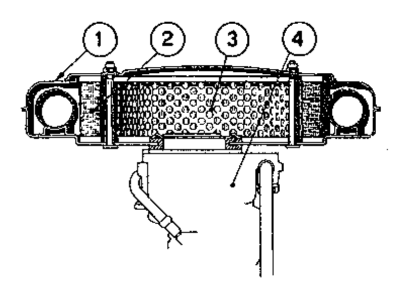

1. Cámara silenciadora - 2. Cartucho filtrante recambiable - 3. Cámara de aspiración - 4. Carburador.

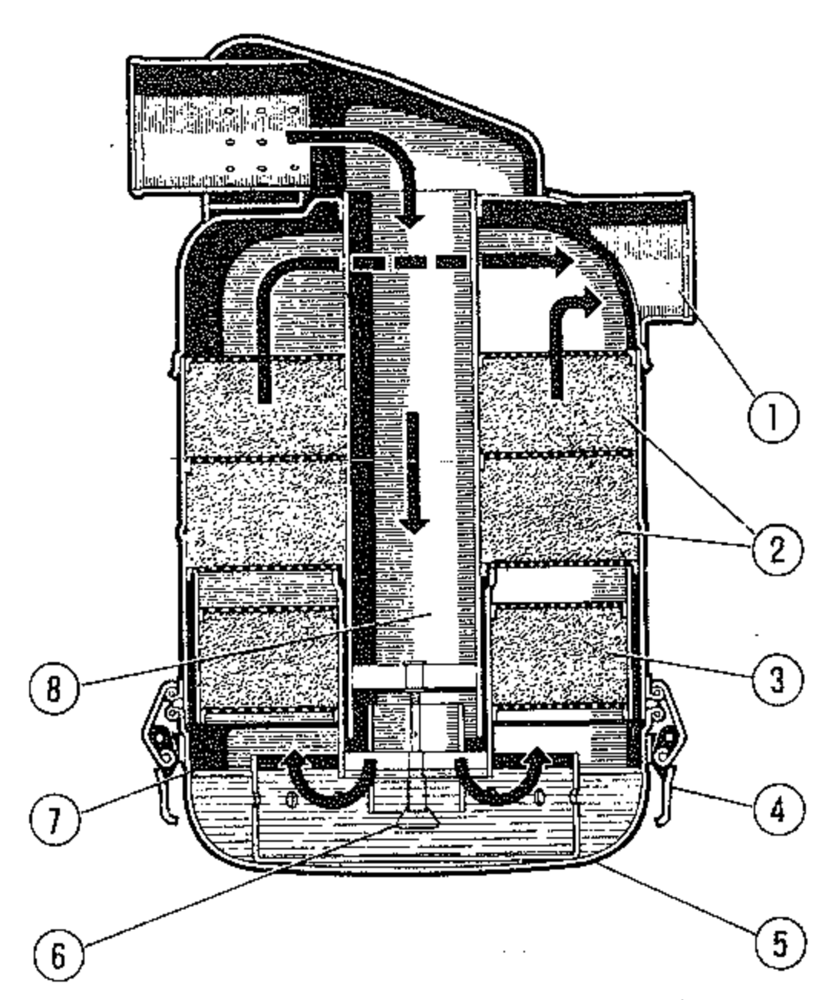

Salida del aire filtrado - 2. Elemento filtrante superior fijo - 3. Elemento filtrante inferior móvil - 4. Ganchos de unión de las dos partes del filtro - 5. Recipiente del aceite - 6. Tornillo de retención del filtro inferior - 7. Nivel del aceite - 8. Conducto de entrada del aire.

 buen poder de acumulación, es decir, posibilidad de funcionar por largos períodos sin necesidad de ser limpiado o cambiado;

3) baja pérdida de carga; normalmente  $150 \div 200 \text{ mm H}_2\text{O}$ .

Para los motores automovilísticos el filtro de aire está generalmente pensado de modo que también sirva como silenciador para reducir el ruido producido por el flujo pulsante en la entrada, el llamado ruido de aspiración. El silenciador consiste, generalmente, en una o más cámaras de resonancia adecuadamente dimensionadas.

En los automóviles de competición se usa a veces la toma de aire dinámica, constituida por un tubo captador del aire que, aprovechando la presión generada por la velocidad, hace más eficiente la alimentación del motor.

Para conducir el combustible desde el depósito al motor se emplean bombas de diferentes tipos. Cuando se puede instalar el depósito en posición más elevada que el carburador, se puede prescindir de la bomba. Para los motores automovilísticos se usan especialmente bombas de membrana o de émbolo sencillas y poco costosas (fig. 16).

La membrana, generalmente de tejido especial de alta resistencia, pulsa por acción de una palanca impulsada por el árbol de levas. El mando puede ser eléctrico (tipo Auto-Flux o Autopulse) y en tal caso se emplea un electroimán (fig. 16b). También se usan bombas eléctricas rotativas de varios émbolos o bien de rodillos, como en el caso de los sistemas de inyección (ver capítulo XVII.9).

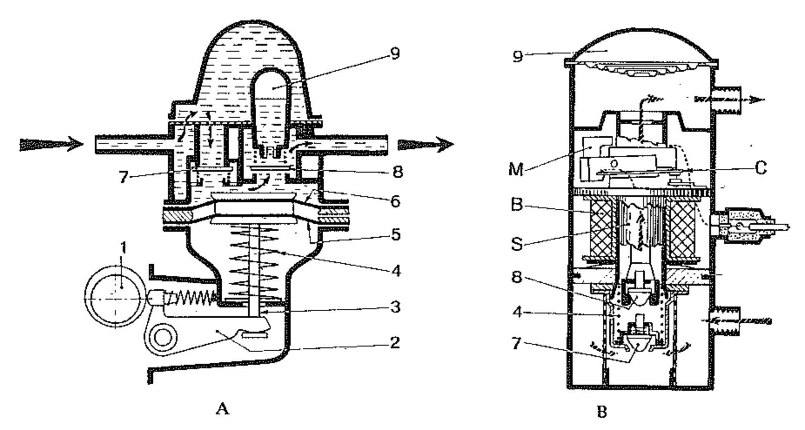

1. Leva del árbol de levas del motor - 2. Palanca intermedia - 3. Vástago - 4. Resorte de regulación de la presión de envío - 5. Membrana de cierre - 6. Membrana para bombear el carburante - 7. Válvula de aspiración - 8. Válvula de envío - 9. Cámara de aire - M) Imán permanente - C) Contactos - B) Bobina eléctrica - S) Embolo de bombeo.

Las **bombas eléctricas** tienen la ventaja de poder ser puestas en movimiento antes que el motor, por lo cual la gasolina alcanza el carburador con anticipación y el motor puede arrancar más rápidamente sin derroche de energía de la batería. Por otra parte pueden instalarse lejos del motor y de los tubos de escape para evitar la formación de burbujas de vapor por efecto del calor. También pueden estar sumergidas en el depósito.

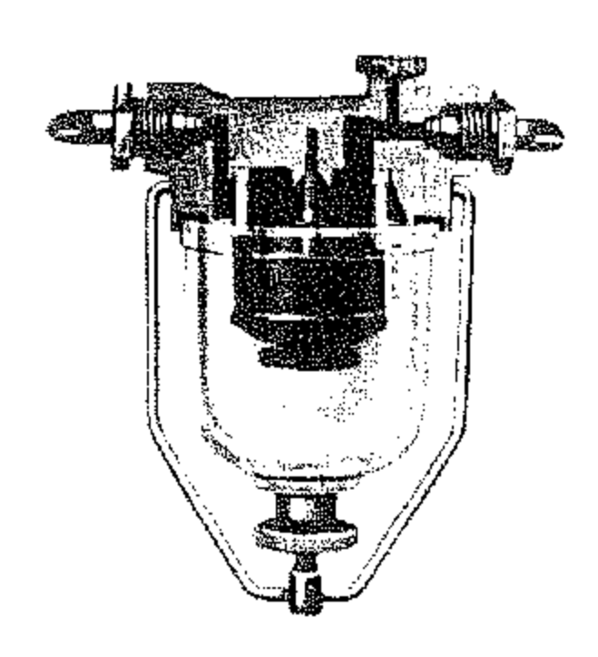{width=50%}

Para eliminar las partículas extrañas que podrían encontrarse en la gasolina o en el circuito y ser causa de obturación de los pequeños agujeros del carburador o de los inyectores, se insertan en el circuito pequeños filtros de papel en recipientes de plástico generalmente transparentes. Antes se usaban filtros de vaso que permitían controlar visualmente la presencia de partículas extrañas (fig. 17).

### 3. El carburador

El carburador debe cumplir las siguientes funciones:

- 1) dosificar la gasolina de modo de obtener la razón de mezcla (razón en masa combustible/aire) que satisfaga las condiciones de funcionamiento del motor;
  - 2) pulverizar la gasolina y mezclarla homogéneamente con el aire.

En el capítulo VI de la 1.ª parte, vimos cuáles son las exigencias del motor en lo referente a la razón de mezcla a diferentes regímenes. El carburador debe ser tal que satisfaga con la mejor aproximación posible estas exigencias; por lo tanto resulta bastante más complicado de lo que podría ser si debiera simplemente proporcionar una razón de mezcla constante para toda la gama de regímenes a los que el motor puede funcionar.

Para explicar cómo funciona nos referimos a la figura 18 que representa el esquema más elemental posible de un carburador vertical, tal como se lo usaba en los viejos motores con válvulas laterales. Está constituido por las siguientes partes:

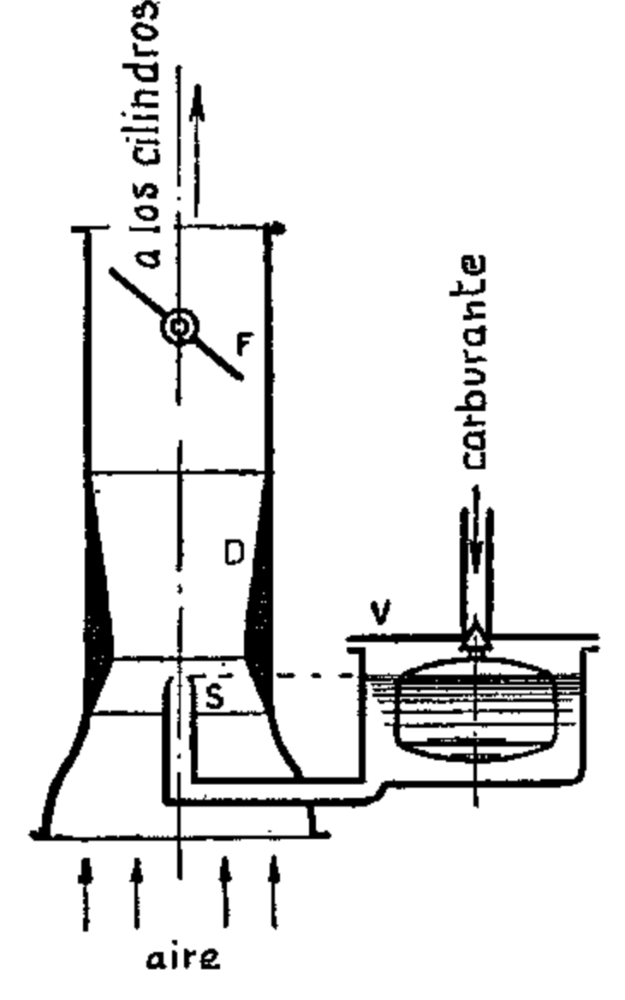{width=50%}

- a) Un depósito llamado *cuba* V, donde el carburante es mantenido a nivel constante;
- b) Un difusor D en forma de tubo Venturi;
- c) Un surtidor S del cual fluye el carburante reclamado por la depresión que se genera en la sección más estrecha del Venturi;
- d) Una válvula F (generalmente de mariposa), situada después del surtidor, que sirve de órgano de regulación de la cantidad de aire y por lo tanto de mezcla que se introduce en los cilindros.

La cuba a nivel constante sirve para mantener el nivel del combustible aproximadamente a la altura del surtidor. Esto se consigue mediante un flotador (fig. 18) construido de delgada chapa de bronce, o de corcho barnizado, o de plástico, que actúa directamente, o mediante una pequeña palanca, sobre una válvula cónica; la válvula se abre en cuanto el nivel desciende y deja entrar más carburante.

Este sistema tiene la ventaja de ser bastante sencillo y sólo en raras ocasiones da lugar a irregularidades de funcionamiento por defecto en el cierre de la válvula o por sensibilidad a las acciones dinámicas. Para los autovehículos la forma y la posición del flotador en el carburador, y del surtidor con respecto al flotador, se escogen de modo que el nivel con relación al surtidor se mantenga correcto incluso en subidas o en curvas.

El difusor (o Venturi) sirve para crear a la altura del surtidor la depresión necesaria para la aspiración del carburante.

Según la posición del difusor y la dirección del flujo del fluido el carburador se denomina horizontal o vertical; invertido cuando el flujo está dirigido de arriba hacia abajo. Éste es el más difundido en el sector automovilístico por razones de espacio y porque el movimiento del flujo se ve favorecido por la gravedad.

El diámetro de la sección más estrecha del Venturi se escoge de modo que, a bajo número de revoluciones, la velocidad del aire sea aún suficiente para aspirar carburante del surtidor, y a alto número de revoluciones, no sea demasiado fuerte para no rebajar excesivamente el rendimiento volumétrico y por lo tanto la potencia. El límite máximo de la velocidad media del aire (para corriente de aspiración considerada uniforme) es, para los motores de 4 y de 6 cilindros, de alrededor de los 120 m/s.

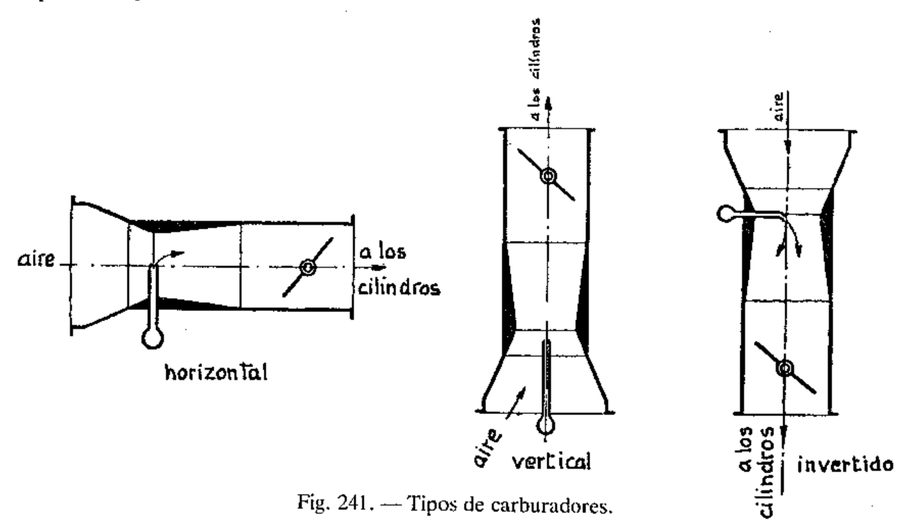

Los dispositivos especiales para aumentar el grado de pulverización (cuerpos de choque, rejillas finísimas, ventiladores o hélices accionadas por el aire aspirado, etc.), son generalmente inútiles o perjudiciales porque aumentan la resistencia al paso del aire reduciendo por lo tanto el rendimiento volumétrico del motor.

El caudal del surtidor está determinado por el diámetro del calibre. El calibre está generalmente constituido por un pequeño tornillo desmontable, provisto de un agujero calibrado, situado en el conducto que lleva el combustible al surtidor. El diámetro de la perforación, llamado diámetro del calibre, es una de las dimensiones características del carburador y se expresa en centésimas de mm (80/100, 125/100, etc.). Variando el diámetro del calibre se puede enriquecer o empobrecer la mezcla y variar dentro de ciertos límites las prestaciones y el consumo del motor, o bien permitir el funcionamiento con carburantes de densidad y poder calorífico diferentes del normal (etanol, benzol, etc.).

La válvula para la regulación del caudal de la mezcla es, en la gran mayoría de los casos, del tipo de mariposa; en algunos tipos de carburador tiene forma de compuerta o de macho cilíndrico, o de cuña. La forma de la válvula puede tener importancia para la regularidad de funcionamiento del motor durante las variaciones de régimen.

Un carburador elemental como el descrito no podría satisfacer las exigencias del motor, que varían según el número de revoluciones, la temperatura y la presión atmosférica. Otras exigencias están relacionadas con el arranque en frío, la marcha en vacío (ralentí, mínimo), la aceleración, la economía de combustible.

Ya hemos aludido a la sensibilidad del carburador ante las acciones dinámicas; en su momento añadiremos algunas otras observaciones para el caso especial de los motores de aviación.

### 4. Regulación automática de la razón de mezcla

El caudal Q y la velocidad de flujo W están relacionadas con la diferencia de presiones y con la densidad  $\gamma$  según la expresión:

$$Q = \beta \cdot S \cdot W = \beta \cdot S \cdot \sqrt{\frac{2H}{\gamma}} \quad (^{1})$$

(i) Si con  $\gamma$  se indica el peso específico (sistema técnico),  $Q = \beta \cdot S \cdot \sqrt{\frac{2g \cdot H}{\gamma}}$  donde g es la aceleración de gravedad.

donde  $\beta$  es el coeficiente de reducción del caudal y S es la sección del flujo. La expresión es válida tanto para el aire como para el combustible.

Para el aire el coeficiente  $\beta$  es prácticamente constante al variar la diferencia de presión H. Para el carburante,  $\beta$  es función creciente de H como consecuencia de complejos fenómenos debidos a la superposición del movimiento laminar y el movimiento turbulento en el calibre, considerado como un tubo capilar de pequeñísima longitud. Las variaciones del coeficiente  $\beta$  en función de H dependen de la longitud, del diámetro y de la forma del extremo del calibre.

Por lo tanto si se tara el carburador para la razón de mezcla adecuada para el máximo número de revoluciones, la mezcla resultará excesivamente pobre a bajo régimen; al contrario, si se adopta una razón aire/combustible adecuada para los regímenes bajos, la mezcla será demasiado rica para el máximo número de revoluciones.

Para evitar este inconveniente se han ideado diferentes dispositivos, en base a los cuales se distinguen los tres tipos más característicos de carburadores calibrados:

#### 1) Carburador con calibre compensador (Zenith)

En la figura 20 se ilustra el funcionamiento de este carburador; la acción del calibre principal P regulado para la dosificación adecuada para el máximo número de revoluciones, es corregida mediante un calibre secundario y compensador C que enriquece la mezcla a regímenes bajos.

El calibre compensador C descarga en el pozo de aceleración R, abierto a la atmósfera y que comunica con el conducto del carburador mediante un surtidor subsidiario puesto en paralelo con el surtidor principal.

El calibre compensador C no es afectado por los efectos de la depresión que existe en el difusor y eroga un caudal que depende solamente de la columna de carburante, y por lo tanto es constante cualquiera que sea el régimen del motor. La mezcla formada por el calibre compensador es por lo tanto más pobre cuanto más alto es el régimen del motor.

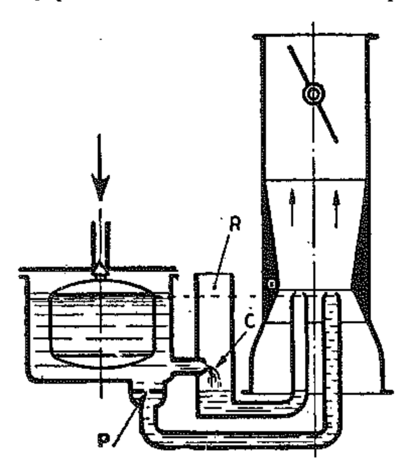{width=50%}

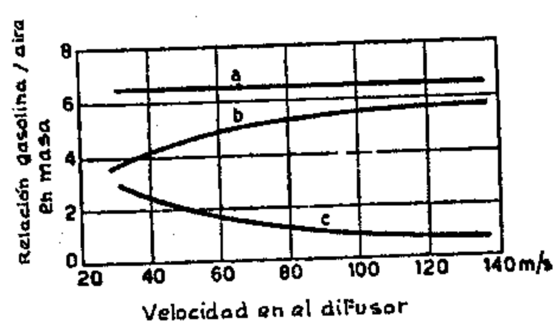{width=50%}

En la figura 21 la curva b representa la ley de variación de la razón aire/combustible (expresada en %) debida al calibre principal, la c la debida al compensador y la a la de la razón resultante.

#### 2) Carburador de aire suplementario (Krebs-Pallas)

La mezcla, dosificada para los regímenes bajos, es empobrecida a los regímenes altos mediante aire aspirado por una lumbrera colocada después del difusor y mandada automáticamente por la misma depresión producida por la aspiración (Krebs). El sistema da lugar a inconvenientes por el movimiento de algunos órganos (resortes, válvulas, etc.) y ha sido útilmente perfeccionado en la solución Pallas con la adición de un calibre de aire corrector además del calibre de aire principal normal (fig. 22).

#### 3) Carburador de aire antagonista (Solex-Weber)

La mezcla, también aquí dosificada para los regímenes bajos, es empobrecida para los altos regímenes mediante aire que, aspirado por la misma depresión, actúa antagónicamente al combustible (figs. 23, 24). Este aire, con un dispositivo especial, puede ser finamente subdividido para formar con el carburante una emulsión que mejora la formación de la mezcla. El dispositivo, llamado emulsionador, es corrientemente usado en los carburadores para autovehículos y para aviación.

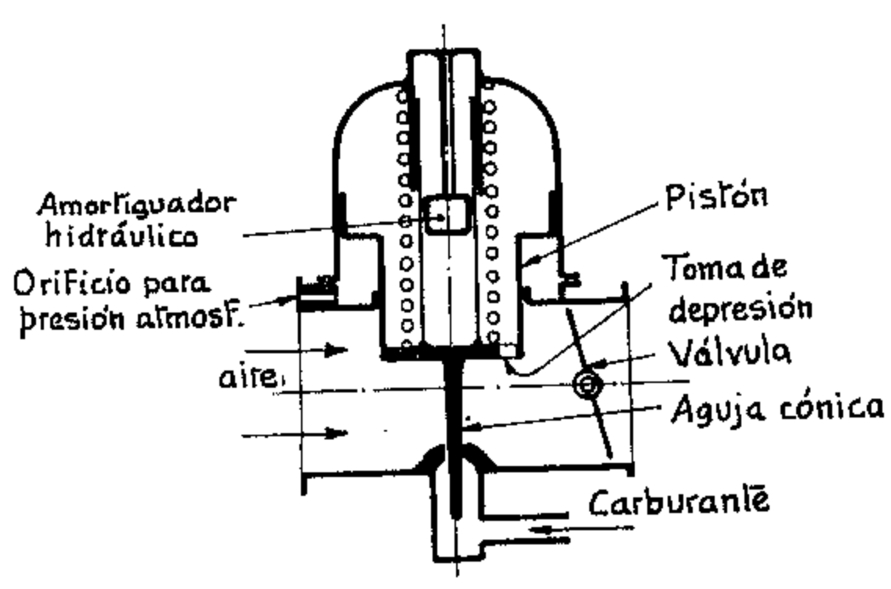{width=50%}

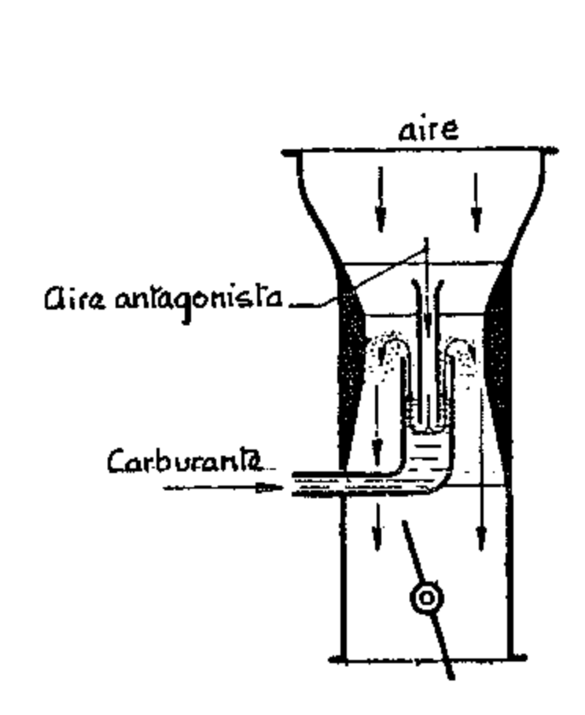{width=50%}

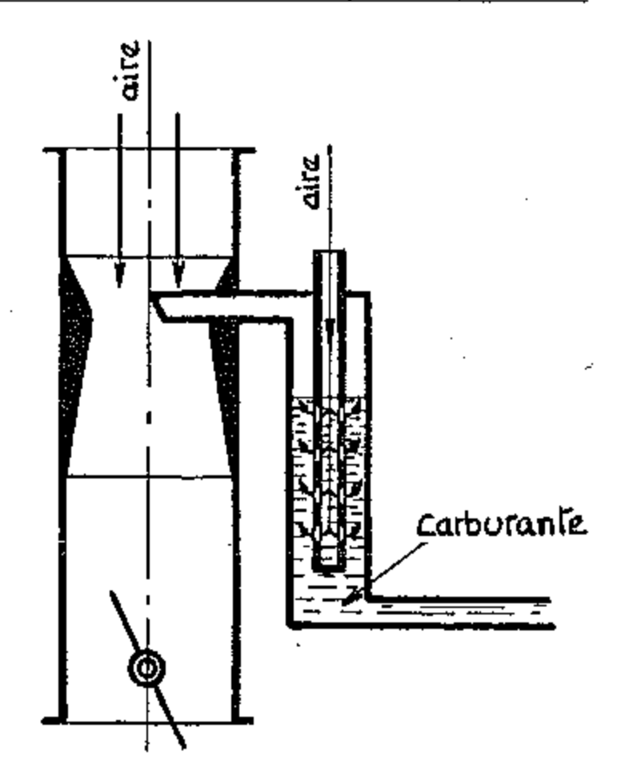{width=50%}

#### 4) Carburador de difusores múltiples

Difiere de los normales por la presencia de dos o tres tubos venturi montados en serie de modo que la sección terminal del más pequeño coincida con la sección mínima del más grande. El surtidor está puesto coincidiendo con la sección mínima del difusor más pequeño (fig. 25). Las ventajas de este tipo carburador son:

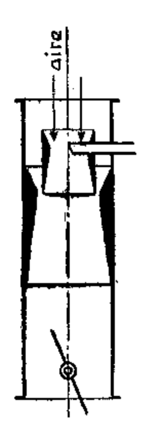{width=50%}

1) mayor velocidad del aire y consiguiente mayor depresión en el calibre a las bajas velocidades y en la aceleración;

2) por la presencia de un cojinete anular de aire entre los difusores, las partículas líquidas de carburante no entran en contacto con las paredes del cuerpo en el tramo más frío y por lo tanto no se depositan en él;

3) mayor homogeneidad de la mezcla, y por lo tanto mejor distribución de ésta entre los cilindros.

### 5. Dispositivos del carburador para el arranque, el régimen mínimo y la aceleración

Para el arranque en frío es necesario que la mezcla sea muy rica para compensar las condensaciones que con facilidad se producen sobre las paredes frías de los conductos y de los cilindros.

Los dispositivos ideados con este fin, comúnmente llamados starter, se distinguen en dos categorías: con mariposa suplementaria de estrangulación y con carburador auxiliar. En el primer caso una mariposa suplementaria dispuesta antes del surtidor (figs. 26-249), restringiendo el conducto del aire expone el surtidor a una fuerte depresión que hace salir una cantidad abundante de carburante. En el segundo caso un pequeño carburador auxiliar está colocado en paralelo con el principal y actúa por la fuerte depresión que en éste se verifica cuando mediante un mando especial se pone la mariposa en la posición de mínimo.

Tanto el sistema de mariposa suplementaria como el del carburador auxiliar pueden ponerse en condiciones de funcionar, en el momento del arranque, por un mando manual, o bien automáticamente, mediante un resorte bimetálico sensible a las variaciones de temperatura ya sea del aire calentado por el múltiple de escape o del agua de refrigeración del motor.

En la figura 249 se ilustra un sistema con mariposa suplementaria con mando-semiautomático que requiere que el conductor conecte el starter antes del arranque apretando a fondo el pedal del acelerador.

También para la marcha al mínimo es necesario, como sabemos, que el carburador proporcione mezcla rica. Puesto que el surtidor principal da un caudal escaso y la velocidad del aire es demasiado baja para poder arrastrar consigo el carburante, se pone remedio aprovechando el hecho de que, estando la válvula de mariposa casi completamente cerrada, se tiene, después de ella, una fuerte depresión. Esta última es utilizada para aspirar el carburante de un surtidor especial (surtidor de mínimo o ralentí) o bien de una derivación del surtidor principal.

La regulación de la dosificación del mínimo, además de con la elección del diámetro del calibre respectivo, se efectúa mediante un tornillo de regulación de la mezcla aspirada por el motor; la regulación del régimen de funcionamiento al mínimo se consigue mediante otro tornillo, que permite abrir ligeramente la válvula de mariposa del carburador.

También para las fases de aceleración se debe recurrir a una erogación suplementaria de carburante. Durante estas maniobras se tiene en los conductos de aspiración un brusco aumento de presión (de unos 0,3 a unos 0,9 bares) que obstaculiza la evaporación; además, dada la baja velocidad inicial del aire y la resistencia debida a la inercia del líquido, el aumento de caudal requerido del calibre principal se produce con un cierto retraso, por lo que sin un enriquecimiento adecuado de la mezcla el motor tardaría en alcanzar el régimen deseado o incluso tendría tendencia a detenerse. Se instala por esto una pequeña bomba de aceleración de membrana (fig. 251) o de émbolo, cuya acción se explica pulverizando carburante a través de un calibre especial.

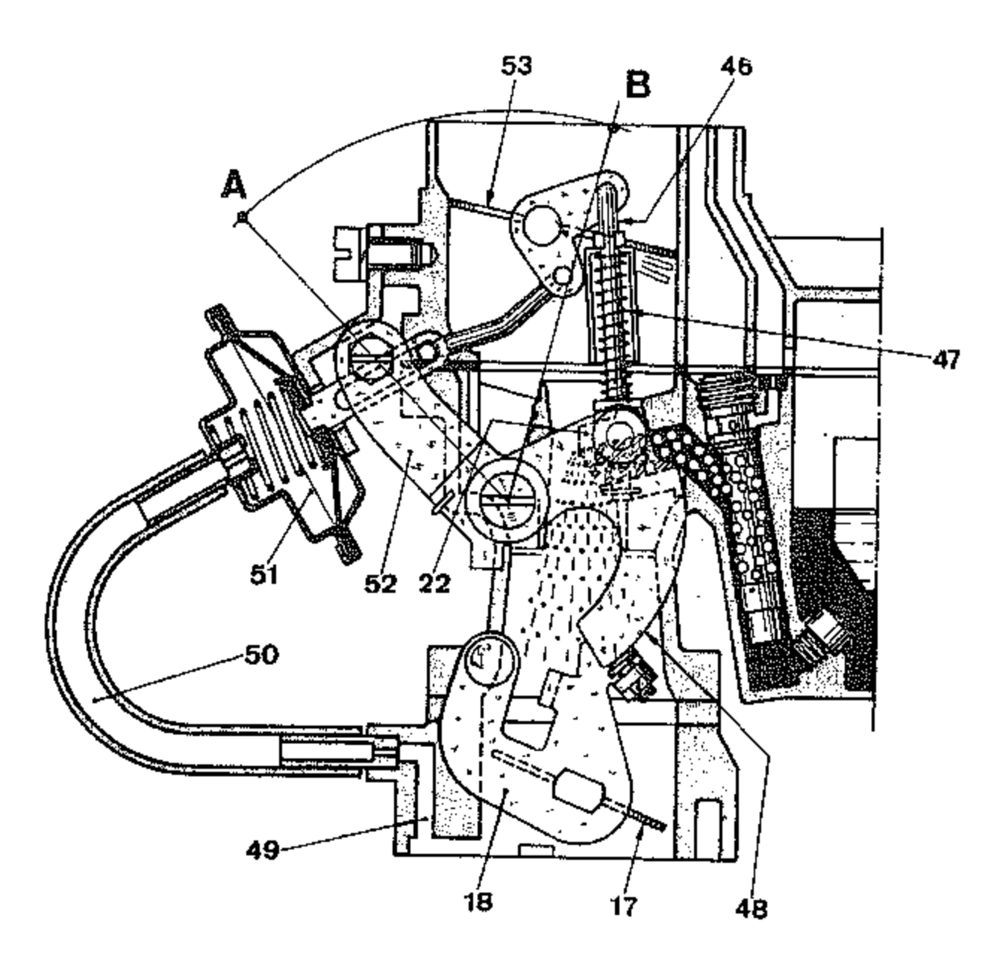{width=50%}

Arranque — Con la palanca (52) en la posición (A) la mariposa (53) obstruye la toma de aire del carburador mientras que mediante la leva (52) y la palanca (18), la mariposa (17) se abre parcialmente (mínimo veloz). El surtidor (22) eroga por tanto una mezcla idónea para permitir un pronto arranque del motor. Con el motor en marcha, la depresión abre parcialmente la mariposa (53) contra la acción del resorte calibrado (47). La depresión existente después de la mariposa (17) a través del canal (49) y el conducto (50), actúa sobre el dispositivo de membrana (51), provocando un ulterior descenso del título de la mezcla, permitiendo una marcha regular del motor. Alcanzada la temperatura de régimen, el dispositivo se desconecta completamente. Posición (B): la mariposa (53) es mantenida completamente abierta por el tirante (46), mientras la mariposa (17) es puesta en la posición de mínimo normal. — Arranque del motor. Se conecta completamente el dispositivo de arranque tirando de la maneta a fondo, posición (A). — Puesta en eficiencia del vehículo. Durante el período de calentamiento del motor, incluso con el vehículo en movimiento, el dispositivo se desconecta gradualmente. — Marcha normal del vehículo, dispositivo desconectado — Posición (B) en cuanto el motor ha alcanzado la temperatura de régimen.