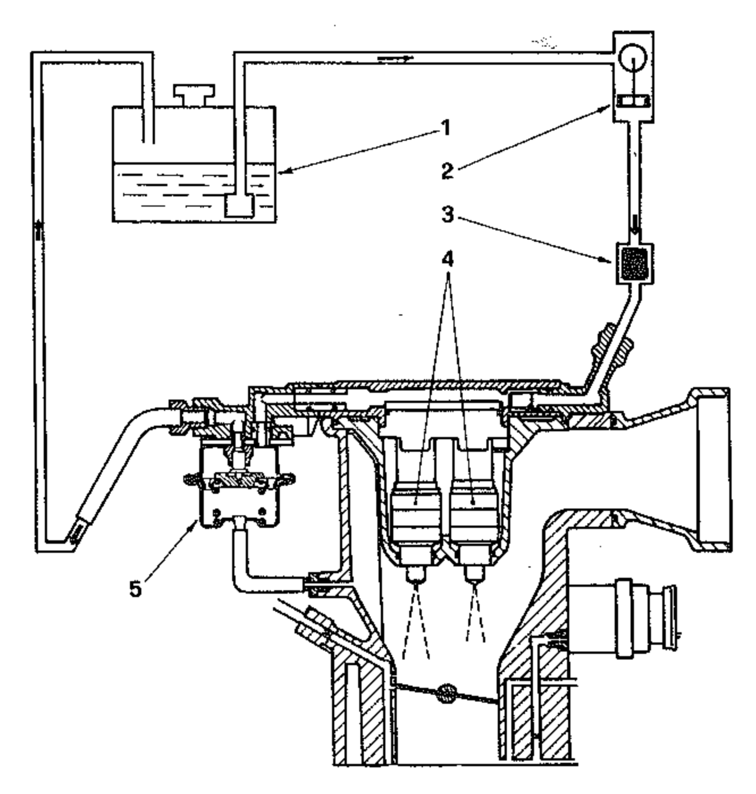
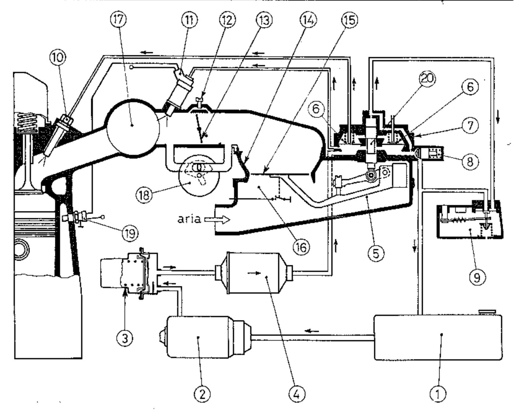
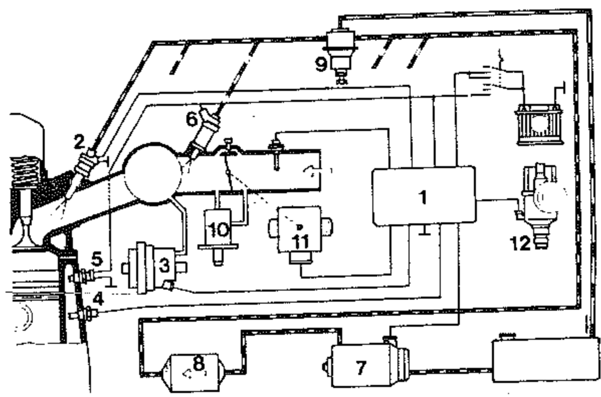
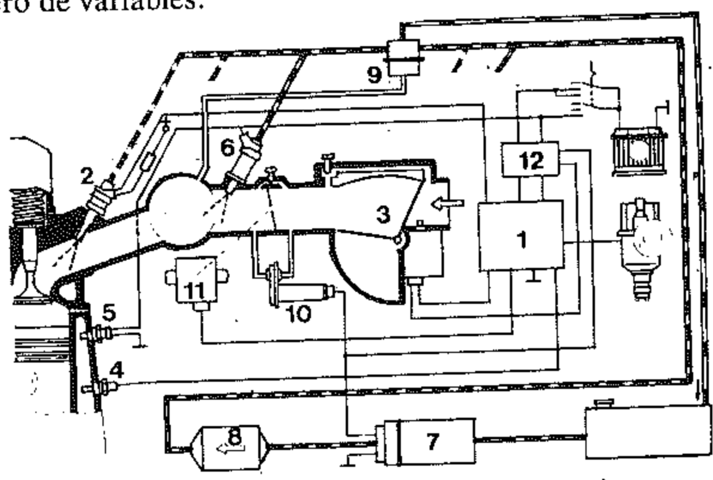
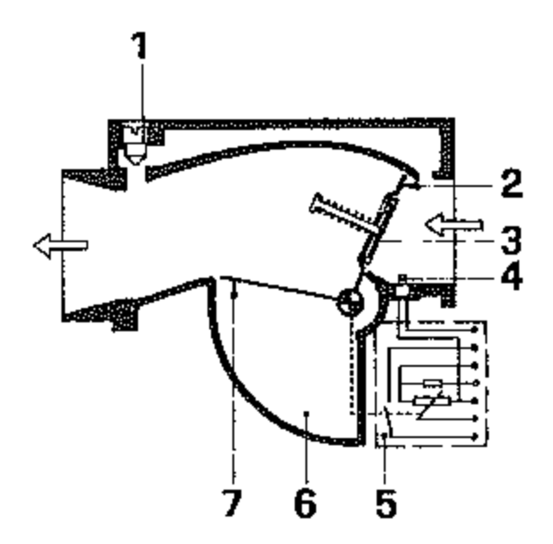
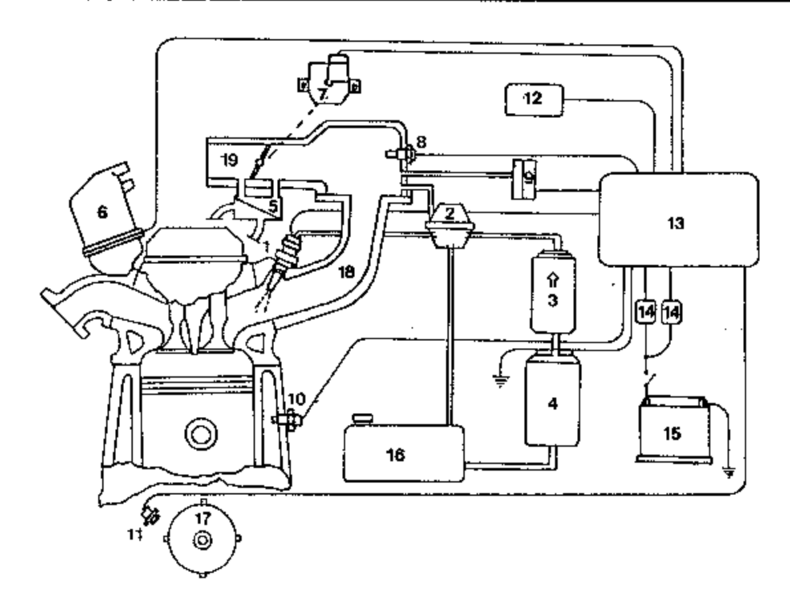
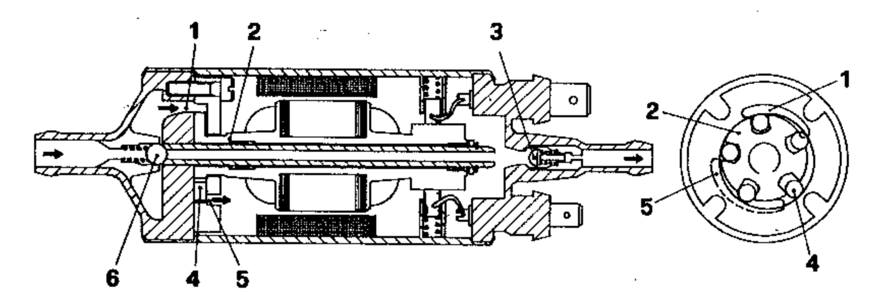
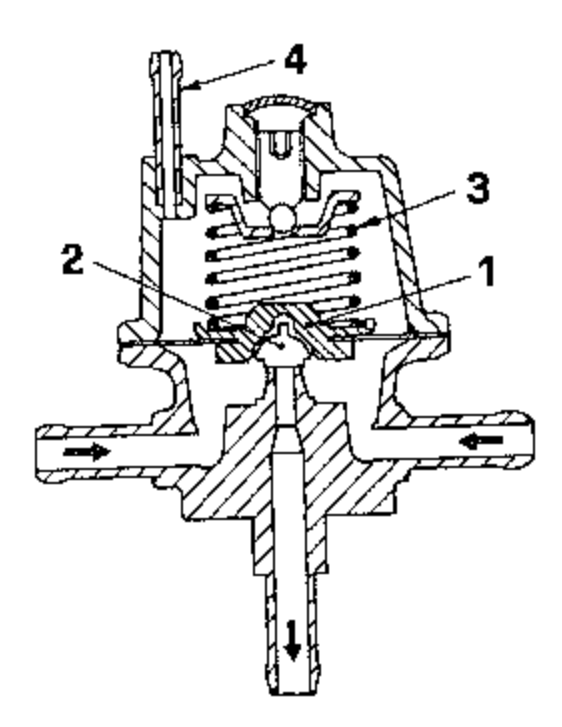
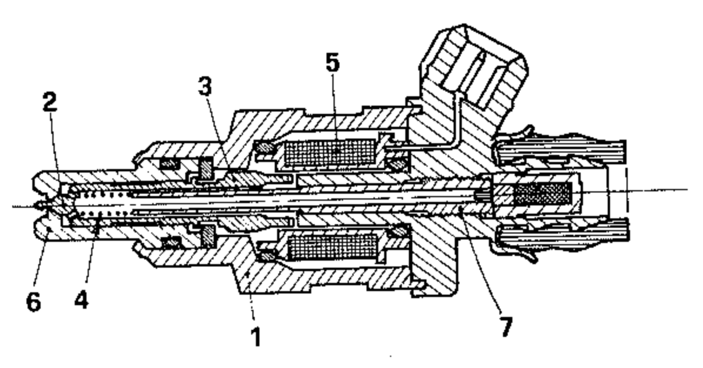

# La inyección de gasolina para los autovehículos

En los motores para autovehículos la carburación por inyección se ha desarrollado progresivamente primero bajo el empuje de las investigaciones sobre mejores prestaciones y después, recientemente, para reducir las emisiones nocivas y el consumo de combustible.

La inyección tiene la ventaja potencial de un mayor rendimiento volumétrico, por la ausencia del tubo Venturi y del calefactor en la entrada del aire, y por lo tanto también de un menor consumo, un mayor par motor y mayor potencia. Además hace-posible realizar una dosificación precisa de la gasolina en relación a la carga en toda la gama de revoluciones y en las fases de transición.

Otras ventajas son la ausencia de formación de hielo, el fácil arranque en frío, ninguna forma de condensación de gasolina, ningún problema en el caso de fuertes aceleraciones positivas o negativas cualquiera que sea la posición del motor, no siendo necesaria la cuba de nivel constante característica de los carburadores tradicionales.

Las desventajas son el costo más alto y la mayor complejidad.

La inyección directa en la cámara de combustión presenta problemas funcionales y tecnológicos no indiferentes:

- La presión de inyección tiene que ser alta

- El tiempo de duración del chorro muy breve

- El inyector debe resistir la temperatura elevada del interior de la cámara, por lo que la fabricación es necesariamente extremadamente precisa, con tolerancias muy estrechas, y las piezas deben ser robustas, relativamente pesadas; en definitiva, el costo resulta más bien elevado.

La inyección directa fue adoptada con éxito durante la Segunda Guerra Mundial por las empresas alemanas Daimler-Benz y Junkers en motores ECh para aviones de caza con un sistema compuesto por la bomba de émbolos y los inyectores, similar, con las adaptaciones adecuadas, al de los motores Diesel rápidos (ver capítulo XXVI).

Hemos visto cómo para los motores de aviación la Stromberg, americana, resolvió entonces el problema de manera más sencilla y económica con la inyección indirecta, es decir con el carburador a inyección. De esto se derivan los sistemas de inyección indirecta usados hoy en día incluso en los motores automovilísticos.

La inyección indirecta se realiza en los conductos individuales de admisión a los cilindros o en la entrada del colector donde normalmente se aplica el carburador tradicional. Ella presenta las siguientes ventajas:

- Presión relativamente baja

- No requiere de una bomba impulsada mecánicamente en fase con el motor
- Los inyectores no están sometidos a altas temperaturas.

Ya hemos dicho (ver capítulo 1) que la inyección puede ser de dos tipos:

- Multichorro, es decir, con un inyector correspondiente a cada válvula de admisión cercano a la entrada;
- Monochorro en el carburador a inyección, es decir, con inyección en un solo punto (single point) a la entrada del colector de admisión de la mezcla.

La posición más racional es evidentemente cerca de la válvula de admisión: la influencia de las aspiraciones de los demás cilindros se hace sentir de manera despreciable: despreciable es también la condensación de la gasolina que se evapora al contacto con la válvula de admisión relativamente caliente; es mínimo el riesgo de una desigual distribución del combustible entre los cilindros. Por estas razones la inyección con un inyector por cilindro se ha impuesto y es la más difundida en los automóviles europeos.

El carburador a inyección, comúnmente llamado en inglés single point (ver. fig. 1), fue desarrollado para reducir el costo del sistema de inyección. En efecto, éste puede ser aplicado también en motores diseñados para funcionar con carburador tradicional a depresión.

En comparación con la inyección multichorro presenta el inconveniente común a los carburadores que alimentan diferentes cilindros, es decir, de una imperfecta distribución de la mezcla.

 1. Depósito - 2. Bomba de combustible - 3 - Filtro - 4. Electroinyectores - 5. Válvula de regulación de la presión del carburante. El carburador a inyección fue adoptado por primera vez por la General Motors y por la Ford en los automóviles modelo 1979, y después por otros fabricantes de autos en los USA y en Japón.

En Europa los mayores méritos en este sector deben atribuirse a la Bosch que desarrolló en Alemania la inyección a baja presión tanto multichorro como single point con regulación de la dosificación, tanto mecánica como electrónica.

Los dispositivos realizados por la Bosch han sido llamados: K-Jetronic el de control mecánico, D y L-Jetronic los de control electrónico.

En el sistema K-Jetronic la inyección es continua y la bomba eléctrica de carburante proporciona la presión de 4,7 bar que se reduce a 3,3 bar cuando llega a los inyectores. En los sistemas D y L-Jetronic la inyección es intermitente, repartida en dos veces por cada ciclo de 4 tiempos, y la presión se mantiene entre 2 y 3 bar según el motor variando en relación con la presión en el conducto de admisión. También la Weber ha desarrollado sistemas similares.

# 10. Inyección Bosch K-Jetronic

La figura 2 ilustra el sistema K-Jetronic para un motor con los inyectores instalados en la culata cerca de las válvulas de admisión.

Una electrobomba 2 rotativa de rodillos alimenta un acumulador 3 cuya función es la de mantener la presión incluso después de la detención para evitar la formación de burbujas de vapor. A través de un filtro 4 la gasolina es enviada al distribuidor 7 que regula la cantidad para la exacta dosificación de la mezcla en relación con la cantidad de aire aspirado por el cilindro. La gasolina en exceso regresa al depósito pasando a través de una válvula 8 de regulación de la presión. La cantidad de aire se mide con el dispositivo 16 que consiste esencialmente en un disco flotante 15 soportado por una palanca que actúa sobre la válvula de émbolo 20. El disco se levanta en el difusor en una medida proporcional a la cantidad de aire aspirado en relación con la apertura de la mariposa 13 y con la palanca desplaza el émbolo piloto. Éste con su movimiento varía la apertura de unas ranuras rectangulares que, una por cilindro, regulan el caudal del combustible. Después de cada ranura de regulación hay una válvula 6 de presión diferenciada cuyo efecto es el de hacer que la cantidad de combustible que pasa a través de cada ranura sea proporcional a la sección de paso de la misma ranura. En efecto, con este fin las válvulas 6 crean una diferencia de presión constante de 0,1 bar entre la sección antes y la de después de cada ranura. La gasolina alcanza los inyectores 10 y es inyectada de manera continua a una presión de unos 3 bar en la cantidad justa, regulada por el medidor de la cantidad de aire 16 y por el distribuidor de carburante 7. Otras posibilidades de corrección de la razón de mezcla están dadas por la elección de la forma y de las dimensiones del difusor 14.

Las exigencias para las diferentes condiciones de servicio del motor son satisfechas por el regulador 9 de la fase de calentamiento, por la válvula de aire suplementario 18 y por el electroinyector para el arranque 11. El dispositivo 9 por medio de una válvula accionada por una plaqueta bimetálica calentada eléctricamente al arranque, regula la presión piloto que actuando sobre el pistón 20 contrasta el movimiento de la palanca accionada por el disco flotante, de modo que con el motor frío la presión piloto disminuye, el dispositivo flotante se levanta y la gasolina entregada aumenta.

Durante el calentamiento interviene también la válvula 18 para proporcionar aire suplementario.

Durante el arranque el electroinyector 11, controlado por un interruptor eléctrico de tiempo 19, que percibe la temperatura del motor, proporciona gasolina suplementaria.

1. Depósito - 2. Electrobomba - 3. Acumulador de carburante - 4. Filtro de carburante - 5. Regulador de la mezcla - 6. Válvula de presión diferenciada - 7. Distribuidor de carburante - 8. Regulador de presión principal - 9. Regulador de la fase de calentamiento del motor - 10. Inyector - 11. Electroinyector para el arranque - 12. Tornillo para la regulación del mínimo - 13. Mariposa - 14. Difusor y conducto del aire - 15. Disco flotante - 16. Medidor de la cantidad de aire - 17. Colector de aspiración - 18. Válvula para el aire suplementario - 19. Interruptor térmico de tiempo - 20. Válvula de émbolo, pistón piloto.

### 11. Inyección Bosch D y L-Jetronic

En los sistemas D y L-Jetronic (figs. 3, 4) una central electrónica cumple las funciones que en el K-Jetronic están confiadas a la unidad de regulación y repartición del carburante. La central regula la duración del chorro de cada electroinyector por medio de una válvula accionada por un solenoide y contenida en el mismo inyector (fig. 5).

1. Central electrónica de control - 2. Electroinyectores - 3. Sensor de presión - 4. Sensor de temperatura Interruptor térmico o interruptor térmico de tiempo - 6. Electrointerruptor de arranque en frío - 7. Electrobomba de alimentación de carburante - 8. Filtro de carburante - 9. Regulación de la presión de carburante - 10. Válvula de aire adicional - 11. Interruptor en la mariposa - 12. Contactos de conexión de la inyección.

Unos sensores de medida obtienen las condiciones de trabajo del motor, transmiten las informaciones a la central electrónica en forma de señales eléctricas y ésta determina las necesidades de carburante y controla los inyectores que dosifican e inyectan la cantidad justa que necesita el motor.

La regulación electrónica sustituye partes mecánicas que podrían gastarse o deteriorarse, y tiene la ventaja de ser más precisa y de responder a un mayor número de variables.

 1. Central electrónica de control - 2. Electroinyector - 3. Medidor de la cantidad de aire - 4. Sensor de temperatura - 5. Interruptor térmico de tiempo - 6. Electroinyector de arranque en frío - 7. Electrobomba de alimentación de carburante - 8. Filtro de carburante - 9. Regulación de la presión de carburante - 10. Válvula de aire adicional - 11. Interruptor en la mariposa - 12. Relé compuesto.

{width=50%}

 1. Tornillo de regulación del régimen de mínimo - 2. Válvula flotante de charnela - 3. Válvula para el retorno de llama - 4. Sensor de temperatura del aire. 5 - Contactos eléctricos - 6. Cámara de amortiguación - 7. Aleta de compensación.

Puesto que los inyectores se abren eléctricamente, la presión de inyección es más baja que la que se necesita para los inyectores del sistema K, los cuales se abren a causa de la presión. Además, para asegurar una distribución uniforme de la gasolina a todos los cilindros, ésta es inyectada por mitades, dos veces en cada conducto durante cada ciclo de 4 tiempos, es decir, cada 360 de rotación del árbol de distribución.

El comienzo de cada inyección es transmitido a la central por un contacto del distribuidor de encendido (ver capítulo XVIII) y la central responde cada segunda señal en los motores de 4 cilindros y cada tercera señal en los motores de 6 cilindros. La duración del chorro es regulada en el sistema D (Druckfühlergesteuerte) en relación con la presión del aire en el colector de aspiración (fig. 3), mientras que en el sistema L (Luftmengegesteuerte) es regulada en relación con la cantidad de aire.

El sistema L-Jetronic representa un avance comparado con el sistema D, por eso se lo describe aquí, aunque sea brevemente, con referencia a la figura 4.

En el medidor de la cantidad de aire aspirado (fig. 5), éste, a su paso, ejerce sobre el plano móvil o aleta de una válvula de charnela un empuje, al cual se opone la carga de un resorte (no indicado en la figura). La posición angular que la válvula asume por efecto del empuje del aire es transmitida a un potenciómetro y éste proporciona a la central electrónica, en forma de tensión, una señal proporcional al caudal.

Como muestra la figura, la válvula de charnela es solidaria con una segunda aleta que se mueve en una cámara llena de aire que sirve para amortiguar las oscilaciones.

Las fuerzas generadas por el aire sobre las dos aletas se equilibran, por lo que las contrapresiones no tienen ningún efecto. Por otra parte una válvula de sentido único, instalada en la aleta principal, protege el dispositivo en el caso de eventuales retornos de llama.

La duración de inyección depende principalmente de la señal emitida por el medidor del caudal de aire, pero tiene que ser variada en relación con otras señales provenientes de otros sensores; la velocidad del motor es señalada por la frecuencia de los contactos del distribuidor de encendido; un interruptor unido a la válvula de mariposa interviene para solicitar un enriquecimiento de la mezcla a plena carga o en ralentí; un sensor de temperatura sirve para corregir la duración de la inyección en relación con la densidad del aire.

Como en el sistema K, para el arranque en frío se han previsto un inyector especial con válvula electromagnética y un dispositivo de aire auxiliar que evita la válvula de mariposa. Uno y otro son puestos en función cuando al girar la llave de arranque un sistema de relés los conecta a la batería. Ésta, al mismo tiempo, envía corriente a la bomba de combustible y a un interruptor térmico temporal que actúa sobre el inyector de arranque en frío junto con un sensor de la temperatura del aire dispuesto antes de la válvula de charnela del medidor del caudal de aire. El mismo bloque de relés envía corriente a la central electrónica, a los inyectores y a los sensores.

Si se prescinde de la central electrónica, los sistemas D y L resultan más sencillos que el K porque el combustible es enviado por la bomba eléctrica al filtro y de ahí directamente a los inyectores a través de un simple regulador de presión (fig. 8) que manda de regreso al depósito la parte excedente.

## 12. Sistema Weber I.A.W.

El esquema general es similar al del sistema D-Jetronic de la Bosch, del cual difiere sobre todo por el modo de medir el caudal de aire aspirado. El caudal se obtiene de los valores del régimen del motor y de la densidad del aire, transmitidos por los respectivos sensores a la central electrónica. Ésta a su vez transmite las órdenes para la regulación tanto del sistema de inyección como del de encendido (ver. fig. 6).

El circuito del combustible incluye, como los de la Bosch, un filtro de papel, dispuesto entre la bomba y la válvula reguladora de presión, y los inyectores.

La bomba (ver fig. 7) es del tipo volumétrico de rodillos con motor eléctrico sumergido en el combustible. Está provista de una válvula de no retorno para evitar que el circuito se vacíe cuando la bomba no funciona.

La válvula reguladora de presión (ver fig. 8), manteniendo constante la diferencia entre la presión del carburante y la del colector de aspiración, mantiene constante la presión en los inyectores.

El inyector (ver fig. 9) funciona según el modo «todo o nada», pudiendo quedar sólo en dos estados estables: cerrado o abierto. Está constituido por un cuerpo (1) y por una aguja (2) solidaria con el ancla magnética (3). La aguja está apretada contra el asiento por medio de un resorte helicoidal (4), cuya carga está determinada por un empujador regulable (7).

1. Electroinyectores - 2. Regulador de presión - 3. Filtro de carburante - 4. Bomba de carburante - 5. Válvula de aire suplementario - 6. Sensores de fase - 7. Conmutador mariposa - 8. Sensor de la temperatura del aire - 9. Sensor de la presión absoluta - 10. Sensor de la temperatura del agua - 11. Sensor de las revoluciones del motor - 12. Grupo de encendido - 13. Central electrónica - 14. Relé - 15. Batería - 16. Depósito - 17. Polea del árbol motor - 18. Colector de aspiración - 19. Cuerpo con mariposa.

1. Lumbrera de aspiración - 2. Eje - 3. Válvula de no-retorno - 4. Rodillo - 5. Lumbrera de envío - 6. Válvula de sobrepresión.

En el interior del cuerpo se aloja la bobina (5), en el extremo se aloja la punta del inyector (asiento y guía de la aguja) (6). Los impulsos de control, establecidos por la central electrónica, crean un campo magnético que atrae el ancla y determina la apertura del inyector.

Considerando constantes las características físicas del carburante (viscosidad, densidad) y el salto de presión (regulador de presión), la cantidad de carburante inyectado depende sólo del tiempo de apertura del inyector.

Este tiempo es determinado por la central de control en función de las condiciones de uso del motor; así se determina la dosificación del carburante. 

1. Conjunto móvil - 2. Válvula - 3. Resorte tarado de contraste - 4. Unión al conducto de aspiración.

Cuerpo inyector - 2. Aguja - 3. Ancla magnética - 4. Resorte helicoidal - 5. Bobina - 6. Punta del inyector - 7. Empujador regulable del resorte - 8. Filtro de carburante.

Finalmente, desde el punto de vista hidráulico, con presión del carburante de 3 bar, el chorro se fracciona en cuanto sale de la boquilla (pulverización), formando un cono de  $\approx 30^{\circ}$ .

## 13. Carburadores especiales

Los carburadores fueron usados en el pasado, además de para la gasolina, también para petróleo o keroseno. Su aplicación se hace sin embargo cada vez más rara, incluso en el sector agrícola donde los pequeños monocilíndricos son sustituidos por motores Diesel.

La diferencia con los carburadores para gasolina deriva del hecho de que el calor latente de evaporación del petróleo es mayor y la volatilidad menor.

El elevado calor latente de evaporación causa un descenso de temperatura durante la evaporación y obstaculiza la formación de una mezcla homogénea y estable. Además, puesto que las curvas de destilación están desplazadas hacia las altas temperaturas, se necesitan temperaturas notablemente mayores para conseguir una buena evaporación.

De aquí resulta la necesidad de calentar fuertemente el carburador y los conductos de admisión y de mejorar en cuanto sea posible la nebulización del combustible. Pero incluso con estas precauciones el funcionamiento tiene lagunas debidas a la escasa volatilidad; en efecto, el arranque es prácticamente imposible en condiciones normales y se encuentran grandes dificultades a régimen variable y a altas velocidades.

Por estas razones el uso del petróleo o keroseno en los motores a carburación ha sido, salvo en el caso de pequeños motores industriales, abandonado.

Los carburadores para petróleo están dotados de dos dispositivos especiales:

a) El dispositivo de arranque;
b) El dispositivo de calentamiento y de regulación del calentamiento.

En general, el arranque se efectúa con gasolina y por esto el carburador está provisto de dos surtidores, uno para la gasolina y uno para el petróleo, o bien de un único surtidor con válvula y doble vía. Para el calentamiento, parte del carburador y de los conductos de aspiración están rodeados por una cámara por la que pasan los gases de escape. Durante los primeros minutos de funcionamiento, la alimentación es, entonces, a bencina; cuando después la temperatura de los gases de escape es tal como para asegurar el calentamiento necesario para la completa evaporación del petróleo (y por lo tanto una mezcla suficientemente homogénea), comienza la alimentación a petróleo.

Si el calentamiento es insuficiente, el consumo es alto y si es excesivo, pueden producirse autoencendido y depósito de carbón. Para el funcionamiento a gasolina, en caso de falta de petróleo, está prevista la total exclusión del calentamiento.

Entre los carburadores especiales, podemos incluir los usados en vehículos destinados al funcionamiento «todo terreno», sometidos a fuertes inclinaciones transversales y longitudinales.

Debiendo asegurar una carburación constante en cualquier posición del vehículo, estos carburadores difieren de los que hemos examinado en los párrafos anteriores, por tener la cuba de forma anular con los calibres centrales. Es evidente que con esta solución el nivel de la gasolina en la cuba, a la altura del calibre, se mantiene constante para cualquier inclinación del carburador.

El mismo resultado puede conseguirse con dos o más flotadores unidos entre sí y el calibre en el centro.

### 14. Alimentación a gas

La alimentación a gas tiene aplicaciones tanto en los motores estacionarios como en los montados en vehículos. Funcionalmente no existe ninguna diferencia entre las dos aplicaciones. En los motores estacionarios, usados a menudo donde existe una red de distribución o en los lugares de producción de gas, el aprovisionamiento no presenta dificultades. Para los autovehículos se necesita un depósito que pueda asegurar una cierta autonomía. Las posibles soluciones son dos:

- 1) comprimir el gas en «bombonas» (cilindros);
- 2) producir el gas por medio de un generador instalado en el vehículo.

Examinemos separadamente estos dos casos y sus aplicaciones.

Se pueden usar gases permanentes comprimidos a unos 200 bar, como el gas de alumbrado, el gas de alto horno y especialmente el metano. Conviene comprimir al máximo el gas para aumentar la autonomía. El gas permanente más importante es el metano (CH4). Éste tiene muchas características adecuadas para el empleo en vehículos: su tonalidad térmica (3,433 kJ por litro de mezcla) es sólo ligeramente inferior a la de las gasolinas. La resistencia a la detonación, la homogeneidad y la estabilidad de la mezcla (consecuencias de la naturaleza gaseosa del combustible), la facilidad de arranque y de aceleración son características favorables a su uso.

El sistema de alimentación se compone de:

- a) Bombonas a 200 bar dispuestas aisladas o en grupos, desmontables o fijas, unidas a un conducto principal mediante válvulas;
- b) Una válvula principal accionable desde el interior del vehículo;
- c) Un manómetro de control para alta presión entre la válvula principal y el reductor;
- d) Un reductor regulable de presión dispuesto generalmente bajo el cofre (capot).
- e) Un manómetro de control de la presión en la cámara de la primera etapa de reducción;
- f) Un mezclador que tiene las funciones del carburador;