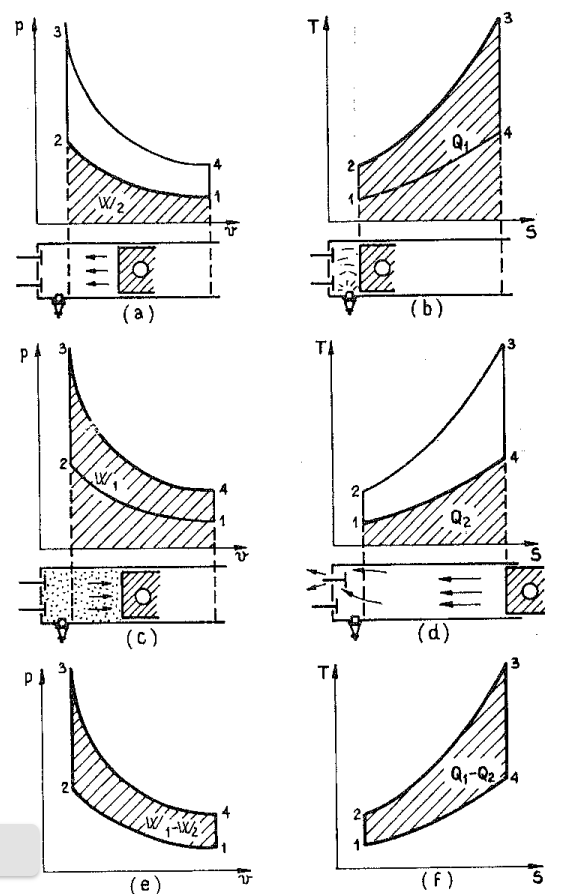
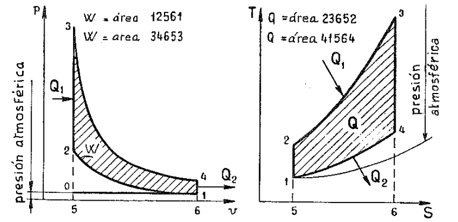
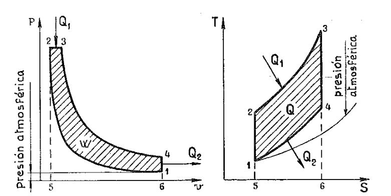
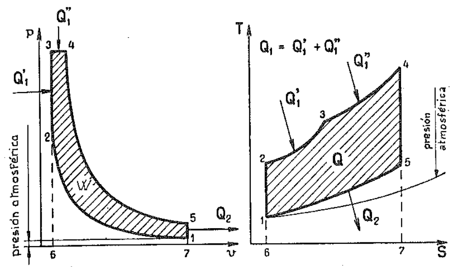
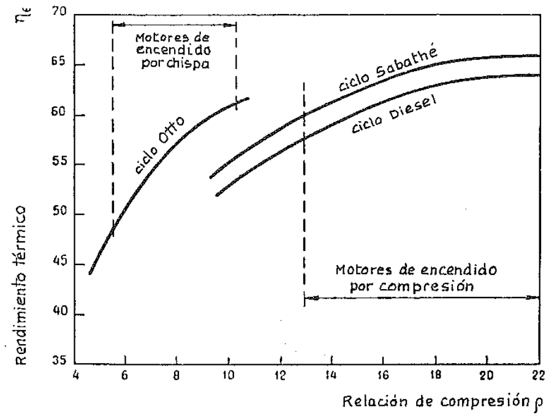
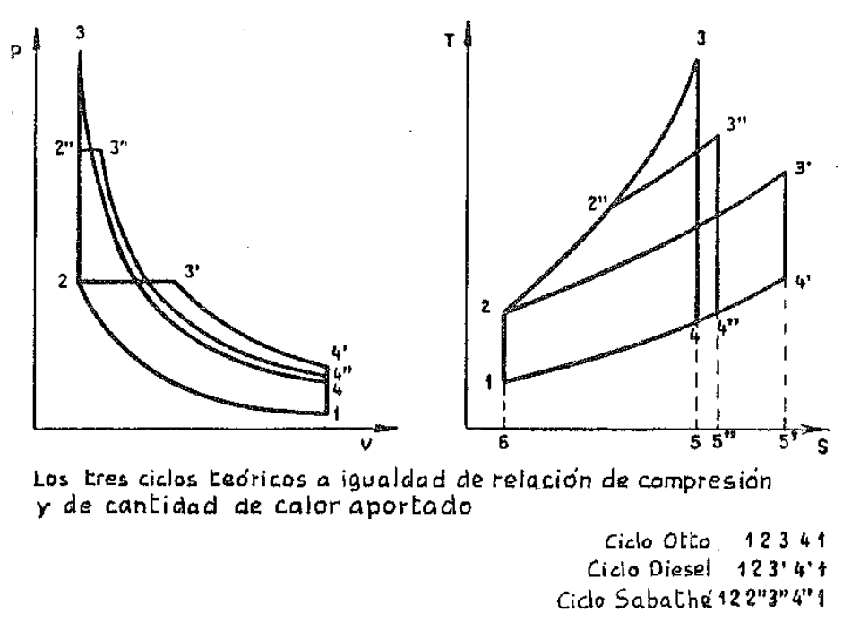
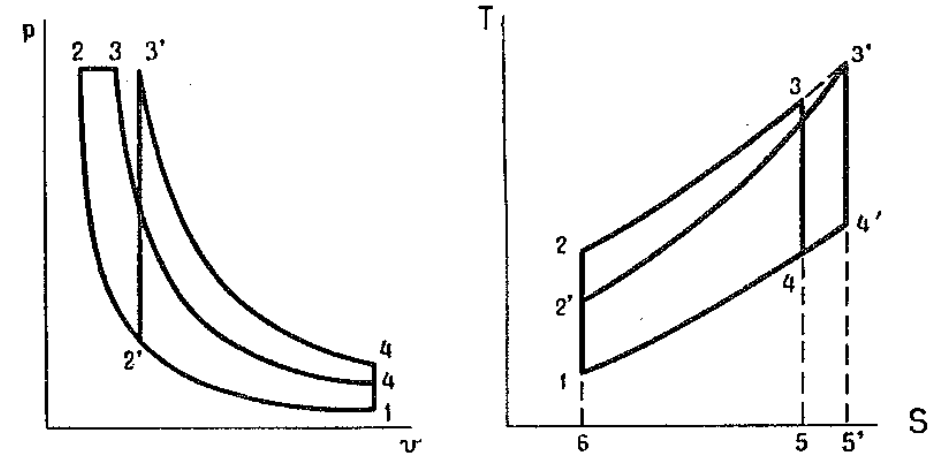
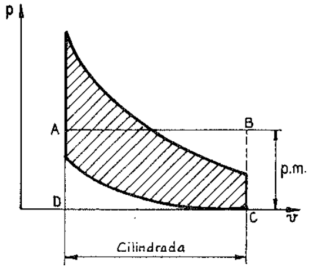
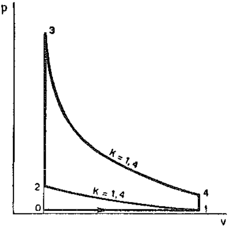

## CICLOS TEÓRICOS DE LOS MOTORES ALTERNATIVOS

#### 1. Ciclos teóricos y ciclo real

Durante el paso por el motor el fluido de trabajo está sometido a una serie de transformaciones químicas y físicas (compresión, expansión, combustión, transferencia de calor a través de las paredes, rozamientos en el interior del fluido y con las paredes, etc.) que constituyen el ciclo del motor. El examen cuantitativo de estos fenómenos, teniendo en cuenta todas las numerosas variables, representa un problema muy complicado; por esto generalmente se lo simplifica recurriendo a sucesivas aproximaciones teóricas, cada una de las cuales está basada en diferentes supuestos simplificativos, de una aproximación gradualmente creciente.

Para los ciclos teóricos, las aproximaciones normalmente empleadas, en orden de similaridad con las condiciones reales, son tres, y son llamadas: **ciclo ideal, ciclo de aire, ciclo de aire-combustible**. Estos ciclos teóricos han de confrontarse en la práctica con los **ciclos reales**, obtenidos experimentalmente mediante aparatos llamados *indicadores*. Por esto al ciclo real se le llama también **ciclo indicado**.

En el **ciclo ideal** se supone que el fluido de trabajo está constituido por aire y que éste se comporta como un gas perfecto. En consecuencia los valores de los calores específicos se consideran constantes e iguales a los del aire en las condiciones normales de 288 °K (15 °C) de temperatura y 1,013 bar (1 atmósfera) de presión:

$$
\begin{aligned}
c_p &= 1 \text{ kJ/kg K} \\
c_v &= 0.72 \text{ kJ/kg K}
\end{aligned}
$$

y por lo tanto

$$k = \frac{c_p}{c_v} = 1,40.$$

Se supone además que las fases de introducción y de extracción de calor tienen una duración bien determinada, que depende del tipo de ciclo (Otto, Diesel, Sabathé) y que en las demás fases del ciclo no se producen pérdidas de calor.

Está claro que, con estas hipótesis, los valores máximos de temperatura y de presión, y por lo tanto el trabajo y el rendimiento térmico calculados para el ciclo ideal, son mayores que los de los otros tipos de ciclos.

El ciclo ideal representa por lo tanto el límite máximo que el motor puede teóricamente alcanzar en lo concerniente a prestaciones y permite un estudio matemático sencillo basado en las leyes de los gases perfectos. A éste nos referiremos en lo que sigue, cuando digamos ciclo tórico.

En el **ciclo de aire el fluido** de trabajo sigue siendo aire, pero se supone que los calores específicos son variables en la gama de temperaturas considerada.

Las condiciones de introducción y extracción del calor son iguales a las del ciclo ideal, y no hay pérdidas de calor. Puesto que el cálculo de los calores específicos medios es largo y complicado, se usan tablas que dan directamente los valores del calor y del trabajo, en términos de energía interna y entalpía para el aire, en los diferentes puntos de los procesos isentrópicos. Teniendo en cuenta la variación de los calores específicos se obtienen para las temperaturas y presiones máximas valores inferiores a los calculados para el ciclo ideal, y en consecuencia también el trabajo y el rendimiento térmico resultan más bajos, pero aún así siempre mayores que los de un ciclo real.

El **ciclo aire-combustible** es, de entre los que generalmente se calculan, el más cercano al ciclo real. En el motor de encendido por chispa, el fluido está compuesto, durante la fase de admisión, por la mezcla y por los gases de combustión residuales; en el motor de encendido por compresión, está formado por el aire y por los gases residuales. Después de la combustión el fluido está constituido por los productos de la combustión, es decir, teóricamente por una mezcla de CO~2~, CO, H~2~O, N~2~. Estos gases poseen un calor específicio medio aún mayor que el del aire; además, los calores específicos aumentan también a causa de la disociación de las moléculas más livianas bajo la acción de la alta temperatura. El aumento de los calores específicos y la disociación, que siendo una reacción endotérmica absorbe una parte del calor de combustión, producen un ulterior descenso de la temperatura y de las presiones máximas en comparación con las calculadas para el ciclo de aire.

Para el cálculo del ciclo aire-combustible se recurre a tablas de datos obtenidos experimentalmente. También en este caso se admite que el calor se introduce y se extrae instantáneamente como en el ciclo ideal y que no se producen pérdidas de calor.

El **ciclo real** es, como hemos dicho, determinado experimentalmente mediante alguno de los numerosos aparatos indicadores capaces de registrar el diagrama de las presiones en función de los volúmenes en el cilindro. El diagrama indicado refleja las condiciones reales del ciclo y por lo tanto tiene en cuenta, además de las variaciones ya enunciadas para el ciclo de aire y para el de aire-combustible en comparación con el ciclo ideal, también las pérdidas de calor, la duración de la combustión, las pérdidas debidas a rozamiento en el fluido, a la duración del tiempo de apertura de las válvulas, al tiempo de encendido, al tiempo de inyección, y las pérdidas en el escape.

## 2. Análisis de un ciclo y su rendimiento térmico

La segunda ley de la termodinámica dice que ningún motor ideal o real puede convertir en trabajo mecánico todo el calor que en él se introduce. Por tanto, sólo una fracción del calor proporcionado por la combustión se transforma en trabajo; esta fracción representa el **rendimiento térmico** del motor. En otras palabras, el rendimiento térmico ideal  $\eta_{\epsilon}$  es la relación entre la cantidad de calor transformada en trabajo útil y la cantidad de calor aportada al fluido.

Como el trabajo útil equivale a la diferencia entre el calor aportado  $Q_1$  y el calor extraído  $Q_2$ , se tiene:

$$\eta_{\varepsilon} = \frac{Q_1 - Q_2}{Q_1}$$

Podemos formarnos una idea más completa del concepto de rendimiento térmico y adquirir familiaridad con la interpretación de los diagramas examinando la sucesión de los procesos en coordenadas p-v y en coordenadas T-S para un ciclo ideal.

La figura 1 se refiere al caso de un motor de encendido por chispa de 4 tiempos. En (a) se representa en coordenadas p-v la fase de compresión. Los puntos 1 y 2 corresponden a los estados del fluido que coinciden respectivamente con el punto muerto inferior y con el punto muerto superior del pistón. El trabajo realizado por el pistón para la compresión del fluido es el trabajo introducido  $W_2$  representado por el área achurada comprendida entre la línea de compresión adiabática 1-2 y el eje de las abscisas. Al final de la compresión, fase (b), se introduce instantáneamente, dado que el proceso es a volumen constante, el calor producido por la combustión. Esta fase está representada gráficamente en coordenadas T-S, y el calor aportado  $Q_1$  corresponde al área achurada comprendida entre la línea térmica a volumen constante 2-3 y el eje de las abscisas. El pistón, por efecto de la presión del fluido, se desplaza ahora desde el punto muerto superior al inferior, es decir, de izquierda a derecha.

En la parte (c) de la figura 1 el trabajo  $W_1$  producido por el fluido de trabajo durante la expansión está representado en coordenadas p-v por el área achurada comprendida entre la línea de expansión adiabática 3-4 y el eje de las abscisas.

En este punto se produce el escape, nuevamente a volumen constante, durante el cual se substrae el calor  $Q_2$  mientras la presión se reduce desde el punto 4 al punto 1. En la parte (d) de la figura el calor  $Q_2$  está representado, en coordenadas T-S, por el área achurada bajo la línea de proceso a volumen constante 4-1.

El trabajo útil  $W_1 - W_2$  está por lo tanto dado por la diferencia de las áreas achuradas en los diagramas (a) y (c) en coordenadas presiones-volúmenes y corresponde por esto al área del ciclo trazada en la parte (e) de la figura.

Así el calor utilizado  $Q_1 - Q_2$  está dado por la diferencia de las áreas achuradas en los diagramas (b) y (d) en coordenadas temperatura-entropía y corresponde al área del ciclo achurada en la parte (f) de la figura.

Puesto que el trabajo útil es evidentemente igual al calor utilizado. Podemos escribir:

$$(W_1 - W_2) = Q_1 - Q_2$$

de modo que podemos simplificar el cálculo del trabajo útil y del rendimiento térmico del ciclo usando los valores  $Q_1$  y  $Q_2$  en lugar de  $W_1$  y  $W_2$ .

#### 3. El ciclo Otto teórico

El ciclo Otto teórico es el ciclo ideal del motor de encendido por chispa (ECh), y está representado gráficamente en la figura 2 tanto en coordenadas p- $\nu$  como en coordenadas T-S. Los procesos termodinámicos que tienen lugar durante el ciclo son:

- 1-2. Adiabático o isentrópico (sin transferencia de calor con el exterior): compresión del fluido de trabajo, correspondiente al trabajo W~1~ realizado por el pistón.
- 2-3. A volumen constante: introducción instantánea del calor aportado  $Q_1$ .
- 3-4. Adiabático: expansión, correspondiente al trabajo W~2~ realizado por el fluido de trabajo.
- 4-1. A volumen constante: extracción instantánea del calor  $Q_2$ .

En realidad en los motores de 4 tiempos la extracción del calor se produce durante la carrera de escape 1-0 y el fluido es introducido en el motor en la carrera de admisión 0-1. Este hecho se representa gráficamente en el diagrama p-v mediante una línea horizontal mientras que no puede representarse en el diagrama T-S.

Los efectos de los dos procesos se anulan entre sí sin ganancia ni pérdida de calor, por lo tanto la carrera de admisión y la de escape normalmente no se consideran en los diagramas ideales en coordenadas p-v y el ciclo Otto se representa como un ciclo cerrado en el cual el fluido de trabajo regresa a su estado inicial al final de la fase de expulsión del calor 4-1.

Puesto que el calor  $Q_1$  es aportado a volumen constante, el trabajo  $W_{2-1}$  realizado durante este proceso es nulo y la ecuación de conservación de la energía del fluido sin flujo resulta:

$$Q_1 = U_3 - U_2.$$

Como el ciclo es ideal, el fluido de trabajo es un gas perfecto y la variación de su energía interna durante la transformación a volumen constante vale:

$$U_3 - U_2 = c_v (T_3 - T_2)$$

y por lo tanto:

$$Q_1 = c_v \left( T_3 - T_2 \right)$$

Análogamente, como el calor  $Q_2$  es extraído también a volumen constante, es decir, en condiciones para las cuales  $W_{4-1} = 0$ , podemos escribir:

$$Q_2 = U_4 - U_1$$

y como el fluido es un gas perfecto:

$$Q_2 = c_{\nu} (T_4 - T_1).$$

Por lo tanto el rendimiento térmico ideal para el ciclo Otto teórico resulta:

$$
\begin{aligned}
\eta_{E} &= \frac{\text{calor aportado} - \text{calor extraído}}{\text{calor aportado}} \\
&= \frac{c_{v} (T_{3} - T_{2}) - c_{v} (T_{4} - T_{1})}{c_{v} (T_{3} - T_{2})} \\
&1-\frac{T_{4} - T_{1}}{T_{3}-T_{2}}= 1-\frac{T_{1} \left(\frac{T_{4}}{T_{1}} - 1\right)}{T_{2} \left(\frac{T_{3}}{T_{2}} - 1\right)}
\end{aligned} \tag{1}
$$

Para los procesos adiabáticos de compresión 1-2 y de expansión 3-4, se tiene respectivamente:

$$\frac{T_2}{T_1} = \left(\frac{v_1}{v_2}\right)^{k-1} \tag{2}$$

$$\frac{T_3}{T_4} = \left(\frac{v_4}{v_3}\right)^{k-1}$$

y como  $v_1 = v_4$  y  $v_2 = v_3$ , podemos escribir:

$$\frac{T_2}{T_1} = \frac{T_3}{T_4}$$

por lo tanto:

$$\frac{T_4}{T_1} = \frac{T_3}{T_2}$$

Introduciendo en la expresión del rendimiento  $\eta_{\epsilon}$  esta relación y teniendo en cuenta la (2) se obtiene:

$$\eta_{\varepsilon} = 1 - \left(\frac{\nu_2}{\nu_1}\right)^{k-1}$$

Indicando con  $\varrho$  la razón entre el volumen  $\nu_1$  al comienzo y el volumen  $\nu_2$  al final de la carrera de compresión, razón a la que daremos el nombre de «relación volumétrica de compresión», se obtiene la expresión final del rendimiento térmico ideal del ciclo Otto:

$$\eta_{\varepsilon} = 1 - \frac{1}{\varrho^{k-1}}$$

El rendimiento térmico del ciclo Otto es por tanto función de la relación de compresión y del exponente k, razón entre los calores específicos del fluido de trabajo. Aumentando o aumenta  $\eta_{\epsilon}$ ; aumentando los valores de los calores específicos, disminuye k y por lo tanto también disminuye el rendimiento térmico  $\eta_{\epsilon}$ . Por lo tanto el ciclo ideal para el cual se da a k el valor de 1,4 tiene un rendimiento térmico superior al ciclo de aire para el cual, variando los calores específicos con la temperatura, k tiene un valor menor.

#### 4. Ciclo Diesel teórico

Es el ciclo teórico de los motores de encendido por compresión (fig. 3).

La diferencia fundamental entre los ciclos Otto y Diesel está en la fase de aportación del calor. En el ciclo Otto el calor es introducido a volumen constante, mientras en el ciclo Diesel es introducido a presión constante. Otra diferencia entre los dos ciclos está en el valor de la relación de compresión. Para los motores Diesel varía de 14 a 22 mientras que para los motores de ciclo Otto varía de 6 a 10.

Como puede verse en la figura 3 el ciclo Diesel está formado por 4 líneas térmicas que representan: la compresión adiabática (1-2); la introducción de calor a presión constante (2-3); la expansión adiabática (3-4); la expulsión de calor a volumen constante (4-1). Durante el proceso 2-3 de introducción del calor  $Q_1$  a presión constante, el pistón se desplaza y por lo tanto el fluido realiza el trabajo:

$$W_{2-3} = \int_{2}^{3} p \ dv = p_{3}v_{3} - p_{2}v_{2}.$$

Por lo tanto la ecuación de la energía sin flujo pasa a ser:

$$Q_1 = (U_3 - U_2) + (p_3v_3 - p_2v_2)$$

y como la entalpía h del fluido está dada por la expresión:

$$h = U + pv$$

la ecuación queda:

$$Q_1 = h_3 - h_2$$

Siendo el fluido un gas perfecto, para su variación de entalpía a presión constante es válida la relación:

$$h_3 - h_2 = c_p (T_3 - T_2)$$

de modo que el calor aportado vale:

$$Q_1 = c_p \left( T_3 - T_2 \right)$$

Hay que hacer notar que en un proceso con introducción de calor a presión constante varía el valor de la entalpía del fluido, mientras que en el caso del proceso a volumen constante varía el de la energía interna del fluido. Puesto que la extracción del calor  $Q_2$  se lleva a cabo como en el ciclo Otto, podremos escribir sin más:

$$Q_2 = U_4 - U_1$$

y puesto que el fluido, dado que el ciclo es ideal, es un gas perfecto:

$$Q_2 = c_v \left( T_4 - T_1 \right)$$

El rendimiento térmico ideal del ciclo Diesel teórico vale entonces:

$$
\begin{aligned}
\eta_{\varepsilon} = \frac{\text{calor aportado} - \text{calor extraído}}{\text{calor aportado}} \\
= \frac{c_p (T_3 - T_2) - c_v (T_4 - T_1)}{c_p (T_3 - T_2)} \\
=1-\frac{1}{k} \frac{T_4 - T_1}{T_3 - T_2} = 1 - \frac{1}{k} \frac{T_1}{T_2} \frac{\frac{T_4}{T_1} - 1}{\frac{T_3}{T_2} - 1}
\end{aligned} 
$$

expresión del todo análoga a la obtenida para el rendimiento térmico ideal del ciclo Otto teórico.

Para el proceso 2-3 de combustión a presión constante se tiene:

$$\frac{v_3}{v_2} = \frac{T_3}{T_2}$$

Para los procesos adiabáticos 1-2 de compresión y 3-4 de expansión se tiene en cambio, respectivamente:

$$T_1 = T_2 \left(\frac{\nu_2}{\nu_1}\right)^{k-1}$$

$$T_4 = T_3 \left(\frac{\nu_3}{\nu_4}\right)^{k-1}$$

de donde se obtiene:

$$\frac{T_1}{T_2} = \left(\frac{v_2}{v_1}\right)^{k-1}$$

$$\frac{T_4}{T_1} = \frac{T_3}{T_2} \frac{\left(\frac{v_3}{v_4}\right)^{k-1}}{\left(\frac{v_2}{v_1}\right)^{k-1}}$$

y puesto que  $v_4 = v_1$  y  $\frac{T_3}{T_2} = \frac{v_3}{v_2}$  se puede escribir:

$$\frac{T_4}{T_1} = \frac{v_3}{v_2} \qquad \left(\frac{v_3}{v_2}\right)^{k-1} = \left(\frac{v_3}{v_2}\right)^k$$

Sustituyendo estas expresiones en la del rendimiento térmico ideal se obtiene:

$$\eta_{\epsilon} = 1 - \frac{1}{k} \left( \frac{v_2}{v_1} \right)^{k-1} \frac{\left( \frac{v_3}{v_2} \right)^k - 1}{\frac{v_3}{v_2} - 1}$$

Indicando con  $\tau'$  la razón entre el volumen  $\nu$  al final y el volumen  $\nu_2$  al comienzo de la fase de combustión a presión constante, razón a la que daremos el nombre de «relación de combustión a presión constante» y recordando que

$$\frac{v_1}{v_2} = \varrho$$

se obtiene la expresión final del rendimiento térmico ideal del ciclo Diesel teórico:

$$\eta_{\varepsilon} = 1 - \frac{1}{\varrho^{k-1}} \left[ \frac{\tau'^{k} - 1}{k(\tau' - 1)} \right].$$

Esta expresión nos dice que  $\eta_{\epsilon}$  para el ciclo Diesel es función de la relación de compresión, de la relación de combustión a presión constante y de la razón k entre los calores específicos. La expresión del rendimiento térmico del ciclo Otto difiere de la del Diesel sólo en el término entre paréntesis que es siempre > 1: queda entonces claro que, a igualdad de la relación de compresión,  $\eta_{\epsilon}$  es mayor para el ciclo Otto que para el ciclo Diesel. Reduciendo  $\tau'$ , y por lo tanto el calor aportado a presión constante, el rendimiento  $\eta_{\epsilon}$  del ciclo Diesel se aproxima al del ciclo Otto con el cual coincide para  $\tau'=1$ .

### 5. Ciclo mixto de Sabathé

Las condiciones reales de funcionamiento de los motores son muy diferentes de las de los ciclos ideales Otto y Diesel. Para los motores Diesel el proceso de combustión se aproxima al proceso a presión constante sólo en el caso de motores excepcionalmente grandes y lentos.

Normalmente en los motores Diesel el diagrama real muestra que la combustión se desarrolla según un proceso que se aproxima a la combinación de un proceso a volumen constante y de uno a presión constante.

Puede decirse que en la práctica los ciclos Otto y Diesel se aproximan mucho en la forma, tanto que pueden considerarse como casos particulares de un ciclo mixto en el cual la combustión se produce en parte a volumen constante y en parte a presión constante. Este ciclo teórico está representado en la figura 4 y se denomina ciclo mixto de Sabathé.

En este ciclo, después de la fase 1-2 de compresión adiabática, tiene lugar, como en el ciclo Otto, una fase 2-3 de combustión a volumen constante en la cual se aporta la cantidad de calor  $Q_1'$ , y después, como en el ciclo Diesel, una fase 3-4 de combustión a presión constante en la cual se aporta la cantidad de calor  $Q_1''$ .

Sucesivamente se tiene una fase 4-5 de expansión adiabática y una fase 5-1 de extracción a volumen constante de la cantidad de calor  $Q_2$ .

La cantidad total de calor aportada vale entonces:

$$Q_1 = Q_1' + Q_1''.$$

Recordando lo dicho a propósito de los ciclos Otto y Diesel podemos escribir:

$$Q_1' = c_{\nu} (T_3 - T_2)$$

$$Q_1'' = c_{p} (T_4 - T_3)$$

$$Q_2 = c_{\nu} (T_5 - T_1)$$

de modo que el rendimiento térmico ideal del ciclo Sabathé teórico vale:

$$
\begin{aligned}
\eta_{\varepsilon} = \frac{\text{calor aportado} - \text{calor extraído}}{\text{calor aportado}} = \\
 \frac{c_{v} (T_{3} - T_{2}) + c_{p} (T_{4} - T_{3}) - c_{v} (T_{5} - T_{1})}{c_{v} (T_{3} - T_{2}) + c_{p} (T_{4} - T_{3})} = \\
 \frac{T_{5} - T_{1}}{(T_{3} - T_{2}) + k (T_{4} - T_{3})} = \\
1-\frac{T_{1}}{T_{2}}\frac{\frac{T_{5}}{T_{1}}-1}{\left(\frac{T_{3}}{T_{2}}-1\right)-k\frac{T_{3}}{T_{2}}\left(\frac{T_{4}}{T_{3}}-1\right)}
\end{aligned} 
$$

Para el proceso 2-3 de combustión a volumen constante se tiene:

$$\frac{P_3}{P_2} = \frac{T_3}{T_2}$$

Para el proceso 3-4 de combustión a presión constante se tiene:

$$\frac{v_4}{v_3} = \frac{T_4}{T_3}$$

Para los procesos adiabáticos 1-2 de compresión y 4-5 de expansión se tiene en cambio, respectivamente:

$$T_1 = T_2 \left(\frac{v_2}{v_1}\right)^{k-1}$$

$$T_5 = T_4 \left(\frac{v_4}{v_5}\right)^{k-1}$$

de donde se obtiene:

$$\frac{T_1}{T_2} = \left(\frac{\nu_2}{\nu_1}\right)^{k-1}$$

$$\frac{T_5}{T_1} = \frac{T_4}{T_2} \frac{\left(\frac{v_4}{v_5}\right)^{k-1}}{\left(\frac{v_2}{v_1}\right)^{k-1}} = \frac{T_4}{T_3} \frac{T_3}{T_2} \frac{\left(\frac{v_4}{v_5}\right)^{k-1}}{\left(\frac{v_2}{v_1}\right)^{k-1}}$$

y puesto que  $v_3 = v_2$ , y  $v_5 = v_1$ ,

$$\frac{T_3}{T_2} = \frac{P_3}{P_2}\qquad;\qquad\frac{T_4}{T_3} = \frac{v_4}{v_3}$$

se puede escribir:

$$= \frac{T_5}{T_1} = \frac{v_4}{v_2} \frac{P_3}{P_2} \left(\frac{v_4}{v_2}\right)^{k-1} = \frac{P_3}{P_2} \left(\frac{v_4}{v_2}\right)$$

Sustituyendo estas expresiones en la del rendimiento térmico ideal se llega a:

$$\eta_{\varepsilon} = 1 - \left(\frac{v_2}{v_1}\right)^{k-1} \frac{\frac{P_3}{P_2} \left(\frac{v_4}{v_2}\right)^k - 1}{\left(\frac{P_3}{P_2} - 1\right) + k \frac{P_3}{P_2} \left(\frac{v_4}{v_2} - 1\right)}$$

Indicando con  $\tau$  la razón entre la presión  $p_3$  al final y la presión  $p_2$  al comienzo de la fase de combustión a volumen constante, razón a la que daremos el nombre de «relación de combustión a volumen constante» y recordando que

$$\frac{v_1}{v_2} = \varrho \qquad \frac{v_4}{v_3} = \frac{v_4}{v_2} = \tau'$$

se obtiene la expresión final del rendimiento térmico ideal del ciclo Sabathé teórico:

$$\eta_{\varepsilon} = 1 - \frac{1}{\varrho^{k-1}} \frac{\tau \tau'^{k} - 1}{(\tau - 1) + k \tau (\tau' - 1)}$$

A igualdad de la relación de compresión g el rendimiento del ciclo mixto resulta intermedio entre los del ciclo Otto y del ciclo Diesel. Si se aumenta el calor aportado a volumen constante, es decir, entre los puntos 2 y 3, y se reduce el aportado a presión constante, entre los puntos 3 y 4, el rendimiento térmico se aproxima al del ciclo Otto. Si por el contrario, se reduce el calor aportado a volumen constante y se aumenta el aportado a presión constante, el rendimiento del ciclo mixto se acerca al del ciclo Diesel.

# 6. Comparación entre los tres ciclos teóricos

Para comparar los ciclos que hemos examinado es necesario tomar como referencia algunos de los parámetros de cuyos valores dependen la forma y el área del diagrama, como la relación de compresión, la presión máxima, la cantidad de calor aportada, la cantidad de calor extraída y el trabajo útil.

En la figura 5 se indican las curvas de las variaciones del rendimiento térmico ideal en función de la relación de compresión para los tres ciclos: Otto, Diesel, Sabathé. Para los ciclos Diesel y Sabathé se ha escogido una relación de combustión a presión constante igual a 2.

Como resulta de la figura, los rendimientos térmicos de los ciclos teóricos aumentan al aumentar la relación de compresión. Para una determinada relación de compresión (por ej. 10) el ciclo Otto tiene el mayor rendimiento, mientras el ciclo Diesel tiene el menor. Sin embargo, debe tenerse presente que para los motores Diesel las relaciones de compresión varían entre 14 y 22, mientras que para los motores de encendido por chispa las relaciones de compresión generalmente no superan el valor de 10 para no incurrir en el fenómeno de la detonación, del cual se tratará más adelante.

Por lo tanto, en la realidad el motor Diesel tiene un rendimiento térmico superior al motor de ciclo Otto.

En la figura 6 se comparan los tres ciclos en los diagramas p-v y T-S, para iguales relaciones de compresión y cantidades de calor aportado. Todos los ciclos comienzan en la condición 1 y tienen la misma compresión adiabática de 1 a 2.

Para que la cantidad de calor aportada sea la misma en los tres casos, las áreas en coordenadas T-S, 2'' 3'' 5'' 6 2 2'', 2 3' 5' 6 2 y 2 3 5 6 2 han de ser iguales.

Como el calor es extraído a igualdad de volumen según la línea de proceso entre los estados 4 y 1, la cantidad de calor extraído está representada para cada ciclo por la propia área bajo la línea 4-1 en el diagrama T-S. Puesto que el calor proporcionado es el mismo para cada ciclo, se desprende que el ciclo de mayor rendimiento térmico es aquél del cual se extrae la menor cantidad de calor, o sea el ciclo Otto, para el cual el área que representa la cantidad de calor extraído está definida en coordenadas T-S por los puntos 4 5 6 1 4. Nótese que la presión máxima y la temperatura máxima para el ciclo Otto son bastante más elevadas que en los otros dos ciclos.

Si bien esta comparación es totalmente teórica, sirve para demostrar que el ciclo que permite la mayor expansión del fluido de trabajo, después de la fase de aportación de calor, tiene el mayor rendimiento.

Por tanto, para los diferentes ciclos indicaremos con  $r_E$  la relación entre el volumen al final de la carrera de expansión y el que se tiene al final de la fase de aportación de calor.

Para el ciclo Otto se tiene:

$$r_E = \frac{v_4}{v_3} = \frac{v_1}{v_2} = \varrho$$

mientras que para el ciclo Diesel se tiene:

$$r_E = \frac{v_4'}{v_3'} = \frac{v_1}{v_2} \frac{v_2}{v_3'} = \frac{\varrho}{\tau'} < \varrho$$

Podremos por lo tanto asumir la relación de expansión así definida como índice del rendimiento de los ciclos.

En la figura 7 la comparación entre los ciclos teóricos Otto y Diesel se ha hecho para igualdad de la presión máxima y de la cantidad de calor aportado. En estas condiciones las áreas 2 3 5 6 2 y 2' 3' 5' 6 2' han de ser iguales.

El ciclo Diesel es aquél del cual se extrae la menor cantidad de calor; en efecto, el área que representa el calor extraído es 4 5 6 1 4.

Por lo tanto el ciclo Diesel es el que en estas condiciones tiene el rendimiento más alto.

También en este caso se ve claramente que el ciclo que permite la mayor expansión del fluido de trabajo después de la combustión es el que tiene el rendimiento térmico más alto.

#### 7. Presión media de un ciclo

Durante el ciclo la presión en el cilindro varía a cada instante. Si se considerase este continuo variar de la presión para la evaluación de la potencia se incurriría en cálculos complicados. El cálculo resulta sencillo nivelando las presiones a un valor medio.

Refiriéndonos a un diagrama genérico en coordenadas p- $\nu$ , como el dibujado en la figura 8, el área del ciclo representa el trabajo útil hecho por el fluido.

{width=50%}

Si sobre la misma base del diagrama trazamos un rectángulo A B C D cuya área sea igual a la del ciclo, la altura del rectángulo representa la presión media p.m. del ciclo considerado.

Multiplicando el valor de esta presión media en bar o kg/cm^2^ por la cilindrada en cm^3^ se obtiene el mismo valor que el trabajo útil representado por el área del ciclo.

El concepto de presión media se aplica asimismo en el caso de los ciclos reales y, como veremos más adelante, también en la evaluación de la potencia en la salida del eje motor.

#### 8. Valores del exponente n para los politrópicos

Es útil comparar los valores de las presiones y de las temperaturas de los ciclos teóricos con las de los reales, para extraer indicaciones que permitan calcular con una cierta aproximación los valores previsibles para motores en fase de proyecto.

Lo dicho al principio del capítulo nos lleva a concluir que la compresión y la expansión del ciclo real son procesos politrópicos y no adiabáticos. Las curvas correspondientes deben por lo tanto ser dibujadas según la ecuación  $p v^n$  donde el exponente n ha de tener un valor oportunamente escogido, en vez del valor k que caracteriza el proceso adiabático. Damos a continuación algunos valores dictados por la práctica.

Para un trazado en primera aproximación del ciclo Otto de aire-combustible se da al exponente n el valor de 1,4. Si el motor es alimentado por gas se escoge un valor de n entre 1,31 y 1,35.

Para los motores de encendido por compresión, cuyas relaciones de compresión varían de 14 a 22, se tiene  $n = 1,30 \div 1,32$  para el proceso politrópico de compresión, y  $n = 1,55 \div 1,65$  para el de expansión.

Para completar la comparación entre el ciclo teórico y el ciclo real presentamos un ejemplo de cálculo simplificado para los dos casos.

#### 9. Ejemplo de cálculo para un ciclo teórico Otto, de aire

Supongamos que en un cilindro ideal, con paredes totalmente aislantes, se comprime, a un volumen 5 veces menor que el inicial ( $\varrho = 5$ ), 1 kg de aire considerado como gas perfecto (a calor específico constante). Terminada la compresión se proporciona al aire, según las condiciones ideales, una cantidad de calor igual a la desarrollada por 1 kg de mezcla aire-gasolina, de modo que el aire se recaliente y se expanda provocando el desplazamiento del pistón. Se obtendrá un ciclo teórico Otto (ver fig. 9).

Para el punto 1 (final de la admisión) se asume:

$p_1$ = 1 bar ($\cong$ 1 kg/cm²), como si la válvula de admisión no ofreciese resistencia alguna a la entrada del aire.

 $T_1 = 350$  °K, valor medio que puede determinarse teniendo en cuenta las características y la cantidad de los gases quemados residuales y el calor de evaporación del combustible.

Para el punto 2 (final de la compresión): de la relación  $T_2 = T_1 \cdot \varrho^{k-1}$  (proceso adiabático) se tiene (siendo k = 1,4):

{width=50%}

$$T_2 = 670 \, {}^{\circ}\text{K}$$

y para la  $p_2 = p_1 \cdot \varrho^k$ :

$$p_2 = 9.5 \, \text{bar}$$

Para el punto 3 (final de la combustión): supongamos que se proporciona una cantidad de calor igual a la desarrollada por 1 kg de mezcla de aire y combustible de un poder calorífico de 46 000 kJ (11 000 kcal). Dado que 1 kg de mezcla contiene 1/16,2 kg de combustible (ver cap.

VI), 1 kg de mezcla produce durante la combustión 
$\frac{46000}{16,2} = 2840\ \text{kJ}$
.

Como el calor específicio a volumen constante del aire considerado como gas perfecto es  $c_v = 0.7 \text{ kJ/kg}^{\circ}\text{K}$ , se tendrá:

$$\triangle T = \frac{2.840}{0.7} = 4050 \,\mathrm{°K}$$

y en el punto 3 se alcanzará la temperatura  $T_3 = 670 + 4050 = 4720$  °K.

Puesto que el proceso se ha realizado a volumen constante el aumento de presión es proporcional al aumento de temperatura, por lo que:

$$p_3 = p_2 \frac{4720}{670} = 67 \text{ bar}.$$

Para el punto 4 (final de la expansión) se tiene, en base a las ecuaciones de la expansión adiabática:

$$\begin{cases} T_4 = \frac{T_3}{\varrho^{k-1}} \text{ o bien} = \frac{T_1 T_3}{T_2} = 2460 \text{ °K} \\ p_4 = \frac{p_3}{\varrho^k} \text{ o bien} = \frac{p_1 p_3}{P_2} = 7,06 \text{ bar} \end{cases}$$

El rendimiento de este ciclo resulta  $\eta_e = 0,475$ .

## 10. Ejemplo de ciclo Otto casi práctico

Supongamos tener 1 kg de mezcla gasolina-aire-gases residuales a la presión  $p_1 = 1$  bar y a la temperatura  $T_1 = 350$  °K (temperatura normal de la mezcla en el cilindro al comienzo de la compresión).

La mezcla se comprime a un volumen 5 veces menor ( $\varrho = 5$ ), se enciende y se expande. Considerando, a diferencia de lo que hicimos al examinar el ciclo teórico, que:

1) la compresión y la expansión no son adiabáticas, porque a través de las paredes se producen transferencias de calor;
2) los calores específicos son variables;
3) los gases de combustión se disocian;

pero suponiendo además que:

1) el encendido es instantáneo;
2) el número de moléculas no es alterado por la combustión;

determinemos las presiones y las temperaturas que se alcanzarán en los puntos característicos del ciclo.

Ya establecimos para el punto 1:

$$p_{\rm I} = 1 \, {\rm bar} \, \qquad,\qquad \, T_{\rm I} = 350 \, {\rm ^oK}$$

Admitiendo que la compresión se produce según un proceso politrópico caracterizado por n=1,30 y por las fórmulas  $p_2=p_1\cdot\varrho^n$  y  $T_2=T_1\cdot\varrho^{n-1}$ , obtenemos:

$$p_2 = 8.1 \text{ bar} \qquad ,
\qquad T_2 = 567 \text{ °K}$$ 

Supongamos que el combustible desarrolle una cantidad de calor  $= 46\,000\,\text{kJ/kg}$  y consideremos la presencia de los gases residuales evaluándolos, como lo confirma la práctica, en 1 kg por cada 15 kg de aire. El calor desarrollado por 1 kg de mezcla aire-combustible-gases residuales será de unos 46 000/17,2  $= 2674\,\text{kJ}$ . Admitiendo que por efecto de la disociación se pierda el 6%, quedan utilizables  $2674 \times 0.94 = 2514\,\text{kJ}$ .

Para obtener del calor proporcionado el aumento de temperatura del fluido  $\Delta T$ , es preciso tener en cuenta la variación de su calor específico con las temperaturas, para lo cual nos servimos de la fórmula de Langen en la que la constante D vale 0,0003. Tendremos:

$$\Delta T = \frac{2514}{c_{vo} + D \cdot \Delta T} = \frac{2514}{0.7 + 0.0003 \, \Delta T}$$

de donde se obtiene  $\Delta T = 1940$  °K, que sumado a  $T_2$  da:

$$T_3 = 2507 \, {}^{\circ}\text{K}$$

Admitiendo además la combustión instantánea, es decir a volumen constante, se tiene:

$$p_3 = 35.8 \, \text{bar}$$

En el punto 4, suponiendo que el exponente politrópico de expansión también es igual a 1,3, se tiene:

$$p_4 = 4,45 \text{ bar}\qquad , 
\qquad  T_4 = 1565 \text{ °K}$$

Este ejemplo, si bien está basado en hipótesis lejanas de la realidad, demuestra que las temperaturas máximas alcanzadas por los gases inmediatamente después de la combustión son muy inferiores a las que haría suponer el ciclo teórico.