# INYECCIÓN Y REGULACIÓN

### 1. Función y requisitos del dispositivo de inyección

El dispositivo de inyección es el conjunto de aparatos que sirven para introducir el combustible al interior del cilindro en la cantidad y del modo necesario para conseguir la combustión más regular y eficaz posible a los efectos de desarrollo del ciclo.

Por lo tanto debe satisfacer las siguientes condiciones:

- 1) Proporcionar a cada cilindro en cada ciclo la cantidad de combustible requerida según la carga y la velocidad del motor (dosificación).
- 2) Introducir el combustible en el momento preciso.

Cuando la inyección está demasiado adelantada con respecto al P.M.S., la presión y la temperatura del aire en la cámara de combustión no son todavía capaces de provocar el encendido. Cuando la inyección está atrasada, una parte del combustible se quema durante la carrera de expansión en detrimento del área del ciclo y por lo tanto de la potencia desarrollada y del consumo. En ambos casos se producen humos en el escape y un recalentamiento excesivo del motor.

3) Graduar la introducción del combustible. Para un desarrollo regular de la combustión, cada motor necesita un gradiente de inyección especial.

Alto gradiente de inyección significa rápida progresión de la cantidad de combustible inyectada.

A igualdad de carga total a inyectar, si el gradiente de inyección es demasiado alto, se tiene un efecto similar al que produce un adelanto excesivo; cuando el gradiente de inyección es demasiado bajo, el efecto es comparable al que produce un excesivo retraso de la inyección.

4) Subdividir el combustible en gotitas pequeñísimas de la manera más uniforme posible (pulverización).

Una buena pulverización facilita el encendido.

5) Impartir a las gotitas la suficiente energía cinética para que puedan penetrar en la masa de aire comprimido (penetración del chorro).

La penetración depende de las características del sistema de inyección y de la turbulencia y presión del aire en la cámara de combustión.

Puesto que la penetración es menor cuanto mayor es la pulverización, es necesario encontrar para cada motor el justo compromiso.

6) Distribuir lo más uniformemente posible las partículas de combustible en el aire presente en la cámara de combustión de modo que cada una de ellas tenga la posibilidad de reaccionar con el oxígeno necesario para quemarse.

Es posible hacerse una idea de las dificultades que se encuentran al tratar de obtener una dosificación justa y una buena pulverización si se consideran los valores de los volúmenes de combustible que hay que inyectar por cada ciclo en cada cilindro. Estos volúmenes van desde 9 mm³ (en ralentí) hasta 30 mm³ (en la curva de plena potencia) para los motores más pequeños, es decir, de cilindradas unitarias de unos 0,5 dm³, desde 20 hasta 90 mm³ para los motores de vehículos industriales medios con cilindrada unitaria de unos 1,5 dm³, y desde 40 hasta 280 mm³ para motores con cilindrada unitaria de unos 5 dm³.

# 2. Inyección mecánica e inyección neumática

Los principales componentes del dispositivo de inyección (¹) son la bomba de inyección y el inyector o pulverizador. Su funcionamiento difiere notablemente según que la inyección sea neumática o mecánica.

Con la inyección neumática, también llamada inyección a pulverización, el combustible, que ha entrado en el inyector en la cantidad exacta necesaria para cada ciclo, es introducido en el cilindro aprovechando el efecto de arrastre de una corriente de aire a alta presión proporcionada por un compresor.

Con la inyección mecánica, también llamada inyección sólida, el combustible es pulverizado bajo el empuje de una altísima presión hidráulica.

En la actualidad se usa casi exclusivamente la inyección mecánica.

El dispositivo para la *inyección neumática* está formado por un compresor de aire de alta presión provisto de enfriadores, tuberías, válvulas y de un complicado mecanismo de accionamiento de los inyectores, por lo que tiene un peso, unas dimensiones y un costo importantes.

Con la inyección mecánica estos órganos se eliminan en provecho no sólo de la simplicidad, sino también de la seguridad de funcionamiento y del menor trabajo de mantenimiento.

En los motores con inyección neumática, para compensar el enfriamiento debido a la expansión del aire introducido con el combustible, la presión final de compresión en los cilindros del motor tiene que ser de unos 35 bar; en los motores con inyección mecánica puede ser de unos 30 bar.

En lo referente a la influencia en la combustión no existen diferencias sustanciales entre los dos sistemas. En cambio existen diferencias notables de funcionamiento para producir las mismas condiciones de pulverización.

En el sistema a inyección neumática la pulverización es facilitada por el íntimo mezclado del aire con el combustible; la presión es de unos 70 bar.

(1) En general los aparatos de inyección son adecuados para funcionar con un solo tipo de combustible; existen sin embargo adaptaciones especiales que permiten inyectar indiferentemente diferentes combustibles, tales como la gasolina, el gasóleo, el keroseno.

En el sistema a inyección mecánica el combustible llega al inyector con un frente compacto y la pulverización es consecuencia del movimiento turbulento que el combustible adquiere en el paso, bajo fuerte presión, a través de las pequeñas perforaciones de salida. Por lo tanto es necesario que la presión de inyección sea alta para conseguir una velocidad de salida suficiente: la presión varía según el tipo de motor y puede alcanzar o incluso superar el valor de 1000 bar en inyectores que tienen perforaciones de salida extremadamente pequeñas. Las fuertes presiones, la velocidad con que éstas se producen y se repiten, la longitud y el diámetro de los conductos desde la bomba a los inyectores, la elasticidad de los conductos y del fluido, la presión residual en los conductos (una vez realizada la inyección) pueden ser causa de diversos tipos de perturbación, como ondas de presión, goteos, retrasos del comienzo de la inyección con respecto al comienzo del impulso de la bomba.

En la inyección neumática, al variar la velocidad del motor sólo varía la velocidad de apertura de la aguja del inyector y permanece constante la presión, que es el factor más importante del fenómeno, con la ventaja de una mayor constancia de las condiciones de inyección. Esto conduce a una puesta a punto más fácil para todos los regímenes.

Sin embargo el balance de los pro y de los contra resulta favorable al sistema mecánico. Éste se ha impuesto no sólo por las ventajas funcionales, sino también por su simplicidad, por las dimensiones más reducidas, y por el costo de fabricación relativamente bajo.

En los párrafos que siguen estudiaremos los principales sistemas de inyección mecánica, mientras que en el párrafo 11, en consideración al hecho de que aún hay en servicio numerosos motores con inyección neumática, describiremos brevemente también este sistema.

### 3. Sistemas de inyección mecánica

Numerosos son los aparatos ideados para la inyección mecánica. Éstos pueden dividirse en dos categorías: a acumulación de presión y a presión intermitente.

En los aparatos a acumulación, la presión de inyección se mantiene continuamente en el circuito de alimentación de los inyectores donde el combustible es enviado a alta presión por la bomba. Cada inyector se abre en el momento preciso, por medio de un mando de empujador y balancín, y comienza la fase de inyección que finaliza cuando el mismo sistema de mando determina el cierre de la tobera o boquilla. La regulación se hace sobre el inyector, teniéndolo abierto durante el tiempo suficiente para introducir la cantidad de combustible adecuada para las condiciones de marcha deseadas. La bomba de inyección tiene sólo la función de proporcionar la presión necesaria para una pulverización satisfactoria. Normalmente en el conducto que une los inyectores se intercala un acumulador con el fin de mantener prácticamente constante la presión de inyección. Los dispositivos de inyección de este tipo han sido estudiados para motores de dimensiones más bien grandes y se los usa poco. En la actualidad se usan casi exclusivamente los dispositivos a presión intermitente, cada día más perfeccionados como consecuencia del gran desarrollo de los motores Diesel rápidos y medios. En este caso el combustible es enviado al inyector con cada golpe de pistón de la bomba de inyección en la cantidad deseada y en el momento oportuno. La apertura y el cierre de la tobera del inyector se verifican automáticamente bajo el efecto de la presión.

Se pueden realizar aparatos de este tipo manteniendo las bombas de inyección separadas de los inyectores, o bien reuniendo en un todo único cada bomba con su correspondiente inyector. Las bombas de inyección son siempre del tipo de émbolo.

Las soluciones adoptadas para la bomba, cuando ésta está separada de los inyectores, varían según el tipo de aplicación y por lo tanto según las exigencias del motor. En el caso de los motores de pequeña cilindrada unitaria, como los de los automóviles, se emplean generalmente bombas con un solo elemento de bombeo y un distribuidor que alternativamente envía el combustible a cada inyector.

En los motores de mayor cilindrada, como los de los camiones, la bomba está compuesta por tantos elementos de bombeo como cilindros tiene el motor. Estos elementos de bombeo están reunidos en un único cuerpo, que comprende también el dispositivo de regulación y el regulador (fig. 1).

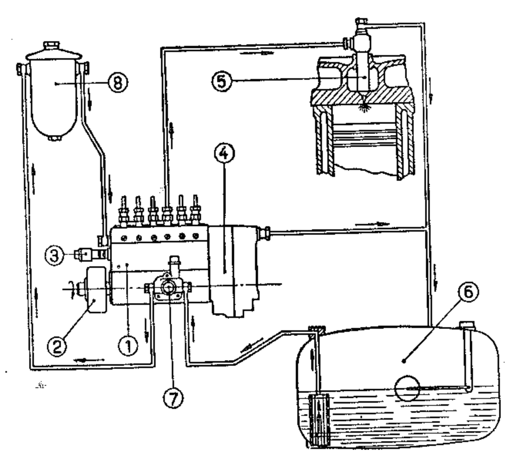

1. Bomba de inyección (para motor de 6 cilindros) - 2. Variador del avance - 3. Vástago de regulación -4. Regulador centrífugo - 5. Inyector - 6. Depósito de combustible - 7. Bomba de alimentación. -8. Filtro principal de combustible.

En los motores de gran cilindrada unitaria se adoptan también bombas individuales separadas, una por cada cilindro.

El movimiento de los émbolos se consigue por medio de un árbol de leva; la regulación del caudal de combustible se lleva a cabo actuando sobre los émbolos o bien sobre válvulas especiales.

Cuando cada bomba tiene además la función de inyector, cada cilindro del motor está equipado con su propio grupo *inyector-bomba*. Cada inyector-bomba está accionado por una leva mediante un eje de levas en la culata o un sistema de empujador y balancín similar al del mando de las válvulas de un motor con válvulas en la culata (fig. 2).

El inyector-bomba no tiene tubos sometidos a altas presiones y no presenta por esto el problema de las pulsaciones debidas a la elasticidad de las tuberías y a la compresibilidad del combustible, y a los golpes de ariete. Sin embargo presenta una cierta complejidad en los órganos de mando así como también algunas dificultades para obtener una dosificación uniforme para los diferentes cilindros, especialmente en caso de que la regulación se efectúe en los inyectores (fig. 2). Esto es consecuencia de los juegos que pueden determinarse entre las uniones de los vástagos de regulación, y de los movimientos irregulares que pueden verificarse entre los vástagos mismos por efecto de las dilataciones térmicas de las cabezas. Por último hay que recordar que, para llevar a cabo las revisiones periódicas de los inyectores con el fin de verificar su grado de eficiencia, generalmente es indispensable desmontar todo el grupo inyector-bomba, en vez de simplemente el inyector, por lo que, en la subsiguiente operación de montaje en el motor, debe procederse a la puesta a punto del sistema de regulación.

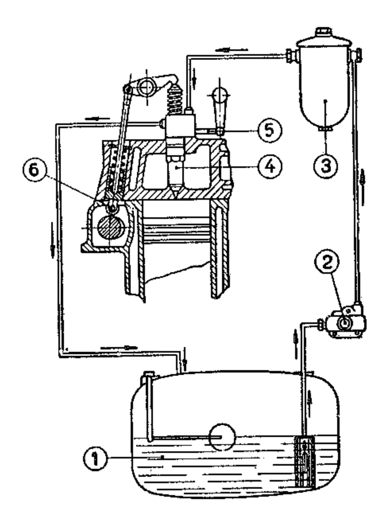

 1. Depósito de combustible - 2. Bomba de alimentación - 3. Filtro principal de combustible - 4. Inyectorbomba - 5. Vástago de regulación - 6. Empujador de accionamiento del inyector-bomba. 

En estos últimos años se han realizado importantes avances especialmente en las bombas de inyección destinadas a los motores Diesel para automóviles con el fin de reducir las dimensiones y el peso.

Como hemos insinuado antes, se trata de bombas compuestas por un solo elemento de bombeo que tiene además la función de distribuidor. El esquema de la figura 3 ilustra de manera simplificada el sistema C.A.V.

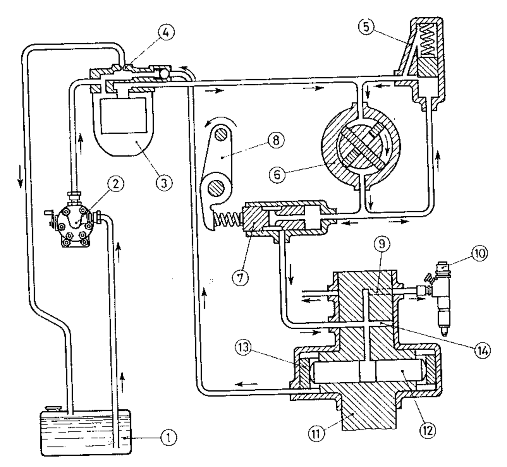

Depósito de combustible - 2. Bomba con 2 émbolos contrapuestos - 3. Filtro - 4. Tobera calibrada para el reflujo del combustible - 5. Válvula de regulación de presión - 6. Bomba de transferencia. - 7. Válvula de regulación - 8. Palanca del acelerador - 9. Conducto del distribuidor - 10, Inyector. - 11. Árbol rotante de la bomba - 12. Émbolo - 13. Anillo con cámaras internas - 14. Conducto de entrada.

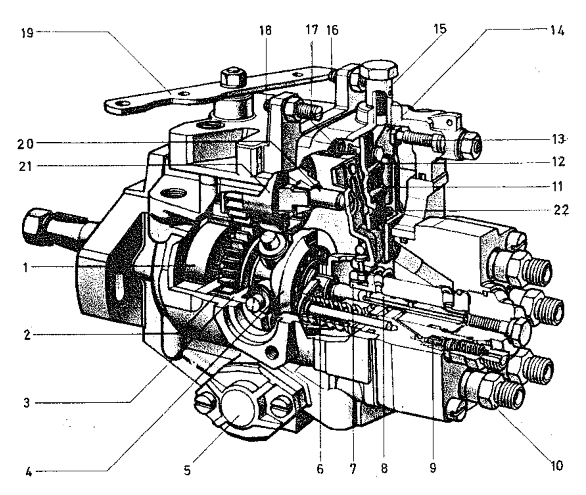

1. Bomba de alimentación - 2. Engranaje de regulación - 3. Anillo de rodillos 4. Disco de levas - 5. Émbolo variador del avance - 6. Muelle de retorno del elemento de bombeo - 7. Cursor de regulación - 8. Elemento de bombeo-distribuidor - 9. Válvula de envío - 10. Copla portaválvula - 11. Palanca de arranque - 12. Palanca tensora - 13. Tornillo de regulación del caudal máximo - 14. Palanca de regulación - 15. Unión con agujero calibrado - 16. Tornillo de regulación de revoluciones mínimas - 17. Muelle de regulación - 18. Tornillo de regulación de revoluciones nominales - 19. Palanca de mando - 20. Manguito de regulación - 21. Soporte de las masas del regulador - 22. Apoyo para 14.

y la figura 4 ilustra la bomba Bosch. Estas bombas, de pequeñas dimensiones, simples y económicas, han reemplazado en los motores de menor cilindrada, que son, como sabemos, con precámara, a las bombas de émbolos múltiples.

Tanto la bomba Bosch como la C.A.V. están provistas de un regulador de mínimo y máximo o bien de velocidad variable para los diferentes regímenes.

En la bomba C.A.V. el elemento de bombeo está compuesto por dos émbolos contrapuestos accionados por una serie de levas situadas sobre la superficie interna de un anillo. La regulación del caudal se produce por reflujo.

En la bomba Bosch el émbolo de bombeo funciona como distribuidor girando alrededor de su eje y dejando sucesivamente al descubierto las lumbreras de comunicación con los tubos que llevan el combustible a los inyectores. A. B.

(

## 4. Principales sistemas de dosificación del combustible

En los aparatos de inyección a acumulación, la dosificación de la cantidad de combustible a introducir en la cámara de combustión por cada ciclo del motor se consigue haciendo variar el tiempo de apertura del inyector.

En los aparatos a presión intermitente la dosificación se efectúa sobre la bomba de inyección.

La variación de la cantidad de combustible puede conseguirse variando la carrera del émbolo de la bomba o bien restringiendo la lumbrera de admisión. El sistema por variación de la carrera es poco usado, mientras que la restricción de la admisión se adopta en un tipo de bomba única con distribuidor rotatorio (Roosa Master).

En el inyector-bomba (fig. 2) la cantidad de combustible es dosificada por las válvulas reguladoras de la presión en el circuito de alimentación y es después impulsada por el émbolo a través de las perforaciones del inyector.

Mucho más usados son los sistemas basados en el principio de hacer refluir de la bomba al depósito de alimentación una parte del combustible desplazado por el émbolo de bombeo. Según el modo de realizar la variación del reflujo las bombas pueden agruparse en dos categorías:

- Bombas de émbolo rotante con regulación del caudal por rotación del émbolo.
- Bombas de válvula de reflujo con regulación del caudal por apertura en el momento oportuno de una válvula especial.

Las bombas de émbolo rotante, que serán descritas en el párrafo siguiente, son las bombas típicas de los motores Diesel rápidos y medios y se están difundiendo rápidamente incluso en el sector de los motores lentos. Las bombas con regulación del caudal por medio de válvula de reflujo (ver descripción en el párrafo 6) se usan especialmente en los motores lentos.

### 5. Bomba con regulación por émbolo rotante

La bomba para motores de varios cilindros está compuesta por tantos elementos de bombeo como cilindros tenga el motor. El tipo de elemento de bombeo más usado actualmente se ilustra en la figura 5.

Una leva, con perfil estudiado de modo de realizar el movimiento del émbolo según la ley deseada, acciona un empujador de rodillo, mantenido en posición por un resorte. El émbolo está anclado al empujador, pero de manera que pueda hacérselo girar mediante un mecanismo de cremallera. Cuando el émbolo está en el punto muerto inferior, las lumbreras de alimentación quedan al descubierto y el cilindro recibe el combustible que desde la bomba de alimentación es enviado a baja presión a través del filtro.

El émbolo tiene una forma muy especial, como puede verse en las figuras 5 y 7.

En la carrera ascendente el émbolo empuja en un primer momento una parte del combustible hacia el conducto de llegada, hasta que las lumbreras de alimentación son cerradas por el mismo émbolo. En este punto, cuando el émbolo ya ha alcanzado una velocidad elevada, comienza el envío del combustible al inyector a través de la válvula especial de envío o impulsión. La impulsión se interrumpe cuando una de las lumbreras de alimentación es alcanzada por el borde helicoidal del émbolo. En efecto, en esta posición, el combustible contenido en la parte superior del cilindro puede, a través de una ranura vertical practicada en el émbolo, refluir desde la lumbrera de alimentación. Para la regulación de la cantidad de combustible es suficiente con hacer girar el émbolo con respecto al cilindro de modo que la lumbrera de alimentación se encuentre a la altura de la zona restringida del émbolo después de que éste ha desplazado el volumen establecido de líquido.

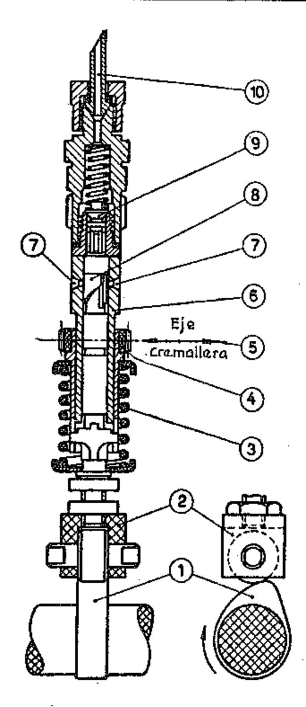{height=400px}

1. Árbol de levas accionado por el motor - 2. Empujador de rodillo - 3. Resorte de retorno del émbolo y empujador - 4. Engranaje de regulación - 5. Eje de la cremallera de regulación - 6. Cuerpo de la bomba - 7. Lumbreras de alimentación y de reflujo - 8. Émbolo con ranura helicoidal - 9. Válvula de envío - 10. Tubo de unión al inyector.

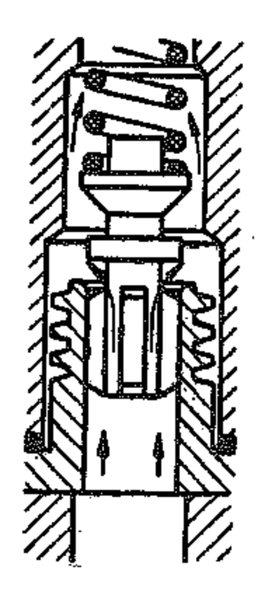{height=400px}

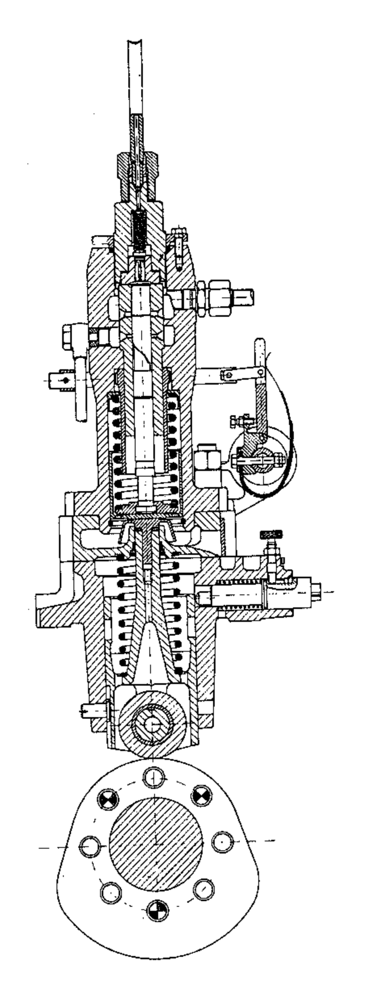{height=400px}

La válvula de envío, situada en la parte superior del cilindro, tiene la función de rebajar instantáneamente la presión en el tubo que comunica con el inyector y por lo tanto de interrumpir rápidamente la inyección para evitar que el inyector gotee.

Con este fin la válvula (fig. 6) está provista, por debajo del asiento cónico, de un tramo cilíndrico; al final de la impulsión, la válvula, al desplazarse, cierra primero el paso con el vástago cilíndrico y después, para alcanzar su asiento, efectúa un ulterior desplazamiento con el cual genera un aumento del volumen contenido entre la válvula y el inyector y por lo tanto una reducción repentina de la presión que evita el goteo del líquido desde el inyector.

La ranura helicoidal del émbolo se denomina a hélice normal cuando está situada en la parte inferior del émbolo, a hélice invertida cuando está situada en la parte superior del émbolo.

Las fases de funcionamiento de un elemento de bomba están ilustradas y descritas en la figura 8 para los dos tipos de ranuras.

# NOTAS DESCRIPTIVAS DEL FUNCIONAMIENTO DEL ÉMBOLO ROTANTE ilustrado en la figura 8

- Posición 1 El émbolo está en el P.M.I., las lumbreras de alimentación están descubiertas. El combustible fluye al cilindro y la válvula de envío permanece cerrada.
- Posición 2 Se hace girar el émbolo a la posición de caudal nulo. Durante toda la carrera la ranura enfrenta una lumbrera de alimentación. El combustible puede así fluir libremente a través de la ranura misma. La válvula de envío permanece cerrada por ausencia de presión en el cilindro.
- Posición 3 El émbolo está en posición de inicio de la impulsión y ha sido girado para el caudal deseado. El plano superior del émbolo (para la hélice normal) o un tramo de la hélice de regulación (para la hélice invertida), han superado las lumbreras de alimentación que quedan cerradas. El émbolo en la carrera ascendente ha generado una presión en el interior del cilindro, por lo que la válvula de envío ha comenzado a levantarse. La parte cónica de la válvula ha salido de su asiento, mientras la parte cilíndrica aún está en el asiento e impulsa el combustible contenido en la tubería hacia el inyector.
- Posición 4 Impulsión. Al proseguir la carrera ascendente del émbolo se ha completado la apertura de la válvula de envío. También la parte cilíndrica de la misma ha salido de su asiento y el combustible contenido en el cilindro forma, con el combustible contenido en la tubería, una única columna de líquido que se desplaza hacia el inyector del cual sale pulverizada.
- Posición 5 Fin de la impulsión. Un tramo de la hélice de regulación (para la hélice normal) o el borde inferior del émbolo (para la hélice invertida) han superado y dejado al descubierto las perforaciones, por lo que el combustible puede así fluir libremente a través de la fresadura vertical del émbolo. La presión en el cilindro ha caído y la válvula de envío, impulsada por su propio resorte, inicia la carrera de retorno. El tramo cilíndrico de la válvula, que ha vuelto a entrar en su asiento, retrae parcialmente el combustible de la tubería hasta el cierre total de la válvula misma.
- Nota. La diferencia fundamental entre el émbolo de hélice normal y el de hélice invertida consiste en el hecho de que mientras que con el primero el inicio de la impulsión se produce en el mismo instante para cualquier caudal de la bomba y el final de la impulsión es por lo tanto variable, con el segundo el inicio de la impulsión es variable según el caudal, mientras que el final de la impulsión permanece constante.
  El empleo de uno o de otro émbolo está dictado por las exigencias del motor.

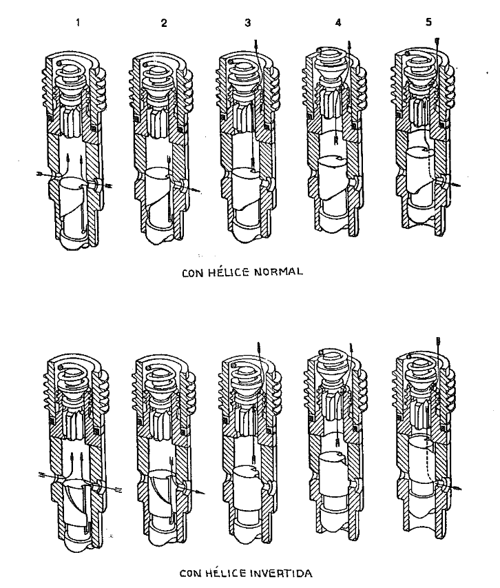

La figura 9 ilustra en sus detalles constructivos una bomba para motor rápido de 6 cilindros en la que los diferentes elementos de bombeo del tipo descrito están agrupados en una carcasa única.

Un árbol de levas, en fase con el motor, acciona los diferentes émbolos mediante empujadores de rodillo. Un resorte helicoidal mantiene cada émbolo y su correspondiente empujador en contacto con la propia leva. Así la carrera de admisión es accionada por el resorte. Cada émbolo está unido a una rueda dentada que sirve para la regulación. Para que las rotaciones de los émbolos se produzcan simultáneamente y en la misma medida exacta, los engranajes están unidos por un único vástago de regulación, de cremallera longitudinal.

Se fabrican bombas para diferentes rangos de caudales: para cada rango sólo se varía el diámetro del émbolo, mientras que la carrera se mantiene constante con el valor de 10 mm para todos los tipos. El caudal máximo de un elemento que tiene un diámetro de émbolo de 6 mm es, para cada carrera, de 160 mm3; con un diámetro de 10 mm es de 1140 mm3.

Es necesario que el combustible llegue con la presión de  $1 \div 2$  bar para que los elementos de bombeo se llenen completamente en los breves intervalos de tiempo disponibles. Además, el combustible tiene que filtrarse prolijamente y desgasificarse (extracción del aire). El circuito de alimentación de

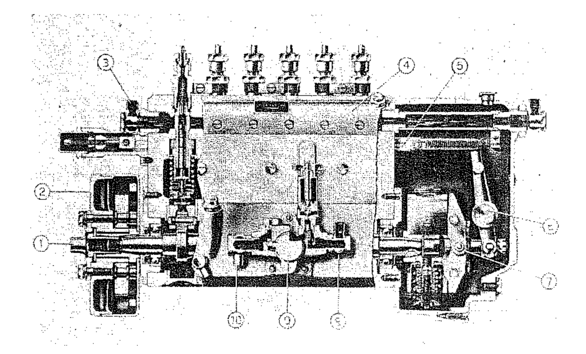

1. Toma de fuerza del motor - 2. Variador de avance - 3. Unión para entrada de combustible proveniente del filtro - 4. Bomba de inyección - 5. Vástago de regulación - 6. Árbol accionado por el pedal del acelerador - 7. Regulador centrífugo - 8. Unión de aspiración de combustible desde depósito - 9. Bomba de alimentación - 10. Unión de envío al filtro.

una bomba de inyección incluye por lo tanto también una bomba de alimentación, una serie de filtros y a veces un desgasificador.

La bomba de alimentación es generalmente de émbolo accionada directamente por el mismo árbol de levas que la bomba de inyección (fig. 10).

Los filtros pueden ser:

— de mella, generalmente situados en el extremo del tubo de aspiración que está en el depósito y a la entrada de la bomba de alimentación;

— de baño, o bien de cartucho, intercalados entre la bomba de alimentación y la bomba de inyección. Aquí el combustible es sometido al filtrado principal; en la figura 11 se tiene la sección de un tipo de filtro en el cual el elemento filtrante está constituido por un cartucho de discos de papel especial conformados interiormente y superpuestos de modo que formen una columna.

A la entrada de los inyectores (ver fig. 14) generalmente se pone un filtro de varilla o de pastilla. Entre la bomba de alimentación y la de inyección se intercala un desgasificador cuando así lo requieren las condiciones de funcionamiento o de instalación del motor, para eliminar burbujas de aire o de vapor que darían lugar a irregularidades de funcionamiento.

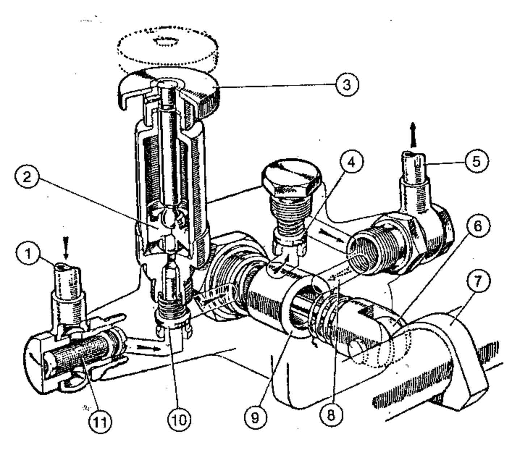{width=50%}

1. Tubería de llegada de combutible de depósito - 2. Émbolo de la bomba manual - 3. Pomo de accionamiento bomba manual de cebado - 4. Válvula de envío - 5. Tubería envío combustible al filtro. - 6. Rodillo de empujador del mando del émbolo de la bomba - 7. Árbol de levas de bomba de inyección. - 8. Conducto de equilibrado de presiones - 9. Émbolo de la bomba - 10. Válvula de aspiración - 11. Malla de filtro en tubería de llegada de combustible para protección de la bomba.

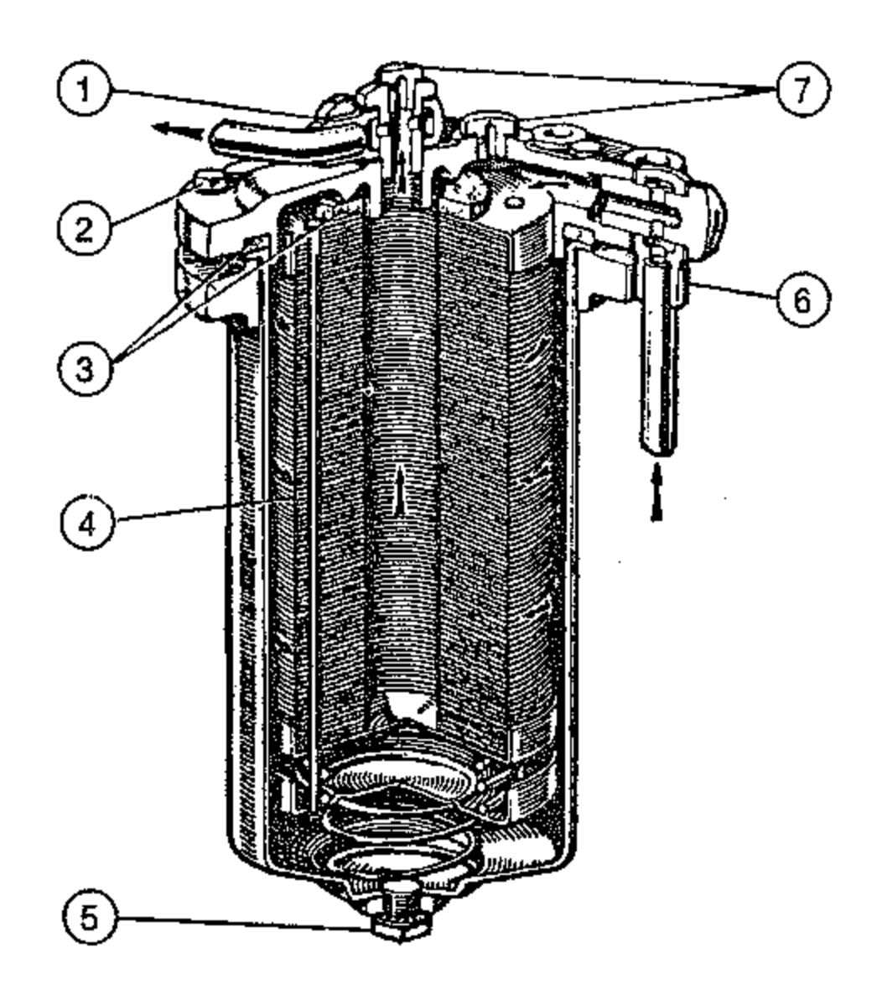{width=50%}

 Copla de salida del combustible filtrado - 2. Tornillos de fijación de la tapa al cuerpo del filtro - 3. Junta de hermeticidad - 4. Cartucho filtrante de discos de papel - 5. Tapón de descarga de las impurezas - 6. Copla de entrada del combustible - 7. Tapones para purgar el aire.

### 6. Bomba con regulación por válvula de reflujo

Este tipo de bomba es usado especialmente en los grandes motores lentos.

Se trata de una bomba de émbolos provista generalmente de tres válvulas de las cuales dos, las de aspiración y de envío, son automáticas, y la tercera, de reflujo está accionada desde el exterior y sirve para dosificar la cantidad de combustible que se ha de enviar al inyector. La válvula de reflujo se abre en un cierto punto de la carrera de envío; con su apertura el combustible excedente refluye al conducto de aspiración.

Para poder establecer el inicio de la inyección independientemente del caudal de combustible el reflujo debe seguir a la fase de envío, es decir, la válvula de reflujo debe funcionar como interruptor y no como retardador del envío.

Sin embargo se tiene algún ejemplo de bomba (Sulzer) con regulación mediante variación del inicio del envío; pero ésta es sólo adecuada para la propulsión náutica donde un aumento de carga del motor, que conduce siempre a un aumento del número de revoluciones, es compatible con un aumento del avance de la inyección.

Una bomba típica es la representada esquemáticamente en la figura 12.

El envío o impulsión empieza con la carrera ascendente del émbolo A y termina cuando el empujador B abre la válvula de reflujo C. La regulación del caudal, que consiste en la variación del instante de apertura de esta válvula, se consigue mediante la leva E con la que se desplaza el centro de rotación de la palanca de modo de acercar o alejar B de C. Un regulador centrífugo controla a través de un sistema de palancas la leva y mantiene automáticamente el caudal en el valor correspondiente a la carga a la que está sometido el motor. La válvula de envío es doble para impedir un eventual goteo del reflujo.

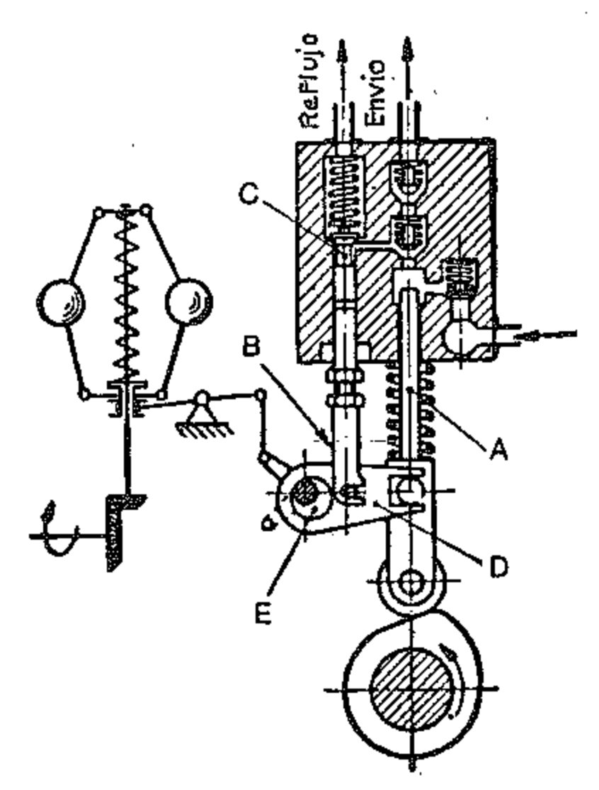{width=50%}

La figura 13 representa en sus detalles constructivos, una bomba FIAT; en ella puede notarse:

- El cilindro C con el correspondiente émbolo S; la hermeticidad está asegurada por la gran precisión del acoplamiento;
  - El cuerpo K, sede de la válvula automática de aspiración V;
  - El cuerpo J, sede de la válvula de reflujo R.

Cuando durante la carrera de envío o impulsión del émbolo S, se abre la válvula de reflujo R, el combustible sale a una cámara anular A para regresar a lo largo de los costados de los cuerpos J y K, al conducto de aspiración. La apertura de la válvula R puede hacerse en un momento cualquiera después de la impulsión, de modo que es posible variar el caudal desde cero hasta un máximo para hacerlo proporcional a la carga requerida por el motor.

El mando de la válvula R se consigue por medio del balancín B, accionado por la barra D y las palancas L y M desde el empujador P.

La palanca M tiene su apoyo en un árbol excéntrico E, mediante el cual puede variarse la distancia entre el tornillo Q y el talón G de apertura de la válvula R, y por lo tanto el caudal de combustible, en relación con la carga del motor.

### 7. El inyector

Está compuesto generalmente por dos partes diferentes: el porta-inyector, que puede tener formas y dimensiones variadas según las características de la culata del motor, y el inyector propiamente tal o pulverizador, que en cambio está casi universalmente normalizado en sus dimensiones.

El inyector-está unido a la bomba de inyección mediante un tubo de acero de pequeño diámetro interior, pero de pared gruesa (para diámetros interiores de 1,5 ÷ 2 mm el diámetro exterior es de 6 mm). El diámetro es pequeño para reducir el volumen del gasóleo contenido en la tubería, que está sometido al efecto de la compresibilidad. Si el diámetro es demasiado pequeño, se tiene en el tubo una alta velocidad y una apreciable caída de presión debida al flujo turbulento del fluido. Con el empleo de tubos de pared gruesa se pretende evitar las pulsaciones elásticas que podrían ser de magnitud y frecuencia tales como para alterar la ley de inyección; es decir, se pretende evitar que el inyector, aun recibiendo de la bomba el combustible en cantidad constante a impulsos regulares, lo pulverice en cantidades diferentes con impulsos irregulares. Por la misma razón conviene que los tubos tengan la menor longitud posible. Para la uniformidad de la inyección conviene que los tubos de unión con los inyectores tengan todos la misma longitud.

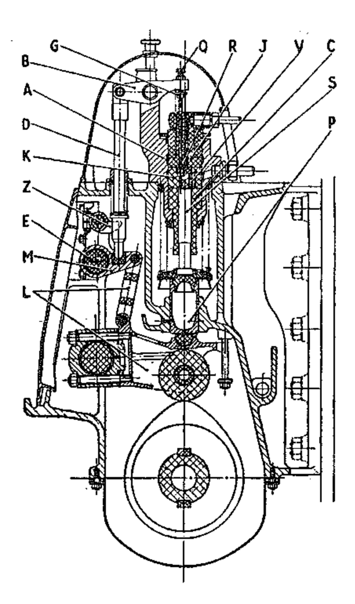{width=50%}

Un fenómeno que influye en el funcionamiento de los inyectores y del motor, es el goteo inmediatamente antes e inmediatamente después del período de inyección. Especialmente perjudicial, así como fácil de producirse, es el goteo final que constituye una prolongación de la inyección. El combustible introducido en esta fase, al no estar pulverizado, no está en condiciones de quemarse de inmediato y provoca la obturación de las boquillas o toberas por cokerización, produciendo además humos en el escape, o bien se quema en el ciclo siguiente provocando un irregular aumento del gradiente y del valor máximo de la presión de combustión, porque produce un aumento del retraso del encendido.

Para impedir el goteo se usan sobre todo inyectores del tipo cerrado

(fig. 14).

En éstos el combustible, enviado a alta presión por la bomba, llega, a través del filtro y del canal de envío del inyector, a un punto bajo la guía de la aguja del inyector. La aguja se mantiene adherida a su asiento cónico mediante el empuje que ejerce un resorte por intermedio de una barra. El empuje del resorte se regula, por medio de unas arandelas, de modo que la aguja se levanta por efecto de la presión del combustible sólo cuando éste ejerce sobre la superficie anular de la aguja un empuje superior al del resorte.

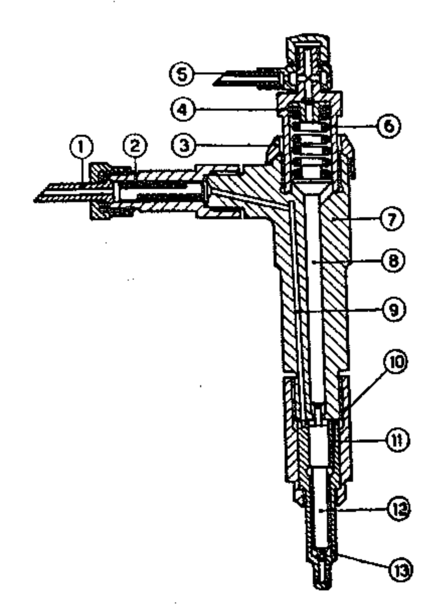{width=50%}

1. Tubería de llegada del combustible - 2. Copla con filtro de barra - 3. Collarín de fijación a la culata - 4. Arandela de regulación - 5. Copla de drenaje de combustible - 6. Resorte de presión - 7. Cuerpo del porta inyector - 8. Barra - 9. Canal de envío del porta inyector - 10. Garganta de unión canal de envío - 11. Canal de envío en inyector - 12. Aguja del inyector - 13. Cuerpo del inyector.

Al desplazarse la aguja el combustible sale pulverizado por uno o más orificios practicados en el extremo de la boquilla. Una cierta cantidad de combustible se filtra por la guía de la aguja, por lo que está prevista una unión especial de drenaje a través de la cual regresa al depósito; así se evita que se cree una contrapresión sobre la aguja, que alteraría el funcionamiento del inyector.

La presión a la cual la aguja del inyector comienza a levantarse es denominada, comúnmente, *presión de apertura*, y su valor está generalmente comprendido entre 100 y 250 bar.

Con el progreso de los últimos años en la selección de los materiales y en la precisión de la fabricación se ha marcado la tendencia hacia presiones de inyección decididamente más altas, en beneficio de la pulverización.

Los pulverizadores del tipo cerrado tienen, además de la ventaja de la precisión en el comienzo y en el fin de la inyección, la de una buena pulverización a los diferentes regímenes, porque el desplazamiento de la aguja, y en consecuencia la sección del paso del combustible, es proporcional al caudal de la bomba.

Como ya se ha dicho, los inyectores pueden ser de uno (fig. 15) o de varios orificios (fig. 16); la elección del número de orificios y su posición depende de la forma de la cámara de combustión y de la posición del inyector.

Normalmente los inyectores de orificio único se adoptan en motores con cámara separada; los de varios orificios se adoptan casi exclusivamente en las cámaras de inyección directa. Su puesta a punto requiere siempre de un preciso y páciente trabajo experimental.

Los principales elementos que permiten variar la ley de inyección que actúa sobre el inyector son: el resorte de presión, la superficie expuesta de la aguja y la lumbrera de flujo del inyector.

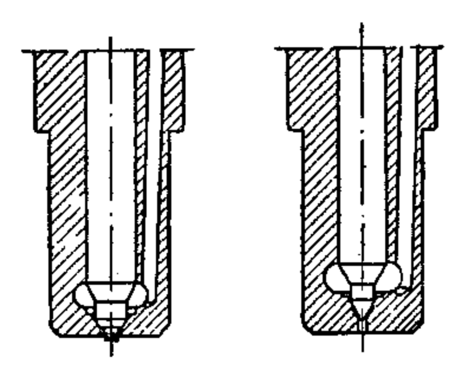{width=50%}

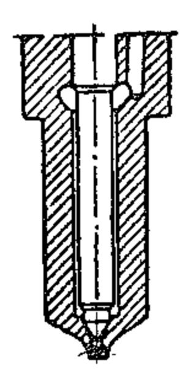{width=20%}

Las piezas que componen el inyector tienen que construirse con materiales especiales adecuadamente tratados, para evitar que eventuales deformaciones causadas por las temperaturas a las cuales están expuestas causen la inmovilización de la aguja. Su fabricación requiere de un trabajo de alta precisión de modo que se asegure la hermeticidad del asiento cónico para evitar el goteo, la hermeticidad y el movimiento de la aguja dentro de su guía para garantizar la constancia de la dosificación de las inyecciones, y la uniformidad de las lumbreras de flujo para asegurar la regularidad de penetración y de pulverización del combustible.

Los inyectores de tipo abierto son muy simples porque consisten esencialmente en una boquilla o tobera provista de un pequeñísimo orificio calibrado con gran precisión. Usados en el pasado para la inyección neumática y después abandonados, son escasamente aplicados para la inyección mecánica porque, siendo constante la sección de paso, la presión de inyección disminuye al disminuir el régimen y por lo tanto la combustión sólo resulta satisfactoria para un régimen determinado; a todos los demás regímenes la combustión es irregular (humos de escape, excesivo consumo, incrustaciones en el cilindro y en las válvulas).

Para garantizar una buena pulverización a bajo régimen, es necesario admitir para los regímenes más altos unas presiones muy fuertes, que en ciertos casos superan los 800 bar.

### 8. El inyector bomba

El sistema de *inyector-bomba* es empleado en algunos famosos motores Diesel rápidos americanos de 4 y de 2 tiempos. Los esquemas de las figuras 2 y 17 ilustran la instalación completa.

El mando del émbolo del inyector se efectúa generalmente con un balancín y el correspondiente empujador accionado por un árbol de levas.

Para la dosificación del combustible, se usa un sistema de reflujo variable, o bien se hace variar la presión del circuito de alimentación del inyector-bomba.

En el primer caso (figs. 2 y 18) el funcionamiento del grupo es análogo al de las bombas de reflujo variable y la regulación se efectúa mediante giro del émbolo.

En el segundo caso (fig. 17) la variación de la presión en el circuito de alimentación se consigue por medio de válvulas de regulación.

Según el valor de la presión entra una cantidad más o menos grande de combustible en el inyector, donde el elemento de bombeo lo impulsa hacia la cámara de combustión: la presión en el circuito es relativamente baja (8 ÷ 10 bar), pero aumenta fuertemente cuando el elemento de bombeo impulsa el combustible a través de los orificios del pulverizador.

El funcionamiento del grupo de regulación es el siguiente (fig. 17): el combustible, introducido en el circuito de alimentación por una bomba de engranajes, encuentra en el recorrido antes del inyector-bomba dos válvulas reguladoras de presión: una, que efectúa la regulación en relación con la posición del pedal del acelerador (carga del motor), y la otra, accionada por un regulador centrífugo, en relación con el régimen del motor. De este modo, a cada condición de funcionamiento corresponde una determinada presión en el tubo que conduce al inyector-bomba, por lo que una cantidad proporcional de combustible fluye por la boquilla b (fig. 19) al pulverizador para ser introducido a alta presión en la cámara de combustión.

En el circuito de alimentación se intercalan también una válvula reguladora de la presión máxima y una válvula de detención, esta última manual o bien eléctrica, para interrumpir completamente el flujo de combustible cuando se detiene el motor.

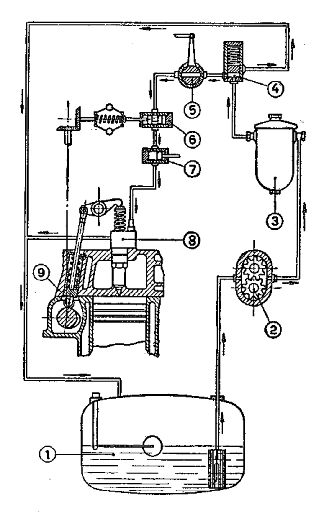

1. Depósito de combustible - 2. Bomba de alimentación 3. - Filtro principal de combustible - 4. Válvula limitadora de la presión máxima - 5. Válvula de regulación controlada por el pedal del acelerador - 6. Válvula de regulación controlada por el regulador centrífugo - 7. Válvula de detención - 8. Inyector bomba - 9. Empujador de mando del inyector bomba.

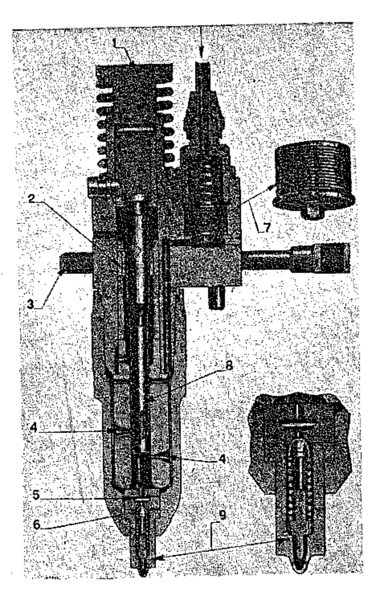{width=50%}

1. Empujador - 2. Engranaje de regulación - 3. Cremallera de mando de la regulación - 4. Lumbreras de admisión - 5. Válvula de asiento piano - 6. Válvula de asiento esférico - 7. Filtro - 8. Pequeño pistón - 9. Boquilla.

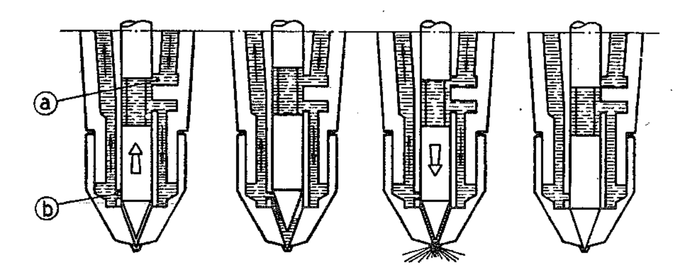

De izquierda a derecha:
1. Comienza la subida del pistón del inyector-bomba. El combustible proveniente del orificio a circula en el inyector-bomba desaireándose y refrigerando la bomba misma.

2. Continúa la subida del pistón del inyector-homba. El pistón ha descubierto el orificio b y la necesaria cantidad de combustible, que varía con la presión de alimentación, es introducida en la copa del pulverizador.

3. Comienza la carrera descendente. Se cierra el orificio b y el combustible contenido en la copa es enviado a alta presión y pulverizado en la cámara de combustión.

4. Termina la carrera descendente, El pistón completa la carrera de inyección hasta alcanzar el asiento cónico de la tobera. También se ha cerrado el orificio a: el combustible ya no circula en el inyector-bomba.

### 9. La inyección de gasolina

En casos especiales por razones contingentes se siente la necesidad de utilizar motores Diesel rápidos para el funcionamiento con keroseno o con gasolina (motores policombustibles). Con este fin se aportan algunas variaciones a las cámaras de combustión para aumentar la relación de compresión y variar las características de la turbulencia del aire. También se adaptan los aparatos de inyección a las nuevas exigencias que dependen de las razones siguientes:

- a) Necesidad de lubricar los émbolos de la bomba, porque la gasolina, a diferencia del gasóleo, tiene baja viscosidad y en consecuencia escasas propiedades lubricantes;
- b) Necesidad de proporcionar para los émbolos un sistema de sellos tal que evite que filtraciones de carburante diluyan el aceite lubricante. En general la hermeticidad se consigue con aceite a presión que se hace fluir por una ranura practicada en el interior del cilindro por encima de las lumbreras de paso del carburante (ver fig. 461): de esta manera se alcanza el doble objetivo de lubricar y de evitar pérdidas por filtraciones.

La inyección mecánica de gasolina en los cilindros se usó en motores de aviación militares de encendido por chispa. En estos motores la presión ejercida por las bombas tenía valores relativamente bajos (de unos 50 bar) dado que la inyección de gasolina, al menos hasta que no se desciende a volatilidades exageradamente bajas, no tiene las exigencias de pulverización que caracterizan la inyección de gasóleo.

Los inyectores eran del tipo abierto (motores *Junkers*) o bien del tipo cerrado con boquilla de varios orificios (motores *Daimler-Benz*).