#### CICLOS REALES - DIAGRAMAS DE LAS PRESIONES

#### 1. Ciclo indicado y presión media indicada

El ciclo real refleja las condiciones reales de funcionamiento de un motor y se identifica con el diagrama de las presiones medidas en el cilindro, correspondientes a las diferentes posiciones del pistón.

Este diagrama se llama diagrama indicado y el aparato que sírve para trazarlo, indicador.

El aparato esquematizado en la figura 1 sirve para demostrar el principio que se sigue para obtener un diagrama indicado, pero no es realizable en la práctica.

Los aparatos indicadores son en realidad dispositivos complejos y delicados que se han beneficiado de la electrónica en lo referente a facilidad de aplicación.

Un pequeño cilindro, provisto de un émbolo contrastado por un resorte, está puesto en comunicación, por medio de un tubo, con la cámara de combustión de uno de los cilindros del motor. El vástago del émbolo actúa sobre un conjunto de varillas que forman un cuadrilátero amplificador, cuya última varilla lleva en su extremo una punta trazadora.

La presión de los gases, transmitida a través del tubo, empuja el émbolo del indicador, y venciendo la carga del resorte, lo desplaza una cierta distancia proporcional al valor de la presión. La punta trazadora en el extremo de la varilla dibuja por lo tanto en sentido vertical una línea de longitud proporcional a la presión que actúa sobre el émbolo. Como todo el conjunto indicador está fijado al pistón del motor, la punta trazadora se desplaza adelante y atrás con éste y su posición horizontal corresponde en cada punto a la del pistón del motor.

Las curvas dibujadas por la punta trazadora se refieren por lo tanto a dos ejes de coordenadas cuyas abscisas representan los espacios recorridos por el pistón, y por lo tanto los volúmenes, y cuyas ordenadas representan las presiones.

Supongamos que el motor sea de encendido por chispa y de 4 tiempos, y, para simplificar, que las condiciones de funcionamiento sean aproximadamente las teóricas.

Desplazando el pistón del P.M.S. al P.M.I. y viceversa, con las válvulas abiertas, de modo que no ofrezcan prácticamente resistencia alguna al paso del gas, la presión en el cilindro se mantiene igual a la atmosférica y la punta trazadora dibuja un trazo horizontal A-A, de longitud igual a la carrera. Este trazo representa el diagrama de las presiones para las fases de admisión y de escape.

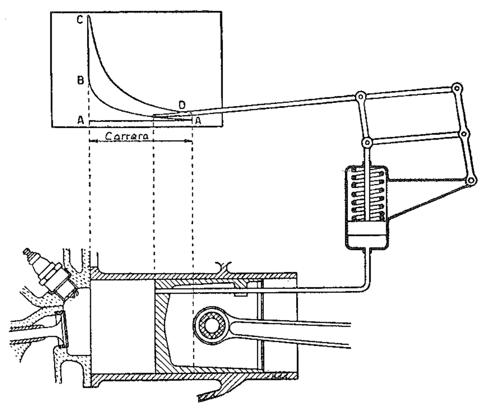{width=70%}

Cerradas las válvulas, durante la carrera de compresión la punta describe la curva A-B. Al final de la carrera de compresión se produce la combustión y en consecuencia se tiene un repentino aumento de presión que hace describir a la punta la línea casi vertical B-C. Sucesivamente, durante la carrera de expansión, la punta describe la curva C-D. Hacia el final de la carrera de expansión se abre la válvula de escape, la presión desciende hasta un valor cercano al de la atmosférica y por lo tanto la punta dibuja un corto trazo casi vertical D-A.

La figura 2 representa dos ciclos reales típicos de motores de ciclo Otto y Diesel de igual cilindrada unitaria.

Para facilitar la comparación entre los dos ciclos, los diagramas se han superpuesto. El eje de las presiones para el ciclo Diesel resulta desplazado con respecto al del ciclo Otto como consecuencia del diferente volumen  $V_c$  de la cámara de combustión. En efecto, a igual cilindrada unitaria  $V_p$ , siendo la relación de compresión del motor Diesel mayor que la del motor de ciclo Otto, el volumen  $V_c$  de la cámara de combustión es menor.

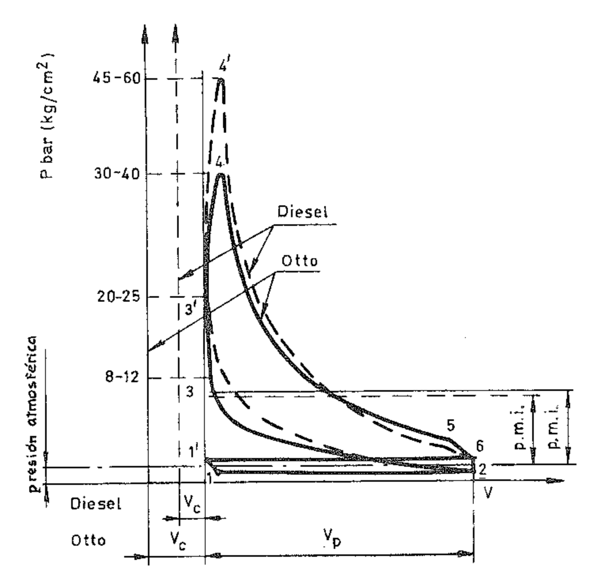{width=50%}

El área 1 2 6 1' 1 representa el trabajo negativo debido al bombeo en las fases de admisión y de escape; el área 2 3 4 5 6 2 representa el trabajo positivo.

La diferencia entre ellos es el trabajo útil. Dividiendo el área correspondiente al trabajo útil realizado por el fluido por la longitud de la carrera o por la cilindrada  $V_p$ , según la escala elegida para el eje de las abscisas, se obtiene el valor de la **presión media indicada** p.m.i.

Si se quiere evaluar la importancia de la variación de trabajo útil al pasar del ciclo teórico al indicado, se hace la razón entre las áreas correspondientes.

Dividiendo el área del ciclo indicado por la del ciclo teórico de aire se obtiene el rendimiento indicado.

En la tabla siguiente se comparan los valores de los rendimientos de los ciclos teóricos de aire y de los ciclos indicados obtenidos experimentalmente para un motor especial con relación de compresión variable. Los datos han sido registrados por el investigador inglés Sir H. Ricardo.

| Relación de compresión | Rendimiento del ciclo teórico de aire: $1 - 1/\varrho^{0.4}$ | Rendimiento experimental |
|------------------------|--------------------------------------------------------------|--------------------------|
| 4                      | 0,426                                                        | 0,277                    |
| 4,5                    | 0,453                                                        | 0,297                    |
| 5                      | 0,475                                                        | 0,316                    |
| 5,5                    | 0,494                                                        | 0,332                    |
| 6                      | 0,512                                                        | 0,346                    |
| 6,5                    | 0,527                                                        | 0,360                    |
| 7                      | 0,541                                                        | 0,372                    |
| 7,5                    | 0,553                                                        | 0,383                    |
| 8                      | 0,565                                                        |                          |

Table: Variación de los rendimientos en función de la relación de compresión.

## 2. Diferencias entre ciclo Otto real y teórico

Entre el ciclo indicado y el correspondiente ciclo teórico existen diferencias sustanciales tanto en la forma del diagrama como en los valores de las temperaturas y de las presiones.

Las diferencias de forma del ciclo indicado con respecto al teórico consisten en un diferente recorrido seguido por las curvas de expansión y de compresión, en la sustitución de los tramos rectilíneos y en la sustitución de los ángulos por curvas de enlace. Las causas de estas diferencias han de buscarse en las siguientes razones:

a) Pérdidas de calor. — En el ciclo teórico son nulas; en el ciclo real son en cambio apreciables. Puesto que el cilindro y la culata están refrigerados, una parte del calor es transmitida por el fluido a las paredes. Las líneas de compresión y expansión no son por lo tanto adiabáticas, sino politrópicas con exponente n diferente de k. Como el fluido sufre pérdidas de calor, evidentemente para la expansión se tendrá n > k y para la compresión n < k.

Se verifica por lo tanto una pérdida de trabajo útil correspondiente a las áreas A en la figura 3.

b) Combustión no instantánea. — En el ciclo teórico se supone que la combustión se realiza a volumen constante, es decir, que es instantánea; en el ciclo real, en cambio, se requiere un cierto espacio de tiempo. Si el encendido tuviera lugar coincidiendo con el P.M.S., la combustión tendría lugar mientras el pistón se va alejando del P.M.S. y el valor de la presión sería inferior al previsto con la consiguiente pérdida de trabajo útil.

Por esto conviene anticipar el encendido de modo que la combustión pueda llevarse a cabo en su mayor parte cuando el pistón se encuentra en las cercanías del P.M.S. Esto produce un redondeamiento de la línea teórica de aportación de calor, y por lo tanto una pérdida de trabajo útil representada por las áreas B, pero esta pérdida resulta de magnitud mucho menor que la que se tendría sin adelanto del encendido.

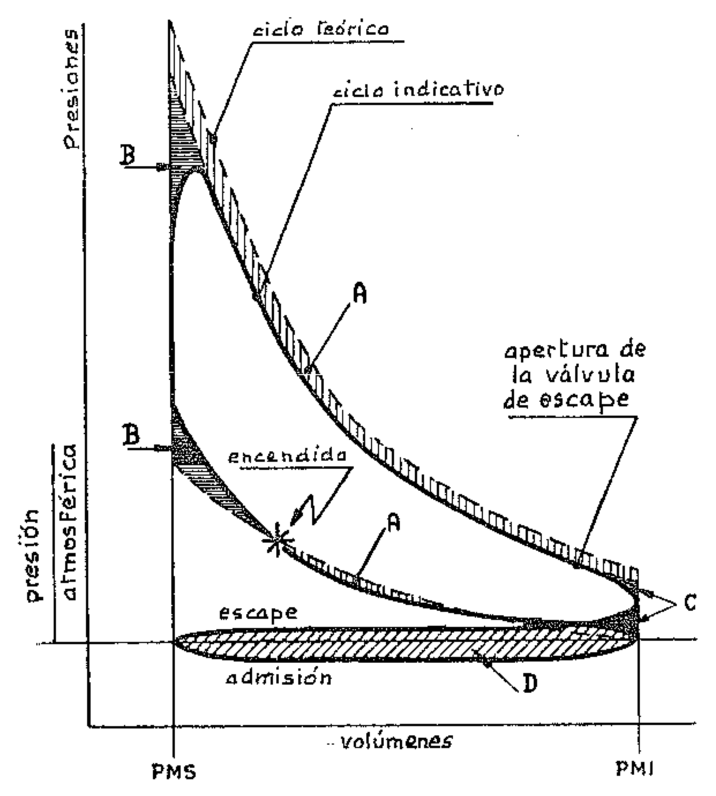{width=50%}

c) Tiempo de apertura de la válvula de escape. — En el ciclo teórico se ha supuesto que también la extracción de calor se lleva a cabo instantáneamente coincidiendo con la posición del pistón en el P.M.I. En el ciclo real la extracción de calor se produce durante un tiempo relativamente largo: la válvula de escape debe abrirse anticipadamente para dar tiempo a una parte de los gases quemados para salir del cilindro antes que el pistón alcance el P.M.I., de modo que la presión descienda aproximadamente hasta el valor de la presión exterior al comienzo de la carrera de escape. Este hecho produce una pérdida que sin embargo es menor que la que se tendría sin el avance de la apertura de la válvula de escape.

Las causas de las diferencias en los valores de las presiones y temperaturas máximas son:

a) Aumento de los calores específicos del fluido con la temperatura. Como bien sabemos, tanto el calor específico a presión constante  $c_p$  como el a volumen constante  $c_v$  de un gas real aumentan con la temperatura, pero de modo que su diferencia permanece constante, es decir,  $c_p - c_v = R$  (párrafo II.10); en consecuencia al aumentar la temperatura disminuye el valor de la relación  $k = \frac{c_p}{c_v}$ .

Se desprende que los valores de la presión y de la temperatura máxima resultan siempre inferiores a los obtenibles en el caso de que los calores específicos fueran constantes para las variaciones de temperatura. Este hecho también se tiene en cuenta al trazar el ciclo teórico de aire, pero en el caso real los productos de la combustión poseen calores específicos mayores que los del aire, y por lo tanto los valores de la presión y de la temperatura máxima son, en la realidad, inferiores a los del ciclo teórico. El área del ciclo y el rendimiento térmico resultan por lo tanto disminuidos.

b) Disociación en la combustión. — Como la disociación de los productos de la combustión, constituidos esencialmente por CO2 y H2O, en otros compuestos tales como CO, H2 y O2, es una reacción que se realiza con absorción de calor, la temperatura máxima obtenible se reduce y se pierde una cierta cantidad de trabajo. Pero, dado que durante la expansión la temperatura se reduce, la reacción de disociación retrocede. Se produce entonces en esta fase una recombinación parcial con desarrollo de calor. El valor del exponente politrópico de la expansión, que debería ser mayor que k por las pérdidas de calor a través de las paredes del cilindro, se reduce acercándose al del politrópico de compresión y por esto se produce una recuperación parcial del trabajo anteriormente perdido.

Finalmente, el ciclo real presenta otra diferencia importante en la comparación con el ciclo teórico: durante la carrera de admisión la presión en el cilindro es inferior a la que se tiene durante la carrera de escape. Salvo casos particulares, durante la admisión la presión es inferior a la atmosférica y durante el escape es superior. Se crea por lo tanto en el diagrama indicado un área negativa (área D en la fig. 3) que corresponde a trabajo perdido. Este trabajo hecho por el motor para llevar a cabo la admisión y el escape se llama **trabajo de bombeo** y generalmente se lo evalúa como trabajo perdido por rozamiento.

### 3. Diferencias entre ciclo Diesel real y teórico

Como en el caso del ciclo Otto, entre el ciclo real y el ciclo teórico Diesel tenemos diferencias de forma y diferencias en los valores de las presiones y temperaturas. Algunas de estas diferencias corresponden a las del ciclo Otto: las debidas a la variación de los calores específicos, a las pérdidas de calor, al tiempo de apertura de la válvula de escape. Otras diferencias son sólo parciales, como las debidas a la disociación y a las pérdidas por bombeo. Finalmente, una es peculiar del motor Diesel y se refiere a la combustión que, en el caso del ciclo real, no se realiza a presión constante.

a) Combustión a presión constante. — Como se ve en el diagrama indicado (fig. 4), en la práctica la combustión se realiza en condiciones tales que la presión varía durante el proceso, mientras que en el ciclo teórico habíamos supuesto que se mantiene constante. En realidad la combustión se realiza en parte a volumen constante y en parte a presión constante, casi como en el ciclo Otto real. Sólo en el caso de motores muy lentos la combustión se desarrolla de manera que se aproxima un poco al proceso teórico (fig. 5).

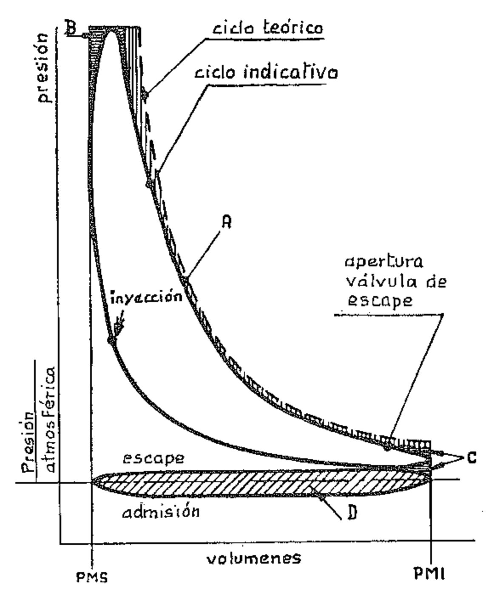{width=50%}

- b) Disociación de los productos de la combustión. En los motores EC la disociación no tiene un efecto tan importante como en el motor ECh, porque el exceso de aire y el mezclado de los productos de la combustión son tales que reducen la temperatura máxima y por esto también la disociación de los productos de la combustión.
- c) Pérdidas por bombeo. Las pérdidas por bombeo son inferiores a las del ciclo Otto porque no hay parcialización del aire en la admisión; en los motores EC no existe, en efecto, la válvula de mariposa, característica de los motores ECh provistos de carburador. Por lo tanto el área D negativa del ciclo Diesel real es menor que la del ciclo Otto.

Lo dicho se refiere a los motores de 4 tiempos. En los motores de 2 tiempos, bastante comunes entre los Diesel, las pérdidas por bombeo y las pérdidas debidas al hecho de que la expansión se interrumpe antes del P.M.I. para dar lugar al escape, se hacen importantes. Entre las pérdidas por bombeo debe además considerarse también el trabajo hecho para llevar a cabo el barrido del cilindro, que con frecuencia es realizado por un compresor.

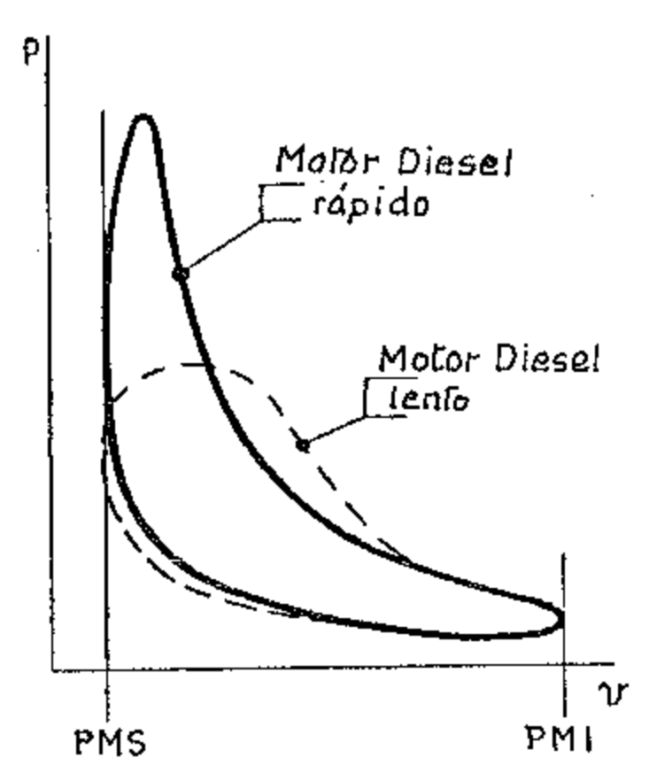{width=50%}

# 4. Estudio del diagrama indicado

El conocimiento del diagrama indicado de un motor es importante. Midiendo su área se obtiene, como ya hemos dicho, la p.m.i. (presión media indicada). Conociendo la p.m.i. se obtiene, considerando la cilindrada total del motor y el número de carreras útiles en la unidad de tiempo, la potencia indicada, es decir la potencia desarrollada en los cilindros. En la práctica la potencia indicada se obtiene agregando a la potencia medida al freno la potencia absorbida por los rozamientos, la que se mide haciendo girar el motor sin encendido.

Los aparatos indicadores se usan para estudios de laboratorio y para controlar la regularidad del ciclo. Puesto que la forma del ciclo depende del modo en que se desarrollan los procesos que se verifican en el motor, las irregularidades de funcionamiento pueden ser estudiadas examinando el ciclo indicado.

Estudiemos entonces con un poco de detalle el diagrama indicado tomando como referencia el del motor de 4 tiempos. Muchos de los razonamientos que haremos son válidos tanto para los motores de ciclo Otto como para los de ciclo Diesel, puesto que, como hemos demostrado en los párrafos precedentes, las formas de sus diagramas son similares, difiriendo sólo los valores de las presiones y de las temperaturas máximas. La figura 6 ilustra dos diagramas indicados de un motor ECh; uno a plena abertura, es decir, con la mariposa del carburador completamente abierta, y el otro a abertura parcial, es decir con la mariposa cerrada en parte.

Como sabemos, el área en blanco es positiva y el área achurada es negativa; el área achurada representa en efecto el trabajo perdido por el bombeo durante las fases de escape y admisión.

Cuando la mariposa está totalmente abierta la resistencia al paso del aire es mínima y entra la máxima cantidad de mezcla. El área positiva, que representa el trabajo útil, es por lo tanto máxima. Cuando en cambio la mariposa está parcialmente cerrada, entra una menor cantidad de mezcla, por lo tanto el trabajo realizado por el fluido es menor y el área positiva es más pequeña.

Sobre el área achurada el efecto de la estrangulación mediante la mariposa es totalmente opuesto. Cuando la mariposa está abierta la resistencia al paso del aire es mínima y, si el conducto está bien diseñado, la presión en el cilindro es muy próxima a la atmosférica. En cambio, cuando la mariposa está parcialmente cerrada, la resistencia al paso de la mezcla es considerable; ésta no entra con la misma rapidez con la que está aumentando el volumen en el cilindro por el movimiento del pistón, por lo que se crea una depresión. En el primer caso el trabajo perdido por bombeo es mínimo y el área negativa es mayor.

Por lo tanto el trabajo perdido por bombeo está muy influenciado por la posición de la mariposa del carburador. En los motores Diesel esto no sucede porque no hay válvula de mariposa.

En la figura 7 está marcado el punto que corresponde al encendido de la carga. Como hemos dicho antes, el encendido debe producirse antes del P.M.S. para que la combustión, que requiere de un cierto tiempo para completarse, se produzca de la manera más cercana posible a la teórica, es decir, casi a volumen constante. El momento del encendido se establece experimentalmente mediante pruebas para corresponder a la potencia máxima obtenible al límite de la detonación o a la regularidad de marcha del motor. En general el momento en el cual se hace saltar la chispa corresponde al punto en el cual la presión es la mitad de la que se alcanza en el P.M.S. Si la chispa salta con retraso (atrasada) la combustión se produce casi totalmente después del P.M.S., la presión máxima se alcanza cuando el pistón se ha alejado notablemente del P.M.S., y su valor es por lo tanto más bajo que el normal. Por lo tanto el área del ciclo se reduce como se ve en la figura 7a. La misma deformación del diagrama indicado se verifica en el caso de combustión lenta. Cuando en cambio la chispa salta con anticipación la combustión se realiza en gran parte antes del P.M.S., la presión máxima alcanza un valor superior al normal y el ciclo se deforma como se ve en la figura 7b.

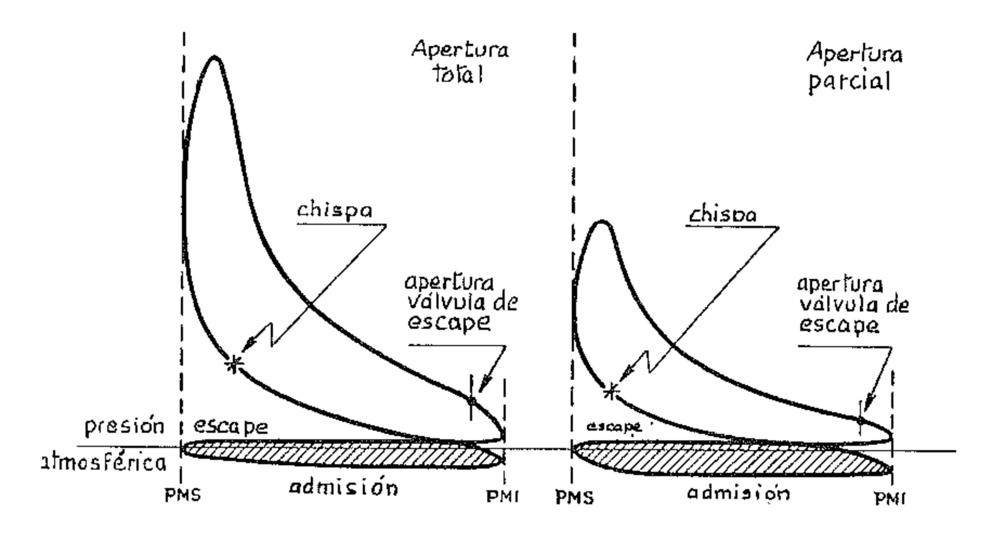

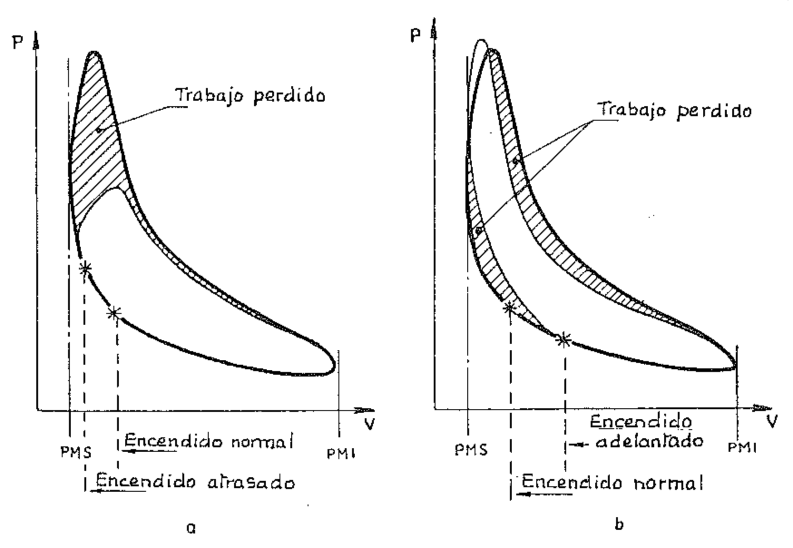

Del examen del ciclo indicado es también fácil ver si los conductos y las válvulas de admisión y escape están bien diseñados y proporcionados, y si los tiempos de apertura de las válvulas se han escogido adecuadamente.

En efecto, si los pasos para la mezcla o para el aire son insuficientes y ofrecen resistencias excesivas, o bien si se ha retrasado el comienzo de la apertura de la válvula de admisión, durante la carrera de admisión la presión en el cilindro es inferior a la normal y por lo tanto aumenta el trabajo de bombeo, como se ve en la figura 8a.

Si en cambio son los conductos de escape los que ofrecen resistencia anormal al paso de los gases quemados, o bien si se ha retrasado el comienzo de la apertura de la válvula de escape, durante la carrera de escape la presión en el cilindro es superior a la normal y por lo tanto no sólo aumenta el trabajo de bombeo, como se ve en la figura 8b, sino que resulta excesiva la cantidad de gases quemados que quedan en el cilindro al final de tal carrera, por lo que es excesiva la dilución de la carga fresca que es introducida durante la sucesiva fase de admisión. La consecuencia es un descenso del valor de la presión máxima y de los valores de las presiones en toda la fase de trabajo. También este defecto es entonces una causa de reducción del área del diagrama indicado y por lo tanto de una pérdida de trabajo útil.

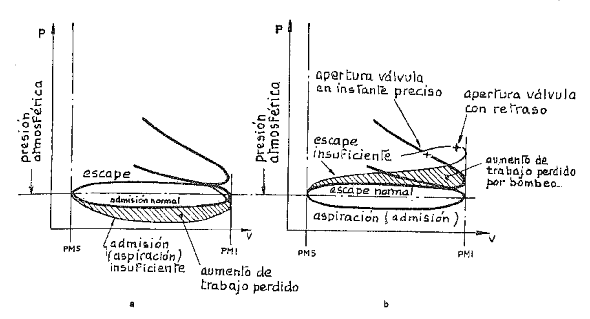

# 5. Diagrama de las presiones en función de los desplazamientos angulares del eje para un motor de cuatro tiempos

Conociendo el ciclo indicado es fácil trazar el diagrama de las presiones en el cilindro en función de los desplazamientos angulares de la manivela, más que en función de los volúmenes o de los desplazamientos del pistón, dada la relación cinemática que une estos últimos a la rotación del eje.

Este diagrama sirve, como veremos más adelante, para el cálculo de las cargas sobre los cojinetes, pero anticipamos aquí su estudio para adquirir mayor familiaridad con los razonamientos sobre los ciclos.

En la figura 9 se representa el diagrama para un motor de 4 tiempos. Como sabemos, en el ciclo real los procesos no se realizan, como se supone en el ciclo teórico, dentro de los límites representados por los puntos muertos. Por tanto las fases del ciclo se cumplen durante desplazamientos angulares de la manivela que son diferentes entre sí y de los que corresponden a las carreras totales del pistón.

Este hecho puede apreciarse en la figura 9.

Examinemos cómo varían los valores de la presión durante el desarrollo del ciclo:

a) Admisión. — Al comienzo de la carrera de aspiración (o admisión) 1-2 el interior del cilindro se encuentra a una presión ligeramente superior a la atmosférica, porque aún no ha terminado la fase de escape. Coincidiendo con el punto 2 el pistón, en su carrera hacia el P.M.I., aspira aire o mezcla gaseosa a través de la válvula de admisión que se ha abierto en el momento oportuno. Como ya hemos visto, a causa de las resistencias que el gas encuentra en los conductos en la mayor parte de esta fase se tiene una presión menor que la exterior (depresión de la aspiración). La depresión es tanto mayor cuanto mayor es la velocidad del gas en los conductos porque mayores resultan las resistencias a su paso. Esta fase representa trabajo pasivo.

Cuando en 3 el pistón inicia la carrera hacia el P.M.S., el interior del cilindro se halla aún en depresión por lo que, a pesar del movimiento contrario del pistón, continúa la introducción del fluido, hasta que en 4 se verifica el equilibrio entre la presión interna y la atmosférica. En este punto debe cerrarse la válvula de admisión. Si los conductos de aspiración son largos, se puede utilizar el efecto de la inercia de la columna gaseosa para prolongar la introducción incluso después del punto 4 retrasando aún más el cierre de la válvula. En el punto 4 comienza por lo tanto la verdadera fase de compresión.

b) Compresión. La compresión de la carga se produce por efecto del movimiento del pistón en la carrera 4-6. Teniendo en cuenta el hecho de que la combustión requiere de un cierto tiempo para completarse, para permitir el desarrollo más satisfactorio de la fase útil (combustión y expansión) se hace comenzar el encendido antes del P.M.S. El punto 6' da el valor máximo de la presión en el caso de falta de encendido.

c) Combustión y expansión. Con el encendido coincidiendo con el punto 5, poco antes del final de la carrera de compresión, comienza la combustión; ésta genera una repentina elevación de temperatura y de presión que alcanza su valor máximo en el punto 7. La combustión termina cuando el pistón ya ha recorrido un primer tramo de la carrera. Examinaremos más detalladamente en lo que sigue el desarrollo de la combustión en los dos casos diferentes de encendido por chispa y de encendido por compresión.

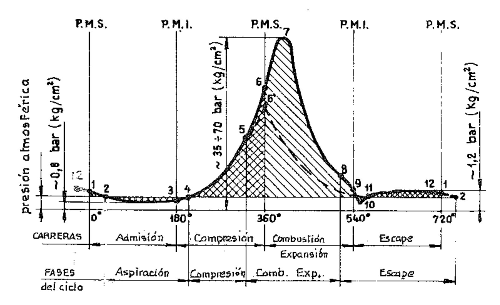

Terminada la combustión, se lleva a cabo la expansión. El volumen aumenta y la presión experimenta una rápida caída, que es debida también en parte a la cesión de calor a las paredes del cilindro. La expansión debería prolongarse lo más posible para aprovechar al máximo la fase útil, es decir, hasta alcanzarse el P.M.I., pero en la práctica, para facilitar la expulsión de los gases quemados, ésta es interrumpida con la apertura anticipada con respecto al P.M.I. de la válvula de escape, en el punto 8.

d) Escape. - Los gases que en el momento de la apertura de la válvula de escape se encuentran a una presión superior a la atmosférica, se descargan violentamente al exterior. En este primer período de la fase, que se produce casi a volumen constante (escape espontáneo), la presión se reduce rápidamente y en 9, cuando comienza la carrera de escape, supera por poco la presión atmosférica con tendencia a reducirse aún más durante el primer tramo de esta carrera. A veces, si los conductos de escape son largos, por efecto de inercia de la columna gaseosa puede además tenerse en 10 una rápida punta de depresión. En 11 comienza el segundo período de la fase; el pistón, desplazándose hacia el P.M.S., expulsa los gases que aún ocupan el cilindro. Este período se desarrolla a presión ligeramente superior a la atmosférica (sobrepresión de escape) por efecto de la resistencia que los gases encuentran al atravesar la válvula y las tuberías de escape, y representa trabajo pasivo. El pistón, sin embargo, no puede expulsar completamente los gases quemados porque una parte de ellos ocupa la cámara de combustión. En 1, al final de la carrera de escape, la presión tiene aún un valor ligeramente superior a la atmosférica, por lo que la fase se prolonga últimamente hasta el punto 2. Mientras tanto, ha comenzado a reabrirse en 12 la válvula de admisión de modo que en 2 ésta se encuentra ya completamente abierta y ofrece la máxima sección de paso para la nueva fase de admisión: así comienza un nuevo ciclo, que continuará repitiéndose regularmente.

En la figura 9 las áreas achuradas representan trabajo útil, las cuadriculadas trabajo pasivo, y la línea de trazos representa la evolución de las presiones cuando no hay combustión.

# 6. Diagrama indicado en función de los ángulos de manivela para un motor de dos tiempos

En la figura 10 se representa un diagrama indicado típico de un motor de 2 tiempos. Nos parece superfluo describirlo detalladamente; bastará, para aclarar los eventuales puntos oscuros, con el examen del diagrama trazado en función de los desplazamientos angulares de la manivela. Este diagrama está reproducido en la figura 11.

Como tampoco en este caso hay correspondencia exacta entre «tiempos» y «carreras», para facilitar la explicación hemos hecho coincidir el comienzo de los dos tiempos con los puntos que corresponden respectivamente al comienzo de la fase de combustión y al comienzo de la fase de barrido.

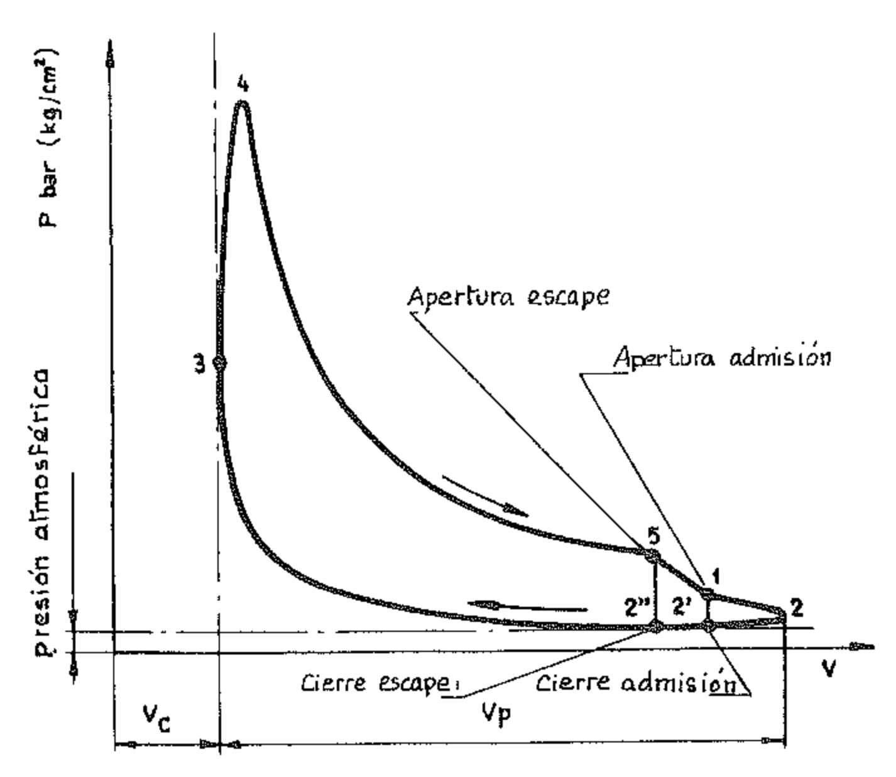{width=50%}

a) 1. er tiempo. — En el punto 3 se produce el encendido de la carga y se desarrolla la combustión para dar lugar a la subsiguiente expansión. Ésta continúa hasta que el pistón, coincidiendo con el punto 5, abre la lumbrera de escape (A en la fig. 7). Puesto que la presión en el cilindro es aún alta, la fase de escape comienza de modo espontáneo. Inmediatamente después, es decir, cuando la presión se ha reducido a un valor casi igual al que se tiene en el conducto de alimentación (C en la fig. 7), se abre en 1 la lumbrera de admisión y el aire, o la mezcla, impulsado por la presión existente en el cárter, o producida por un compresor, entra en el cilindro.

b) 2.º tiempo. — En este punto comienza la llamada fase de barrido que se desarrolla sobre el P.M.I. Estando abiertas tanto las lumbreras de escape como las de admisión, se verifican al mismo tiempo el escape de los gases quemados y la carga de las gases frescos. Estos últimos expulsan a los gases quemados para ocupar su puesto.

Durante el barrido, si la compresión de la mezcla fresca se produce en el cárter, la presión en el cilindro sigue disminuyendo, porque el cilindro está comunicado con la atmósfera y la presión de alimentación va disminuyendo gradualmente. En cambio, cuando la presión de la carga fresca es producida por un compresor, la presión en el conducto de admisión y en el cilindro permanece casi constante. A veces, con tuberías de escape más bien largas, la inercia de la columna de gases de escape provoca una succión de gases frescos en el período final de la fase. Por esta razón, cuando en 2' se vuelve a cerrar la lumbrera de admisión y prácticamente cesa la introducción de gases frescos, puede continuar el escape con pérdida de gases frescos que no pueden ya ser reemplazados. Veremos cómo este inconveniente se elimina en los Diesel lentos mediante la adopción de válvulas llamadas válvulas de barrido, dispuestas en el conducto de admisión. La presión del cilindro se mantiene casi constante, hasta que en 2'' se vuelve a cerrar también la lumbrera de escape para dar comienzo a la fase de compresión. En el caso en que el fluido fresco es comprimido en el cárter, el pistón, antes de alcanzar el P.M.S., deja libre la lumbrera de entrada a la bancada (B en la fig. 7), y el fluido entra aspirado por la depresión que se ha creado durante la carrera ascendente del pistón. En el cárter el fluido es comprimido durante la primera fase de la carrera siguiente.

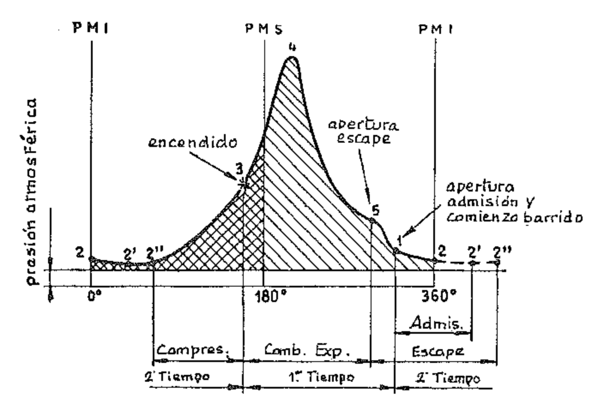{width=70%}

En la figura 11 las áreas achuradas representan trabajo útil y las cuadriculadas trabajo pasivo. Hacemos notar que aquí no aparece, como en el caso del motor de 4 tiempos, el trabajo de aspiración, porque éste forma parte del trabajo consumido para la compresión del fluido en el cárter o para el funcionamiento del compresor.

#### 7. Ciclo indicado previsto

El conocimiento del ciclo es necesario no sólo para controlar si el funcionamiento térmico es correcto, sino también para definir el valor de las fuerzas que actúan sobre los órganos del motor. Cuando, en la etapa de proyecto, han de establecerse las dimensiones de los órganos del motor, se procede al cálculo de las solicitaciones partiendo de un ciclo previsto. Éste puede trazarse mediante cálculos o por analogías con ciclos de motores comparables al que se estudia, pero también puede obtenerse de modo sencillo y rápido, y con la suficiente aproximación, con el siguiente método, que a modo de ejemplo, presentamos aquí aplicado al caso de los motores de 4 tiempso ECh (fig. 12).

Conociendo el diámetro, la carrera y la relación de compresión  $\varrho$ , se calculan el volumen de la cámara de combustión  $V_c$  y el de la cilindrada unitaria  $V_p$ , llevándose los valores  $V_c$  y  $V_c + V_p$  como abscisas en un diagrama cartesiano. Correspondiendo a estas abscisas se llevan como ordenadas las presiones del final de cada fase. Para el ciclo Otto, en la práctica y con discreta aproximación, sus valores se determinan del modo siguiente:

 $P_1$  = Presión al final de la admisión =  $0.9 \div 1$  bar;

 $P_2$  = Presión al final de la compresión =  $P_1 \cdot \varrho^{n_c}$ ;

 $P_3$  = Presión máxima al final de la combustión =  $7\varrho - 2$ ;

$P_4$ = Presión al final de la expansión =  $\frac{P_3}{\varrho^{n_e}}$ 

donde:

 $n_c$  = Exponente politrópico de compresión;

 $n_e$  = Exponente politrópico de expansión.

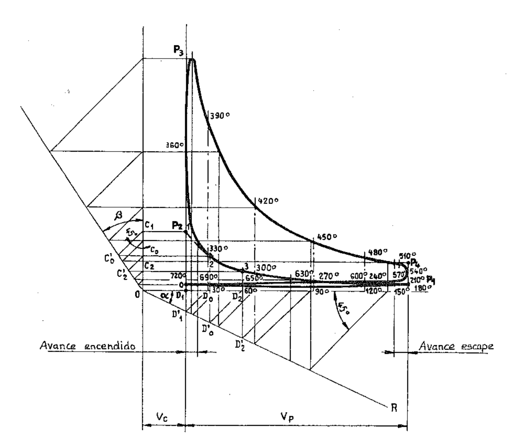{width=50%}

Las dos politrópicas de compresión y de expansión se trazan con la construcción de Bauer. Por ejemplo, para la curva de compresión se traza la recta O R que forma un ángulo α cualquiera con el eje de las abscisas y después la recta O B que forma un ángulo β con el de las ordenadas, de modo que resulte:

$$tg \beta = (1 + tg \alpha)^n - 1,$$

donde  $n = n_c$ , o bien  $n = n_e$ .

Se proyecta el punto 1 ( $P_2$ ) sobre los dos ejes cartesianos, después, desde los puntos  $C_1$  y  $D_1'$  se trazan dos rectas a 45° con los ejes y desde los puntos  $C_0'$  y  $D_0$  otras dos ortogonales a los mismos ejes: su intersección representa el punto 2 de la politrópica. Repitiendo la construcción partiendo del punto 2 se obtiene el punto 3 y así se continúa. Para la curva de expansión se procede de manera análoga.

Teniendo presente lo que se ha dicho con respecto a las diferencias entre ciclo ideal y ciclo indicado, se comprende por qué en la figura se han redondeado los diferentes tramos terminales de las fases. En la figura se indican para cada punto los ángulos correspondientes recorridos por la manivela.

El valor de  $P_1$  se asume, para simplificar, igual a 1 bar para todos los ciclos y todas las aplicaciones. La expresión de  $P_4$  más arriba indicada es también válida en todos los casos. Para el ciclo Diesel no existen expresiones empíricas que den valores de  $P_2$  y  $P_3$  próximos a los calculados según las normas y las fórmulas de la termodinámica.

En los motores lentos para instalaciones fijas y marinas, dado el limitado campo de variación de la relación de compresión y la escasa importancia que dicha variación tiene con respecto al elevado valor de esta relación, generalmente no se traza el ciclo indicado previsto, motor a motor, sino que se parte de un ciclo típico, normalizado, derivado de los obtenidos de motores existentes.

A partir del ciclo indicado previsto obtenido de esta manera se determinan los esfuerzos producidos por los gases sobre el pasador del pistón, multiplicando los valores de las presiones por el área del pistón mismo.

En la tabla se dan, a título informativo, los valores medios de las presiones y de la relación de compresión para los diferentes ciclos y las aplicaciones normales a alimentación natural, es decir, sin sobrealimentación.