# LOS COMBUSTIBLES

#### 1. Generalidades

Los combustibles para los motores endotérmicos pueden clasificarse en: sólidos, gaseosos, líquidos.

Los combustibles sólidos no pueden usarse en su estado natural: las tentativas hechas para introducirlos pulverizados han puesto en evidencia graves inconvenientes funcionales, como el desgaste y la corrosión de los cilindros y el enclavamiento de las válvulas a causa de las cenizas que no pueden ser totalmente eliminadas.

Por esto los combustibles sólidos se transforman en combustibles gaseosos en generadores especiales, llamados gasógenos. Pueden someterse a este tratamiento la leña, el carbón de leña, el coke de turba, el coke de lignito y de carbón fósil o de antracita, así como también sucedáneos formados por leña o residuos de leña pulverizados y comprimidos en bloques tratados en caliente con alquitrán vegetal y posteriormente endurecidos. Pueden transformarse en combustibles líquidos cuando ello sea conveniente desde el punto de vista económico. Con el aumento del precio de la gasolina y del gasoil puede llegar a ser conveniente recurrir al tratamiento del carbón fósil y de las turbas o arenas oleosas.

Los combustibles gaseosos pueden clasificarse en dos categorías: gases licuados y gases permanentes.

Los gases licuados son mezclas de hidrocarburos parafínicos (propano, butano, etc.) u olefínicos (propileno, butileno, isobutileno), que a temperatura normal puede licuarse a una presión relativamente baja (~ 8 bar). A presión atmosférica están en estado gaseoso. Para los usos automovilísticos se los contiene en depósitos de acero o de aleación ligera.

Los gases permanentes que encuentran escasas aplicaciones en la autotracción son el metano natural o artificial, el gas de coke (esencialmente compuesto de hidrógeno y metano) y el gas ciudad. Estos gases normalmente se comprimen en cilindros («bombonas») de acero especial a una presión de unos 200 bar.

El metano es con mucho el más difundido. Dificultades de producción industrial y otros inconvenientes obstaculizan por ahora el uso del metano líquido. El bajo poder calorífico (12 000  $\div$  21 000 kJ/m³ = 3000  $\div$  5000 kcal/m³) limita el campo de utilización de los gases de coke y del gas ciudad a casos excepcionales.

Los combustibles líquidos constituyen la fuente principal de energía para los motores endotérmicos. Por amplio margen los más empleados son los derivados del petróleo. A veces, donde los derivados del petróleo no son disponibles, se recurre a combustibles similares obtenidos del carbón mediante procedimientos especiales, pero su costo resulta evidentemente bastante más elevado.

Los principales tipos de combustibles líquidos en el comercio son los hidrocarburos resultantes de la refinación del petróleo, además del benzol y los alcoholes.

Los hidrocarburos se diferencian entre ellos esencialmente por la volatibilidad, es decir, por la tendencia a evaporarse y por lo tanto a mezclarse homogéneamente con el aire.

Los carburantes se emplean principalmente en los motores de encendido por chispa; las naftas (¹) en los motores de encendido por compresión. Entre los carburantes están incluidas las gasolinas (bencinas).

Las naftas comprenden los aceites medios y pesados provenientes de la destilación del aceite mineral o del alquitrán, llamados respectivamente gasóleos y naftas pesadas o naftas negras.

El keroseno (petróleo), puede considerarse como intermedio entre los carburantes y las naftas.

- El benzol y los alcoholes pueden ser clasificados como carburantes.

El benzol es un subproducto del carbón en su transformación en coke y consiste principalmente en benceno  $(C_6H_6)$ . Tiene un buen poder antidetonante, pero un poder calorífico inferior al de la gasolina. Se lo utiliza cuando y donde escasea la gasolina y abunda el carbón fósil.

Los alcoholes tienen una composición similar a la de los hidrocarburos pero contienen en sus moléculas átomos de oxígeno. Tienen buen poder antidetonante, pero poder calorífico bajo. En casos especiales se usan mezclados con la gasolina, sobre todo el alcohol metílico o metanol (CH3-OH), y el alcohol etílico o etanol (C2H5-OH).

(¹) Impropiamente se llama naftas a todos los productos de destilación que están entre las gasolinas y los aceites lubricantes.

### 2. Los componentes de los combustibles derivados del petróleo

El petróleo crudo es la mezcla de un gran número de hidrocarburos, es decir, de compuestos de carbono y de hidrógeno con un cierto porcentaje de azufre, oxígeno y nitrógeno; contiene también impurezas como agua y arena.

Los hidrocarburos se diferencian entre sí por el número y sobre todo por la disposición de los átomos en las moléculas y por lo tanto se los clasifica en grandes familias según su estructura molecular. La gran variedad de estructuras moleculares de los hidrocarburos se debe al hecho de que los átomos de carbono tienen la propiedad de poder unirse entre ellos tanto mediante enlaces simples como mediante enlaces dobles o triples. Las familias o series principales de hidrocarburos se describen aquí brevemente.

1. Serie parafínica o alifática ( $C_nH_{2n+2}$ ). — La estructura molecular de los hidrocarburos es de *cadena simple*. La valencia de cada átomo de carbono es totalmente utilizada en la combinación mediante enlaces simples con otros átomos de carbono y átomos de hidrógeno (fig. 1). Por eso las parafinas se denominan también *hidrocarburos saturados* y son muy estables.

Cuando la estructura es ramificada, como es el caso del iso-octano (figura 2), isómero del octano, y del isobutano, isómero del butano, los hidrocarburos de esta serie toman el nombre de isoparafinas. Las isoparafinas tienen un buen poder antidetonante mejor que el de las parafinas.

- 2. Serie olefínica  $(C_nH_{2n})$ . Las olefinas son similares a las parafinas, pero *no están saturadas* porque contienen átomos de carbono unidos por un doble enlace; por esto son menos estables. La estructura es de cadena simple con dobles enlaces (fig. 3).
- 3. Serie nafténica (bencénica)  $(C_nH_{2n})$ . La estructura molecular es de cadena cerrada o cíclica (fig. 4). Los hidrocarburos de esta serie están saturados y tienden a la estabilidad.
- 4. Serie aromática  $(C_nH_{2n-2})$ . La estructura molecular es de *cadena* cerrada. Los hidrocarburos aromáticos no están saturados, pero son más estables que los hidrocarburos de las demás series no saturadas.

Los combustibles que a temperatura y presión ordinarias son gaseosos están constituidos por hidrocarburos de las series parafínica y olefínica de estructura simple (ej., metano  $CH_4$ , etileno  $C_2H_4$ ).

Las bencinas o gasolinas están formadas por hidrocarburos de todas las series, pero con masa molecular no elevada y según las proporciones de las diferentes series varían sus propiedades motorísticas.

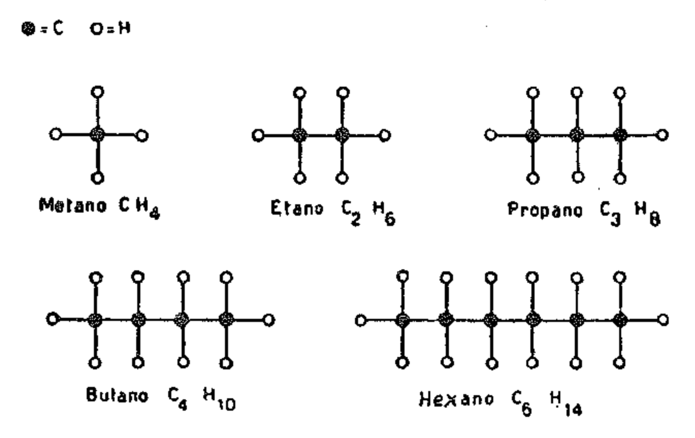{width=80%}

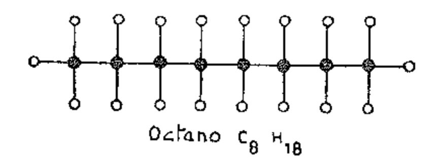{width=50%}

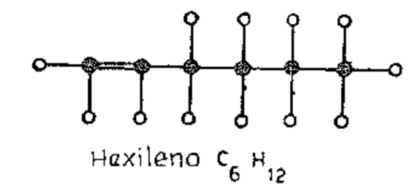{width=50%}

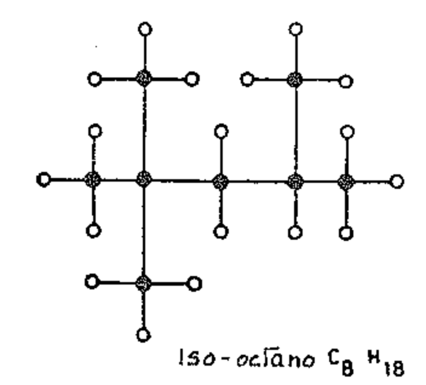{width=50%}

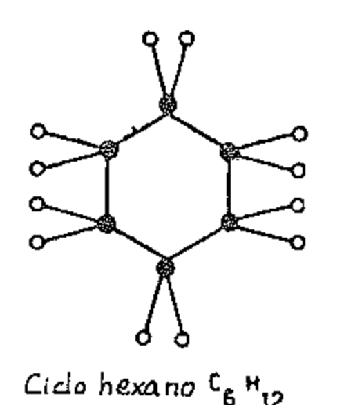{width=50%}

Avanzando hacia moléculas de masa molecular creciente, tenemos el keroseno, el gasóleo (gasoil), la nafta pesada o nafta negra. La densidad aumenta y la volatibilidad disminuye.

La composición del crudo varía según la localidad de extracción; los crudos rusos de la cuenca petrolífera de Bakú y los americanos de Texas son ricos en hidrocarburos nafténicos; los de Pennsylvania, en parafínicos; los rumanos y de Borneo, en aromáticos. Los crudos del Medio Oriente deben considerarse como mixtos y ricos en aromáticos; los libios son ricos en fracciones livianas.

### 3. Poder antidetonante de los carburantes. El número de octano

Cuando un motor de encendido por chispa funciona en condiciones especialmente severas, es decir, a mucha carga con avance de encendido excesivo, o con razón aire-combustible no adecuada a ese régimen en particular y a temperatura demasiado alta, puede verificarse el fenómeno llamado detonación (golpeteo, picado, etc.).

Esta detonación es la consecuencia de una combustión anormal de carácter explosivo que depende de las características del combustible y se produce tanto más fácilmente cuanto mayor es la relación de compresión del motor.

Cuando el combustible tiene la capacidad de soportar sin detonación compresiones elevadas se dice que tiene alto poder antidetonante. Las cualidades de un carburante dependen esencialmente del poder antidetonante cuya medida está dada por el llamado número de octano: N.O. El valor N.O. de un carburante se obtiene comparándolo con combustibles de referencia constituidos por mezclas de iso-octano y heptano o bien de iso-octano y tetraetil-plomo.

Al iso-octano  $C_8H_{18}$ , de la serie iso-parafínica, que posee óptimas cualidades antidetonantes, se le asigna convencionalmente un N.O. = 100, y al heptano  $C_7H_{16}$ , de la serie parafínica, que posee cualidades antidetonantes bastante bajas, un N.O. = cero. Mezclando los dos combustibles en diferentes proporciones, se obtienen mezclas de todos los N.O. posibles entre 0 y 100.

La determinación del N.O. de un carburante se efectúa mediante motores «standard» según prescripciones de ensayo normalizadas (¹). Estos motores son monocilindros especiales que permiten variar la relación de compresión durante el funcionamiento. Los motores y los ensayos han sido normalizados por el Cooperative Fuel Research Committee (Comité de Cooperación para las Investigaciones sobre Combustibles). El motor se distingue con la sigla C.F.R. de este comité.

Para el ensayo se establecen los datos de funcionamiento: número de revoluciones, temperatura de la mezcla, avance del encendido, etc., mientras la relación de compresión se va aumentando hasta que el combustible examinado detona. La detonación se pone en evidencia con el movimiento de una barrita apoyada sobre una membrana que está comunicada con el interior del cilindro. La intensidad de la detonación se mide mediante un dispositivo eléctrico sensible al movimiento de la barrita. Con ensayos sucesivos se halla la mezcla de iso-octano y heptano que para un mismo valor de la relación de compresión da la misma intensidad de detonación que el combustible ensayado. El porcentaje de iso-octano en esta mezcla representa el número de octano del combustible. Así, por ejemplo, un combustible que da la misma intensidad de detonación que una mezcla compuesta por el 80 % en volumen de iso-octano y por el 20 % de heptano, tiene un N.O. de 80.

Por lo tanto el número de octano es el porcentaje en volumen de iso-octano contenido en la mezcla heptano-iso-octano que, en el motor «standard», detona para el mismo valor de la relación de compresión que aquel para el cual detona el carburante ensayado. Al iso-octano y al heptano se los llama también combustibles de referencia primarios. A veces se emplean como combustibles de referencia carburantes más económicos y más estables, llamados secundarios.

Cuanto más elevado es el N.O. de un combustible, tanto mayor es su capacidad de resistir a la detonación y tanto mayor puede ser la relación de compresión en el motor. Como la potencia y el consumo específico dependen de la relación de compresión, puede decirse que dependen también del N.O. del combustible.

Puesto que un combustible puede comportarse ante la detonación de diferentes maneras en diferentes motores y en diferentes condiciones de fun-

(1) Para la medición ver párr. XXXVII-5.

cionamiento, también se efectúan mediciones del poder antidetonante en motores a escala real o directamente en vehículos.

El N.O. determinado con ensayos en vehículos se llama número de octano en carretera. Los métodos usados para esta determinación son numerosos, pero siempre están basados en la comparación con carburantes de referencia.

Hay que notar que cada unidad adicional del N.O. tiene un efecto antidetonante mayor cuando se suma a N.O. altos que cuando se suma a N.O. bajos, así por ejemplo un aumento de 90 a 91 produce un efecto mayor que un aumento de 60 a 61.

 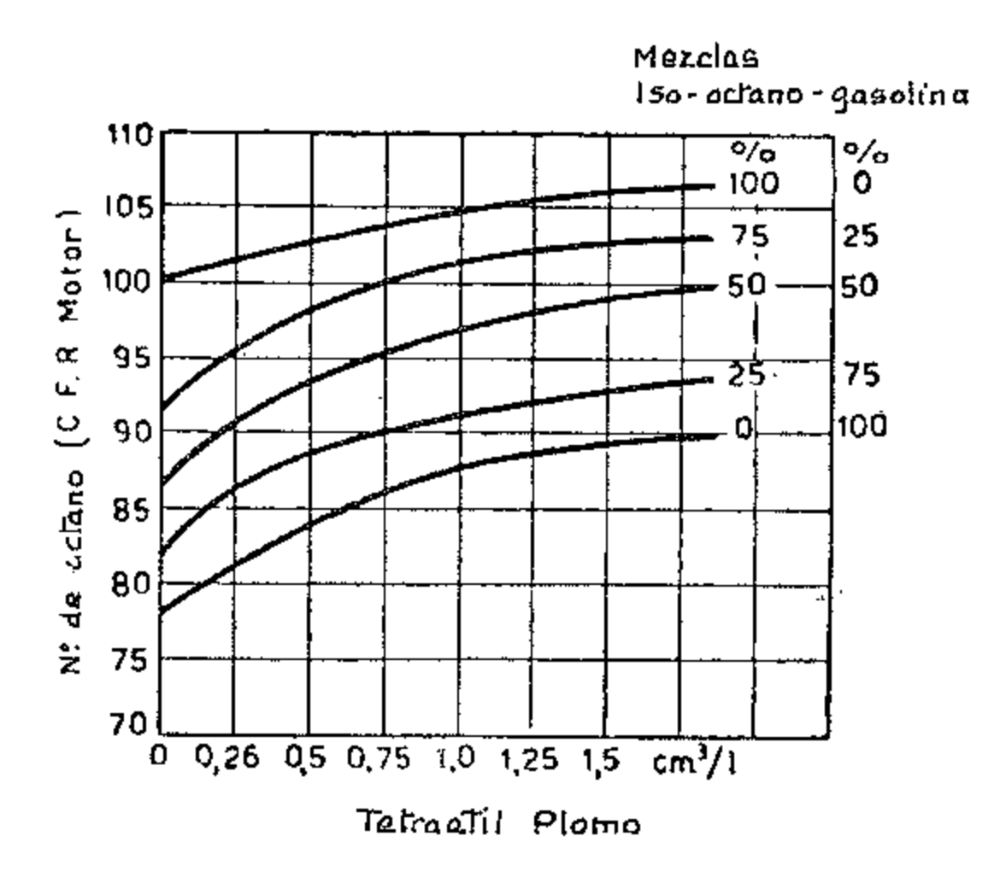{width=50%}

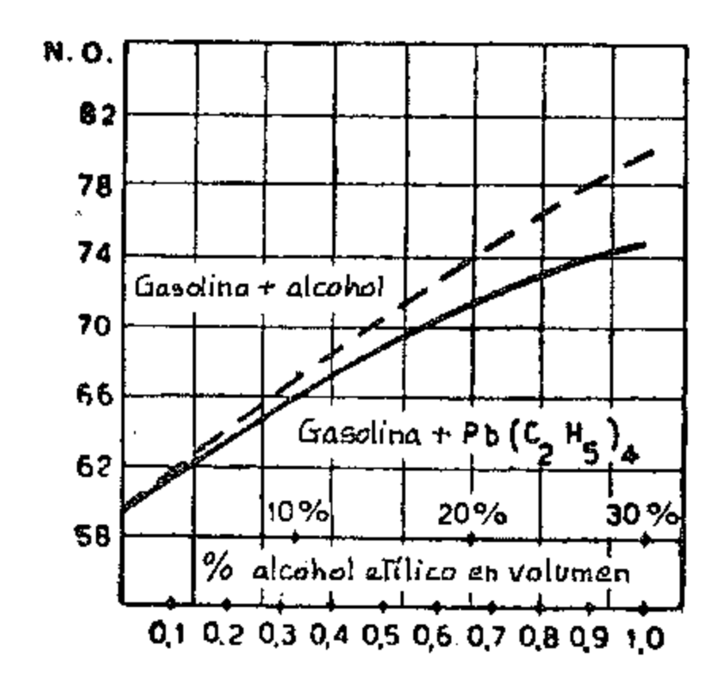{width=50%}

El N.O. de un combustible varía al cambiar su composición química. La resistencia a la detonación es favorecida por una estructura compleja de la molécula (de cadena cerrada, de cadena ramificada, con dobles enlaces, etc.) y disminuye al aumentar la longitud de la cadena. La máxima resistencia a la detonación entre los hidrocarburos la ofrecen por lo tanto los aromáticos, mientras disminuye escalarmente para los nafténicos, los olefínicos y los parafínicos. Se comprende así cómo pueden existir valores del N.O. mayores de 100 y otros menores de cero, es decir, negativos: el primer caso se produce por ejemplo para el benzol, el toluol y el metano; el segundo para el octano normal el cual, aún teniendo la misma fórmula global que el iso-octano (C8H18), tiene una estructura de cadena abierta y por lo tanto un N.O. no sólo mucho menor que el del iso-octano (100) sino que incluso es negativo (-20).

#### 4. Aditivos antidetonación

El N.O. de los carburantes puede aumentarse con la adición de pequeñas dosis de ciertas sustancias antidetonantes, como:

* Tetraetil plomo (TEL) . . Pb( $C_2H_5$ )4, también indicado como Pb Et4. Tetrametil plomo (TML) . Pb (CH3)4

Antiguamente también se usaron:

* Pentacarbonilo de Hierro. Fe  $(CO)_5$ Tetracarbonilo de níquel. Ni  $(CO)_4$ Anilina

El tetraetil plomo es un líquido incoloro tóxico, con densidad 1,66 kg/dm3 (0,166 g/cm3) que hierve a 199 °C.

La sensibilidad de los hidrocarburos al plomo varía muchísimo. Los antidetonantes son principalmente compuestos organo-metálicos que se descomponen a la presión y temperatura de la combustión. El metal precipita como polvo finísimo y actúa como catalizador anticombustión. El «ethyl fluid» añadido a la gasolina es generalmente una mezcla de tetraetil plomo, dibromoetano y dicloroetano.

Para reducir la contaminación atmosférica la CEE (Comunidad Económica Europea, Bruselas) ha dictado una normativa según la cual a partir de 1981 el contenido calculado en plomo de la gasolina no debería superar 0,4 g/l.

A este valor corresponden respectivamente 0,378 ml/l de tetraetil puro y 0,259 ml/l de tetrametil puro.

En algunas naciones europeas, entre las cuales se encuentra Alemania, se emplea gasolina con contenido de plomo inferior a 0,15 g/l. Otras naciones ya demandan que el plomo quede eliminado en la década de los 80.

La figura 7 muestra el aumento del N.O. de una gasolina en función de la cantidad de tetraetil plomo; como puede verse no conviene sobrepasar 1 cm³/l dado que el N.O. aumenta sólo ligeramente para concentraciones mayores.

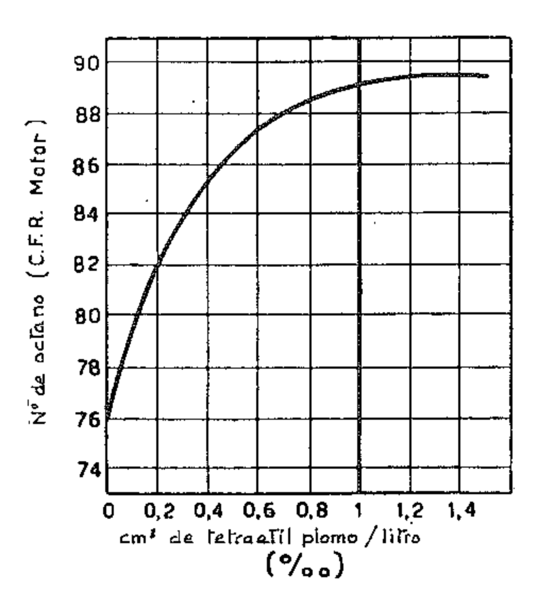{width=50%}

Los N.O. superiores a 100 se determinan por comparación con el iso-octano hecho aún más resistente a la detonación mediante la adición de PbEt4; el N.O. se fija en base al porcentaje de PbEt4. Para los N.O. negativos se procede análogamente, es decir, haciendo aún más detonante el heptano mediante la adición de combustibles de poquísima resistencia a la detonación.

## 5. Naftas y gasóleos - Número de cetano

En el motor de encendido por compresión, desde el momento en que el combustible es inyectado en la cámara de combustión hasta aquel en el cual se verifica la ignición, transcurre un pequeño período de tiempo llamado retraso de la ignición.

Cuanto mayor es el retraso de la ignición, tanto mayor es la cantidad de combustible que se acumula en la cámara de combustión antes de encenderse, por lo cual la combustión se desarrolla con una velocidad tal que causa un gradiente de presión tan elevado que provoca un «picado» similar al causado por la detonación en el motor de encendido por chispa.

Una nafta o un gasóleo es tanto mejor cuanto menor es el retraso de la ignición que provoca en el motor; en tal caso se dice que tiene un buen grado de *inflamabilidad*. La importancia de esta característica es notable si se piensa que el retraso de la ignición tiene influencia sobre el arranque, sobre la puesta en régimen del motor y sobre la cantidad de humos en el escape.

La inflamabilidad es función de muchas características del combustible tales como la temperatura de ignición espontánea, la viscosidad, el calor específico, etc., y varía al variar la composición química.

Como en general los gasóleos deben presentar justamente aquellas características que no deben tener las gasolinas (tab. III) se ve inmediatamente que el mejor comportamiento lo tienen los aceites parafínicos y después, en grado descendente, los olefínicos, los nafténicos y los aromáticos.

Para evaluar la inflamabilidad de un combustible, se hace la comparación en un motor «standard» o patrón con un combustible de referencia. La medida de la inflamabilidad está generalmente dada por el número de cetano N.C. El cetano ( $C_{16}H_{35}$ ) es un hidrocarburo parafínico con óptima inflamabilidad al cual se le asigna por convención N.C. = 100. A éste se le mezcla alfametilnaftaleno (C., H.,), hidrocarburo poco inflamable, al cual se le asigna N.C. = cero.

| La detonac                                                                                               | ión aumenta                                                                                             |
|----------------------------------------------------------------------------------------------------------|---------------------------------------------------------------------------------------------------------|
| en el motor Diesel                                                                                       | ↓ en el motor <b>Otto</b>                                                                            |
| con compresión baja                                                                                      | con compresión alta                                                                                     |
| con estrangulación del aire en la admisión                                                               | con sobrealimentación                                                                                   |
| con carga baja                                                                                           | con carga alta                                                                                          |
| con el aumento de las revoluciones                                                                       | con la reducción de las revoluciones                                                                    |
| con el descenso de la temperatura del aire as- pirado, del agua de refrigeración y de la cu- lata. | con el aumento de la temperatura del aire as- pirado, del agua de refrigeración y de la cu- lata. |
| con hidrocarburos de cadena cerrada (aromá- ticos, nafténicos, etc.)                                  | con hidrocarburos de cadena abierta (parafi- nas, olefinas, etc.)                                    |
| con adición al combustible de: tetraetil, plo- mo, carbonilo de hierro, etc.                          | con adición al combustible de: nitrato de ami- lo, acetaldehído, nitrito de etilo, etc.              |
| en el motor Otto                                                                                         | en el motor Diesel                                                                                      |
| La detonació                                                                                             | ón disminuye                                                                                            |

Table: Factores que influyen en la detonación en los motores Diesel y Otto.

El procedimiento para la determinación del N.C. es similar al que se sigue para la determinación del N.O. También en este caso se usan motores monocilíndricos y se siguen determinadas normas. Para variar la temperatura del aire en el motor se varía la presión final de compresión actuando sobre la relación de compresión o bien sobre la cantidad de aire aspirado por restricción o estrangulación de los conductos.

Cuanto más baja es la relación de compresión o, a igualdad de relación de compresión, cuanto mayor es la depresión en los conductos a la cual el combustible se enciende, tanto más elevado es su N.C.

Los gasóleos normales tienen N.C. comprendidos entre 40 y 70. Para las naftas pesadas o naftas negras el N.C. no tiene importancia práctica, como veremos, dado que éstas se emplean en motores lentos en los cuales un retraso del encendido no produce inconvenientes apreciables.

No disponiéndose de los dispositivos necesarios para las determinaciones del número de cetano se suele determinar el llamado Índice Diesel (I.D.). El índice Diesel es una función empírica de la densidad del combustible y del punto de anilina:

$$I.D. = \frac{d_{API} \cdot P_A}{100}$$

La densidad  $d_{API}$  del gasóleo se expresa en grados API (American Petroleum Institute) y es una magnitud adimensional; su valor está dado por la relación

$$d_{API} = \frac{141.5}{d} - 131.5$$

donde d es la densidad relativa (razón entre la masa de un cierto volumen de gasóleo y la masa de un volumen igual de agua) medida a la temperatura de 288,66 °K (15,5 °C). El punto de anilina  $P_A$  es la más baja temperatura a la cual un cierto volumen de gasóleo es completamente mezclable con un volumen igual de anilina y constituye un índice del contenido en compuestos parafínicos (grado de parafinidad) del gasóleo que se ensaya.

## 6. Volatilidad, tensión de vapor y calor de evaporación

Los diferentes hidrocarburos puros tienen diferentes temperaturas de evaporación. Los combustibles comerciales, siendo mezclas de hidrocarburos, se evaporan por lo tanto parcialmente a diversas temperaturas. Para definir su modo de comportamiento desde el punto de vista de la volatilidad se obtiene la curva de destilación que representa la ley según la cual varía el porcentaje de combustible que se evapora al aumentar la temperatura. El método usual para medir la volatilidad es el normalizado por la American Society for Testing Materials (A.S.T.M.). La curva de destilación caracteriza cada tipo de combustible líquido.

La figura 8 muestra los intervalos de destilación de los bencinas o gasolinas, de los gasóleos, del petróleo o keroseno. Las curvas de destilación de los alcoholes son en cambio rectas, porque los alcoholes son compuestos puros que evaporan a una temperatura bien definida.

La volatilidad es una propiedad importante de la cual depende el comportamiento de los motores en el arranque y en la aceleración. De la curva de la volatilidad dependen también algunos inconvenientes funcionales, como la formación de vapor en el circuito del combustible y la dilución del lubricante.

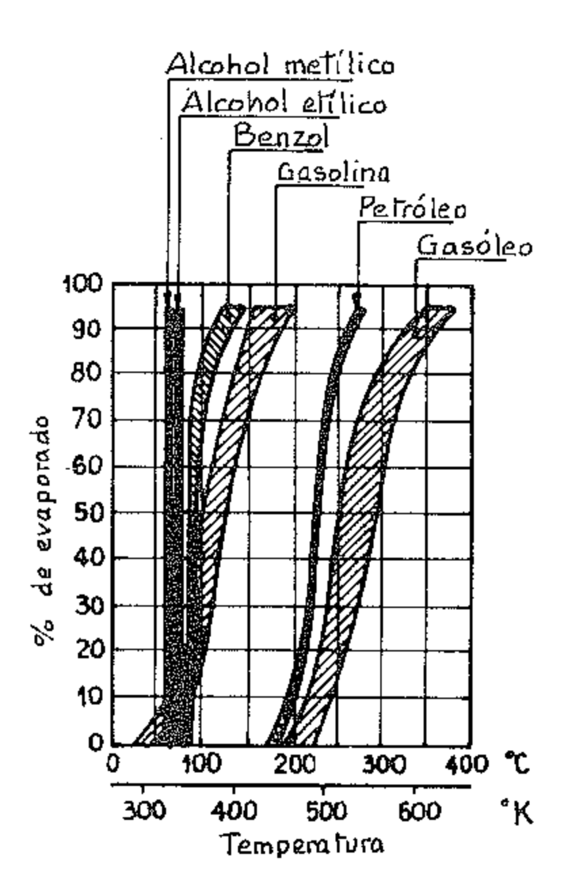{width=50%}

Arranque. — Para facilitar el arranque conviene que parte de la gasolina evapore a temperatura ambiente, es decir, que el tramo de la curva de destilación relativo a los porcentajes vaporizados comprendidos entre el 0 % y el 10 % se desarrolle a una temperatura relativamente baja. Además para obtener las mejores condiciones para el período de calentamiento después de arrancar el motor, son deseables unas temperaturas de destilación más bien bajas en toda la curva.

Aceleración y distribución de la mezcla. — Una buena vaporización a bajas temperaturas es favorable a la mejor distribución del combustible entre los cilindros y a una mejor aceleración, porque se reduce la cantidad de partículas líquidas en los conductos de admisión.

Formación de burbujas de vapor. — Si las temperaturas de destilación son demasiado bajas, la gasolina tiende a formar en los tubos que la llevan al carburador o a los inyectores o bien en el carburador mismo, burbujas de vapor que pueden interrumpir el flujo. Desde este punto de vista sería deseable tener temperaturas de evaporación más bien elevadas, pero esto se opone a las exigencias para el arranque y la aceleración.

Las gasolinas que soportan bien las condiciones que causan la formación de burbujas de vapor son especialmente adecuadas para los motores que han de funcionar a grandes alturas donde el punto de ebullición es más bajo.

Dilución del aceite en el cárter. — Debe evitarse que el combustible líquido se deposite sobre las paredes del cilindro porque diluye el aceite perjudicando la lubricación. Si el combustible líquido pasa al cárter, diluye el lubricante y puede causar daños mayores, porque con la dilución el aceite pierde la capacidad de soportar las cargas.

Para evitar estos inconvenientes es preciso que todo el combustible que entra al cilindro se evapore, y para esto la parte superior de la curva de destilación debería desarrollarse a temperaturas suficientemente bajas.

Con el fin de conseguir un compromiso entre las diferentes exigencias, para las gasolinas comerciales se especifica que dentro de los 373 °K (100 °C) se evapore al menos el 30 % y para los combustibles de aviación al menos el 50 %. Durante el verano las refinerías normalmente reducen la volatilidad de la gasolina que va al consumo y la aumentan durante el invierno para facilitar el arranque.

En la figura 9 se muestran las curvas de destilación de dos tipos diferentes de gasolina. La gasolina a la que corresponde la curva b, si bien tiene temperatura final de destilación inferior a la correspondiente a la curva a, es menos rica en elementos volátiles a baja temperatura y por lo tanto resulta menos buena a efectos del arranque y de la aceleración, pero mejor a efectos de la dilución del aceite.

Para las naftas la curva de destilación tiene evidentemente una importancia mucho menor que para las gasolinas, tanto que para las naftas pesadas la curva de destilación ni siquiera es tomada en consideración en la práctica. Para los gasóleos generalmente se fijan los porcentajes correspondientes a dos temperaturas próximas al final de la destilación, como también la temperatura final y el valor del residuo (5 %) con el fin de evitar la presencia de hidrocarburos pesados y viscosos que pueden provocar incrustaciones dañinas.

Para definir las características de volatilidad de un carburante, además de la curva de destilación, se usa también la tensión de vapor (medida con el aparato especial de la fig. 10) la cual, por convención, es referida normalmente a la temperatura de 311 °K (37,8 °C) = 100 °F (tensión de vapor Reid). Ésta es un dato de referencia para prever la formación en el sistema de alimentación de burbujas de vapor que podrían interferir o incluso interrumpir el flujo de combustible. El límite superior de la tensión de vapor para los carburantes de aviación se ha fijado en 0,5 bar a 311 °K; el límite para los carburantes para autovehículos, en 0,70 (verano) y 0,85 (invierno). Para las naftas la tensión de vapor no tiene importancia.

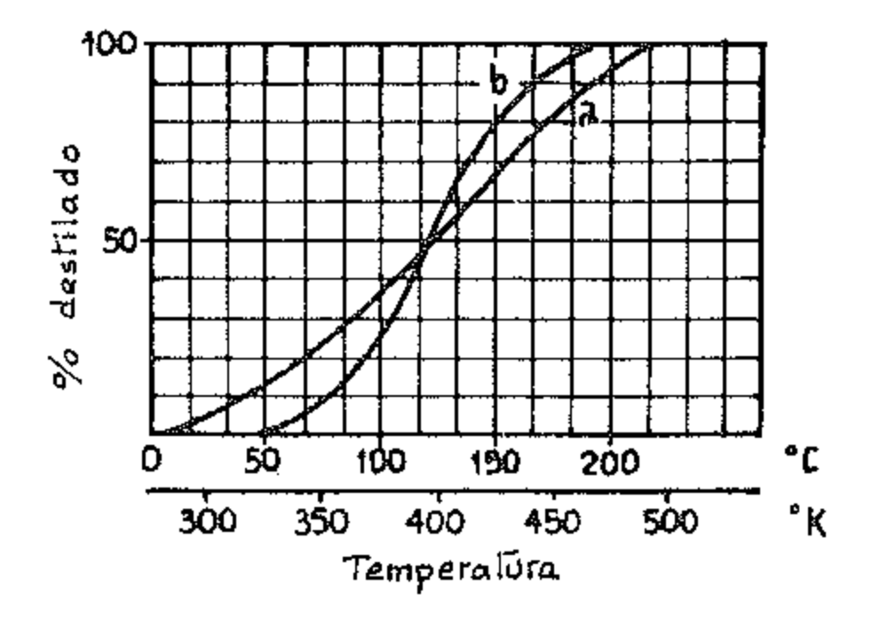{width=50%}

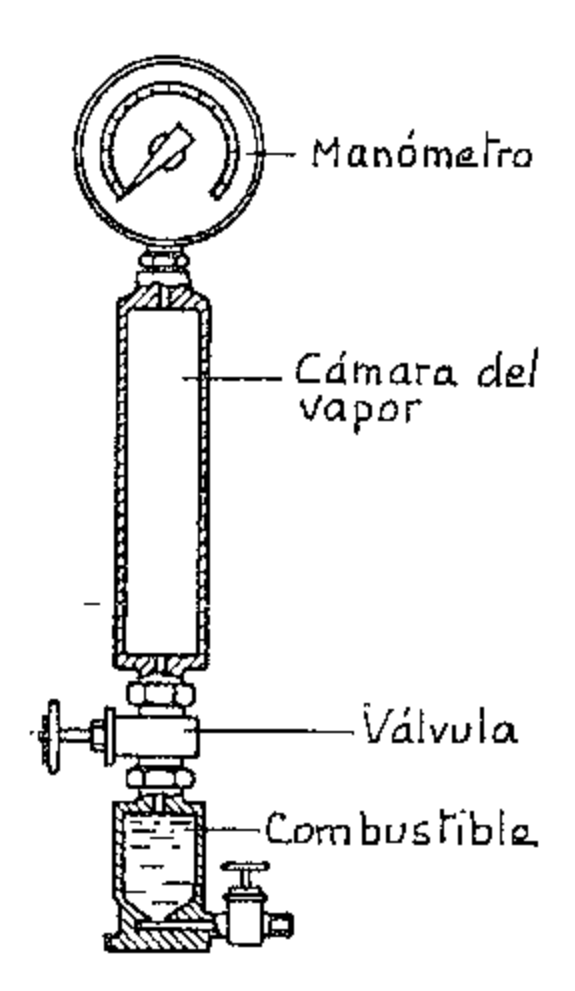{width=50%}

Otra característica de los carburantes es el calor latente de evaporación. El descenso teórico de temperatura que, por efecto de la evaporación, experimenta una mezcla aire-gasolina es de unos 20 °C. El calor de evaporación de los alcoholes es muy superior al de la gasolina; el descenso de temperatura provocado por la formación de la mezcla aire-alcohol, teniendo en cuenta que la cantidad de aire de combustión es menor, es, de hecho, de unos 338 °K (85 °C) para el alcohol etílico y de 398 °K (125 °C) para el metílico. Un elevado calor de evaporación impide el arranque y la marcha en frío, mientras que en caliente favorece un buen rendimiento volumétrico.

### 7. Densidad y poder calorífico

La densidad (masa por unidad de volumen) sirve para distinguir los diferentes tipos de combustibles y permite calcular los datos de volumen y de masa y por lo tanto la energía interna específica (por unidad de masa) que se expresa en J por kg de mezcla. No es lícito, para cada categoría de combustible, deducir de la densidad un juicio sobre las otras características como por ejemplo, sobre la volatilidad o sobre el N.O. En efecto, una gasolina puede ser pesada porque contiene compuestos aromáticos, siendo por lo tanto muy buena en lo concerniente a la volatilidad y el valor antidetonante. Sin embargo se tiende a fijar los límites superior e inferior de la densidad para no tener que proceder a retoques o sustituciones de los órganos que regulan la alimentación, los cuales están dimensionalmente relacionados con el volumen y no con la masa del carburante. Cuando varía la densidad varía el consumo, dado que éste generalmente es medido en volumen (litros/100 km en el caso de los autovehículos).

En Italia para la gasolina normal los límites admitidos son  $0,710 \div 0,755$  kg/dm³; para la super  $0,725 \div 0,770$  kg/dm³ (Tab. CUAN NC 620-01 y NC 623-01).

Para los gasóleos los valores límite son  $0.805 \div 0.865$  kg/dm³ (Tab. CUNA NC 630-01); para el keroseno  $0.770 \div 0.820$  kg/dm³ (Tab. CUNA NC 627-01). Para las naftas pesadas usadas en los Diesel marinos y en instalaciones fijas la densidad es mayor de 0.890 kg/dm³.

Poder calorífico. — El poder calorífico no es más que el contenido de energía del combustible. Éste varía según la razón entre las cantidades de hidrógeno y de carbono. Cuanto mayor es la cantidad de hidrógeno, tanto más alto es el poder calorífico o energía interna específica, dado que ésta vale para el hidrógeno 120,16 kJ/kg (28 700 kcal/kg), mientras que para el carbón vale 34,08 kJ/kg (8140 kcal/kg).

Uno de los productos de la combustión es el agua; según que ésta se encuentre en estado líquido o en estado de vapor, varía el valor del poder calorífico del combustible. Se tiene por lo tanto dos poderes caloríficos.

El poder calorífico superior es la cantidad de calor en kJ (kcal) producido por 1 kg de combustible quemado en exceso de aire cuando los productos de la combustión se enfrían de modo que el vapor de agua en ellos contenido se condense.

El poder calorífico inferior es la cantidad de calor producida por 1 kg de combustible quemado en exceso de aire cuando los productos de la combustión se enfrían hasta el punto de ebullición del agua sin que el vapor de agua en ellos contenido se condense.

A efectos de la utilización, en los motores interesa principalmente el poder calorífico inferior, en cuanto el vapor de agua, como ya hemos dicho, no se condensa dada la alta temperatura a la cual se expulsan los gases de escape.

Dadas las dificultades que se presentan en la determinación directa del poder calorífico inferior, conviene determinar experimentalmente el poder calorífico superior (bomba de Mahler) y obtener el inferior mediante cálculo. En efecto, la diferencia entre los dos valores está dada por el calor de condensación del vapor de agua contenido en los productos de la combustión, por lo que puede calcularse fácilmente: así por ej., suponiendo conocido experimentalmente el poder calorífico superior  $H_s$ , para una mezcla carburante formada por gasolina, alcohol etílico, alcohol metílico y benzol, el poder calorífico inferior  $H_b$  cuando todos los valores están en kJ/kg, está dado con buena aproximación por la siguiente relación:

$$H_i = H_s - (3266 b + 2930 a + 2930 a' + 1730 c) kJ/kg$$
 
Si las mediciones se han hecho en kcal/kg:

$$H_i = H_s - (780 b + 700 a + 675 a' + 415 c) kcal/kg$$

donde:

* b = porcentaje en volumen de gasolina contenida en el combustible

* a = porcentaje en volumen de alcohol etílico contenido en el combustible

* a' = porcentaje en volumen de alcohol metílico contenido en el combustible

* c =porcentaje en volumen de benzol contenido en el combustible

Para los gasóleos respectivamente:

$$H_i = H_s - 3050  kJ/kg  $$

$$H_i = H_s - 730  kcal/kg $$

El poder calorífico puede también referirse —además de a la unidad de masa (kJ/kg)— a la unidad de volumen en kJ/dm³ (kcal/l) para los combustibles líquidos y en kJ/m³ para los gaseosos. Cuanto mayor es el poder calorífico, tanto menor es el consumo de combustible en masa o en volumen, con tal de que en ningún caso el motor funcione en régimen de detonación.

A menor poder calorífico corresponde menor cantidad de aire para la combustión; esto explica el hecho de que las varias tonalidades térmicas no difieren en mucho. Los diferentes combustibles líquidos permiten por lo tanto desarrollar casi la misma potencia, a igualdad de todas las demás condiciones; es necesario sin embargo tener presente que los consumos están en cambio relacionados con el poder calorífico y por lo tanto aumentan pasando por ejemplo de la gasolina al alcohol o a mezclas alcohólicas.

#### 8. Otras características

En los combustibles pueden existir impurezas que obstaculizan el funcionamiento del motor o limitan la conservabilidad de los combustibles mismos.

El contenido de azufre y la acidez tienden a formar compuestos corrosivos que pueden atacar algunas partes del motor, dañándolas; estos compuestos corrosivos presentes en los gases de escape, al difundirse en la atmósfera contribuyen a los daños causados por la contaminación atmosférica. Por esto se prescribe que el azufre y la acidez no han de superar ciertos límites.

Las gomas tienden a formar depósitos en los conductos de aspiración, entre los aros y los pistones y en otras partes del motor; por esto se prescriben límites al contenido de goma (gomas actuales) y a la formación de depósitos de goma durante el almacenamiento (gomas potenciales).

Los componentes que forman gomas son por lo general hidrocarburos no saturados (olefínicos); la determinación de su porcentaje se hace mediante pruebas químicas (número de bromo): con sustancias especiales (inhibidores) se pueden reducir los efectos que son especialmente dañinos para los carburantes de almacenamiento.

Para las naftas en especial es necesario limitar las sustancias incrustantes (residuos carbonosos, índice de Conradson) y abrasivas (cenizas) que pueden dañar sobre todo las delicadas bombas de inyección del combustible. Para evitar peligros durante el almacenamiento se establece la temperatura de inflamabilidad (punto de inflamabilidad en tanque cerrado Pensky Martens).

Para los gasóleos es importante el comportamiento a las bajas temperaturas: queda definido por el punto de escurrimiento, y por ensayos de filtrabilidad. El punto de congelación es la temperatura a la cual una parte de los componentes comienza a cristalizar o a separarse de la solución sometida a un oportuno enfriamiento; el punto de escurrimiento es la más baja temperatura a la cual el combustible comienza a escurrir después de haber sido llevado a temperaturas inferiores. Como media entre los dos puntos hay un intervalo de 3 °K. El comportamiento es tanto mejor cuanto más bajos son estos valores.

El ensayo de filtrabilidad consiste en la medida del tiempo de flujo de un determinado volumen de gasóleo, a través de un determinado aparato filtrante, bajo una cierta presión y a una temperatura dada. El ensayo sirve para indicar el grado de separación de las parafinas, que a temperaturas más bien bajas pueden depositarse sobre los filtros obturándolos.

Para el gasóleo es especialmente importante el contenido de azufre, causa de corrosión en los cilindros y en las válvulas. El porcentaje de azufre no debería ser superior al 1,2 %.

Otras características subsidiarias pueden ser el color, el origen de los crudos, el porcentaje de los hidrocarburos componentes, el proceso de elaboración.

Los carburantes de aviación tienen que garantizar una gran homogeneidad incluso a las bajas temperaturas que se alcanzan en vuelo, y por esto se establece que el punto de congelación debe ser inferior a 223 °K (-50 °C).

Para las naftas y las mezclas invernales, los valores del punto de congelacinó pueden ser más altos:  $253 \, {}^{\circ}\text{K} (-20 \, {}^{\circ}\text{C})$ .

Para los carburantes alcohólicos un elemento interesante es la higroscopicidad; estos combustibles pueden enriquecerse con agua hasta un determinado límite, sobrepasado el cual se enturbian porque el alcohol contenido se separa en forma acuosa y el combustible se inutiliza. Por esta razón conviene que el título del alcohol destinado a mezclas carburantes no sea inferior al 98 %.

#### 9. Producción de los combustibles comerciales

A) Gasolina y naftas a partir del aceite mineral crudo. — En la figura 11 está esquematizada la elaboración del aceite crudo. Sus diferentes componentes son separados mediante destilación fraccionada con los siguientes intervalos de temperatura (variables según el crudo):

Gasolina (bencina) cruda . hasta 470 °K (197 °C)
Petróleo o keroseno . . . de 450 a 550 °K (177 a 277 °C)
Gasóleo y nafta . . . . . de 550 a 630 °K (277 a 357 °C)
Aceite lubricante . . . . . más de 630 °K (357 °C)

Las resinas y asfaltos constituyen los residuos de la destilación.

El contenido de gasolina en el aceite mineral crudo por lo general no supera el 25 % y en todo caso es insuficiente para las necesidades mundiales, continuamente crecientes.

Para aumentar el porcentaje de gasolina que puede obtenerse del crudo se recurre en la refinería a toda una serie de procedimientos térmicos y termocatalíticos que dan óptimos resultados cuantitativos y cualitativos.

Entre estos variados procesos los más importantes son: el cracking (o pirólisis), la polimerización, la hidrogenación y la alquilación.

Los procesos de cracking o pirólisis se basan en el fraccionamiento de las moléculas más grandes de los hidrocarburos, que constituyen las fracciones menos volátiles, en moléculas más pequeñas mediante temperaturas y presiones relativamente altas, con o sin catalizador. El reforming es un cracking aplicado a las bencinas de primera destilación y al gasóleo, mientras el cracking propiamente tal se aplica exclusivamente al aceite crudo. Sin entrar en detalles, es interesante notar que, con diferentes procedimientos, es posible obtener producciones importantes de gasóleo a partir del crudo y de carburantes de alto N.O. a partir del crudo o del gasóleo.

En los procesos térmicos las presiones son del orden de 20-60 bar y las temperaturas de alrededor de los 770 °K (497 °C); en los catalíticos, a iguales temperaturas, las presiones no superan los 7 bar, salvo el proceso de platform (cracking catalítico con catalizador a base de Ni) que requiere de presiones del orden de los 50 bar.

Polimerización. — Durante el cracking se forma una notable cantidad de gas, variable en función del poder antidetonante del combustible producido. Este gas está constituido principalmente por una mezcla de hidrocarburos parafínicos y olefínicos que contienen de uno a cuatro átomos de carbono por molécula. Habiéndose constatado que algunos de estos componentes, en determinadas condiciones de temperatura y presión, con o sin catalizadores, podían reaccionar entre ellos dando lugar a hidrocarburos poliméricos (es decir, de masa molecular múltiple), nacieron los procesos industriales de polimerización, en la actualidad extensamente difundidos.

Hidrogenación. — Poniendo en contacto los residuos de primera destilación con hidrógeno en presencia de catalizadores es posible aumentar el contenido de hidrógeno del combustible enriqueciéndolo con fracciones de molécula más sencilla, con una producción total de carburantes valiosos incluso del 80 % aún partiendo de un aceite crudo de baja calidad. Los procesos de hidrogenación han tenido extensas aplicaciones en Italia durante la última guerra, especialmente por obra de la ANIC (Azienda Nazionale Idrogenazione Combustibili) en sus dos plantas de Bari y de Livorno.

Alquilación. — Este proceso es análogo a los métodos de hidrogenación y de polimerización en cuanto permite producir, en una sola etapa, un producto similar al obtenible por la combinación de olefinas (p. ej. butileno y propileno) con parafinas (p. ej. isobutano) o con aromáticos (p. ej. benceno) para dar productos líquidos de elevado poder antidetonante, junto con hidrocarburos livianos y con productos de gran masa molecular.

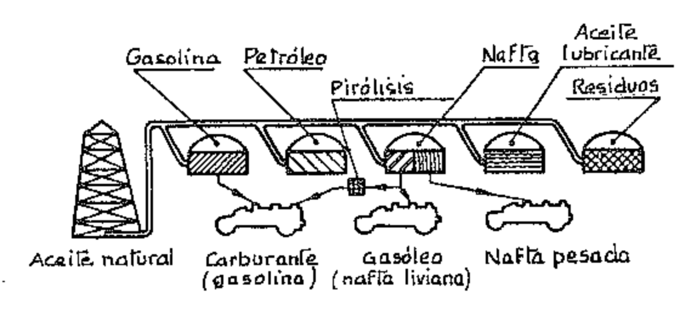

Así, por ejemplo, el iso-octano puede obtenerse haciendo reaccionar el isobutano C4H8 en presencia de un catalizador y en determinadas condiciones de temperatura y presión:

$$C_4H_{10} + C_4H_8 = C_8H_{18}$$

Los catalizadores más empleados son el ácido fluorhídrico y el ácido fosfórico; las presiones no exceden los 50 bar (en muchos casos los 10 bar) y las temperaturas son relativamente bajas (290 ÷ 320 °K en el tratamiento con ácido fluorhídrico, 450 ÷ 570 °K con ácido fosfórico).

B) Gasolina sintética. — La gasolina sintética está compuesta por hidrocarburos obtenidos por la combinación directa de carbono e hidrógeno. Se la llama también gasolina obtenida por licuación del carbón.

Los procesos originalmente adoptados en Alemania durante el período bélico son los siguientes:

a) Proceso Bergius-I.G. Farben Industrie (fig. 12). — Consiste en la hidrogenación de carbón fósil o de lignito o alquitrán.

El combustible pulverizado se pone en suspensión en aceite para poder aspirarlo con las bombas e inyectarlo junto con el hidrógeno en las torres de catalización. Mediante altas presiones y temperatura y con la ayuda de un catalizador se consigue el fraccionamiento de las moléculas de carbono y la formación de moléculas compuestas de carbono e hidrógeno. Una destilación fraccionada permite obtener una primera cantidad de gasolina, mientras las demás fracciones y los residuos son a continuación hidrogenados y transformados en gasolina.

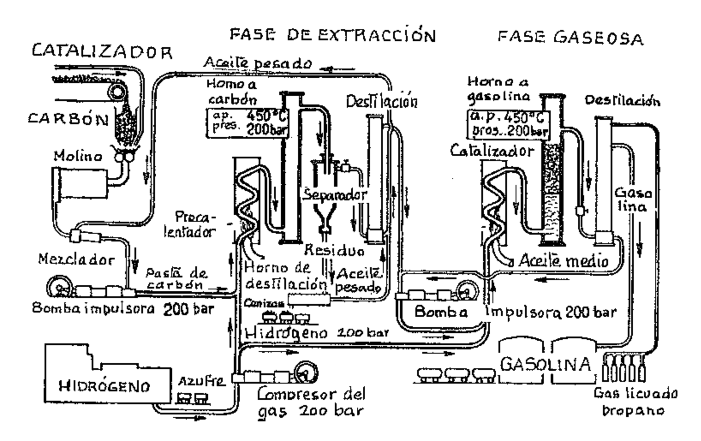

b) Proceso Fischer-Tropsch-Ruhrchemie (fig. 13). El coke se gasifica completamente, en presencia de vapor de agua: se obtiene así una mezcla de óxido de carbono e hidrógeno que, previamente depurada, se introduce en una torre de reacción. Aquí, en presencia de un catalizador, estos gases sintéticos son transformados en hidrocarburos gaseosos; por último, por licuación fraccionada, se separan las diferentes fracciones de combustible.

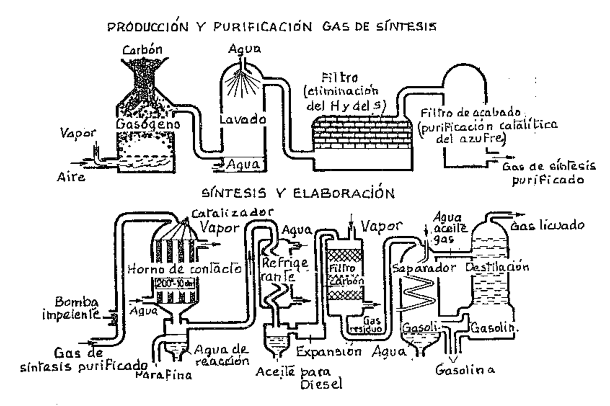

C) Benzol. El benzol se obtiene a partir del alquitrán de carbón fósil. Éste, compuesto de grandes moléculas ricas en carbono que además contienen hidrógeno, oxígeno, nitrógeno y azufre, es calentado sin contacto con el aire con lo que se rompen sus moléculas (análogamente a lo que sucede en el proceso de pirólisis del aceite mineral) y se forman moléculas más pequeñas (como las que se encuentran en el gas de alumbrado) junto con notables cantidades de productos residuales y coke. Con este proceso especial se obtiene una fracción de hidrocarburos líquidos a temperatura normal, formados en gran parte por benzol, los cuales, a causa de su bajo punto de ebullición, escapan con el gas que se consigue. Los hidrocarburos contenidos en el gas son después lavados con aceite de alquitrán; con sucesivas destilaciones se obtiene el benzol comercial (técnico) que no es nunca puro, sino que contiene además toluol y otros similares. Este procedimiento permite después obtener, a partir de las otras fracciones y del residuo, muchos subproductos entre los cuales aceites de creosota, aceites de antraceno y pez.

D) Iso-octano. Se obtiene del isobutileno  $C_4H_8$  que es polimerizado en di-isobutileno  $C_8H_{16}$  y por hidrogenación transformado en iso-octano. El isobutileno es uno de los componentes de los gases de pirólisis, pero también puede obtenerse del butano conseguido como subproducto en las plantas de hidrogenación.

E) Etanol (alcohol etílico, C2H5OH). En alcohol puro producido por fermentación de sustancias que contienen almidón (patatas, cereales) o azúcar (melazas de la fabricación del azúcar de caña o de remolacha), pero también puede ser producido por síntesis.

Todo proceso de producción industrial del alcohol puede subdividirse en cuatro fases:

- 1) Preparación del almidón.
- 2) Transformación del almidón en azúcar (sacarificación).
- 3) Transformación del azúcar en alcohol (fermentación).
- 4) Destilación y rectificación.

El número de octano Research (NOR) del etanol es 106.

F) Metanol (alcohol metílico  $CH_3OH$ ). — Es tóxico y pobre en calorías. Es empleado principalmente como componente de mezclas carburantes alcohólicas (dos partes de etanol y una de metanol). Es producido industrialmente con un proceso de catálisis a alta presión de la I.G. Farben Industrie, a partir de óxido de carbono y de hidrógeno: ( $CO + 2H_2 = CH_3OH$ ). NOR = 106.

| Combustible                                                                        | Poder antidetonante              | Temperatura destilación a 1 bar (760 mm Hg) | Tensión de vapor a 273 °K (0 °C) | Calor de evaporación | Poder calorífico inferior | llorífico rior     | Aire teórico de combustión | Tonalidad térmica a 0 °C | Densidad a 288 °K (15 °C) |
|------------------------------------------------------------------------------------|-------------------------------------|------------------------------------------------------|-------------------------------------------|----------------------------|------------------------------|-----------------------|-------------------------------------|--------------------------------|------------------------------------|
| ı                                                                                  | N.O.                                | (℃) <b>%</b>                                      | bar (mm Hg)                            | kJ/kg (kcal/kg)         | kJ/kg (kcal/kg)           | kJ/dm³ (kcal/l)    | kg/kg                               | kJ/dm³ (kcal/l)             | kg/m³                              |
| Carburantes aviación                                                               | 90 ÷ 115 (MON) (1)    | $348 \div 473$ (75 ÷ 200)                            | 0,45 (Reid)                            | ~314 (75)               | 43 543 (10 400)           | 32 029 (7650)      | 14,8                                | 3,726 (0,890)               | 700 ÷ 750                          |
| Combustibles para turbomotores                                                     | ļ                                   | $423 \div 573$ (150 ÷ 300)                           | l                                         | 1                          | 43 124 (10 300)           | 33 913 (8100)      | I                                   |                                | 739 ÷ 825                          |
| Gasolina (bencina): Normal (Tab. CUNA NC 620-01) Super (Tab. CUNA NC 623-01) | 84 (RON) (2) 97 (RON) | $303 \div 478$ $(30 \div 205)$                    | 0,70 (est.) 0,85 (in)                | ~314 (75)                  | 43 543 (10 400)           | 32 029 (7650)      | 15                                  | 3,726 (0,890)               | 710 ÷ 775                          |
|                                                                                    | 87 (MON)                            |                                                      | (Reid)                                    |                            | ,                            | ,                     |                                     |                                | 725 - 770                          |
| Benzol puro                                                                        | $\sim 100$                          | 353 (80)                                          | 28                                        | 397 (95)                | 40 193 (9600)             | 35 169 (8400)      | 13                                  | 3,864 (0,923)               | 875                                |
| Alcohol etílico 100 %                                                              | $\sim 100$                          | 351,3 (78,3)                                      | 12,7                                      | 963 (230)               | 27 423 (6550)             | 21 <i>77</i> 1 (5200) | 6                                   | 3,847 (0,919)               | 795                                |
| Alcohol metílico 100 %                                                             | >100                                | 337,7 (64,7)                                      | 29                                        | 1164 (278)                 | 18 840 (4500)             | 15 072 (3600)      | 6,5                                 | 3,902 (0,932)               | 795                                |
| Petróleo para agricultura (Tab. CUNA NC 627-01)                                 | 32 min (MON)                        | $423 \div 573$ (150 ÷ 300)                        | I                                         | Ţ                          | 41 868 (10 000)           | 34 331 (8200)      | 4                                   | 3,851 (0,920)                  | 770 ÷ 820                          |
| Gasóleo (Tab. CUNA NC 630-01)                                                      | N.C. 48 min                         | $473 \div 643$ $(200 \div 370)$                      |                                           | 1                          | 42 705 (10 200)           | 35 588 (8500)      | 14,5                                | 3,893 (0,930)               | 805 ÷ 865                          |
| Naftas pesadas                                                                     | 1                                   | 1                                                    | I                                         | 1                          | 41 030 (9800)             | 36 425 (8700)      | 14                                  | (3,893) (0,930)             | 890                                |

(1) MON = Motor Octane Number; NOM = Número de Octano Motor. (2) RON = Research Octane Number; NOR = Número de Octano Research.

- G) Gases licuados. Se obtienen en gran parte durante los procesos de cracking o de hidrogenación para la producción de las gasolinas, pero pueden también producirse a partir del gas de coke o de las emanaciones gaseosas de los pozos petrolíferos. Están constituidos por los hidrocarburos parafínicos y bencénicos más volátiles. Los gases licuados comerciales son generalmente mezclas de propano y butano, en la proporción de 50/50, o sí no del tipo: butileno-propileno 55 %, propano-butano 20 %, etileno 15 %, metano y etano el resto. Se licúan a temperatura normal y presión relativamente baja, inferior a 8 bar, y se venden bajo varias denominaciones como GLP (gas licuado de petróleo), LPG (Liquified Petroleum Gas), y numerosas marcas comerciales. Para su uso ver el párr. XVII.14.
- H) Metano. El metano es un gas permanente natural proveniente del subsuelo. Artificialmente es producido a partir del gas de coke por escisión a baja temperatura o bien a partir de desechos de origen vegetal y animal (metano biológico). El metano es actualmente empleado en ciudades y centros industriales mediante imponentes metanoductos.

| Combustión                             | Densidad a 288 °K y 1 bar | Poder calorífico inferior |                    | Aire teórico de combustión |                 | Tonalidad térmica a 273 °K            | N,º de octano (Re- search) |
|----------------------------------------|------------------------------------|------------------------------|--------------------|-------------------------------|-----------------|---------------------------------------------|-------------------------------------|
|                                        | kg/m³                              | kJ/m³ (kcal/m³)           | kJ/kg (kcal/kg) | m³/m³ de ĝas               | kg/kg de gas | kJ/dm³ de mezcla (kcal/l)             | NOR                                 |
| Metano al 97 %                         | 0,74                               | 34 750 (8300)             | 46 892 (11 200) | 9,5                           | 17,4            | 3,433 (0,820)                            | ~125                                |
| Propano                                | 1,81                               | 83 317 (19 900)           | 46 055 (11 000) | 24                            | 15,8            | 3,768 (0,900)                            | ~125                                |
| Butano                                 | 2,38                               | 108 438 (25 900)          | 45 636 (10 900) | 31                            | 16,5            | 3,642 (0,870)                            | ~93                                 |
| Propano Butano 50/50                | 2,06                               | 94 621 (22 600)           | 45 845 (10 950) | 27,5                          | 16,1            | _                                           | ~100                                |
| Gas de alum- brado (Berlín 1940) | 0,60                               | 15 910 (3800)             | 45 845 (10 950) | 5,1                           | 8               | 3,349 (0,800)                            | ~90                                 |
| Gas de gasó- geno                   | 1 ÷ 1,2                            | 4186 ÷ 5861 (1000 ÷ 1400) |                    | 0,9÷1,2                       | 0,95÷1,         | $42,093 \div 2,512$ $(0,500 \div 0,600)$ |                                     |
| Gas de coke                            | 0,425 (*)                          | 17 584 (4200)             | <del></del>        | _                             | _               |                                             | ~90                                 |

Table: Características de los combustibles gaseosos.

(\*) Comprimido en fase gaseosa a 200 bar.